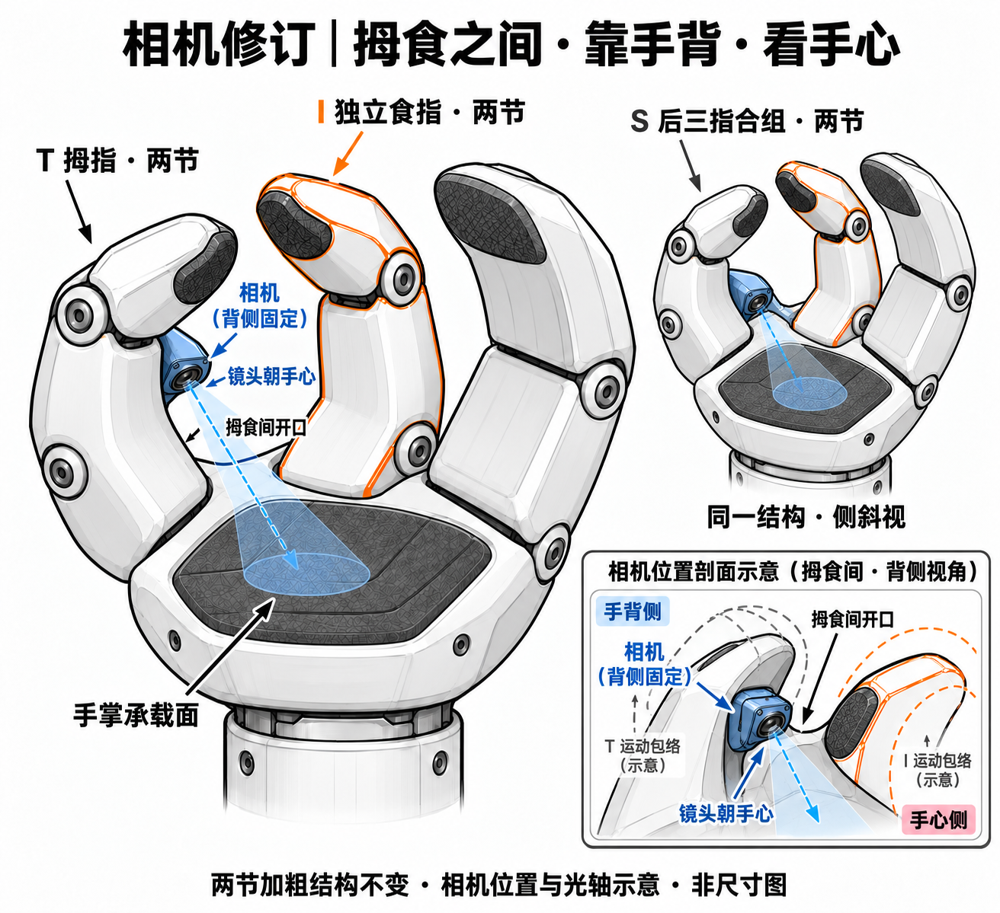

# 用户认可的当前末端构型参考

日期：2026-10-26。用户针对本图明确反馈“这个基本是对的，把这个也加到我们数据和机器人设计里”。

本目录保存用户这次选中的原图，不替换为后续手背图或其他生成版本。来源为此前内置 image_gen 生成的 `exec-c51d7aa4-0718-4709-bcd7-a8900968a1e8.png`；原生成提示词保留在 [图像过程记录](../three-finger-two-segment-v01/dorsal-web-camera-prompt.txt)。

原文件与本副本 SHA-256 一致：`ff332afe87c46c6dd2d5d21cf008a090d5bd3c2375fb4b6bc7aaa7d48495e1dd`。

认可范围：加粗的 T 拇指、I 独立食指、S 后三指合组；各组两节；完整手掌承载面；相机位于 T/I 之间靠手背一侧、朝手心看；采集端与执行端共同设计。图中姿态只是一个工作姿态，不是机械角度限位。

认可概念方向不等于尺寸、关节轴、驱动数量、光轴、支架、载荷、传感器型号或工程验收已冻结。尤其图中背侧固定连接与开口通视仍需参数 CAD/样机验证。

当前设计入口：[末端与数据接入设计](../../inhouse-isomorphic-end-effector.md)。旧图与讨论只作历史参考，不覆盖本次明确选图。
