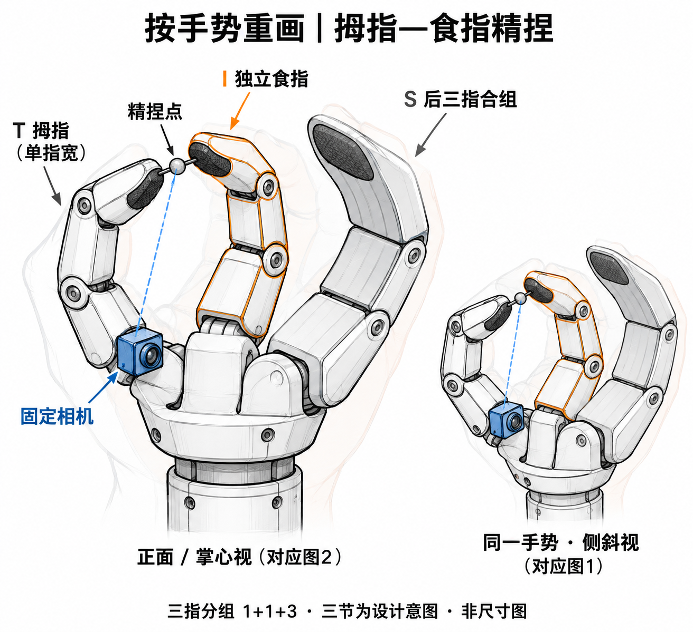

# 按用户手势重画：拇指—食指精捏

2026-10-26，使用内置 image_gen（imagegen 技能），输入为用户提供的两张手势照片，未用 V06/V07 或上下大夹爪草图作为图像参考。照片只作手势与解剖布局参考，生成时不复现桌面/屏幕背景。



要求：单指尺度 T 与 I 精捏；S 为旁侧中/无名/小指合组，在此手势下较张开，不参与精捏。三条机械指链仍以三节作为设计意图。主图为掌心/正面、小图为侧斜视示意。

检查：T/I 指端形成小捏合环，T 不再横跨 S 成宽下颚；S 位于旁侧且较张开。两视图的实际关节轴、节长和对掌运动尚未几何求解。相机的外观镜面与蓝色光轴并未严格一致，因此不能据图冻结相机朝向；下一阶段需单独确定固定座与实际镜头光轴。

这是构型草图，不是 Sunday 内部设计复刻，也不是 CAD、实物或功能验收证据。

## 完整提示词

```text
Use case: scientific-educational hardware sketch derived from HUMAN GESTURE.
Inputs are the user's own two hand gesture photos. Image 1 side-oblique human pinch; image 2 palm/front human pinch. Use ONLY the hands as pose/anatomical placement references; do not reproduce desk, keyboard, screens, room or any background text. Create ONE clean simple mechanical concept SKETCH on white paper. NOT photorealistic. Do NOT use previous giant upper/lower C gripper geometry. The hand photos are PRIMARY geometry guide.
Two views of SAME proposed three-digit robot end effector, large MAIN PALM/FRONT view matching photo 2, small SIDE-OBLIQUE matching photo1. Same wrist placement bottom, finger roots at distal palm, same proportions and pose between views.
EXACT GROUPING: T = one HUMAN-SCALE opposed THUMB, I = independent INDEX, S = ONE broad common finger accommodating human MIDDLE+RING+LITTLE. Exactly THREE mechanical digits representing five anatomical fingers grouped 1+1+3.
CRITICAL POSE from photo2: thumb T on viewer LEFT curls obliquely inward/up toward INDEX I, index curls down/inward to meet thumb TIP. Their two fingertips form a SMALL PRECISION PINCH RING, roughly OK gesture, with a tiny pale gray pin/disk between tips. THUMB is only about one-finger width (slightly broader than index), NEVER a wide shelf spanning all fingers, NEVER a horizontal lower jaw under entire S. Index and S have laterally adjacent roots, INDEX nearer thumb, S to viewer RIGHT. S stays more OPEN / less flexed beside pinch ring, its distal contact pad HIGHER than the T/I pinch point. S does NOT touch the tiny object and is not part of this precision pinch. Keep actual hand-like asymmetry and thumb angled opposition from user's photos. Do NOT lay S arch directly over thumb like big C claw. No giant solid palm block.
Design sketch: simple slim white/gray outlined phalange blocks and three small rotary joint symbols per proposed digit chain, no extra distal stub making four segments. Thin dark soft pads inside tips. Only S is broad, approximately three-finger width with a SINGLE common three-segment chain; optional faint three inner saddle lanes, NOT three separately articulating fingers. T and I individually narrow, not broad mechanically identical jaws. Palm/base just a compact support outline and wrist mount, NOT an anatomically detailed human hand. Use pale ghost anatomical hand silhouette very lightly beneath mechanism if helpful to preserve the photo pose, but DO NOT draw exposed real skin or nails, and don't add human digits outside device. Broad S symbolizes grouped three fingers.
Color: INDEX outline orange, THUMB outline dark gray, S pale gray outline; camera blue. Camera one very small blue block on FIXED PALM SIDE near thumb BASE, clear of moving thumb, lens aims toward T/I pinch tip. A short thin blue optical axis from camera to pinch point, not to table. Camera secondary visual emphasis.
Labels short readable Chinese: title "按手势重画｜拇指—食指精捏". Main callouts "T 拇指（单指宽）","I 独立食指","S 后三指合组","精捏点","固定相机". Small side view caption "同一手势 · 侧斜视". Footer "三指分组 1+1+3 · 三节为设计意图 · 非尺寸图".
Keep sketch sparse, accurate placement and pose, no motors/no decorative CAD/no dimensions/no tabletop/no giant object/no complicated compound transmissions. If three-segment hinges cannot all be seen, use hidden-line conventions rather than adding extra joints.
```
