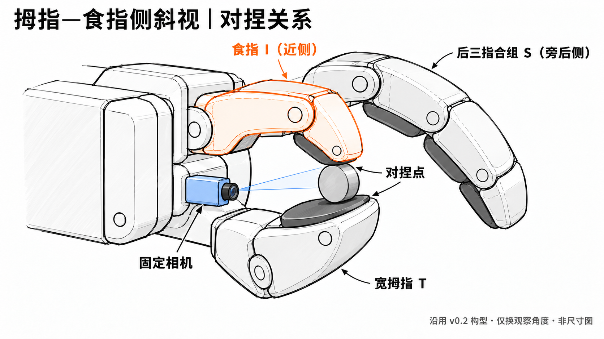
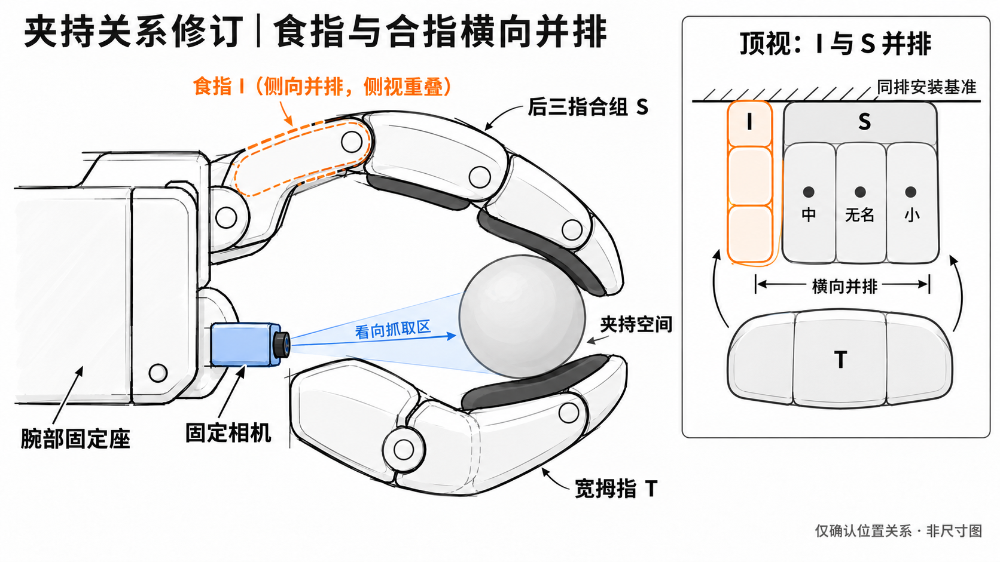
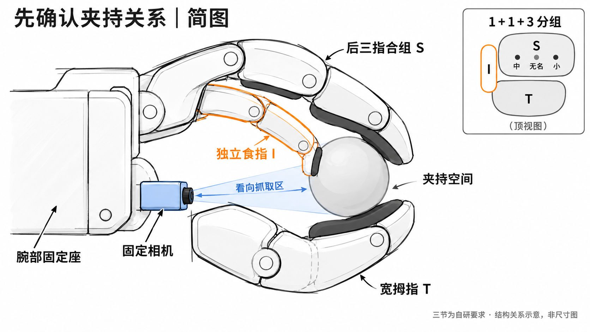

# 夹持关系简图

## 拇指—食指侧斜视



用户对 v0.2 反馈“差不多”，要求从拇指/食指角度观察。内置 image_gen 以 v0.2 为唯一图像输入，画近侧食指 I 与宽拇指 T 对捏，宽面 S 位于旁后侧，固定相机看向抓取区。图中因观察角度与对捏姿态变化导致轮廓重投影；指节数量与长度并未通过几何一致性核验，不作为三节/尺寸冻结依据。

[完整提示词](thumb-index-oblique-prompt.txt)。

## 食指位置修订 v0.2



用户指出 v0.1 独立食指位置错误；修订意图为 I 与 S 在手宽方向并排、根部同排安装，侧视投影应重叠，不能把 I 放在 S 下方形成第三层夹爪。顶视图中的 S 三列表示人手三指承托位，非三个独立机械指；具体连杆与三节分段仍非工程图。侧视橙色虚线仅为位置提示，不是完整独立食指运动链。

内置 image_gen 编辑 v0.1；[完整提示词](index-position-v02-prompt.txt)。

2026-10-26，按用户“先画个简图”要求，使用内置 image_gen，以 Sunday 官方归档设备对照照片作为紧凑夹持形态参考；不使用 V06/V07 作为造型母版。



本图只讨论：上侧 S 宽面后三指合组、旁侧 I 独立食指、下侧 T 宽拇指形成的夹持空间；相机在固定座附近从侧面看向手内抓取区，而非固定朝桌面。三节是自研要求，不是 Sunday 内部结构已核实事实。

生成图的关节圆、指段分缝与光轴箭头均为示意，不能用于数关节、冻结运动链或判定真实遮挡。三节运动链尚需单独机械线图确认；宽度与侧向错位关系也需顶视图核查。本次不扩展新写实图或批量多视图。

## 完整提示词

```text
Create a SIMPLE HARDWARE CONCEPT SKETCH, not a product render. Use the supplied Sunday photo ONLY as compact curved gripping-shape reference. DO NOT draw our earlier open fan/palm-style robotic hand.
White paper background, spare black/gray pen strokes, large shapes, almost no surface details. One LARGE SIDE-VIEW schematic occupies 80% of landscape image. Small top-right grouping inset only.
Main side view: wrist/base on LEFT, gripping space on RIGHT. Draw an upper curved articulated paddle S (the human middle+ring+little grouped together), bending DOWN around an object; draw a lower BROAD thumb T curving UP to oppose it. These form a COMPACT C-SHAPED GRIPPING ENCLOSURE with OPEN SPACE between their black soft contact pads. A small pale gray round object sits BETWEEN upper and lower pads. Do not draw a large solid palm filling the gripping space. Each paddle is divided into THREE conceptual segments by simple joint circles, without detailed transmissions. One narrower independent INDEX finger I lies beside upper wide S, follows a similar curve and reaches the object's near side; offset its outline slightly toward viewer in orange so its separate motion chain is legible. It must NOT be a third finger sticking upward from palm. Exactly three mechanical chains T/I/S.
Camera: ONE small BLUE rectangular camera fixed on a SHORT lateral tab at thumb-root side of stationary base, OUTSIDE thumb moving arc. Draw it in SIDE PROFILE, lens is its RIGHT-facing end aimed diagonally into central GRIPPING SPACE toward object and pad contacts. Blue narrow triangular field starts at actual lens and terminates at object. Lens does NOT face external observer, ground/table or wrist. There is NO table, NO blue cone to ground. Camera not on moving thumb or fingertips. It observes HAND-INTERNAL OBJECT INTERACTION. Leave unblocked sightline from lens to near side of object through open C cavity. If necessary draw near-side thumb as partly transparent, indicate diagram not proven clearance.
Labels only these readable Chinese labels with simple leaders:
"后三指合组 S" on upper broad chain
"独立食指 I" on narrow orange chain
"宽拇指 T" on lower broad chain
"夹持空间" at empty center around object
"固定相机" at blue housing
"看向抓取区" along blue optical axis
"腕部固定座" at left
Small inset top right is an EXTREMELY SIMPLE top-view block diagram: thumb as ONE block opposed to index ONE narrow block plus S ONE broad block; inside S three small dots marked "中 / 无名 / 小". No real human anatomy. Label inset "1 + 1 + 3 分组".
Title "先确认夹持关系｜简图". Tiny footer "三节为自研要求 · 结构关系示意，非尺寸图". Avoid photorealism, logos, busy blueprints, motor drawings, complicated geometry, fingers crossing, 3 equal slender digits, upright palm fan, claims of Sunday hidden internals. Functional placement and compact gripping relationship take precedence over aesthetics.
```
