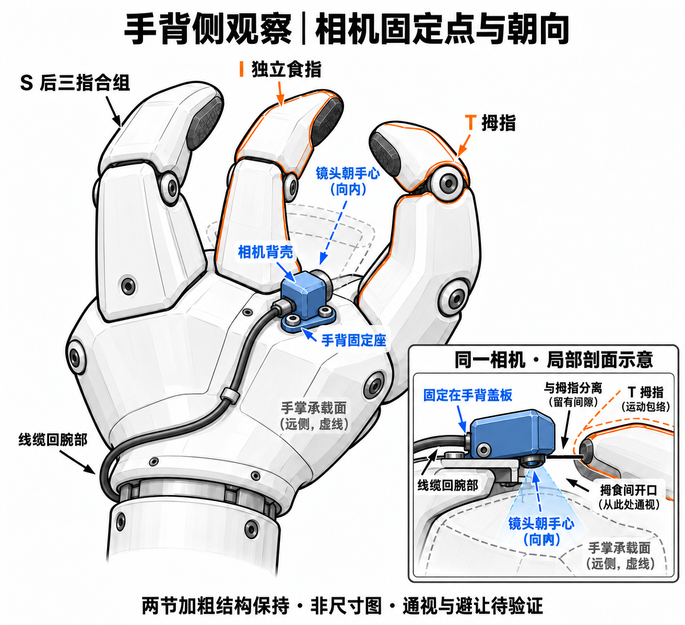
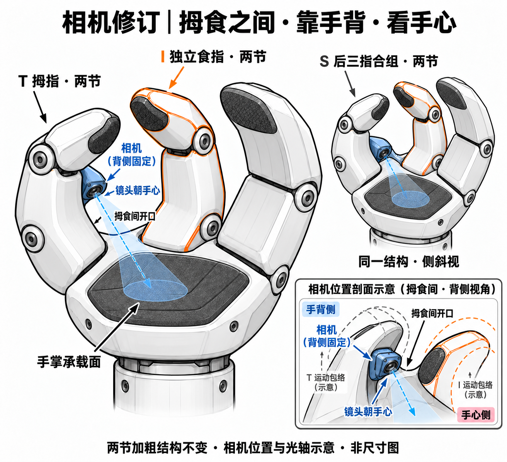
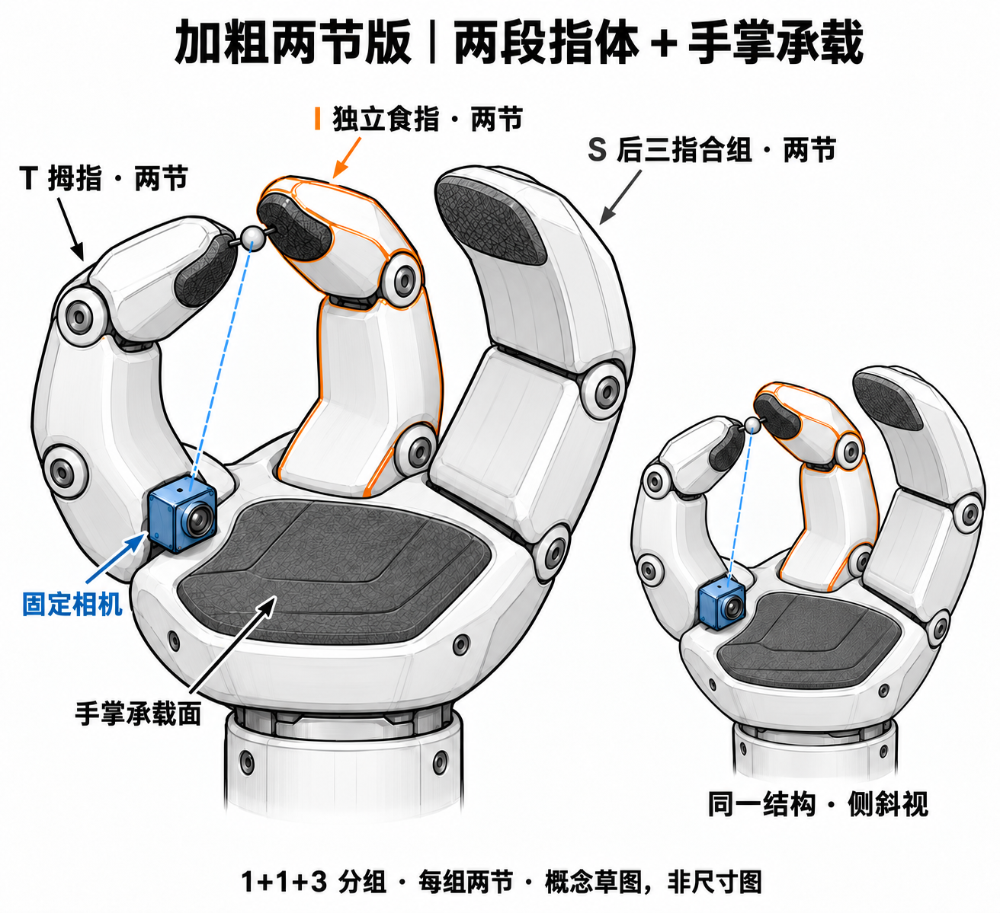

# 加粗两节指体与完整手掌草图

## 手背观察与相机固定座

用户要求调整相机或补手背图；本图将相机安装意图表达为手背盖板上的独立固定脚，靠近 T/I 根部之间，线缆回腕部；镜头在内侧/下侧朝手心，不应为了可见而朝外。局部剖面显示单镜头与拇指运动分离的设计意图。

初次结果多出第四机械指、局部相机出现双镜头，修订后删除。当前主图可数三组机械指，手背盖板为白色，掌面远侧用虚线提示。镜头光轴、视锥、支座通孔和运动包络仍是示意；后侧 S 的宽度比例、关节轴与正面图的一致性未由三维模型核验，不作几何一致性结论。

内置 image_gen 提示词：[初次手背视角](dorsal_view_camera_prompt.txt)、[三指与单镜头纠正](dorsal_view_camera_fix_prompt.txt)。

## 当前相机修订：拇食之间、靠手背、看手心

用户指定相机置于拇指与食指之间、靠手背，但向手心看。原掌面蓝色相机移除，改为背侧固定座候选；图中主视、斜视和局部剖面画出镜头朝掌心承载面。工具为内置 image_gen，[完整提示词](dorsal-web-camera-prompt.txt)。

图像检查：相机不再占据掌面承载垫，光轴示意指向手心；主图相机固定座与拇指根部的机械分离仍不够明确，剖面仅表达意图，不能作为固定支架或运动避让已实现的证据。需要在 CAD 中确认背侧掌座固定、拇食间开口通视与全关节范围避让。

2026-10-26。用户新要求：三组手指加粗、要有手掌；拇指、独立食指、后三指合组均可做两节。按两节方案编辑，原三节要求对本候选被更新。工具为内置 image_gen，沿用 imagegen 技能。

保留手势：单指宽的 T/I 精捏，S 位于旁侧较张开；三组均加粗，并增加手掌承载面。初次结果仍把 T/I 画成三段，已针对性合并多余指段后保存本图。

视觉检查：每链目标为根部铰轴连接近节、一个中间铰轴连接末节；T/I/S 各两段指体，掌部承载垫可见。节长、铰轴、对掌自由度与相机外观光轴仍未几何验证，不能作为制造/CAD或实机证据。

提示词：[初次编辑](two_segment_sketch_prompt.txt)、[两节结构纠正](two_segment_fix_prompt.txt)。
