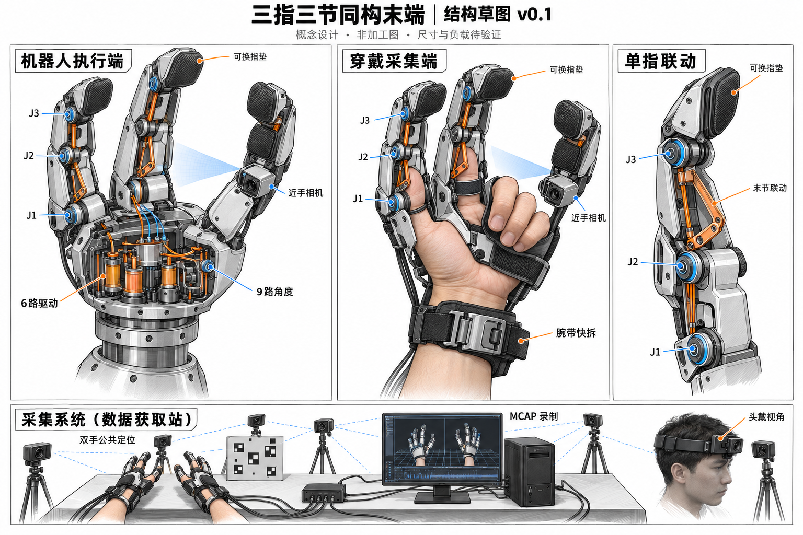
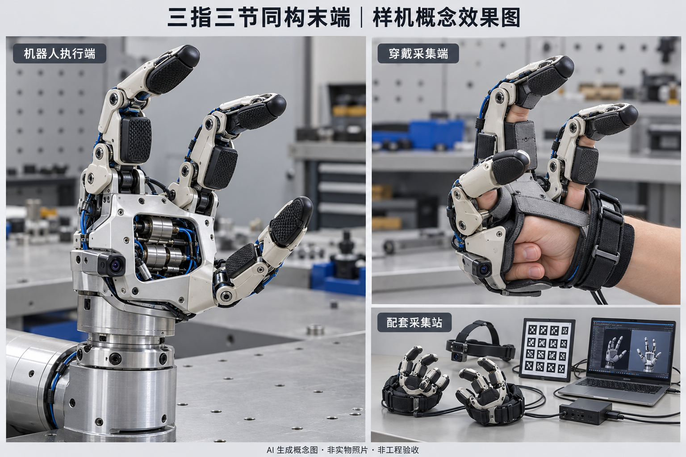

# 三指三节同构末端概念图

日期：2026-10-26。生成方式：内置 image_gen（imagegen 技能），非 CLI/API。

用途：硬件构型评审。三指、每指三节、Sunday 构型参考，两端共设计；推荐每指 J1/J2 主动、J3 联动。结构草图与写实图都是 AI 生成概念图，不是实物照片、可制造 CAD 或测量/验收证据。

依据：[系统设计](../../inhouse-isomorphic-end-effector.md)。机械拓扑、装配空间、传感器数量和尺寸需要后续 CAD 与样机验证。生成图中的完整四连杆闭环、实际牵引路径、指托和传感器位置均不作为已解决结构；相机视锥为示意。





## 图像检查

- 两张主视图均表现三根机械指，执行端驱动舱与无动力穿戴端区分可见；单指草图标出 J1/J2/J3。
- 关节角传感器与六区接触模块没有在所有视图完整画出，不能据图核对 BOM 数量。
- 两张图、以及机器人与穿戴视图之间的指长比例、相机位置和指托仍有生成差异；未实现精确同构约束，后续由同一套参数 CAD 收敛。
- 概念图不验证四连杆运动闭环、腱索布置、工具负载、穿戴工效或真实相机型号。

## 写实效果图生成提示词

```text
Use case: product-mockup
Asset type: photorealistic industrial hardware concept render, original three-finger robotics end effector and matching wearable collection device, not a photograph of existing hardware.
Create a wide landscape high-resolution product engineering presentation on a neutral light-gray robotics workbench. Header exact Chinese "三指三节同构末端｜样机概念效果图". Footer exact "AI 生成概念图 · 非实物照片 · 非工程验收".
Two equal main panels: left robot execution hand on a short aluminum forearm with visible wrist mounting flange; right matching unpowered data collection glove worn by a human right hand. A small lower-right inset shows the collection station: paired wearable units, a head-mounted camera band, tracking marker board and laptop connected by cables. No full humanoid robot needed. Professional neutral studio light, real nylon printed prototype shell texture, machined aluminum, dark fasteners, black replaceable elastomer pads, subtle blue sensor wiring; practical maintainable engineering prototype appearance.
MANDATORY TOPOLOGY on BOTH devices: exactly THREE mechanical fingers in opposed 1 versus 2 arrangement, each with exactly THREE phalange segments and three rotary joints. Keep all three fingers visible and separated, partially curled toward the viewer; no extra fingers, no five-finger anthropomorphic robot hand, no simple two-jaw gripper. One opposed thumb-like digit, two opposing narrow fingers. Broad soft pads on middle and distal segments, distal tips thinner and rounded. Human fingers tucked inside wearable saddles, realistic anatomy, no robot finger emerging from bare skin.
Robot side: compact palm-root actuator chamber packages six motors (two per digit); small cutaway window reveals real motor cartridges and short tendon transmission paths, never motors in all distal joints. Distal J3 has compact side linkage coupled to J2. Joint pins and slim encoder covers; side-mounted small camera pod aimed at contact area, does not block workspace. Show a comfortable useful grasp workspace. No ungrounded force or precision claims.
Wearable side: visibly NO motor chamber, lighter open palm support with finger saddles and wrist strap; same external finger lengths, joint geometry, contact pads and side camera pose as robot hand; thumb/index/middle drive the three fingers, remaining human fingers naturally folded into clear free space. Mechanical quick-release strap. Gray textile padding and black wrist strap. Short sensor cable routed away from moving joints. Device inspired by compact soft-contact Sunday-style wearable interfaces but no company logos and not a reproduction of undocumented internals.
Keep drawing realistic, restrained and buildable-looking; no floating unexplained parts, no science-fiction armor, no glowing panels, no surgical/prosthetic depiction. Small panel labels only: "机器人执行端", "穿戴采集端", "配套采集站". Concept render, not a manufactured product claim.
```

## 草图生成提示词

```text
Use case: scientific-educational
Asset type: early industrial design engineering sketch board for an original three-finger robot hand and matching human-operated data collection glove, for hardware review.
Create ONE wide landscape high-resolution white-paper technical concept sketch board. Precise black pencil/fineliner linework, restrained gray shading, blue sensing overlays and orange actuator/linkage overlays. Clean professional readable drawings, no decorative futurism.
Title Chinese exact: "三指三节同构末端｜结构草图 v0.1". Small subtitle: "概念设计 · 非加工图 · 尺寸与负载待验证".
Layout: left large panel robot execution hand, center large panel matching wearable data collection hand shown worn on a realistic human right hand, right narrow panel single-finger mechanism enlarged, bottom narrow strip acquisition station.
STRICT MECHANICAL DESIGN: Each device has exactly THREE robot fingers in a one-opposed-to-two layout, not five fingers. Each finger consists of exactly THREE rigid phalange segments with THREE visible rotary joints J1 J2 J3. Opposed thumb-like digit and two separated opposing digits. Broad soft black replaceable contact pads, thinner rounded distal tips. Compact light-gray shells and dark metal pivots. Show fingers partially open so all three fingers and segment boundaries can be counted.
Robot hand: six motor actuators packaged at palm base near wrist, two per finger J1 and J2, short tendon routing to those joints; J3 driven by a visible compact four-bar linkage from J2, not independently motorized. Wrist mounting flange to robot forearm. A small side camera pod points at fingertips without blocking pinch. Nine small joint encoder icons, six contact zones, two per finger (middle and distal). Draw transparent cutaway only at motor chamber. Do not invent rigid dimensions.
Wearable hand: matching three-finger kinematics, lengths, linkage, contact surfaces and camera placement; NO motors. Human thumb/index/middle engage adjustable inner finger saddles, remaining fingers naturally folded behind palm support, wrist strap carries weight and mechanical quick release. Human fingers remain inside frame, objects contacted by external robotic pads. Match proportions with robot version. Keep human hand anatomy plausible.
Detail: ONE finger side view clearly shows three segments, J1 at palm-root hinge, J2 middle hinge, J3 distal hinge, short coupled linkage J2 to J3, encoder at each joint, two pad locations. Precise arrow leader callouts.
Use only short readable labels: "机器人执行端", "穿戴采集端", "单指联动", "6 路驱动", "9 路角度", "J1", "J2", "J3", "可换指垫", "近手相机", "腕带快拆", "末节联动".
Bottom acquisition station simple isometric drawing: two wearable gloves with cables to desktop recording computer, head camera band, fixed external tracking cameras and marker board, no robot required at collection station. Labels "双手公共定位", "头戴视角", "MCAP 录制".
Constraints: conceptual design sketch, not a circuit schematic; no brand logos, no claims copied from Sunday, no extra fingers, no misleading final CAD manufacturing drawings, no excess tiny text.
```
