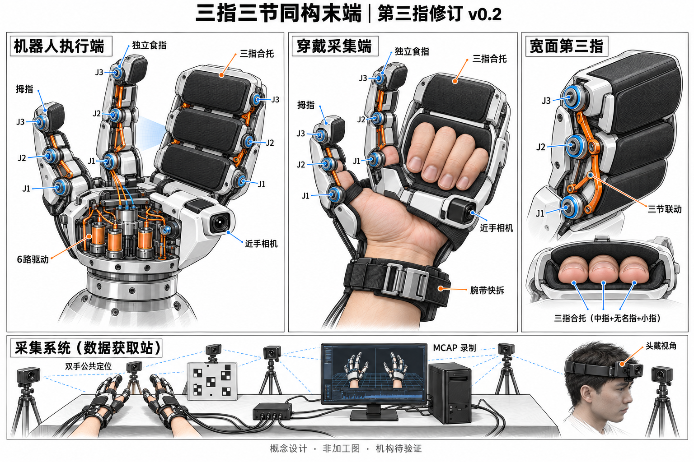
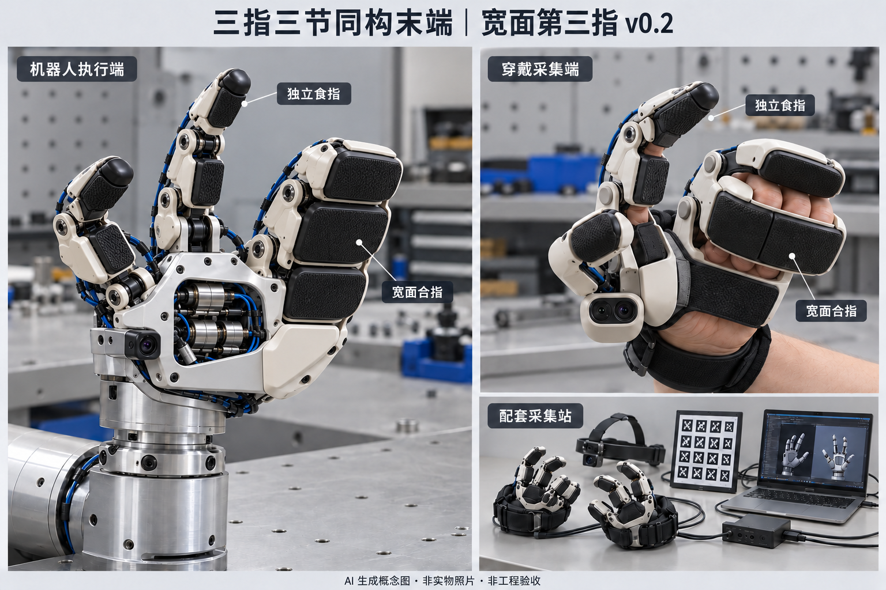

# 三指三节：宽面第三指修订 v0.2

日期：2026-10-26。工具：内置 image_gen，按 imagegen 技能编辑 v0.1 草图与效果图。

参考图为仓库归档的 Sunday 设备照片：[采集端/机器人端对照](../sources/sunday/sunday-glove-vs-memo-hand.jpg)、[手套特写](../sunday-glove-closeup.jpg)。用途仅为不对称宽面构型参考。Sunday 内部关节/驱动数量、人指分配未因本次图像编辑得到核实。

本项目修订：T 拇指、I 独立窄食指、S 宽面第三指。S 对应中指/无名指/小指共同承托的自研方案，三段均宽面、三个机械关节。每手 9 状态 / 6 主动轴候选不变。





用户随后明确确认：拇指、食指、后面三指（中指/无名指/小指）合组。最终主视图按这一分组修订，机器人主视图为短拇指、独立窄食指和宽面第三指；穿戴主视图表现宽指托。采集站插图仍保留旧版窄指轮廓，非结构依据。

## 写实图机器人端纠正提示词

```text
Use case: precise-object-edit. Image 1 is the EDIT TARGET photorealistic board. Image 2 is the AUTHORITATIVE GEOMETRY reference, our corrected sketch board. Correct only the left main robot execution hand in Image 1 to match the hand topology in the left main panel of Image 2. Keep the right worn glove panel, station inset, lighting, materials and title/footer unchanged.
The left robot currently INCORRECTLY shows TWO slender upright fingers plus a broad thumb-like digit. REPLACE this with: ONE small opposed thumb on viewer LEFT, ONE slender upright INDEX in CENTER, and ONE full-width three-segment SUPPORT finger on viewer RIGHT. Exactly three digits TOTAL. NO extra second narrow finger in the center. The BROAD support finger must have its ROOT at the SAME distal palm edge as the index (ulnar side), NOT grow sideways out of the thumb base. Thumb grows from radial side of palm viewer left and opposes the broad support finger and index. This is the same topology clearly shown in the sketch. Use the exact large open fan palm layout of sketch Image 2 to make all roots and three segments visible. Narrow finger centered, broad support on right, shorter opposed thumb left. Articulate each digit at J1 J2 J3. Broad support is 2.5 times index width along all three segments with broad black pads. Six actuators in palm base, same side camera, forearm flange. Realistic white/black lab prototype material preserved. The robot should be the unoccupied electrically-driven twin of the wearable shown on the right, with same broad support digit orientation.
Move label "独立食指" to point only to the ONE index in center and "宽面合指" to point to the broad ulnar support finger on right. No motors on right wearable. Do not change right panel. Preserve Chinese header and AI concept footer. No anatomical five-finger hand, no triangular three-jaw industrial chuck.
```

草图主面板可区分三种指型，宽指托内可见三个人指。底部采集站缩略图保留旧版轮廓，不用于关节/指型验收。所有图均为概念图，非加工图或实物证据；传动、负载与穿戴需 CAD/样机验证。

## 草图编辑提示词

```text
Use case: precise-object-edit
Asset type: corrected engineering concept sketch board.
INPUT ROLES: Image 1 Sunday original glove-to-robot photograph is a morphology reference ONLY. Image 2 Sunday original screw-holding glove photo is a morphology reference ONLY. Image 3 is the EDIT TARGET, our previous engineering sketch board.
Correct the fundamental finger morphology in Image 3. Preserve its professional white technical sketch board style, robot left / worn collector center / single-finger detail right / acquisition station bottom layout, gray/black material palette with blue sensor and orange mechanism highlights. Do not copy logos.
CRITICAL CORRECTION: three digits are NOT three similar slender fingers. Our design must have (T) opposed thumb-like digit, (I) one slender individually controlled INDEX finger, and (S) a visibly MUCH WIDER ULaNAR SUPPORT digit, a broad paddle-like articulated finger spanning the width of the human MIDDLE+RING+LITTLE fingers TOGETHER. The third support finger is approximately 2.3 to 2.8 times the width of the narrow index finger, three distinct articulated broad segments, broad rounded rectangular black pads, a single common flexion chain rather than three separate fingers. In worn view, clearly show the three human fingers middle/ring/little side-by-side inside ONE wide saddle; human INDEX occupies its own narrow saddle; human THUMB its opposed saddle. Exactly THREE mechanical digits total, never four/five and never two equal narrow opposing fingers. The third support finger is the key visual feature and must be unmistakable.
Each of all three mechanical digits keeps our project requirement of THREE articulated segments, J1 J2 J3; this is our own design, not a claim about Sunday's hidden mechanism. J1 and J2 driven, J3 coupled, six active axes total and nine measured angles. Robot and collector share same asymmetrical geometry and broad support pads. The broad digit has reinforced side pivots and parallel side-link plates across its width with ONE shared hinge axis at each joint, no unsupported narrow neck. Robot has compact palm-base motor enclosure; collector NO motors, wrist strap and quick release. Camera on side of palm away from fingertip collision, does not obstruct grasp.
Right detail should now show the WIDE THIRD SUPPORT FINGER in three-quarter and a small cross-section showing three human finger saddles in one common shell, plus three articulating segments and side coupling.
Labels exact short Chinese: title "三指三节同构末端｜第三指修订 v0.2"; panel labels "机器人执行端","穿戴采集端","宽面第三指"; arrows "拇指","独立食指","三指合托","三节联动","近手相机","腕带快拆". Footer "概念设计 · 非加工图 · 机构待验证".
Avoid three equally thin fingers, avoid normal humanlike robotic middle finger, avoid all human fingers curled unused, avoid assertion of exact Sunday internal design, avoid decorative science-fiction hardware.
```

## 写实效果初次编辑提示词

初次效果的机器人端宽指根部位置偏离草图，保留 draft 文件作为过程记录，不作最终结构依据。

```text
Use case: precise-object-edit
Asset type: corrected photorealistic prototype concept product board.
Image 1 = Sunday original glove and Memo hand photo, morphology reference ONLY. Image 2 = Sunday screw-holding glove photograph, morphology reference ONLY. Image 3 = EDIT TARGET, our previous photorealistic prototype board. Preserve Image 3 photographic neutral robotics workshop, two main panels robot hand left and worn collector right with acquisition station inset. Keep materials off-white engineering polymer, black elastomer and exposed dark metal pivots, blue sensor wiring. It remains an AI concept render, not an actual photo.
Replace the INCORRECT slender middle-finger morphology with a BROAD THIRD SUPPORT DIGIT as inspired by the reference. Exactly THREE mechanically articulated digits: (1) opposing thumb, (2) ONE thin independent index finger, (3) ONE VERY BROAD common ulnar support paddle spanning MIDDLE+RING+LITTLE human fingers together. This broad digit must be 2.5 times as wide as the index finger with three broad articulated segments and black soft rectangular pads. NOT two thin opposing fingers, NOT a five-finger hand, NOT a mere widened fingertip. The ENTIRE third digit from its palm hinge through middle and distal segments is wide, with reinforcement on both sides and shared hinge axes. Show it prominently on the far ulnar side adjacent to thin index, not hidden behind other parts.
Collector view: anatomically plausible right hand, thumb inside its saddle, index inside its SEPARATE narrow saddle, middle/ring/little visibly side-by-side on the inside of ONE broad three-finger cradle, all three bend the broad mechanical finger together. Do NOT depict ring and pinky curled unused in palm. The thumb opposes both index and broad cradle. Pose partly open, fingers arcing toward camera so all three mechanical digits and their width contrast can be inspected.
Each mechanical digit has THREE moving phalange segments under OUR design requirement, not a claim about Sunday's hidden joints. Nine measured joint angles; robot six base actuators (J1/J2 each digit), J3 linkage-coupled. Reinforced broad finger side linkages, matching robot/collector contact geometry. Robot on forearm flange with motor enclosure; collector is unpowered with slim open support and wrist strap. Position side palm camera clear of contact area, with same geometry on both devices. No motors on collector.
Header exact "三指三节同构末端｜宽面第三指 v0.2"; footer exact "AI 生成概念图 · 非实物照片 · 非工程验收". Small labels only "机器人执行端","穿戴采集端","配套采集站","独立食指","宽面合指".
Keep physically believable but conceptual; no logos; correct three-segment count; avoid ungrounded dimensions or performance claims.
```
