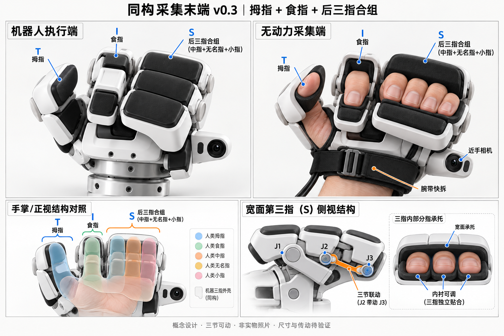

# 紧凑合指式同构末端 v0.3

日期：2026-10-26。生成方式：内置 image_gen，沿用 imagegen 技能。参考输入：Sunday 官方归档设备对照图、手套特写和本项目 v0.2 草图。非 CLI/API 调用。



需求：拇指 T 独立、食指 I 独立、后三指 S 合组；三条机械指链各三节；执行端与采集端共同设计。相较 v0.2，本版采用更紧凑的弧形指部、封闭掌根驱动舱与宽面第三指，去掉不一致的采集站缩略图。

图像检查：三种指型在两端均可辨；穿戴图可见 S 中三个手指；底部有 1+1+3 分组与三节侧视。不同视图的连杆、铰轴位置和三节计数仍需以 CAD 验证，尤其侧视 J1 标签不能作为准确轴定义。封闭壳体不证明六个驱动器、散热与传感器已有真实装配空间；小型相机舱不证明能容纳 D405。指长与相机安装尚未达到参数级精确同构。

工程依据：[系统方案 §10.13](../../inhouse-isomorphic-end-effector.md)。本图为概念效果，不是实物照片、尺寸图或加工/验收依据。v0.1/v0.2 历史图仍保留在对应目录。

## 完整生成提示词

```text
Use case: precise-object-edit / product-mockup.
Input image 1: Sunday official collection glove vs robot hand comparison, morphology reference. Image 2: Sunday official glove closeup holding a screw, morphology reference. Image 3: our v0.2 technical sketch, edit/reference target for our specified three-segment topology. Create a NEW unified hardware review board v0.3, substantially more COMPACT and Sunday-like than v0.2 while retaining OUR three moving segments per digit. Original self-developed concept, no brand logos.
Wide landscape board, white/light gray background, meticulous industrial design. Header exact "同构采集末端 v0.3｜拇指 + 食指 + 后三指合组". Footer exact "概念设计 · 三节可动 · 非实物照片 · 尺寸与传动待验证".
Top 65% split two equal photorealistic panels: LEFT matching robot hand on short wrist flange, RIGHT human-worn unpowered capture glove; identical right-hand viewpoint and partly curled pose showing palm/contact surfaces. Lower 35% two technical sketches: LEFT palm/front anatomical finger-group map, RIGHT side view of WIDE THIRD DIGIT's three-segment linkage with small cross-section showing three human fingers in ONE shared cradle. Do NOT include acquisition station thumbnail; focus on hand structure.
MANDATORY TOPOLOGY: exactly THREE mechanical digits corresponding to HUMAN FIVE fingers grouped 1+1+3. One opposed thumb T on radial viewer-left side, ONE independent narrow INDEX I centrally, ONE very wide ULNAR COMPOSITE DIGIT S on viewer-right side. S holds middle+ring+little together side by side, entire length 2.5 times the width of I, three broad articulated shell segments, common hinge axis per joint, double side hinge supports. T and I must not merge. S is NOT a third ordinary thin finger, NOT only a wide fingertip, NOT the thumb. In worn photo show human thumb inside thumb cradle, human index inside independent slim cradle, THREE other fingertips visibly side by side inside broad composite saddle. No fingers left curled unused. Robot hand has the same T/I/S external geometry.
COMPACT FORM: shorter gently precurved three-segment fingers, rounded broad black contact pads, closed white or light gray shell surfaces and recessed joints, low-profile palm, thumb root angled for opposition, index only slightly extends beyond broad finger. Do not use long skeletal fingers, thick towering palm, giant visible motor cylinders, monster robot aesthetic or large armor. Show three segment boundaries and three joints clearly on each digit despite closed shells. Broad digit all three segments wide with clear horizontal joint seams. Keep middle/index root side-by-side at distal palm edge, thumb at radial side. Rounded edges, pinch guards, slim side linkage covers.
ACTUATION: robot six active axes, two per digit (J1,J2); J3 coupled to J2 by short linkage; compact actuators packaged palm/near-wrist with CLOSED COVER, no exposed motor rack. Human capture unit has NO motors, light open inner supports, fabric-lined wrist strap and quick release. Angle sensor covers recessed on joints, broad contact pad sensor zones. Camera is a SMALL side-palm pod outside grasp area on both devices, not big lens bolted on a fingertip; consistent camera pose. Cable leaves wrist away from contacts.
Bottom left: diagram shows simplified FIVE human finger silhouette under translucent machine shell; blue bracket groups thumb alone labelled "T 拇指", index alone "I 食指", last THREE together "S 后三指合组"; machine exterior exactly three. Bottom right: wide finger three articulated sections label J1 J2 J3, orange coupling only J2-to-J3, inset three soft individual inner finger contact saddles in ONE rigid three-segment shell. Tiny labels "宽面承托","三节联动","内衬可调","腕带快拆","近手相机". Title photo panels "机器人执行端" and "无动力采集端".
Preserve camera and fingertip visual alignment across paired views but do not add fake dimensions or CAD tolerances. Human hand anatomy credible. Label diagram as concept, not Sunday hidden internals. No claims of functional prototype, no force/precision claims.
```
