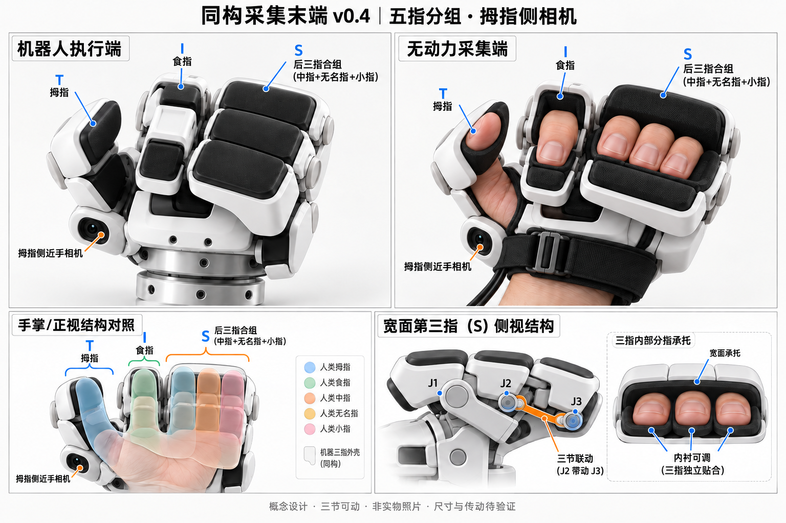

# 五指分组与拇指侧相机 v0.4

日期：2026-10-26。工具：内置 image_gen；编辑目标为 v0.3 概念板，按 imagegen 技能执行。



用户修订：右上人手应为五指，S 仅含中指/无名指/小指；近手相机放到拇指附近。检查结果：右上主图可见一拇指、一食指和 S 内三指尖；两端主视图与左下分组图的相机均已移到拇指侧，原小指侧镜头移除。下右内衬图仍为三个指尖。

概念图不验证真实视场和铰轴，图中镜头朝向仍需通过 CAD 视锥/实拍调整。相机安装在固定掌根而非活动拇指上的要求见 [设计 §10.14](../../inhouse-isomorphic-end-effector.md)。小型外壳不代表 D405 已能装入；不同视图的精确外参、装配空间与关节计数以后续 CAD 为准。

## 完整编辑提示词

```text
Use case: precise-object-edit. EDIT the supplied v0.3 hardware concept board into v0.4. Keep the four-panel layout, all mechanical three-digit / three-segment topology, compact closed white shells, black pads, typography, clean background, and existing technical diagrams. Apply ONLY these corrections consistently:
1) TOP RIGHT WORN HUMAN HAND ANATOMY: it currently has SIX human digits (thumb + index + FOUR fingertips in the broad holder). Correct to exactly FIVE human digits. Thumb alone in T holder (one visible thumb nail), index alone in I holder (one visible index nail), and exactly THREE fingertips/nails inside the S broad holder: MIDDLE, RING, LITTLE, arranged side by side, little shorter. Remove the extra fourth fingertip COMPLETELY and reconstruct skin and pads naturally. Count human nails: total FIVE across hand, exactly THREE in wide group. Do NOT remove thumb or index. S shell remains a SINGLE wide articulated three-segment robot finger, not three separate mechanical fingers.
2) CAMERA LOCATION ALL VIEWS: REMOVE the existing camera pod from outer little-finger/ulnar side (currently viewer RIGHT). Reconstruct a flush clean shell there, no spare lens or socket left. Relocate ONE camera pod to THUMB SIDE, radial side, near the base of the thumb at the lower-left palm in these front-view images. It attaches to FIXED PALM beside thumb root and slightly proximal toward wrist, NOT to the moving thumb segment. Small protected bracket, compact oval camera housing. Aim optical axis obliquely toward thumb-index pinch zone and broad finger contact area. Keep clear of the thumb swing envelope and do NOT place lens in finger web or gripping gap. Matching robot and worn unit camera mount transform. Also move the camera in bottom-left schematic from viewer-right to thumb-side viewer-left.
3) Update camera callout on top right to point to new thumb-side camera and text exact "拇指侧近手相机". Replace header v0.3 with "同构采集末端 v0.4｜五指分组 · 拇指侧相机". Preserve footer concept disclaimer. Keep T/I/S labels accurate.
Do not invent other changes, do not add fingers, do not change THREE articulated segments per mechanical digit or 1+1+3 grouping. Bottom-right cradle inset already has exactly three fingers: keep it that way. Prioritize correct human anatomy over identical pixel pose. This is a concept board, not a real hardware photo.
```
