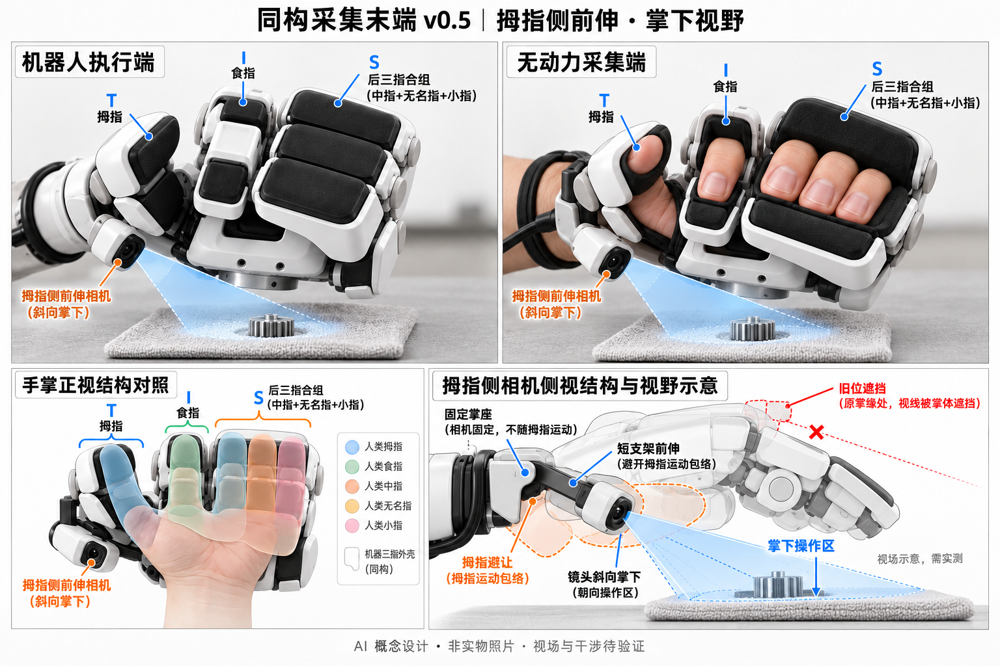
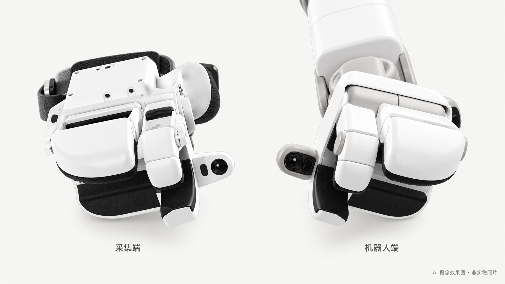

# 拇指侧前伸相机与掌下视野 v0.5

日期：2026-10-26。使用内置 image_gen 编辑 v0.4 概念板，沿用 imagegen 技能。



用户反馈：v0.4 位置看不到掌下。修订为固定掌座上的拇指侧短支架前伸，镜头朝内下方，补侧视光轴/视锥。保留五个人指按 1+1+3 分组。

图像检查：两端主视图相机位于拇指附近、画出朝桌面操作区的蓝色视锥；右下侧视图展示固定掌座、前伸支架、拇指避让与旧位置遮挡；主穿戴图仍可见一拇指、一食指和 S 内三个指尖。蓝色视锥为生成示意，并非光学仿真；侧视相机和拇指的碰撞/扫掠关系未实际求解。

下一步按真实镜头 FOV/工作距离与器件尺寸做 CAD 扫描和实拍；相机需要看到掌下目标，不代表所有接触面可见。小相机外壳不证明 D405 能装入。图像不能作为实物、尺寸、功能或验收证据。

工程说明：[设计 §10.15](../../inhouse-isomorphic-end-effector.md)。

## 完整编辑提示词

### 配对斜俯视角补图



按用户附图的斜俯视角、半握合姿态与左右并排构图生成；左为采集端，右为机器人端。工具仍为内置 image_gen，输入是用户角度参考与本项目 v0.5 概念板。

检查：画面角度与参考接近，但造型受 Sunday 参考影响较强，部分三节关节被遮挡/简化，相机朝向仍需工程核查；此图作为外形与角度研究，不能替代 v0.5 结构定义，不能据此声称已呈现精确自研运动学或无遮挡掌下视场。

完整补图提示词：

```text
Use case: product-mockup / precise-object-edit.
Input 1 is the user's reference for CAMERA ANGLE, POSE and COMPOSITION. Input 2 is OUR current v0.5 self-developed concept board, design identity reference. Render our v0.5 hardware in EXACTLY the paired oblique overhead viewing angle and semi-closed posture of input 1, NOT the open palm frontal presentation of input 2.
One clean photorealistic product shot on uniform off-white/light gray background, wide landscape. Two matching devices side by side with same scale and perspective, LEFT unpowered wearable capture device (unworn, show inner fabric saddles and wrist band subtly from rear), RIGHT robot execution end effector attached to short white forearm entering from upper right, as reference input 1. Angled downward, curled fingers face inward/down, camera looks at the backs/outer shells of curved digits and some black palm contact surfaces below. Broad composite digit is on opposite side to opposed thumb; narrow independent index is beside broad group. Maintain reference's approximately 45 degree oblique top/front view and inward mirrored paired arrangement. No human face, no tabletop, no tools, no acquired dataset diagrams.
Preserve OUR REQUIREMENTS: EXACTLY THREE mechanical finger chains per device: opposed THUMB T, separate narrow INDEX I, and MUCH WIDER COMPOSITE S corresponding to HUMAN MIDDLE+RING+LITTLE together. S whole finger is broad rounded-rectangular (roughly 2.5x index width), not three separate mechanical fingers. All three chains have THREE moving phalange segments; semi-closed posture can partially occlude hinges but show three shell segment seams plausibly. White/offwhite compact rounded shells, recessed pivots, wide black replaceable soft pads, low palm root shell. Robot closed six-drive palm chamber without exposed motor rack, wearable lighter inner saddle frame with no motors and quick release. Same external contact geometry on both, no long skeletal fingers, no five-finger robot, no two-jaw gripper.
CAMERA REQUIREMENT from v0.5: one small camera on THUMB SIDE fixed palm bracket of each device, short protected forward projection so lens optical center clears palm edge, lens tipped down/inward to see UNDER-PALM operating area. NOT a little-finger-side camera; NOT on moving thumb. In this overhead view camera pods should be visible near each device's thumb-root side like the reference, but retain a slight forward/downward offset. Lens face obeys the downward optical direction rather than unnaturally staring at viewer. Match robot/wearable palm-to-camera pose. No visible blue frustum or arrows in this beauty shot.
Composition favors observing compact outer morphology and broad S vs narrow I distinction. Left capture unit and right robot each fully framed except robot forearm can crop at top. Realistic satin polymer, small metal fasteners, black soft fabric/elastomer, gentle studio shadows, precise product visualization, no logos. Minimal tiny bottom labels only "采集端" and "机器人端"; small unobtrusive footer "AI 概念效果图 · 非实物照片". No title block, no extra panels, no invented dimension text.
Do not simply reproduce Sunday original hardware: use our three-articulated-segment concept and our short forward-offset thumb camera from input2, rendered in input1 viewing direction.
```

```text
Use case: precise-object-edit, engineering concept board correction.
Edit supplied v0.4 board into v0.5. Preserve exact THREE mechanical digits T thumb, I index, S broad composite and human anatomy exactly FIVE fingers (1 thumb + 1 index + 3 in broad cradle). Preserve compact white shells, black pads, two main views robot left and wearable right. We need to CORRECT CAMERA VIEW GEOMETRY, not just its left/right position.
PROBLEM: existing camera faces the external viewer and sits flush behind palm rim, so it cannot observe work surface UNDER THE PALM. Remove this flush outward-facing camera.
NEW MOUNT: thumb-side FIXED PALM bracket, not moving thumb; short protected dog-leg arm extends the camera slightly forward beyond the palm/contact-side shell occlusion boundary, lateral to thumb movement, so optical center has a clear sightline toward UNDER-PALM manipulation volume. Camera pod tilted INWARD AND DOWNWARD toward the table/work region under palm and between fingertips, rather than looking straight at viewer, wrist or sky. Short bracket with adjustable tilt joint (concept), no long selfie stick, outside thumb swept envelope. Matching relative camera mount on robot and wearable. Show camera in three-quarter side orientation: lens face on its LOWER/INNER oblique surface, not front-facing bullseye. Small pale blue FRUSTUM begins at lens and goes DOWN/INWARD to workspace under fingertips. Cone does not pass through solid palm. Realistic camera cable along bracket into fixed wrist.
TOP main panels show hands tilted in slightly horizontal working pose above a small neutral cloth square on tabletop, with 1+1+3 groups clearly countable and blue frustum reaching cloth area below palm. Do not add fingers or change groups; human total FIVE nails, three inside S. Keep all three mechanical fingers three-segment articulated. No lens pointing at audience.
BOTTOM change layout: left narrow panel retain five-human-finger/three-machine-digit grouping schematic; right LARGE panel replace old finger linkage diagram with clear CAMERA SIDE-VIEW engineering sketch: hand horizontal, wrist left, fingers curve down/right above table, camera on thumb-side small projecting bracket with optical center clear of palm silhouette, lens angled diagonally down/right toward cloth/object under palm. Draw blue camera optical axis and frustum, transparent hand outer silhouette if necessary for line-of-sight, orange dashed swept envelope for thumb separate from camera bracket. Mark a blocked comparison dashed red line from old flush position to indicate palm occlusion, labelled "旧位遮挡". New blue frustum labelled "掌下操作区"; callouts "固定掌座","短支架前伸","镜头斜向掌下","拇指避让". Do NOT invent exact dimensions, field of view degrees or guaranteed visibility; annotate "视场示意，需实测".
Header exact "同构采集末端 v0.5｜拇指侧前伸 · 掌下视野". Footer "AI 概念设计 · 非实物照片 · 视场与干涉待验证".
Mandatory optical consistency: lens looks toward UNDER-PALM table operation zone, blue frustum goes from lens to tabletop, never through housing. Thumb-side mount remains fixed while thumb moves. No additional camera on little-finger side. Keep human anatomy five fingers.
```
