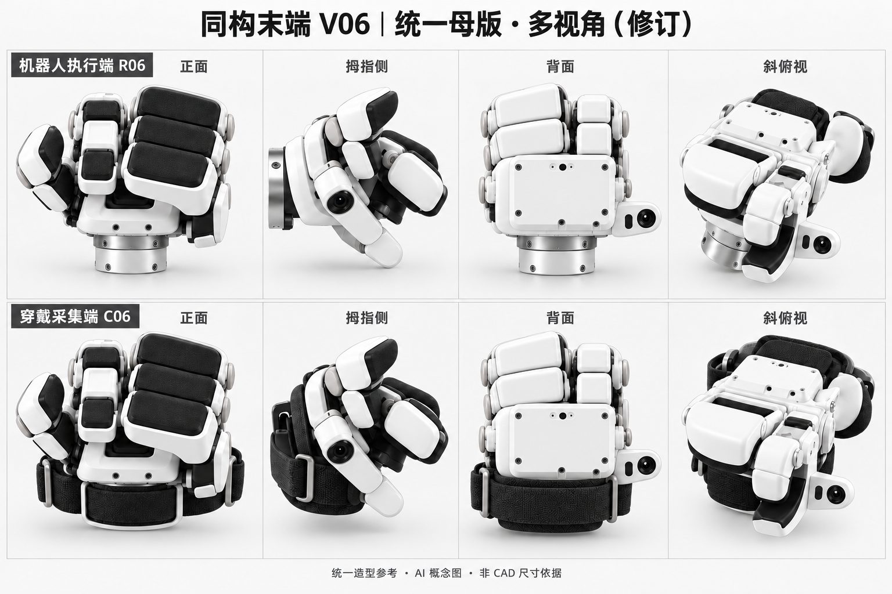
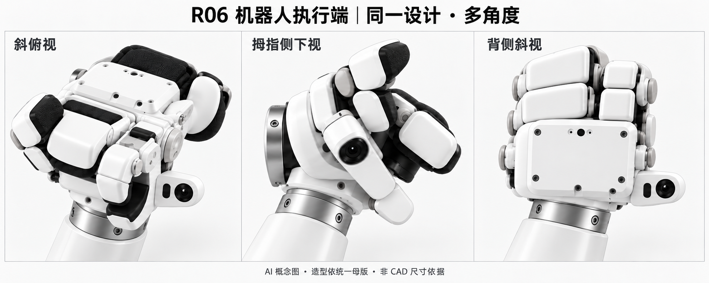
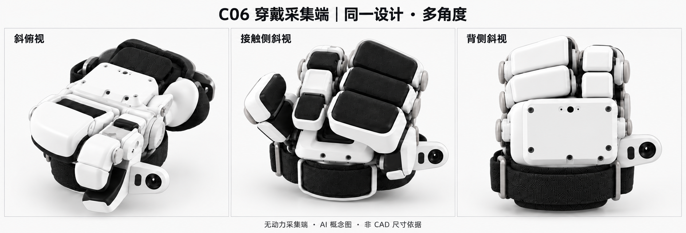

# V06 多视角图组（评审不通过）

日期：2026-10-26。工具：内置 image_gen（imagegen 技能）。

**用户评审未通过**：第一组相机不可辨认，第二组指部扭曲交叠，第三组相机方向不正确。三张均不作为当前统一设计母版或结构冻结依据。

用户要求：多角度、不同视图、几张图使用同一设计，避免逐图重设计。工作方式：先生成统一母版、检查多视图，再以同一修订母版作为后续图片的参考。

造型基准：v0.5 配对斜俯视图的紧凑外壳，v0.5 概念板的 1+1+3 分组和拇指侧固定相机。R06 与 C06 是本图组的造型标识，不代表新硬件已冻结或运行时 profile 已注册。

AI 多视图只作为视觉一致性参考，不能保证与参数 CAD 相同的三维几何。尺寸、运动学、器件包络和真实视场仍需 CAD/样机验证。

## 锁定的造型约束

```text
VISUAL DESIGN LOCK V06 — ONE DEVICE FAMILY, NOT VARIANTS.
- One RIGHT-hand topology, five human fingers grouped T thumb alone + I index alone + S middle/ring/little together. Exactly THREE mechanical finger chains. Do not mirror chirality between views.
- Three phalanges and rotary hinges J1/J2/J3 per mechanical chain; J3 coupled. Broad S is full-width from base to tip, approximately 2.5x index width; single common hinge per level and paired side plates. Compact precurved digits, index only slightly longer than S. Thumb opposed on radial side.
- Satin off-white rounded shells, fine dark fasteners, charcoal black replaceable pads, slim recessed joint caps, same shell seam pattern. No visible giant motor rack. Fixed palm cover with rectangular service plate, screw layout preserved in all appearances. No arbitrary vents/LEDs.
- ONE oval two-window camera pod (one circular lens + one dark rectangular auxiliary window) on SHORT protected bracket attached to FIXED THUMB-SIDE PALM. Project just clear of palm rim toward workspace, lens angles inward/down to under-palm operation zone. Pod never on little-finger side, never on moving thumb, never changes side/shape between views. Same palm-to-camera pose across collection/execution versions.
- Robot R06: closed low-profile palm actuator shell, short white forearm and metallic wrist flange. Capture C06: same OUTER finger geometry/pads/camera as R06, no motors, inner finger saddles + black textile wrist strap and quick release replacing flange. Three padded inner contact saddles inside S, not three separate mechanical fingers.
- Keep semi-flexed neutral inspection pose constant for turntable views; only rotate virtual camera. Views should plausibly describe one physical object. Exact CAD consistency is not implied.
- No branding, no new model variants, no fourth mechanical digit, no extra human finger, no overwide thumb, no symmetric three-finger chuck. No schematic invented electronics.

```

## 母版生成提示词

```text
Use case: product-mockup / multi-view model sheet.
Input image 1 paired oblique shot = compact outer shell appearance reference. Input image 2 v0.5 board = functional topology/camera-under-palm requirement reference. Create an AUTHORITATIVE master design sheet for ONE coherent industrial hardware design. Do not redesign between panels.
VISUAL DESIGN LOCK V06 — ONE DEVICE FAMILY, NOT VARIANTS.
- One RIGHT-hand topology, five human fingers grouped T thumb alone + I index alone + S middle/ring/little together. Exactly THREE mechanical finger chains. Do not mirror chirality between views.
- Three phalanges and rotary hinges J1/J2/J3 per mechanical chain; J3 coupled. Broad S is full-width from base to tip, approximately 2.5x index width; single common hinge per level and paired side plates. Compact precurved digits, index only slightly longer than S. Thumb opposed on radial side.
- Satin off-white rounded shells, fine dark fasteners, charcoal black replaceable pads, slim recessed joint caps, same shell seam pattern. No visible giant motor rack. Fixed palm cover with rectangular service plate, screw layout preserved in all appearances. No arbitrary vents/LEDs.
- ONE oval two-window camera pod (one circular lens + one dark rectangular auxiliary window) on SHORT protected bracket attached to FIXED THUMB-SIDE PALM. Project just clear of palm rim toward workspace, lens angles inward/down to under-palm operation zone. Pod never on little-finger side, never on moving thumb, never changes side/shape between views. Same palm-to-camera pose across collection/execution versions.
- Robot R06: closed low-profile palm actuator shell, short white forearm and metallic wrist flange. Capture C06: same OUTER finger geometry/pads/camera as R06, no motors, inner finger saddles + black textile wrist strap and quick release replacing flange. Three padded inner contact saddles inside S, not three separate mechanical fingers.
- Keep semi-flexed neutral inspection pose constant for turntable views; only rotate virtual camera. Views should plausibly describe one physical object. Exact CAD consistency is not implied.
- No branding, no new model variants, no fourth mechanical digit, no extra human finger, no overwide thumb, no symmetric three-finger chuck. No schematic invented electronics.

Output ONE wide landscape high-resolution board with TWO rows x FOUR columns, consistent scale, uniform neutral background, studio lighting and same semi-flexed neutral finger pose in EVERY panel.
TOP ROW same robot execution R06 in four views: FRONT/contact side, TRUE THUMB-SIDE PROFILE, BACK/service-cover side, REFERENCE OBLIQUE overhead three-quarter angle.
BOTTOM ROW same collection C06 in matching four views FRONT/contact side, TRUE THUMB-SIDE PROFILE, BACK/strap side, REFERENCE OBLIQUE. Collector unworn so no anatomy errors, show interior soft saddles where visible, NO motor enclosure. Top and bottom correspond same underlying contact geometry, camera moves with object, not independently repositioned.
Use realistic CAD-style product renders with clean surfaces, show enough segment seams for all three mechanical digits. In side views lens point down/inward toward below-palm manipulation zone. Back views camera may partially occlude naturally; do not move pod to make it visible. Avoid assembling unrelated attractive variants.
Header exact "同构末端 V06｜统一母版 · 多视角". Row labels "机器人执行端 R06","穿戴采集端 C06". Column labels "正面","拇指侧","背面","斜俯视". Small footer "统一造型参考 · AI 概念图 · 非 CAD 尺寸依据".
Most important: each column has exactly SAME proportions, camera bracket, white shell surfaces, black pads and screw/service-cover shapes. Finger count THREE mechanical digits in each view, S is unmistakably much wider than I. Do not copy the single-reference shot as all views; actually rotate the same design.
```

## 检查与修订记录

母版第一轮存在侧视重复镜头、背视仍露出正面接触垫的问题，因此需修订后再用作后续图片参考。未通过检查的草稿不作为一致性依据。

## 输出图组







后两图均仅以修订后的统一母版作为视觉输入，而不是独立从文本重设计。

## 复核结论与限度

- 图组采用同一紧凑白壳/黑垫、T/I/S 不对称三指、宽面 S、矩形检修盖、执行端法兰/采集端腕带区分。修订母版的侧视重复镜头已移除，背视改为白色外壳。
- 仍存在视图间铰轴、分缝、手指遮挡和相机相对位置的生成差异；尤其正面与背面相机的左右关系需以固定掌系核查。不能把“同一母版参考”写成精确几何一致或已满足拇指侧相机外参。
- 新增视角会推测未见表面，这些表面尚未由三维模型定义。图组可供外形评审，不作为零件数量、传动闭环、三节结构与安装位置冻结依据。
- 要达到严格统一，需要同一套参数化三维/CAD 模型，固定相机安装与指节参数后转动视角输出；本次尚未建立该模型。

提示词文件：[母版修订](v06_master_fix_prompt.txt)、[执行端](v06_robot_prompt.txt)、[采集端](v06_capture_prompt.txt)。
