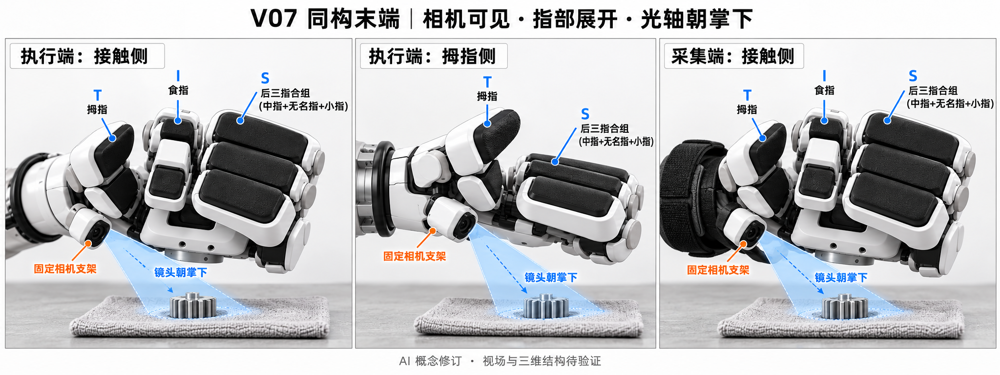

# V07：相机与指部修订（用户评审不通过）

用户随后反馈“都不对”，要求重新与 Sunday 比较。本图不作为通过评审的构型或统一多视图依据；下一步先以侧视简图确认夹持关系。

日期：2026-10-26。内置 image_gen，沿用 imagegen 技能；仅用 v0.5 掌下视野板作为结构参考，不把用户评审不通过的 V06 作为母版继续放大。



用户反馈：V06 第一组相机看不到、第二组指部扭在一起、第三组相机方向错误。修订板采用三个大面板：执行端接触侧、执行端拇指侧、采集端接触侧。

视觉检查：三面板均有一处可辨认的相机舱；T/I/S 在接触侧区分，指部保持展开，侧视允许遮挡而不强扭；相机位于拇指根附近，蓝色光轴示意指向桌面掌下目标。采集端无人体模型，避免多指人体错误。

限制：视锥为 AI 示意，不证明真实镜头的光轴与可见率；支架是否固定在掌座、相机外参是否在各视图完全一致、指段和铰轴位置均仍需参数 CAD 验证。不标注几何一致验收通过；本图仅用于下一轮构型评审。

## 完整生成提示词

```text
Use case: precise-object-edit, coherent industrial hardware review.
Use supplied v0.5 as ONLY structural reference. Make a replacement V07 board correcting errors from later failed multi-view images. ONE WIDE image with THREE LARGE panels, not 8 tiny views. SAME physical right-hand device geometry, modestly OPEN finger pose, no crossed/intertwined fingers. Compact white shell/black pad design.
Panel 1 robot execution hand, front three-quarter contact view; Panel 2 SAME robot in true radial/thumb-side view, palm horizontal over tabletop; Panel 3 matching UNPOWERED wearable collector in same front three-quarter contact view as Panel1, UNWORN showing wrist strap/inner saddles so no invented human anatomy.
Each device EXACTLY THREE separated digit chains: opposed thumb T on left in front view, ONE narrow independent index I center, ONE WIDE three-finger support S on right, corresponding human middle+ring+little. Each chain has THREE segments and clear three hinge axes, white shells with broad black pads; S 2.5x width of index along entire length. J1/J2 flex modestly, J3 coupled. Keep visible SPACE between T/I/S, do not clench or twist. Long axes of I and S approximately parallel, thumb opposes; no interpenetration, no crossed linkages, no extra fingers.
MOST IMPORTANT CAMERA: EXACTLY ONE clearly identifiable CAMERA POD per device. It is a SMALL ONE-LENS box housing on a SHORT rigid bracket from FIXED PALM ROOT on THUMB SIDE. In front view camera must be near LEFT thumb root, NOT little-finger-side right. It projects slightly toward under-palm contact side, clears palm rim, optical face is LOWER/INNER oblique side, aim DIAGONALLY DOWNWARD/INWARD toward tabletop region UNDER PALM and fingertips. It does NOT look outward at the viewer, sideways away from fingers, or at wrist. Camera BODY is clearly visible in every panel. A CYAN line from actual optical lens center and translucent narrow blue frustum terminate on tabletop under palm. Mount does not attach to moving thumb. Robot and collector have identical palm-to-camera position, shape and pointing direction. Circular joint caps gray/white, never black glass, so not confused for additional cameras.
Panel2 must show clear geometric side explanation: wrist left, palm extends right, gently curled fingers right, one camera BELOW thumb-side palm rim on short fixed bracket, lens aimed down/right at a small gray cloth square below palm, blue optical-axis arrow. All cones originate at lens and avoid solid hand silhouette. No additional old camera or fake lens elsewhere. Thumb side view may occlude non-thumb fingers naturally; do not twist to show them. Front panels preserve tabletop just below palm to make downward optical axis legible.
Geometry and camera remain unchanged between panels; ONLY viewing camera rotates. Wrist connector is robot flange for Panels1/2, collector black wrist strap in Panel3. No service panel invented on contact pads. No exposed motor rack, no anatomy, no new shell redesign.
Header "V07 同构末端｜相机可见 · 指部展开 · 光轴朝掌下".
Panel labels "执行端：接触侧", "执行端：拇指侧", "采集端：接触侧".
Only short callouts "T 拇指","I 食指","S 后三指合组","固定相机支架","镜头朝掌下". Footer "AI 概念修订 · 视场与三维结构待验证".
Prioritize correct consistent camera and uncrossed finger topology over photoreal glamour. Realistic CAD-style render on offwhite background, clean and readable.
```
