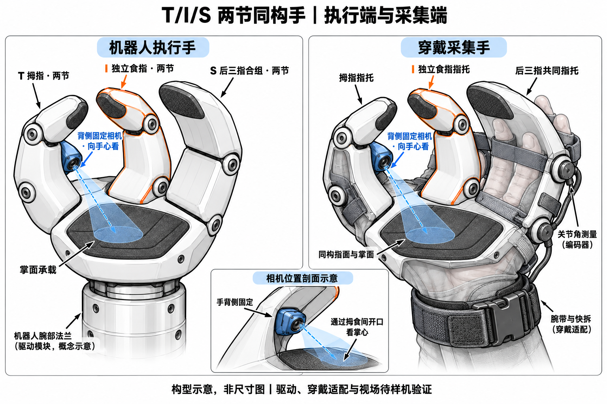

# TIS2 执行手与穿戴采集手配套结构图

按用户“把这个三指手结构图更新下，对应的采集手也是”的要求，使用内置 image_gen，以已认可的 [原图](../inhouse-hand-reference-20261026/selected-reference.png) 为参考制作。

左右共用 T 拇指、I 独立食指、S 后三指合组的两节结构、掌面和背侧拇食间朝内相机。执行端显示腕法兰与驱动舱概念；采集端以局部透视示意指托、后三指共同指托、编码器与腕带快拆。编码器外观不表示轴数或器件选型已冻结。

生成提示词：[prompt.txt](prompt.txt)。本图是更新概念草图，尚未获得用户逐项确认，不替换原图的认可记录；人体透视、绑带、关节装配和相机光路须用 CAD/样机验证。指托视图中的人体不能理解为新增独立机械指。

设计入口：[同构末端方案](../../inhouse-isomorphic-end-effector.md)。
