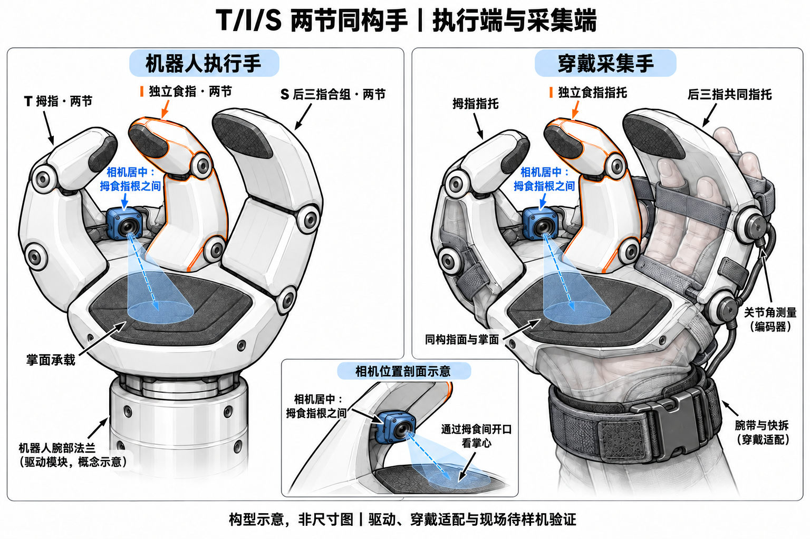

# TIS2 配套结构图：相机向拇食指根中点移动

用户要求“摄像头位置放到食指拇指中间点”。在 [v02](../tis2-paired-hand-v02/README.md) 上使用内置 image_gen 定点修改两端相机位置，保留指组、掌面、法兰与穿戴结构。

相机向拇指与独立食指根部之间的中点移动，背侧固定于掌体，向内观察掌心；两端同步修订。此为更新草图，不代表光路、运动干涉和人体适配已验证。v02 偏拇指的安装图保留历史，不作为最新位置参考；最初认可构型记录仍保留。

[生成提示词](prompt.txt) · [主设计](../../inhouse-isomorphic-end-effector.md)
