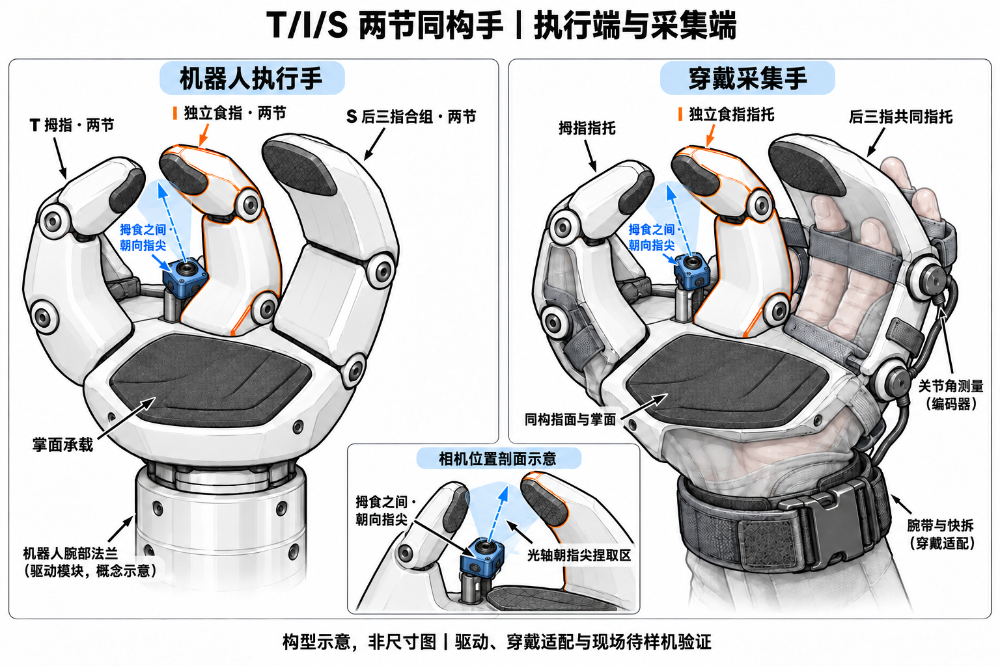

# TIS2 配套结构图：拇食之间，朝向指尖

根据用户最新要求“摄像头位置再向2指中间放点，方向看向指尖”，用内置 image_gen 在 [v03](../tis2-paired-hand-v03/README.md) 上同步修改执行端与穿戴采集端。

相机再向拇指和独立食指的间隙中心移动，镜头与光轴朝两指指尖之间的捏取区；不再以掌垫中心为主光轴目标。支架连接固定掌体，不能随活动指体转动。其余三组两节、宽 S 合指、承载掌面和穿戴结构沿用。当前草图仍待用户审阅；立柱外形不代表支架已冻结，须验证捏合干涉、手部适配与视场。

此前朝掌心的图保留为历史，不覆盖这次方向修订。[提示词](prompt.txt) · [主设计](../../inhouse-isomorphic-end-effector.md)
