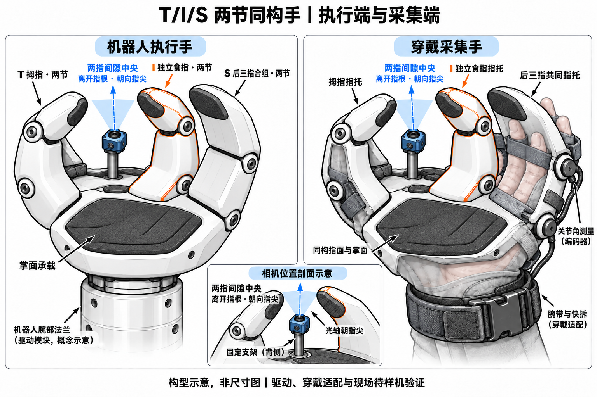

# TIS2 相机位置澄清：两指空隙中央，离开指根

用户澄清：“放中间意思是不要靠近拇指根部和食指根部”。本轮用内置 image_gen 修改 [v04](../tis2-paired-hand-v04/README.md)，两端相机均移向两指之间空隙的中部，离开两侧指根，朝指尖捏取区。

“中间”是开放空间中的安装位置，不是两指根的中点。支撑连接固定掌体，保持与活动指体分离；立柱是位置示意，不是已选定机械方案。实际支架、捏合空间、运动遮挡和人体适配待 CAD/样机验证。图像仍待用户审阅，不把生成结果当作新确认。

[生成提示词](prompt.txt) · [当前设计](../../inhouse-isomorphic-end-effector.md)
