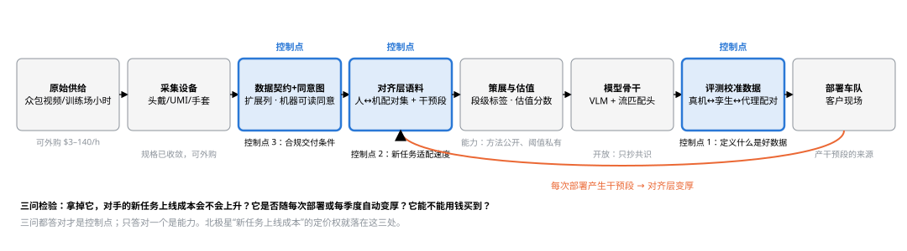

# 第 1 章 具身数据的瓶颈在哪里

## 1.1 具身数据为什么特殊

互联网文本和图像数据的问题主要是"多"：清洗、去重、过滤有害内容。自动驾驶数据的问题主要是"长尾"：常规场景多到泛滥，罕见场景采不到。具身操作数据同时面对这两个问题，还多了三个它们没有的难点：

1. **动作不在画面里。** 一段人做家务的视频，看得见手在动，看不见关节角、末端位姿、抓握力。要把它变成机器人能学的监督信号，必须恢复或合成动作。这是"具身鸿沟"（[architecture.md](../architecture.md) §6）。
2. **形态各不相同。** 同一个"把杯子放进篮子"，可以由遥操作的双臂机器人、戴头戴相机的人、拿 UMI 夹爪的人、仿真里的虚拟手完成。它们的观测视角、动作空间、采样率、噪声来源都不同，却要进同一个模型。
3. **时间要对得很准。** 动作专家以 100–200 Hz 消费状态和动作，一个控制周期只有 5–10 ms。视觉帧和动作差一帧，学到的就是错位的因果。

## 1.2 供给过剩，可用稀缺

2026 年的态势（[data-strategy-roadmap.md](../data-strategy-roadmap.md) §1.2）有一个很清楚的剪刀差：

- **供给端在崩价。** 众包第一视角视频的事实价格约 $6/小时（第三方），Figure Index 官方口径每秒入库 30 分钟视频，Generalist 自报 50 万+ 小时手持夹爪数据 ⚠️。
- **可用端仍然稀缺。** 熟练采集员的有效数据只有 1/3–1/2，QA 拒收 10–30%；Dyna 自报成功率 99.9%，而客户侧质量通过率只有 87% 和 46% ⚠️；Index 的五阶段策展会丢弃大部分原始上传（Forbes，第三方），可用训练数据远小于 1,600 万条的名义规模。

结论是：原始小时不是资产，是输入。CTO 的资源应从"多采"转向**对齐、策展、评测**三个自研环节，原始供给当作可外购的大宗商品（roadmap §2.1）。

## 1.3 三层数据结构

GR00T 2 的预训练混合给了一个清楚的分层（[gr00t2-trends-analysis.md](../gr00t2-trends-analysis.md) §0，NVIDIA 一手，比例为自报 ⚠️）：人类视频约 92%、机器人遥操约 5%、UMI 约 2%。把这个比例和 roadmap 的态势判断合起来，数据需求可以看成三层：

| 层 | 内容 | 量级 | 作用 |
|---|---|---|---|
| 覆盖层 | 人类第一视角视频（无动作标签） | 10⁵–10⁶ 小时 | 世界知识、物体与场景多样性、视频预测 |
| 对齐层 | 与机器人对齐的人类/手持数据、遥操作、干预段 | 10³–10⁴ 小时 | 任务能力、动作语义 |
| 本体层 | 目标本体的 play 数据 + 少量后训练演示 | 每本体若干小时 | 交代"这台机器怎么动、长什么样" |

稀缺的不是覆盖层的原始小时，而是**对齐层的小时和灵巧手的小时**。这决定了本仓库四条采集轨的分工（第 3 章）：human 轨打底，device 轨和 robot 轨做对齐层，sim 轨补长尾、做评测载体。

## 1.4 五个正在发生的转变

roadmap §1 用十个维度扫描了 2026-06 至 2026-09 的 225 条来源，归纳出几个与数据管线直接相关的转变：

1. **人类视频成为预训练主轴**，机器人数据退为对齐层。GR00T N1.7 加入 2 万小时人类视频，Cosmos 3 的动作中训练集 67% 是人类第一视角（官方）；HumanScale 的等小时对比里人类视频优于遥操作（论文）。
2. **动作空间、格式、质量标准三线收敛。** 至少四家独立收敛到相机系相对末端动作；LeRobot v0.6 把逐帧子任务、进度、奖励列做进标准格式；中国 YD/T 6771-2026 八维数据质量标准 2026-11-01 实施。
3. **"不删只标"从原则变成方法。** π0.7 用元数据条件化吃失败和自主 rollout 数据，Ambient Diffusion Policy 用次优数据在 OXE 上再涨最多 33%（论文）。失败数据是一等公民。
4. **评测走向分级、序贯与代理，并在产品化。** 仿真评测器、世界模型评测器开始与真机做相关性标定，但世界模型评测只在专家动作分布内有效。
5. **监管把 lineage、同意、脱敏变成交付条件。** 欧盟 Data Act、CRA、PLD、机械法规叠层生效，旁观者隐私诉讼出现。

## 1.5 北极星：新任务上线成本

如果数据量不是目标，什么是？本仓库的北极星指标（roadmap §2.3）是**新任务上线成本**：让一个新任务在真机上分级得分达到 ≥90% 所需的真机小时数与全成本美元。它同时惩罚预训练弱（要采很多新数据）和策展差（采了用不上）。12 个月目标是 ≤20 真机小时 / ≤$5k（占位值，M2 初用实测曲线重定）。

数据系统对北极星的贡献可以拆成四个直接可管的量（[data-system-plan.md](../data-system-plan.md) §1.3）：

```
新任务上线成本（北极星）
 ├─ 可用训练小时/月 ········· 入湖量 × 漏斗通过率
 ├─ 每可用训练小时全成本 ···· 采集计酬 + 设备摊销 + 平台 + VLM + 人工
 ├─ 采集 → 可训练时延 ········ 上传完成到 training_ready 的 P50 / P95
 └─ 闭环有效率 ··············· 回流 loop 中评测提升的轮次 / 总轮次
```

## 1.6 三个战略控制点

roadmap §2.5 用"三问"检验什么才是值得战略投入的东西：拿掉它，对手的新任务上线成本会不会上升；它是否随每次部署或每季度自动变厚；它能不能用钱买到。通过检验的只有三样：

1. **评测校准数据**：自家本体 × 自家任务的真机↔孪生↔代理三层配对。它定义"什么是好数据"，必须在自家本体上做。
2. **对齐层语料**：人↔机同任务配对集 + 干预段。只有同时拥有本体、任务和采集通道的人能产出。
3. **数据契约 + 同意/来源图**：合规交付条件，一旦成为训练场与 OEM 的交付格式，切换成本落在对方。

看起来像控制点、其实不是的：原始小时数、头戴设备、模型骨干、仿真引擎。它们要么已是大宗商品，要么领先半年就被追平。



*图 8（引自 roadmap §2.5）　价值链上的三个控制点（蓝色）与可外购或开放的环节（灰色）。*

## 1.7 本章小结

- 具身数据的特殊性：动作不在画面里、形态各异、时间要对得准。
- 瓶颈已从"采不到"变成"对不齐、验不了、用不上"。
- 数据需求呈三层：覆盖层（人类视频）、对齐层（对齐过的小时）、本体层（play 数据）。
- 北极星是新任务上线成本，控制点是评测校准数据、对齐层语料、数据契约与同意图。
- 所以本书的重心不在"怎么多采"，而在"怎么对齐、怎么质检、怎么评测、怎么闭环"。

**延伸阅读**：[data-strategy-roadmap.md](../data-strategy-roadmap.md) §0–§2 · [gr00t2-trends-analysis.md](../gr00t2-trends-analysis.md) §1 · [research-four-routes.md](../research-four-routes.md)
