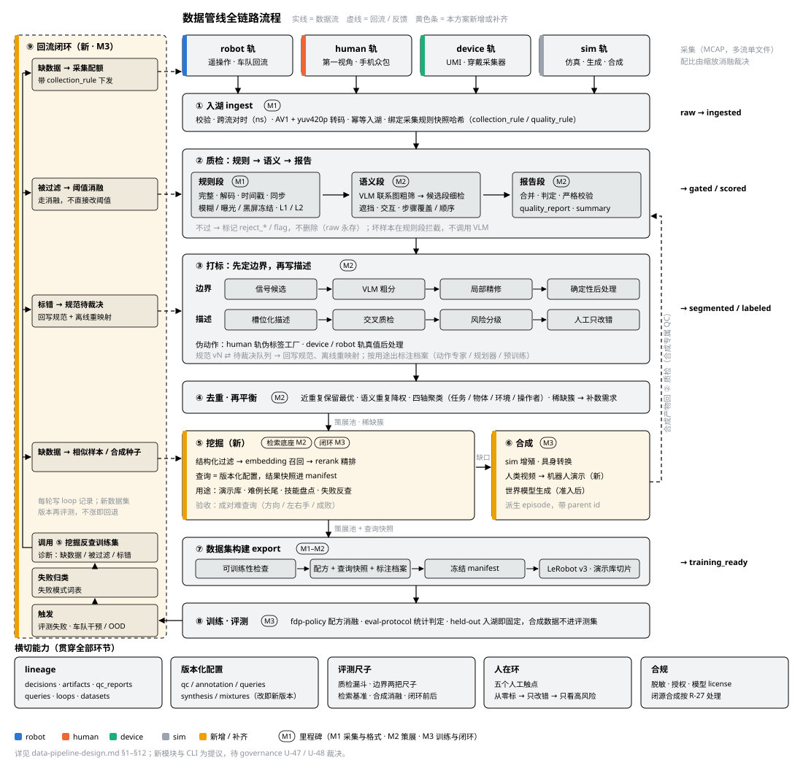

# 第 2 章 七条贯穿性决策

一条管线能不能长期演进，取决于少数几条"不轻易改"的决策是否选对。本仓库把它们写在 [CLAUDE.md](../../CLAUDE.md) 里，偏离前必须先更新 [architecture.md](../architecture.md)。本章逐条讲：决策是什么、解决什么问题、代价是什么。

## 2.1 管线的五层骨架

先看骨架。数据流分五层，`src/fdp/` 的子包与之一一对应，CLI 子命令按层命名：

```
recorder(采集, MCAP) → ingest(入湖: 校验/对齐/转码) → curation(策展) → export(LeRobotDataset v3) → viz(rerun)
   fdp record             fdp ingest                     fdp curate        fdp export                 fdp viz
```

2026-11-17 对照某大模型厂商 具身数据链路（入湖 → 质检 → 打标 → 挖掘 → 合成 → 训练评估 → 回流）后发现缺了**挖掘、人类视频合成、回流闭环**三环。补法是不新增管线层和持久化格式：挖掘与合成作为 curation 层的新阶段，回流闭环作为跨层流程用 lineage 串起（[data-pipeline-design.md](../data-pipeline-design.md) §0）。



*图 P1（引自 data-pipeline-design §1）　全链路：采集四轨 → ① 入湖 → ② 质检 → ③ 打标 → ④ 去重再平衡 → ⑤ 挖掘 / ⑥ 合成 → ⑦ 数据集构建 → ⑧ 训练评测 → ⑨ 回流闭环。*

## 2.2 决策一：双格式

**内容**：机上采集和原始数据用 MCAP（append-only、耐崩、多流单文件）；训练和发布用 LeRobotDataset v3（parquet + mp4、流式）。二者之间由 export 层转换，**不引入第三种持久化格式**。

**为什么是两种**：采集态和训练态的需求相反。采集要的是断电不丢、多路传感器各按原生频率写进一个文件、写入时不需要知道将来怎么用；训练要的是按样本随机访问、列式压缩、社区工具直接能读。一种格式两头兼顾，必然两头都不好。

**为什么不能是三种**：每多一种持久化格式，就多一条转换路径、一套一致性校验、一处 lineage 断点。GR00T 2 用 Lance 做快照和 QC 视图，我们的判断是 Lance 只作为 LeRobot 之下可选的存储后端评估，不作为第三种格式（[gr00t2-trends-analysis.md](../gr00t2-trends-analysis.md) §4）。

**外部旁证**：Dyna 在百万小时规模上把 episode 容器从 H5 逐帧 JPEG 换成 canonical MCAP + H.264，并按读取模式分组 topic，自报存储 −68%、样本读延迟 2.9× ⚠️（[data-format-contract.md](../data-format-contract.md) §1.1）。

## 2.3 决策二：四轨同 schema

**内容**：robot（遥操作/车队，含动作真值）、human（第一视角视频，无动作标签）、device（UMI 类手持/穿戴采集，硬件动作真值）、sim（仿真 rollout）四条 ingest 轨共用同一个 `EpisodeMeta`，用 `track` 字段区分。采集方式是组合不是单选；**新增采集形态 = 新增 track 值，不新增 schema**。所有模态可空（mask），schema 带版本号，新增传感器不得破坏旧数据可读性。

**为什么**：如果每种采集形态一套 schema，跨形态混合训练就要在训练侧写 N 套适配；更糟的是，质检、去重、再平衡、lineage 也都要写 N 套。同 schema 加可空模态，让"一条 human 轨 episode 没有动作"和"一条 robot 轨 episode 没有掌心相机"用同一种机制表达：掩码。

**边界**：合成来源不是采集形态。动捕重定向、神经轨迹、人类视频合成的机器人演示都归 sim 轨，用 `source` 字段区分（[sim-track.md](../sim-track.md) §6）。

## 2.4 决策三：分层采样率

**内容**：视觉流 ~10–30 Hz（对齐 VLM / S2 消费），状态和动作流 100–200 Hz（对齐动作专家 / S1 消费），统一 ns 时间戳对齐，**不做全局重采样到单一频率**。

**豁免**：device 轨的动作流以传感器原生频率入湖（≥50 Hz，如 VIO 位姿 60 Hz），`rate_hz` 如实记录，export 不上采；训练取帧时对信号流线性插值。

**为什么**：全局重采样要么把视觉上采浪费存储，要么把动作下采丢掉高频信息；而且一旦重采样落盘，原始时间信息就没了。保留原生时间戳、只在训练取帧时插值，等于把"怎么对齐"推迟到消费时决定。

## 2.5 决策四：策展五阶段

**内容**（对标 Figure Index 的官方披露）：自动质量门 → 欺诈/来源审计 → embedding 去重 → 多样性再平衡 → VLM 分层标注（任务级 + 子任务级指令，事后反推式）。QC 分三级：L1 运动学过滤 / L2 统计过滤 / L3 VLM 语义审计。

**两条附则**：清洗是标记不是删除，raw 永存（隐私脱敏除外）；阈值改动必须走消融裁决。

**为什么是这个顺序**：越便宜的检查越先跑，越贵的越后跑、只对通过者跑。第 8 章会展开这个成本金字塔。

## 2.6 决策五：视频编码

**内容**：机上 h264 硬编；入湖转 AV1（svt-av1）+ `yuv420p`；解码用 torchcodec。

**一个踩过的坑**：`yuv444p` 会导致浏览器和可视化工具无法解码，所以像素格式被写进了决策层而不是留给实现者。

## 2.7 决策六：质量优先于吞吐

**内容**：Figure 用 8 小时精策划数据即出可用策略（官方）。数据质量评估与过滤模块的优先级高于采集吞吐优化；**缩放消融切分器**（按小时、任务、operator_id）是数据集层的内建能力，不是事后脚本。

**为什么切分器要内建**：判断"再采 100 小时值不值"的唯一可靠方法是缩放曲线——Figure 以 10/20/40/60 小时切分跑曲线来决定采集预算。如果切分要靠临时脚本，曲线就跑不起来，预算就只能拍脑袋。

## 2.8 决策七：训练层保守、数据层创新

**内容**：模型决策只抄 ≥2 家独立验证的共识（VLM 骨干 + 流匹配头、槽位向量 + 掩码、相机系增量动作、两段式动作课程），不自研骨干；数据配方（`configs/mixtures/*.yaml`）是版本化一等公民，哈希进 lineage。

**为什么**：骨干领先半年就被开源追平，自研骨干的投入不复利；数据配方、策展规则、评测校准数据才随时间变厚。创新预算放在后者。

## 2.9 在七条之上的五条候选原则

roadmap §2.4 提出了五条候选原则，尚待在下一次 review 中裁决是否写入 CLAUDE.md。它们已经在多处设计里被当作默认值使用：

1. **单一动作 schema**：所有轨最终对齐到相机系相对末端 + 手部/夹爪状态，具身特异性放在提示和掩码里，不放在动作空间里（U-23 已裁决）。
2. **段级而非 episode 级**：策展、估值、奖励、回流都以段为单位，episode 只是容器。
3. **评测先于对齐采集**：robot/device 轨的新预算必须先有对应的评测任务簇与代理相关性。
4. **供给外购、对齐自研**。
5. **元数据条件化优于过滤**：低质、失败、自主 rollout 数据带标签入训练，由模型学会区分；过滤只针对不可用（同步失败、隐私）与投毒。

注意第 5 条与决策四的"质量门"并不矛盾：质量门产出的是**标记**，标记既可以用来过滤，也可以作为条件输入。选哪种用法，由训练配方决定，由消融裁决。

## 2.10 本章小结

| 决策 | 一句话 | 主要代价 |
|---|---|---|
| 双格式 | 采集态 MCAP，训练态 LeRobot v3，无第三种 | export 层必须做好双向一致 |
| 四轨同 schema | 新形态 = 新 track 值 | 槽位布局要预留足够维度 |
| 分层采样率 | 不全局重采样 | 训练取帧逻辑更复杂 |
| 策展五阶段 | 便宜的先跑，标记不删除 | 存储只增不减 |
| 视频编码 | AV1 + yuv420p | 转码算力 |
| 质量优先 | 切分器内建 | 早期采集量看起来少 |
| 训练保守 | 只抄 ≥2 家共识 | 放弃单家领先的新架构 |

**延伸阅读**：[CLAUDE.md](../../CLAUDE.md) · [architecture.md](../architecture.md) §7 · [data-strategy-roadmap.md](../data-strategy-roadmap.md) §2.4
