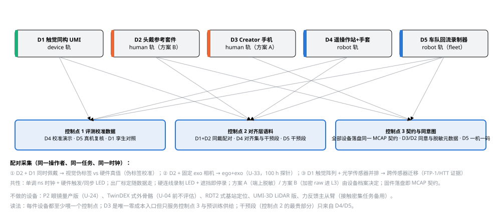

# 第 4 章 采集设备与机上录制

## 4.1 设备只为控制点服务

采集设备的选型逻辑不是"哪种设备采得多"，而是"每件设备喂哪个控制点"（[capture-devices-design.md](../capture-devices-design.md) §0）。本仓库规划了五件设备：

| 设备 | 轨 | 喂哪个控制点 | BOM 量级 | 为什么是它 |
|---|---|---|---|---|
| D1 触觉同构 UMI | device | 对齐集；触觉探针；演示库 | ≤$400；触觉版 +$300–600 | 观测同构构型；自采的理由是许可与末端匹配，不是缺数据 |
| D2 受控场地头戴参考套件 | human | 与 D1 同戴的配对集；脱敏对照 | $150–300 | 规格已收敛，做参考设计不做产能 |
| D3 Creator 手机采集套件 | human | 同意图与脱敏元数据；预训练供给 | ≈$0 + 支架 <$15 | 唯一零设备成本入口 |
| D4 遥操作站 + 数据手套 | robot | 对齐集与干预段；评测校准演示 | Quest 3 $500 + 手套 | 每任务只需几小时对齐数据 |
| D5 车队回流录制器 | robot（fleet） | 干预段；真机复核 | 机器人自带算力 + 512 GB | 单位价值最高的数据只在部署中产生 |

*图 D0-1（引自 capture-devices-design §0）　每件设备至少喂一个控制点；干预段只来自 D4/D5；D3 是唯一零成本入口。*

一个重要的战略裁决（U-24）：**原始人类视频供给外购而不自建头戴量产**，D2 止步 DVT 参考设计，不做 PVT。

## 4.2 末端：采集器与执行手共同设计

GR00T 2 的 DexUMI 与 XHAND 一一对应，Sunday 的手套复刻目标夹爪几何，TwinDEX 让人穿与机器人同构的外骨骼——多家都在走"采集器与执行手共同设计"（[gr00t2-trends-analysis.md](../gr00t2-trends-analysis.md) §3.1）。

本仓库的当前方向是 T/I/S 两节同构手（[inhouse-isomorphic-end-effector.md](../inhouse-isomorphic-end-effector.md)）：独立拇指 T、独立食指 I、后三指合组 S，各两节、加粗、有承载掌面；相机在拇食之间靠背侧，向掌心捏取区看。同一构型同时用于穿戴采集器（device 轨）和机器人执行手（robot 轨）。

这带来了几条数据层的硬要求（[data-format-contract.md](../data-format-contract.md) §1.4，设计待实现）：

- 单独版本化的末端档案，区分穿戴采集与执行手、左右、两节与历史二指版本；
- 人体测量、映射目标、实际发出的命令、机器人反馈**分别声明来源**——穿戴机械读数不是机器人已执行的动作；
- `/video/palm_left/right` 表示看抓取区的语义视图；
- 旧二指数据保留独立身份，不静默替换。

另一个契约级的趋势是：相机布局收敛为"头部 1 路 + 双腕 2 路"，**腕部相机安装位成为跨设备契约**。本仓库在本体工程冻结时把相机外参写进具身档案 `cameras.<name>.mount`，作为 D1/D2/D4 支架的共同基准（[robot-track-teleop.md](../robot-track-teleop.md) §1.1）。

## 4.3 五件设备的共性规范

不管哪件设备，都要满足同一组共性规范，缺任一层不进 record→export 验收（capture-devices-design §6）：

1. **时钟与同步总线**：单调 ns 时钟 + 启动时记录 UTC 偏移；有线场景 PTP，头戴/手持用硬件触发脉冲 + 同步 LED 事件。
2. **标定随数据走**：出厂内外参 + 时间偏移写进 `/meta/calibration`，哈希进 EpisodeMeta。
3. **隐私硬件三件套**：硬连线录制 LED（软件不可关）、遮挡或篡改即停录、物理停录开关。
4. **设备注册**：一机一码，固件签名，OTA 灰度，设备档案进 lineage。
5. **固件落盘即 MCAP 契约**：`/meta/health` 1 Hz、关键帧间隔 ≤1 s、chunk 4 MB/1 s flush、断电可恢复。

还有一条采集 SOP 的共性：每个任务模板附带"扰动-恢复"子任务，专门产出恢复数据。

## 4.4 recorder 的写入模型

`fdp record` 是 robot 轨遥操作站、自研头戴设备固件和 device 轨设备的共同录制规范（[recorder-sync-and-storage.md](../recorder-sync-and-storage.md)）：

- **单进程 MCAP writer**，多生产者经有界队列投递。队列满时**先丢低优先级流**（预览、健康），再丢高优先级流（动作、视频关键帧），丢弃计数写进 `/meta/health`。
- **flush 与 fsync**：每 chunk 4 MB 或 1 s 先到即 flush；每 5 s 或每个关键帧组 fsync 一次。
- **分段**：2 GB 或 10 分钟切换 part；每个 part 头部重复写 `/meta/episode` 和 `/meta/calibration`，任一文件可独立解析。
- **结束标记**：episode 结束写最终 `/meta/episode`（含 `duration_ns`）。缺失即表示非正常结束，ingest 会补并打 `flag:abnormal_end`。

## 4.5 带宽与存储预算

| 配置 | 视频 | 合计写入 |
|---|---|---|
| robot 轨：3 路 1080p30 h264 @ 8 Mbps + 200 Hz 状态/动作 + 触觉 | 24 Mbps | ≈ 11.5 GB/h |
| 自研头戴：1440p60 h265 @ 20 Mbps + 2 路灰度 SLAM + 双 IMU | 28 Mbps | ≈ 13 GB/h |
| UMI（GoPro 原生） | 60–100 Mbps | 27–45 GB/h（入湖转 AV1） |

写入介质要求持续 ≥20 MB/s（留 5× 余量）。一个班次 4 小时约 52 GB，256 GB 设备存储可撑 4–5 个班次不回传。

**环形缓冲的铁律**：只有已确认上传（服务端哈希回执）的 part 才可被覆盖；未上传数据占满时**停止录制并提示，不覆盖**。剩余 <10% 关预览流并降码率一档，<5% 停录。

## 4.6 断电与崩溃恢复

- 已 fsync 的 chunk 全部可恢复；未 fsync 的最多丢 5 s；缺失的尾部索引由 ingest 线性扫描恢复。
- 崩溃后重启：发现未关闭的 part → 写恢复标记、新开 part 续录**同一 episode**（`/meta/segment` 记录续接关系），不新开 episode。
- **M1 验收必做**：录制中随机断电 20 次，要求 100% 文件可被 ingest 恢复、丢失时长 ≤5 s、无静默数据错位（用已知同步事件验证对齐仍在预算内）。

"无静默错位"这一条最容易被忽略。文件能打开不等于数据对：如果断电导致某路流的时间基准漂了，文件完全可读，但视觉和动作已经错开。所以恢复测试必须用同步事件验证对齐。

## 4.7 非自研录制端

P0 阶段的手机和 GoPro 不要求机上写 MCAP，只需满足输出要求：视频 + 遥测（GPS 剥离）+ 录制起止 UTC 时间；App 写一份等价于 `/meta/episode` 的 sidecar JSON（`episode_id`、`session_id`、`device_id`、`consent_ref`、`region`、任务模板 id、口令时间戳）；多设备同录时开始和结束各做一次 LED 闪烁 + 拍手。ingest 负责拆流转 MCAP。

## 4.8 遥操作站与接管打点

robot 轨的遥操作站默认用 Quest 3 手追，接口抽象为 `Teleoperator` 协议，可替换为 AVP、GELLO 或带力反馈的主从臂（[robot-track-teleop.md](../robot-track-teleop.md) §2–§4）。三个数据层要点：

1. **闭环延迟测量**：每帧同时记录 `command_time`（遥操作端发出）与 `publish_time`（机器人执行），端到端 ≤150 ms，超过标 `flag:teleop_latency`。
2. **即时质控**：episode 结束即给操作员打分（平滑度、时长、静止占比、是否完成），采集时反馈比事后返工便宜得多。
3. **接管打点由遥操作站写，不是事后标注**：`/event/intervention` 的 `takeover_start / takeover_end / estop / reset`，精度 ≤ 一个控制周期（10 ms），带原因枚举和被接管的策略版本。混合 episode（策略自主 + 人接管）是经验后训练的素材，必须保留策略段与人工段的边界。

操作员纪律：每班次 ≤4 小时，每小时强制 10 分钟休息（质量随疲劳下降是 DROID 的经验）。

## 4.9 本章小结

- 设备选型看它喂哪个控制点；原始人类视频外购，自采只做对齐与校准所需的量。
- 采集器与执行手共同设计；腕部相机安装位是契约。
- 共性规范五层：时钟、标定、隐私硬件、设备注册、落盘契约。
- recorder 的三条铁律：队列满先丢低优先级、未上传不覆盖、断电后不静默错位。
- 接管打点在采集端实时写，不靠事后标注。

**延伸阅读**：[capture-devices-design.md](../capture-devices-design.md) · [recorder-sync-and-storage.md](../recorder-sync-and-storage.md) · [robot-track-teleop.md](../robot-track-teleop.md) · [device-landscape.md](../device-landscape.md) · [client-capture-to-training-report.md](../client-capture-to-training-report.md)
