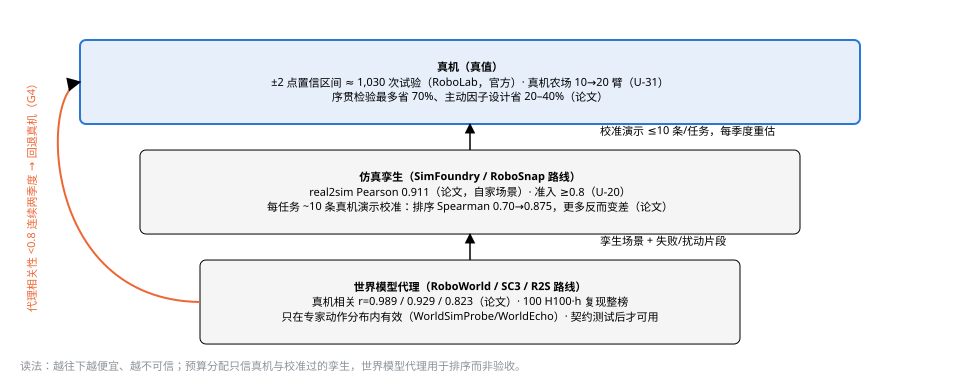
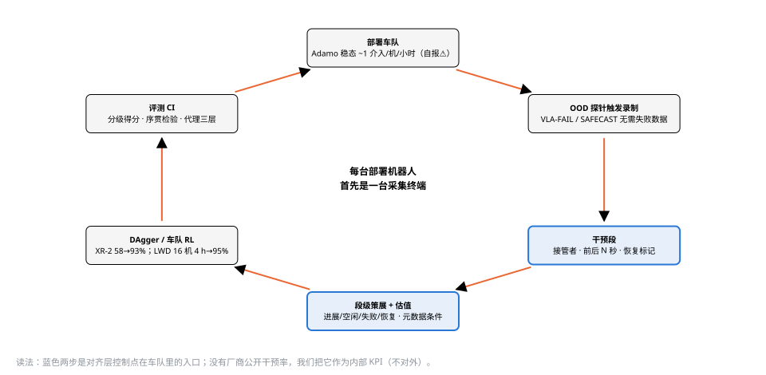

# 第 14 章 评测与回流闭环

数据飞轮转没转，只有一个证据：**数据改动之后，评测涨了没有。** 这一章讲评测的口径（什么叫"显著优于"）、checkpoint 的排名方法、仿真与真机的关系、车队回流，以及把这些串起来的回流闭环。

## 14.1 诚实性协议

先讲为什么评测要设计得这么严。Figure 的关键宣称有第三方反驳先例：BMW 曾公开反驳其部署宣称（单台、非生产时段 vs "每天端到端运营"）；81 小时分拣直播被质疑有遥操作痕迹（第三方，[architecture.md](../architecture.md) §4）。

所以本仓库的评测协议要求：**可复现日志 + 干预率记录**，杜绝"零干预"式不可验证宣称。对外任何能力宣称必须能指向一个 run_id 及其日志。

## 14.2 指标字典

[eval-protocol.md](../eval-protocol.md) §1 是本仓库所有"显著""达标""收益"的唯一定义。

**数据侧**：通过率漏斗、可用训练小时、每可用训练小时全成本、多样性计数（按词表版本报）、伪标签质量、同步残差 P95、欺诈检出率。

**模型侧**：

| 指标 | 定义 |
|---|---|
| 成功率 | 任务模板完成判据为真的 trial 比例，**一起报 95% Wilson 区间** |
| 任务进度分 | 子任务完成数 / 子任务总数的均值 |
| 介入率 | 接管次数 / 自主运行小时；接管时长占比 |
| 吞吐 | 每小时完成任务数（营业级指标） |
| 少样本适应 | 三个刻度并列：1 条演示零梯度；1–5 分钟数据 10 步微调；≤10 h 全量后训练 |
| OOD 分轴 | 背景 / 光照 / 物体 / 场地四轴各自的成功率下降 |

**规模侧**：L(D) 拟合报 α、D_c、R²，数据每翻倍重拟合；多样性幂律按场景数、物体数、操作者数各自拟合。

## 14.3 消融判定规则

- **单位**：一次消融 = 同一代码 commit、同一超参、只变一个因子。
- **显著性**：仿真 ≥3 seed，报均值 ± 标准差；真机每任务 ≥20 trial；Fisher 精确检验（成功率）或 Welch t（进度分），α = 0.05；**效应量至少 5 个百分点才算收益**。
- **功效预估**：20 trial 检测 25 个百分点差异的功效约 0.8；检测 10 个百分点需 ≥80 trial。**报告必须注明本次功效。**
- **Stage A 放行**：仿真自建任务集上微调后成功率 − 零样本 ≥10 个百分点且 p < 0.05，3 seed。
- **Stage B 止损**：0→1 预训练模型不低于 Stage A 微调对照（差 <5 个百分点视为持平，持平不放行）。
- **阈值裁决**：严格化后指标不涨（<5 个百分点且不显著）一律回退。

功效这一条特别重要。20 trial 的真机评测只能检出很大的差异；如果报告说"A 和 B 没有显著差异"，而功效只有 0.3，这个结论几乎没有信息量。

## 14.4 真机协议模板

每次真机评测填写并存档 `data/eval/<run_id>/protocol.yaml`：策略与基线的 checkpoint、数据集版本与配方哈希；具身与固件；每任务 ≥20 trial、ABAB 交替、操作员盲测；≥3 个场景且至少一个 held-out 场地；种子化物体摆放（照片存档）；成功判据版本；接管策略；MCAP 全量记录且 rollout 回流入湖；报告成功率 + Wilson 区间、进度分、介入率、吞吐、失败案例视频索引。

## 14.5 checkpoint 排名：盲测 A/B + Bradley-Terry

绝对成功率会随采集站、操作员、硬件和日期漂移，不同场次的数字不能直接比。挑 checkpoint、比配方时要回答的是"哪个更好、好多少、有多确定"。做法参照 NVIDIA GearArena（自报 ⚠️，eval-protocol §3.1）：

- **一次 trial**：同一场景、同一操作员、几分钟内，以随机顺序跑 2–4 个 checkpoint，操作员不知道哪个是哪个，给出排序。漂移由同组共享，在比较中抵消。
- **评分**：所有成对比较拟合 Bradley-Terry，换算成 Elo；每个任务等权；置信区间**按任务**重采样 bootstrap（独立单位是任务，不是 trial）。
- **接入**：新 checkpoint 先和当前榜首对打，保证评分在一个连通的尺度上。
- **任务集维护**：所有 checkpoint 都能完成的任务归档，都完成不了的搁置——两者都不区分模型。
- **边界**：GR00T 2 报告 30–35% 的比较是平局，任务少时区间很宽，报告必须注明比较数和任务数。

## 14.6 仿真：相对比较可以，绝对能力不行

| 基准 | 用途 |
|---|---|
| LIBERO（四套件） | 每 checkpoint 回归；社区可比 |
| SIMPLEREnv | real-to-sim 一致性 |
| Isaac Lab-Arena 自建任务集（与真机任务模板一一对应；场景用 SimFoundry 从真机评测场地视频重建） | 消融主战场 |
| RoboTwin 子集 | 双臂 |
| 长任务规划基准（SimFoundry 孪生 + BDDL 逐步校验 + 扰动） | S2 规划 |

仿真基准用的具身与目标本体不同（LIBERO 是 Franka），所以仿真结论**只用于相对比较**（配方 A vs B），绝对能力以真机为准。

### sim-real gap 探针与相关性门

- 同任务的 `teleop_replay` 与真机 episode 比轨迹 RMSE 与成功率差；gap >20 个百分点的任务簇标"仿真不可信"。
- 场景级保真度：同一组策略在孪生场景与真机各跑 ≥20 trial，报 Pearson r 与 MMRV。SimFoundry 论文值 0.911 / 0.018；我们的门槛 r ≥0.8。
- GR00T 2 用 14 个 checkpoint 标定后，仿真与真机的进度、成功率、Elo 的 Pearson r 在 0.92–0.93（自报 ⚠️）。标定后仿真承担三件事：checkpoint 追踪与候选收窄、**数据管线改动的回归**（loader、配方改动先跑小规模训练 + 闭环仿真）、推理设置初筛。三项都过门槛的任务簇才允许用仿真替代真机做这三件事；最终放行仍以真机为准。



*图 3（引自 data-strategy-roadmap §1.5）　评测三层代理与各自的可信度：真机是真值但每 ±2 点需约 1,030 次试验；仿真孪生用每任务约 10 条真机演示校准；世界模型代理与真机相关最高 0.989，但只在专家动作分布内有效。代理相关性连续两季度 <0.8 即回退真机（G4）。*

## 14.7 车队回流

部署中的机器人用同一个 recorder 记录自主 rollout（`source="fleet"`，`policy_version` 与 `deployment_id` 必填），回坞批量卸数（[robot-track-teleop.md](../robot-track-teleop.md) §6、[runtime-and-deployment.md](../runtime-and-deployment.md) §3–§4）：

- **带宽有限时的优先级**：含接管、OOD、失败的 episode 优先上传；成功 episode 抽样 20%。
- **用途优先级**：奖励分类器素材 > 纠错片段（接管前后各 5 s）> 成功 rollout 进 SFT；失败 rollout 不进 SFT，只进 RL。
- **OOD 事件**：动作块一致性差、观测 embedding 偏离训练分布、任务进度停滞、力/触觉超限，任一触发即记 `/event/ood`，与接管一起对齐到 episode 时间轴，是 RL 闭环的负样本来源。
- **再训练触发**：接管率周环比上升 >30%，或某任务簇成功率跌破阈值 → 开经验后训练 run（Stage D）。
- **train/serve skew 的三大来源**（相机语义映射、归一化统计、分辨率阶梯）全部由 export 产物驱动，不在运行时手写。

干预段是最贵的对齐层数据：只在自家部署中产生，没有厂商公开干预率。在车队到位之前，用配对集 + DAgger 替代，首批部署当采集车队而非收入来源（roadmap §2.5）。

## 14.8 回流闭环：一轮的步骤

这是 2026-11-17 新增的跨层流程（[data-pipeline-design.md](../data-pipeline-design.md) §9）：

```
触发：评测报告 或 车队回流（干预、失败、OOD 事件）
  1. 失败归类：每个失败片段按失败模式词表打标
  2. 反查：用失败片段做挖掘查询，看训练集中相近样本的数量和质量
  3. 诊断，三选一或组合：
       数据少          → 采集配额（下发采集任务，带 collection_rule）或合成种子
       数据有但被过滤  → 检查对应阈值是否过严（走消融，不直接改）
       数据有但标错    → 打标规范待裁决 + 重映射
  4. 生成新数据集版本，写 manifest
  5. 再评测：按统计判定规则比较前后版本
  6. 评测不涨 → 本轮数据改动回退
```

第 3 步是整条闭环的核心：**失败的原因只有三种——缺数据、数据被误杀、数据标错**，每种对应管线的一个不同环节。挖掘（第 11 章）就是做这个诊断的工具。



*图 4（引自 data-strategy-roadmap §1.6）　车队数据飞轮：部署机器人在 OOD 探针触发下录制干预段，经段级策展与估值进入 DAgger / 车队 RL，新 checkpoint 过评测 CI 再部署。*

## 14.9 loop 记录

每一轮写一条 loop 记录：触发来源、失败归类统计、执行的查询与快照、采取的动作（配额 / 合成 / 重加权 / 重标）、产出的数据集版本、评测前后对比、结论（保留 / 回退）。对应 lineage 的 `loops` 表。

这条记录是"数据飞轮转了没有"的**唯一证据**，也是向管理层汇报数据投入产出的依据。数据系统的"闭环有效率"指标 = 评测提升的轮次 / 总轮次。

节奏：M3 起按评测节奏运行（每个配方 A/B 周期一轮）；单任务部署场景（如洗衣分类大脑的每周难例集）可以更快，但走同一记录格式。

## 14.10 本章小结

- 诚实性协议：可复现日志 + 干预率；对外宣称必须能指向 run_id。
- 显著性看 Fisher/Welch + 效应量 ≥5 点 + 功效声明。
- checkpoint 排名用盲测成对比较 + Bradley-Terry，按任务 bootstrap。
- 仿真只做相对比较；过了相关性门才能替代真机做回归和初筛。
- 车队回流：失败与接管优先，失败不进 SFT 只进 RL。
- 回流闭环：失败归类 → 反查 → 缺数据 / 被误杀 / 标错三选一 → 新版本 → 再评测 → 不涨就回退；每轮一条 loop 记录。

**延伸阅读**：[eval-protocol.md](../eval-protocol.md) · [data-pipeline-design.md](../data-pipeline-design.md) §9 · [runtime-and-deployment.md](../runtime-and-deployment.md) · [robot-track-teleop.md](../robot-track-teleop.md) §6 · [research-gr00t2.md](../research-gr00t2.md) §4.8
