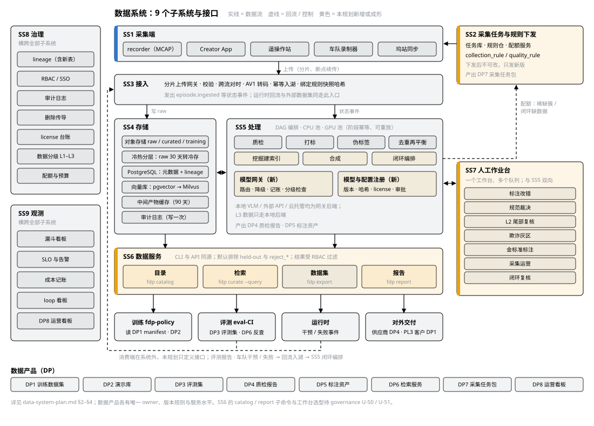

# 第 15 章 数据平台与数据系统

前面的章节按"数据被处理的顺序"讲管线。这一章换一个角度：要支撑这条管线，需要建哪些子系统、交付哪些数据产品、要多大容量、花多少钱、谁来运营（[data-system-plan.md](../data-system-plan.md)、[data-platform.md](../data-platform.md)）。

## 15.1 九个子系统



*图 DP2（引自 data-system-plan §3）　数据系统的 9 个子系统：采集端 → 接入 → 处理（读写存储）→ 数据服务 → 消费端；人工作业台和治理、观测横跨各层。*

| 子系统 | 职责 | 状态 |
|---|---|---|
| SS1 采集端 | 录制、本地缓冲、上传；接收任务 | 已有规范 |
| SS2 采集任务与规则下发 | 任务库、规则快照、配额、下发与回执 | **新增** |
| SS3 接入 | 上传网关、校验、对时、转码、幂等入湖 | 已有规范 |
| SS4 存储 | raw / curated / training 三区、元数据、向量、缓存 | 已有规范 |
| SS5 处理 | 质检、打标、伪标签、去重再平衡、挖掘、合成；**模型网关**与**处理模型和配置注册** | 部分新增 |
| SS6 数据服务 | 目录、检索、数据集构建与导出、报告分发 | **新增** |
| SS7 人工作业台 | 标注改错、审核、规范裁决、采集运营、欺诈灰区 | **新增** |
| SS8 治理 | lineage、权限、审计、删除传导、license 台账 | 已有规范 |
| SS9 观测 | 漏斗、SLO、成本、闭环记录、告警 | 已有规范 |

几个新增子系统的要点：

- **模型网关**：所有 VLM 和模型调用经过一层薄网关，负责记账、数据分级检查、按阶段设日预算、超限自动降级到本地模型。自建，因为"记账、分级、降级"是我们的规则。
- **处理模型与配置注册**：每个阶段用的模型版本、权重哈希、配置哈希都在这里登记，lineage 引用它。
- **人工作业台**：curation 的五个人工触点（欺诈灰区、L2 尾部复核、VLM 分歧队列、伪标签金标准抽检、规范待裁决队列）合进一个统一工作台的多个队列视图。界面采购，队列和规则自建（U-51）。

## 15.2 八类数据产品

数据产品是规划的单位：先定义产品和消费者，再倒推子系统（data-system-plan §2）。

| 编号 | 数据产品 | 消费者 | 版本规则 | 服务水平 |
|---|---|---|---|---|
| DP1 | 训练数据集（LeRobot v3 + 冻结 manifest） | 训练、PL3 客户 | `dataset_version`，只增不改 | H1 规模 ≤24 小时 |
| DP2 | 演示库（切片 + embedding + 槽位描述） | in-context 训练、fewshot-bench | 随索引版本 | 检索 P95 ≤2 s |
| DP3 | 评测集（held-out + 真机/仿真任务集） | 评测 | `split_version` 冻结 | 永不回流训练 |
| DP4 | 质检报告（episode + 批次） | 采集运营、供应商、客户 | 报告 schema 版本，字段只增不删 | 规则段 ≤1 小时；完整 ≤24 小时 |
| DP5 | 标注资产 | 数据集构建、检索 | 规范版本 + 离线重映射 | 金标准回归不退步才发布 |
| DP6 | 检索服务 | 训练、评测、闭环、采集运营 | 查询哈希 + 模型版本 | P95 ≤2 s |
| DP7 | 采集任务包 | Creator App、采集员、供应商 | 规则文件版本化 | 下发后不可改，只能发新版 |
| DP8 | 运营看板 | 管理层、各 owner | — | 日更 |

每个数据产品有唯一 owner。

## 15.3 lineage：整个系统的骨架

lineage 不是一个附加功能，而是让"标记不删除""阈值可消融""删除可传导""数据集可复现"同时成立的那张表（data-platform §3，data-pipeline-design §10.1）：

```
episodes(episode_id, session_id, track, source, state, meta, storage_uri, content_hash, ...)
sessions / devices / operators
artifacts(artifact_id, episode_id, stage, kind, model_name, model_version, weight_hash, config_hash, uri, ...)
decisions(decision_id, episode_id, stage, verdict[pass|flag|reject], flags[], score, config_hash, model_ref, ...)
datasets(dataset_version, manifest_uri, mixture_config_hash, split_version, ...)
dataset_episodes(dataset_version, episode_id, shard, split)
training_runs(run_id, dataset_version, mixture_config_hash, code_commit, checkpoint_uri, eval_report_uri)
deletions(request_id, subject, requested_at, propagated_to[], completed_at)
-- 2026-11-17 提议新增
qc_reports / annotation_specs / arbitrations / queries / query_snapshots / loops
```

三条规则：

1. 每个策展阶段写一行 `decisions` 与零到多行 `artifacts`；
2. **模型升级 = 新 `model_version`，历史 decision 不改**；
3. 删除请求沿 `dataset_episodes → training_runs` 查出受影响的模型并记录。

## 15.4 版本化配置目录

所有规则、规范、查询、配方都是文件，改动 = 新版本、不覆盖、哈希进 lineage（data-pipeline-design §10.2）：

| 目录 | 内容 |
|---|---|
| `configs/qc/collection_rules/` | 任务标准步骤、允许物体与场景、必需流 |
| `configs/qc/quality_rules/` | 质检阈值、状态机、校验规则 |
| `configs/annotation/spec/` | 标注规范（人读 + 机器可判定） |
| `configs/annotation/profiles/` | 标注档案 |
| `configs/queries/` | 挖掘查询 |
| `configs/synthesis/` | 合成本体档案与参数 |
| `configs/sim/randomization/` | 域随机化 |
| `configs/mixtures/` | 训练配方 |
| `configs/embodiments/` | 具身档案（关节顺序、限位、相机映射与安装位、槽位映射） |

截至成书日，`configs/` 下只有 `embodiments/` 与 `mixtures/` 两个目录，其余为提议，实现时创建。

## 15.5 容量与成本

**存储**（data-platform §1.2，按每月可用小时 H，含未通过策展的原始上传 ≈3H）：

| 阶段 | H | raw/月 | 12 个月累计 |
|---|---|---|---|
| H0 | 100 h/月 | 1.5 TB | ~25 TB |
| H1 | 1,000 h/月 | 15 TB | ~250 TB |
| H2 | 10,000 h/月 | 150 TB | ~2.5 PB |

raw 永存意味着 raw 区只增不减，所以**分层存储**：raw 入湖 30 天后转冷存，curated/training 热存，可重算的中间产物 90 天后删除（不违反 raw 永存）。

**月费**（H1 口径，2026 年公有云挂牌价量级）：存储约 $0.7k，策展算力 $3–5k，场景重建 $0.5–1k，托管服务 $0.5–1k，合计约 **$6–8k/月**，即每可用小时 $6–8 平台成本（不含计酬与设备）。

**新变量是 VLM 调用量和向量索引，不是存储**（data-system-plan §6）：

- 按某大模型厂商单次验证口径（自报 ⚠️）外推，H1 语义质检约需 4 个持续并发槽，按 6 个规划；
- 打标和合成的算力**没有可信口径**，M2 前半用 50 小时样本实测、M3 前用 10 小时样本实测；
- 子任务段向量 H1 一年 4–9M 条，约在第一年末到 pgvector 的 1e7 切换点；
- 规则：**合成的单位成本超过同等数据的采集成本时，不扩量**。

## 15.6 SLO

| 指标 | SLO |
|---|---|
| ingest 延迟（上传完成 → ingested） | P95 ≤1 小时 |
| 规则段质检报告 | P95 ≤1 小时 |
| 完整质检报告 | P95 ≤24 小时 |
| 打标周转 | P95 ≤72 小时 |
| 采集 → 可训练时延 | P50 ≤3 天，P95 ≤7 天 |
| 质检一致性（同一样本重跑结论一致） | ≥98% |
| 死信队列 | 0 积压 >24 小时 |
| 欺诈红队检出率 | ≥95% |
| 删除请求完成 | 30 天 |
| 闭环周期 | 一个配方 A/B 周期内 |

"质检一致性"值得单独说：如果同一条数据重跑两次质检结论不同，那么所有基于质检的消融都没有意义。VLM 的非确定性让这一条并不容易做到。

## 15.7 自建与采购

**自建**：状态机、质检规则、标注规范、查询、配方、lineage 语义、模型网关。这些是资产不贬值、可迁移的前提。

**采购或开源**：对象存储、元数据库（PostgreSQL）、向量库（pgvector → Milvus/Qdrant）、编排（Prefect/Dagster）、批计算（Ray）、标注界面、可视化（rerun、Foxglove）、训练算力。

**底座是采购问题，不是设计问题**（data-pipeline-design §11）。如果业务方要求数据不出其云，可以把存储、调度、批计算、训练托管到云厂商，本仓库的模块作为其上的作业运行——前提是确认数据导出能力、lineage 能否完整记录、成本，以及闭源合成平台的三问（第 10 章）。裁决见 U-49。

## 15.8 运营与组织

- **不设"数据标注团队"**：标注走 VLM 初标 + 分层人工抽检 + 外包审核员，避免形成固定成本中心（roadmap §4.3）。
- **人工编制估算**（H1，1,000 小时/月入湖）：欺诈灰区 2 人、L2 尾部 + 分歧样本 2 人、金标准抽检 1 人，共约 5 人/千小时·月，随信誉体系成熟下降（curation §9）。
- **审核员一致性**（Cohen's κ）每月抽测，<0.7 重训指南；审核员只看脱敏预览流，raw 不进审核台。
- 数据引擎按四个组组织：数据平台与契约、策展与对齐算法、评测与闭环、采集与 Creator 运营；**评测负责人先于采集扩张到岗**（U-27）。

## 15.9 本章小结

- 九个子系统，新增任务下发、模型网关与注册、数据服务、人工作业台。
- 八类数据产品各有 owner、版本规则和服务水平。
- lineage 是骨架：模型升级不改历史决策，删除沿链传导。
- 所有规则都是版本化文件。
- 容量的新变量是 VLM 调用和向量索引；未知的算力口径先实测。
- 逻辑自建、底座采购；不设固定标注团队；评测先于采集扩张。

**延伸阅读**：[data-system-plan.md](../data-system-plan.md) · [data-platform.md](../data-platform.md) · [data-pipeline-design.md](../data-pipeline-design.md) §10–§11 · [program-plan.md](../program-plan.md)
