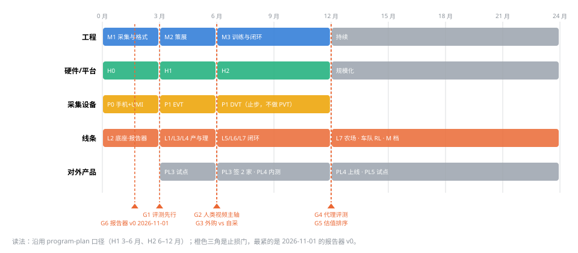
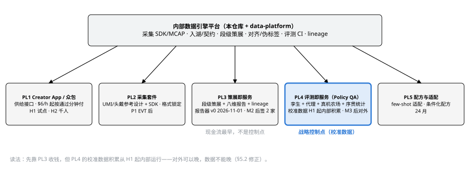

# 第 17 章 建设路线与尚未解决的问题

## 17.1 先建什么

建设顺序与某大模型厂商自己的成熟度标注一致（[data-pipeline-design.md](../data-pipeline-design.md) §12）：**质检已交付、打标是成熟方案、挖掘是长期方案、合成是联合训练方案**。理由与"质量优先于吞吐"相同——质检是唯一能在没有模型、没有本体的阶段就产生价值的环节。

| 阶段 | 内容 | 依赖 | 验收 |
|---|---|---|---|
| **M1** | 入湖 + 采集规则快照绑定；质检规则段 + 报告骨架；LeRobot 导出 | 无模型、无本体 | 外部样本数据集跑通入湖→规则段→报告→导出；报告字段稳定 |
| **M2 前半** | 质检语义段与报告段；打标边界与描述两段 + 确定性后处理；标注规范 v1 + 待裁决队列；金标准集与两把尺子 | VLM 可用（本地 Qwen-VL 起步） | 金标准集上有基线；质检报告可对采集供应商交付 |
| **M2 后半** | 去重再平衡；检索底座（SigLIP 基线 + 成对难查询基准）；演示库；查询即配置 | 打标槽位产出稳定 | 检索基准有基线；manifest 可引用查询快照 |
| **M3** | 人类视频→机器人演示合成；世界模型接入；回流闭环与 loop 记录；检索候选升级 | 训练与评测栈可用 | 至少一轮完整闭环且有评测前后对比；合成组的消融结论 |

**M1 的出口条件**（[data-system-plan.md](../data-system-plan.md) §10）：一个外部开放数据集和一批自采数据走通"入湖 → 规则段质检 → 报告 → 导出 → 训练读入"；规则段报告字段冻结为 v1；**lineage 能从任一训练分片追到 raw**。

**前 8 周**（data-system-plan §10）：冻结质检报告 schema v1 与规则文件格式；ingest 接上规则快照哈希、规则段质检落地；lineage 核心表与事件表上线并跑通外部数据集端到端；模型网关最小版（本地 VLM + 记账）；工作台选型试用；指标字典增补与运营看板骨架。

## 17.2 0–24 个月时间线

*图 10（引自 data-strategy-roadmap §4.1）　工程 M1–M3、硬件 H0–H2、采集设备 P0→P1 EVT→P1 DVT（止步，不做 PVT）、线条推进、对外产品 PL3/PL4，橙色三角为止损门 G1–G6。*

| 阶段 | 一句话目标 | 放行判据（摘） |
|---|---|---|
| 0–3 月（M1 / H0 / P0） | 把底座与评测先立起来，再谈采集 | 一条真实 episode 被 openpi/lerobot 不改代码读入；伪标签在仿真可见收益；八维报告器 v0 可出报告 |
| 3–6 月（M2 / H1 / P1 EVT） | 对齐层与段级策展成型 | 每可用训练小时全成本 < 遥操作 1/5；human 轨 OOD 增益显著 |
| 6–12 月（M3 / H2 / P1 DVT） | 评测反向绑采集跑通一圈 | 北极星 ≤20 真机小时 / ≤$5k；代理相关性 Pearson ≥0.8；干预率基线建立 |
| 12–24 月 | 规模化与对外产品 | 北极星 ≤5 真机小时 / ≤$1k；代理 Spearman ≥0.85 |

资源冲突时的优先级（roadmap §4.2）：**校准数据与对齐集 > 策展 > 评测工具 > 采集吞吐**。采集吞吐永远可以外购，自家本体 × 自家任务的评测校准数据与对齐集不能。

## 17.3 止损门

好的路线图要写清楚"什么情况下停"（roadmap §4.5）：

| 门 | 时点 | 判据 | 触发后 |
|---|---|---|---|
| G1 评测先行 | 3 月末 | 分级得分协议与序贯检验未在 3 任务簇 × ≥3 策略变体上跑通 | 冻结采集扩量，只做底座 |
| G2 人类视频主轴 | 6 月末 | 等小时消融 human 轨 OOD 增益不显著 | human 轨降回"规模腿"，预训练主体改 device + 开源大集 |
| G3 外购 vs 自采 | 6 月末 | 自采 device 轨全成本 > 外购价 1.5× | 停自采改外购 |
| G4 代理评测 | 孪生进 CI 后第二季度末 | 代理 Pearson <0.8 连续两季度 | 评测回退真机，sim 轨预算减半 |
| G5 估值排序 | 12 月末 | 估值 top-50% 训练不优于随机 50% | 回退到 QC 门，影响函数线停 |
| G6 合规（商业口径） | 2026-11-01 | 中国训练场客户要求八维报告而报告器未上线 | PL3 中国签约延后一季度 |

## 17.4 一个内部引擎，五条产品线

数据引擎对外的产品化（roadmap §5）：PL3 策展即服务现金流最早；PL4 评测即服务是战略控制点，校准数据从 H1 起内部积累，**对外可以晚，数据不能晚**；PL1/PL2 做供给接口与格式锁定；PL5 在 24 个月。

*图 11（引自 data-strategy-roadmap §5.1）　一个内部数据引擎支撑五条对外产品线。*

第 8 章说质检报告"字段只增不删"、第 15 章说 DP4 要对外交付，原因就在这里：质检报告本身就是 PL3 的交付物。

## 17.5 尚未解决的问题

最后列出几个连领先团队自己也没解决的问题。它们决定了本书描述的很多设计只能是"带探针的假设"。

### 汇率

人类视频一小时顶几小时遥操作？GR00T 2 只证明人类视频的边际收益为正，没有给出换算；人类视频缩放曲线每档只训一次，1%→10% 在噪声内（[gr00t2-trends-analysis.md](../gr00t2-trends-analysis.md) §5）。任何按他家配比照搬预算的做法都没有依据。**只能靠 U-40 的换算率实验自己测。**

### 伪动作的上限

人类视频丢了主动感知；生成视频"几何幸存、控制信号丢失"。GR00T 2 的人类视频收益主要来自视频预测损失，动作损失依赖手部位姿精度——这层精度在我们这里还没有基线。伪标签金标准抽检（第 10 章）是第一个探针。

### 触觉与力

人类视频不含触觉与力反馈，Index 类数据能撑多深的接触密集操作未被证明（architecture §6）。残差 RL 的力觉变体在接触密集任务 50%→93%（论文）说明力信号有价值，所以契约 0.3 预留了力类动作槽位、D1 规划了触觉 UMI 对照集——但"需要多少触觉数据"仍是开放问题。

### 自动验证不可靠

拧到一半的螺丝被模型和 agent 都判为完成（GR00T 2 自述）。标注引擎化、agent 质检、世界模型评测器都有同一个盲区：它们在专家分布外的判断不可信。所以本书反复强调**保留人工金标准审计，不能完全去人**。

### 灵巧度与端侧压缩的冲突

GR00T 2 的压缩版在灵巧手上掉一半成功率（自报 ⚠️）。"端侧够跑"只对夹爪类任务成立；灵巧手上机的延迟和精度仍然要折中。这会反过来影响数据：如果部署模型必须压缩，训练数据的分辨率、帧率、动作块长度可能都要按末端类型分档。

### 宣称的可信度

最后，也是最朴素的一条：行业里的数字大多是自报的，有第三方反驳的先例。架构设计不能按宣传口径过度乐观。治理表的 D 栏、"若不成立"分支、评测的诚实性协议，都是为此准备的。

## 17.6 全书小结

如果只记住一页，记住这些：

1. 瓶颈不是"采不到"，而是"对不齐、验不了、用不上"。原始小时是输入，不是资产。
2. 七条决策：双格式、四轨同 schema、分层采样率、策展五阶段、AV1 + yuv420p、质量优先、训练保守。
3. 时间对齐只用 `publish_time`，误差预算以一个控制周期为界，标定随数据走。
4. 清洗是标记不是删除；标记变成列，训练选视图，消融只是换视图。
5. 质检先交付：规则段零模型、语义段先粗后细、报告是交付物。
6. 先定边界再写描述；两把尺子；描述槽位化；标注是可重算的派生物。
7. 合成由挖掘驱动、按 source 成组、评测集永不含合成数据。
8. manifest 钉住一切版本；held-out 入湖即固定、永不回流。
9. 评测口径先于结论：Wilson 区间、效应量、功效、按任务 bootstrap。
10. 回流闭环只有三种诊断：缺数据、被误杀、标错；每轮一条 loop 记录，不涨就回退。
11. lineage 是骨架：可复现、可消融、可删除，三者同源。
12. 不确定性要登记：风险、未决、自报数字，每条有 owner 和"若不成立"。

**延伸阅读**：[data-strategy-roadmap.md](../data-strategy-roadmap.md) §4–§6 · [program-plan.md](../program-plan.md) · [data-system-plan.md](../data-system-plan.md) §10 · [plans-review-hard-points.md](../plans-review-hard-points.md) · [governance.md](../governance.md)
