# 关键数据采集设备设计：五件套（对齐控制点、契约 0.3 与 M/H/P 里程碑）

> 2026-09-12。本文把 [data-strategy-roadmap.md](data-strategy-roadmap.md) 的 L1 线条与 §2.5 三个战略控制点落到五件具体设备上，每件给出定位、规格、同步与标定、机上处理、契约映射、BOM、里程碑、验收与负设计。规格来源：仓库既有设计（[index-replica-plan.md](index-replica-plan.md) §1、[device-track-umi.md](device-track-umi.md)、[robot-track-teleop.md](robot-track-teleop.md)、[recorder-sync-and-storage.md](recorder-sync-and-storage.md)、[architecture.md](architecture.md) §8）加 2026-06..09 扫描证据（觅蜂 MEgo 规格收敛、YUBI、RealDexUMI、Koala、T-800、TactiDex、EgoKit、EgoLive JoyEgoCam、Isaac Teleop + MANUS、TAMEn、VLA-FAIL/SAFECAST）。已裁决项：U-23 动作 schema、U-24 头戴不量产、U-25 触觉进契约、U-09 力信号双探针、U-33 ego+exo 探针、U-31 评测农场。本文不设计 P2 眼镜、外骨骼（U-04 前不评估）、评测农场臂（U-31，属评测基础设施）。

## 0. 选型逻辑：设备只为控制点服务

| 设备 | 服务的轨 | 喂哪个控制点 | 里程碑 | BOM 量级 | 为什么是它 |
|---|---|---|---|---|---|
| **D1 触觉同构 UMI** | device | 控制点 2 对齐集；R-04 触觉探针（决策 3）；演示库 | P0 平行夹爪 ×2 → H1 触觉 EVT ×4 → U-04 后同构版 | ≤$400；触觉版 +$300–600 | 观测同构满分构型（device-landscape §7 公理①）；触觉 88.75% vs 70%（RealDexUMI，论文）；自采理由是许可与末端匹配，不是缺数据 |
| **D2 受控场地头戴参考套件** | human（方案 B） | 控制点 2 的配对集（与 D1 同戴）；U-32 脱敏对照；U-33 ego+exo | H1 EVT 10–50 台 → DVT 参考设计开源，不做 PVT（决策 2） | $150–300；EVT 含 NRE ≈$600 | 规格已收敛（觅蜂：双目/深度/60 fps/硬同步/标定），做参考设计而不是产能 |
| **D3 Creator 手机采集套件** | human（方案 A） | 控制点 3（同意图、脱敏元数据）；预训练供给；U-22 场景扫描 | P0 内部 → H1 千人试点 → H2 千人网络 | ≈$0 + 支架 <$15 | 唯一零设备成本入口（EgoKit 证明手机足够）；也是唯一只允许方案 A 的设备 |
| **D4 遥操作站 + 数据手套** | robot | 控制点 2 对齐集与干预段；控制点 1 校准演示 | H0 1 站 → H1 3–5 站 | Quest 3 $500 + 手套 $3–6k/对（低成本备选 $300–800）+ 工控机 | 每任务只需几小时对齐数据（Riemann 3 h/任务，论文）；干预段是 DAgger/RECAP 素材 |
| **D5 车队回流录制器** | robot（fleet） | 控制点 2 干预段；控制点 1 真机复核；一机一码 | M3 回流接口 → H2 车队 | 机器人自带算力 + 512 GB | 单位价值最高的数据只在部署中产生；没有厂商公开干预率 |

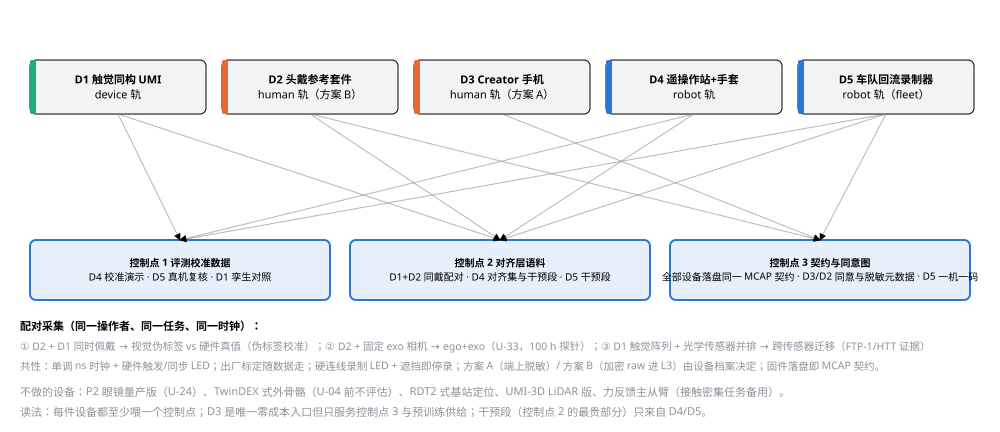

*图 D0-1　五件采集设备与四条数据轨、三个控制点的对应，以及三组配对采集。每件设备至少喂一个控制点；干预段只来自 D4/D5；D3 是唯一零成本入口。*

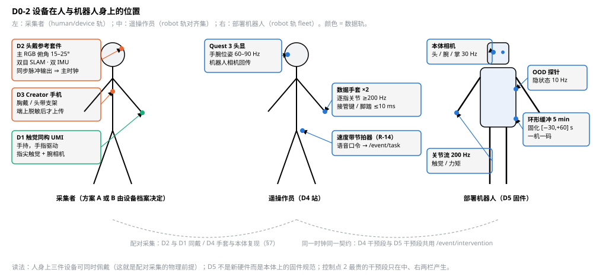

*图 D0-2　设备在人与机器人身上的位置：采集者可同时佩戴 D2/D3/D1（配对采集的物理前提），遥操作员配 Quest 与 ≥200 Hz 手套，D5 是本体上的固件规范而非新硬件。*

## 1. D1 触觉同构 UMI（device 轨主力）

**定位**：device 轨的硬件动作真值来源；与 D2 同戴校准 human 轨伪标签；触觉对照集（500 h）是 R-04 的探针；切片进演示库。

**三个不可省的设计点**

1. **手指驱动**（YUBI 路线）：操作者手指直接驱动夹爪指，无握柄扳机，动作自然、指宽即手指开合；YUBI 8,434 h 开源数据证明该构型可规模化，BOM <$200（论文）。
2. **末端与本体同构**（Koala 协同设计路线）：U-04 裁决后，采集器末端几何、指面材料、开合行程与目标本体末端一致，重定向误差归零；U-04 前用 UMI 平行夹爪，数据带 `end_effector_profile` 以便日后过滤。
3. **触觉阵列与光学传感器并排共装**：跨传感器迁移未解（HTT，论文），配对采集是公认补救；每路触觉流标 传感器家族/功能区/型号（FTP-1 的迁移前提）。

**规格**

| 流 | 传感器 | 原生频率 | 同步 | 理由 |
|---|---|---|---|---|
| `/video/ego_wrist` | 腕部鱼眼 RGB，全局快门，≥150° DFOV | 1080p@60 | 硬触发脉冲，多相机 ≤1 ms | 观测同构；帧率优先于分辨率；全局快门消除快速动作的卷帘畸变 |
| `/video/palm`（可选） | 掌内相机 | 640p@30 | 同上 | 抓握区细节（RealDexUMI 手内相机） |
| `/signal/tactile_l\|r` | 指尖阵列 ×2（5×10 力矢量或 12×12 压力） | 20–30 Hz，最新样本保持 | 触觉↔动作 ≤2 ms | RealDexUMI 20 Hz 配 30 Hz RGB 的零阶保持做法；存 (N,6) 点集，export 窗口化 |
| `/signal/wrench_wrist`（可选） | 腕部六维力/力矩 | 100 Hz | ≤2 ms | 必带 `frame_id`（PRISM 教训）；无传感器时 effort 标 estimated |
| `/signal/gripper_width` | 指宽编码器/霍尔 | 200 Hz | 与 IMU 同总线 | 替代 fiducial 视觉追踪，遮挡不丢 |
| `/imu/wrist` | 6 轴 IMU | 200 Hz | IMU↔视觉 ≤2 ms | VIO 收敛条件 |
| `/signal/ee_pose` | 机上 VIO（Basalt，BSD） | 60 Hz（原生，不上采） | — | CLAUDE.md 决策 3 豁免；ORB-SLAM3 为 GPL 只能服务端（U-10） |

**机上处理**：柄内 SoC（RK3588 级）做 h265 硬编、IMU/触觉/编码器打包、VIO、实时预检（跟踪置信度、标记/指面可见率、尺度回环）并以 LED/振动提示；受控场地默认方案 B（未脱敏 raw 加密进 L3）。落盘 MCAP 分段（128 GB eMMC），坞站/WiFi 批量上传，哈希回执后才可覆盖。

**契约映射**：`track=device`；EpisodeMeta 增 `device_id`（一机一码兼容）、`calibration_ref`、`firmware_version`、`end_effector_profile`、`tactile_sensors[]{family, area, model, rate_hz}`。

**里程碑与验收**

| 阶段 | 交付 | 验收 |
|---|---|---|
| P0（0–3 月） | 原版 UMI ×2（GoPro 版，接受 27–45 GB/h） | 走通 record→export；SLAM 跟丢占比 <5%；视觉↔动作 ≤5 ms |
| H1 EVT | 手指驱动 + 触觉 ×4 台 | 触觉↔动作 ≤2 ms；熟练采集员 ≥30 有效集/h；500 h 对照集启动 |
| U-04 后 | 同构末端版 | 重定向误差（配对采集 vs 本体复现）MPJPE 下降；触觉对照集消融裁决是否进默认配方（U-25） |

**负设计**：不做 RDT2 式基站定位（失去随处可采）；不默认 UMI-3D LiDAR 版；不在 U-04 前做多指外骨骼。

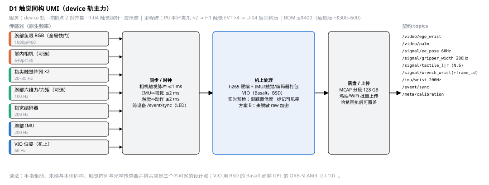

*图 D1　触觉同构 UMI 的数据流：七路传感器经硬件触发同步进入机上 SoC，编码打包后落盘 MCAP。*

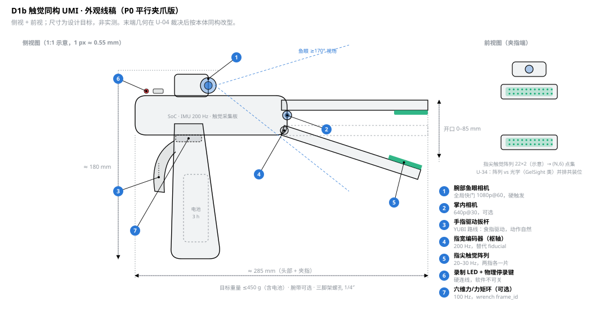

*图 D1b　触觉同构 UMI 外观线稿（P0 平行夹爪版）：手枪式握把 + 食指驱动扳杆、头部电子舱、顶部腕相机、枢轴编码器、两指指尖触觉阵列；尺寸为设计目标。*

## 2. D2 受控场地头戴参考套件（EVT/DVT，不量产）

**定位**：human 轨的内部受控采集（方案 B）；三组配对采集的时钟源（与 D1 同戴校准伪标签、与固定 exo 相机做 U-33、脱敏前后对照做 U-32）；DVT 参考设计开源，供外部供应商按规格供货。决策 2 明确不做 PVT 500 台。

**规格**（按觅蜂 MEgo 与 EgoLive JoyEgoCam 的收敛口径）

| 流 | 传感器 | 原生频率 | 同步 | 理由 |
|---|---|---|---|---|
| `/video/ego` | 主 RGB，≥120° DFOV，俯角 15–25°，EIS | 1440p@60 | 硬触发 | 操作区常驻画面；手部可见率是首要指标 |
| `/video/slam_left\|right` | 双目全局快门灰度 | 1080p@60 | 多相机 ≤1 ms | VIO + 立体深度（默认），ToF 可选不默认 |
| `/imu/head_0\|1` | 双 IMU | 200 Hz | IMU↔视觉 ≤2 ms | 互校与防抖 |
| `/signal/head_pose` | 机上 VIO | 60 Hz | — | 相机运动即动作（ActiveMimic），不丢抖动帧 |
| `/signal/audio_env` | 麦 ×4 | 16 kHz | — | 只保留口令段转写，原音频 30 天删除（compliance §3） |
| `/event/sync` | 同步脉冲输出 + LED | 事件 | ≤1 ms | 让 D2 成为 exo 相机与 D1 的时钟源 |
| `/meta/health` | 录制 LED 状态、遮挡检测 | 1 Hz | — | 遮挡 LED 即停录（Meta 固件先例） |

**机上处理**：SoC 只做编码 + 预检 + 脱敏，不做重推理（index-replica-plan §1）。h265 双码率（存档 + 320p 预览）；预检输出手部可见率、曝光、抖动；隐私模式由设备档案决定：方案 A 端上脱敏（EgoBlur 类 + 时序跟踪补截断人脸）或方案 B 加密 raw 进 L3。256 GB 环形缓冲，≥4 h 电池，硬连线录制 LED + 物理停录开关；P1 预留旁观者拒拍信号接口。重量目标 ≤120 g（Aria Gen 2 为 75 g，参考不苛求）。

**里程碑与验收**：H1 EVT 10–50 台；DVT 参考设计（机械、电路、固件、标定工序）开源。验收：操作段手部可见率 ≥85%；多相机 ≤1 ms、IMU↔视觉 ≤2 ms；脱敏人脸召回 ≥0.95（自测集）且手部可见率降 ≤2 pt；ego+exo 同步 ≤1 ms；4 h 连续录制不丢 chunk。

**负设计**：不做眼动、不默认 ToF、不做 PVT、不做眼镜形态。

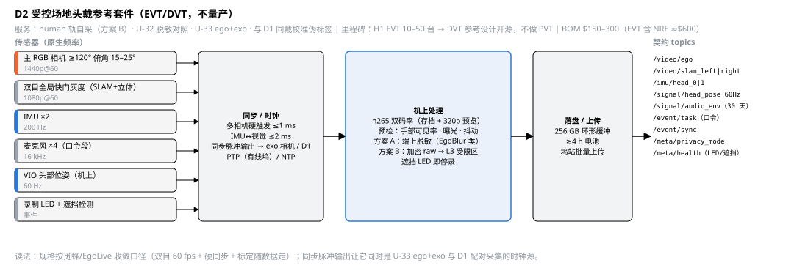

*图 D2　头戴参考套件的数据流：主 RGB、双目 SLAM、双 IMU 与麦克风经硬触发同步，机上双码率编码、预检与脱敏/加密两种模式后落盘。*

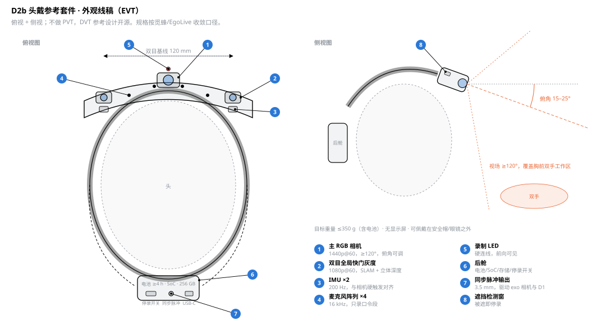

*图 D2b　头戴参考套件外观线稿（EVT）：前梁主 RGB + 两端双目全局快门与 IMU、四麦、前向录制 LED、后舱与同步脉冲口；侧视给出 15–25° 俯角与双手工作区。*

## 3. D3 Creator 手机采集套件（P0 → PL1）

**定位**：众包供给的唯一入口，也是 PL1 产品本体；零设备成本；只允许方案 A（未脱敏帧永不离开手机）；场景扫描（U-22）是区别于 Figure Index 的功能点。

**组成**：用户自有手机（ARKit/ARCore，优先带 LiDAR 机型）+ 胸戴/头带支架（俯角可调，采购或 3D 打印 <$15）+ App（EgoKit 式多设备 SDK 的手机实现）。

**App 功能与规格**

| 功能 | 规格 | 依据 |
|---|---|---|
| 录制 | 平台硬编 h264/h265，1080p@60 或 4K@30；IMU 100–200 Hz；ARKit/ARCore VIO 位姿 60 Hz（provenance=platform_vio） | human 轨视觉↔位姿预算 ≤15 ms，单设备软同步即可 |
| 端上脱敏 | 上传前强制：人脸/车牌（EgoBlur 类或平台检测器，纯定位不生成面部几何）；逐帧置信度摘要进 `/meta/privacy` | BIPA；Bartone 诉讼把"模糊会失效"当证据（第三方） |
| 即时反馈 | 30 s 内返回手部可见率、曝光、时长、抖动（DQAF 式） | 熟练采集员有效数据仅 1/3–1/2（第三方），反馈前置比事后拒收便宜 |
| 同意与区域 | 三档独立勾选（通用任务 / 家居孪生 / 对外发布）+ `region` + `consent_ref` | compliance §2/§3 |
| 录制指示 | 屏幕常显 + 声音提示 + 可选闪光 | 旁观者可感知 |
| 标定 | GeoCalib 自标定（U-11 #11 待核） | 无出厂标定 |
| 场景扫描 | LiDAR 网格或多帧视频 → SimFoundry 表亲 → 个性化任务 + 谓词验收 | U-22（H0 内部 10 场景试跑） |
| 上传 | 分片 + 内容哈希，私有沙箱，上传后本地删除 | compliance §5 |

**契约映射**：`/video/ego`、`/imu/phone`、`/signal/phone_pose`、`/event/task`（口令）、`/meta/task_goal`、`/meta/consent`、`/meta/device`（机型/支架/标定）、`/meta/privacy`（脱敏模型版本 + 置信度摘要）。

**里程碑与验收**：P0 内部试用 10 人；H1 千人试点（10 个内部场景 → 外部 Creator）；H2 千人网络。验收：策展通过率 ≥60%；操作段手部可见率 ≥75%；上传即脱敏 100%；同意拒绝率 >30% 则退回通用任务（U-22）。

**负设计**：不做手机 AR 眼镜；不接第三方相机 App；不上传未脱敏帧；不做上门服务（H2 前，compliance §8）。

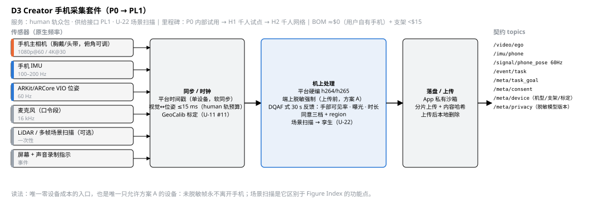

*图 D3　Creator 手机套件的数据流：端上强制脱敏与即时质量反馈后分片上传；另可扫描场景生成仿真孪生。*

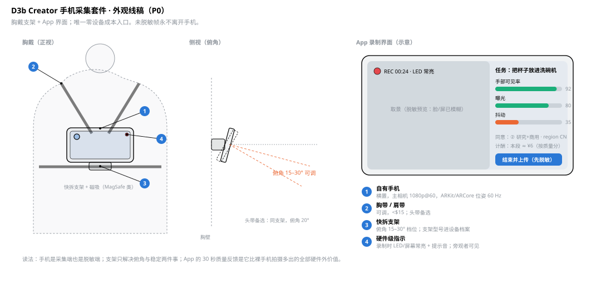

*图 D3b　Creator 手机套件外观线稿（P0）：胸带 + 快拆支架横置手机、俯角 15–30° 可调，右侧为 App 录制界面示意（硬件级指示、30 秒质量反馈、同意档位、计酬）。*

## 4. D4 遥操作站 + 数据手套（robot 轨对齐与干预段）

**定位**：robot 轨对齐集（每任务几小时）、干预段（DAgger/RECAP 素材）、控制点 1 的校准演示（每任务约 10 条）。

**组成与规格**

| 组件 | 规格 | 依据 |
|---|---|---|
| 头显 | Quest 3（OpenTeach 路线）默认；OpenXR 抽象兼容 Isaac Teleop | robot-track-teleop §2 |
| 数据手套 ×2 | 逐指关节 ≥200 Hz；MANUS 级（Isaac Teleop 官方手套）或低成本 IMU 手套备选 | T-800 证明人手动作含 >100 Hz 能量（论文），采样率至少 2× |
| 接管键 / 脚踏 | 打点精度 ≤10 ms（一个控制周期），由站写入 `/event/intervention` | robot-track-teleop §4 |
| 回传 | 机器人头部相机第一视角，端到端 ≤150 ms，超预算标 `flag:teleop_latency` | 同上 |
| 时钟 | 工控机 PTP 主时钟；`command_time`↔`publish_time` 延迟统计进 QC | recorder §1 |
| 速度带节拍器 | 任务模板指定慢/正常速度带，站内节拍提示并记入 `/meta/operator.speed_band` | R-14：操作者多样性引入速度多模态有害（GO-1-Pro） |
| 触觉反馈（可选） | 手套触觉反馈开关与强度记录 `/signal/haptic_feedback` | HapTile 把操作员侧反馈当数据质量杠杆（论文） |
| 场地 exo 相机 | 30 Hz 第三人称，评测用，不进训练默认视图 | eval-protocol |

**契约映射**：`/signal/action` 200 Hz、`/signal/glove_joint_l|r` 200 Hz、`/signal/hand_pose`、`/event/intervention`（kind/reason/policy_version）、`/signal/teleop_latency`、`/meta/operator`（operator_id、speed_band、班次）；重定向参数版本进 EpisodeMeta。

**里程碑与验收**：H0 1 站（1 台本体 + Quest 3 + 工控机）；H1 3–5 站。验收：端到端延迟 ≤150 ms；接管打点 ≤10 ms；熟练操作员 25–40 可用集/h（第三方口径，D-20 待自测替换）；策略段/人工段边界 100% 保留。

**负设计**：U-04 前不做外骨骼；力反馈主从臂只作接触密集任务备用；不做外包遥操作（干预段必须在自家契约下产生）。

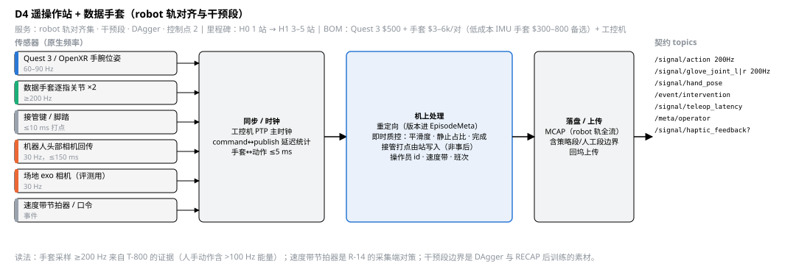

*图 D4　遥操作站的数据流：手腕位姿、≥200 Hz 数据手套、接管键与机器人回传经 PTP 主时钟对齐，站内完成重定向、即时质控与接管打点。*

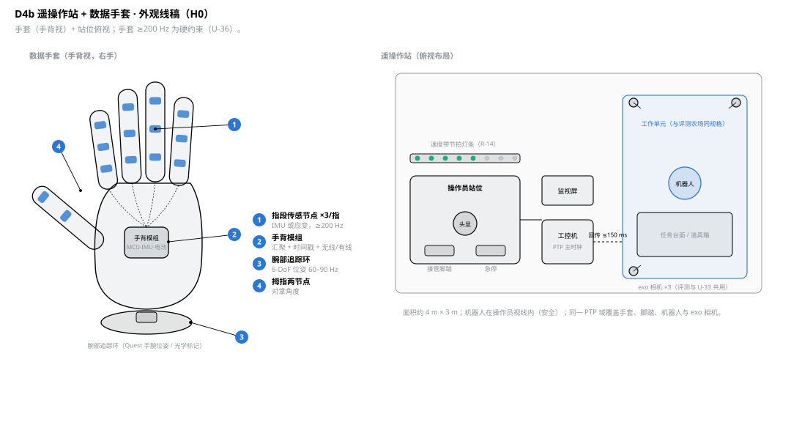

*图 D4b　遥操作站与数据手套外观线稿（H0）：手套每指三段传感节点 + 手背模组 + 腕部追踪环；站位俯视含头显、接管脚踏、急停、速度带节拍灯条、工控机与同规格工作单元。*

## 5. D5 车队回流录制器（部署机器人上的采集终端）

**定位**：不是新硬件，是部署机器人上的固件级规范。每台部署机器人首先是一台采集终端；干预段（谁在何时接管、接管前 N 秒、恢复后 N 秒）是所有数据里单位价值最高的一类，只在这里产生。

**规范**

| 项 | 规格 | 依据 |
|---|---|---|
| 环形缓冲 | 最近 5 min 高码率全流（本体相机 30 Hz、关节 200 Hz、触觉/力矩若有） | 触发式固化比全量上传便宜一个量级 |
| 触发 | OOD 探针分数（VLA-FAIL/SAFECAST 式隐状态探针，10 Hz）越阈、接管信号、任务失败 → 固化 [−30 s, +60 s] 窗口 | 无需失败数据即可标定的探针（论文） |
| 接管语义 | `/event/intervention` 增 `autonomy_tier`（全自主/共享/全遥操）与 `by`（本地/远程） | 1X 三档自主（官方） |
| 隐私 | 家庭部署：机上脱敏（方案 A）+ 禁入区 geofence + `/event/presence_disclosure`（远程在场披露）；工业场地：raw 加密（方案 B，合同约定） | compliance §1/§3；机器人隐私即具身边界工作（论文） |
| 身份 | `device_id`（一机一码兼容）、`firmware_version`、`policy_version`、`deployment_id`、`calibration_ref` | 中国一机一码规范；lineage |
| 上传 | 回坞优先干预/OOD/失败片段，成功 episode 抽样 20%，带宽受限降码率 | runtime §4 |
| 时钟 | 机器人 PTP 主时钟；`/meta/health` 1 Hz | recorder §1 |

**契约映射**：robot 轨全流 + `/signal/ood_score`、`/event/intervention`（tier/by）、`/event/presence_disclosure`、`/meta/deployment`（site、privacy_zones_version、autonomy_tier）、`/meta/episode.source=fleet`。

**里程碑与验收**：M3 回流接口（`fdp ingest --source fleet`）；H2 车队。验收：干预段 100% 捕获且带前 30 s；干预率（每 1,000 任务）可算并作内部 KPI；固化窗口落盘 <2 s；家庭部署脱敏前帧不出机。

**负设计**：不全量高码率上传；不做机上训练；不对外宣称干预率（R-03）。

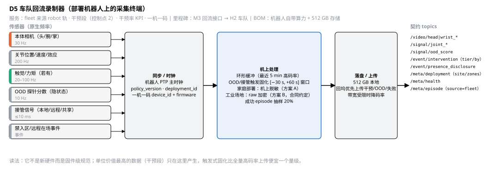

*图 D5　车队回流录制器的数据流：传感器与 OOD 探针分数进入环形缓冲，接管或 OOD 触发时固化前后窗口，按部署场景脱敏或加密后优先上传。*

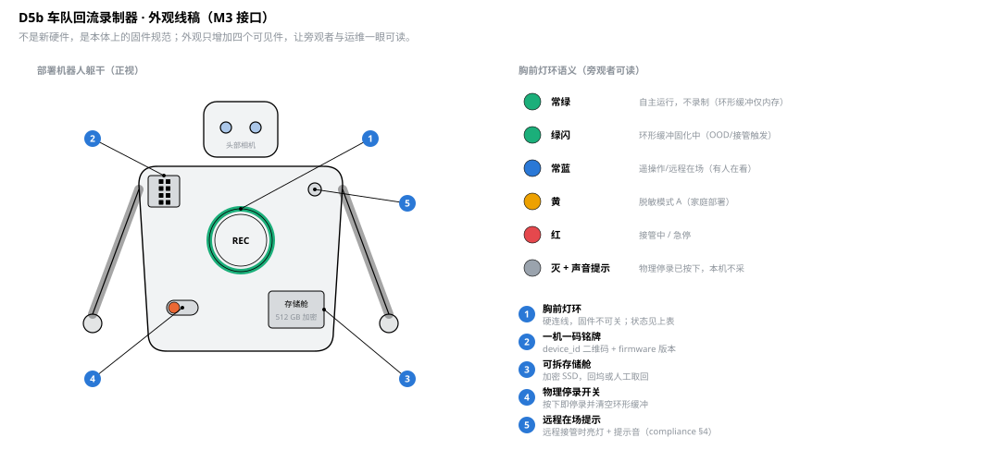

*图 D5b　车队回流录制器外观线稿（M3 接口）：本体上只增加四个可见件（胸前灯环、一机一码铭牌、可拆存储舱、物理停录开关）加远程在场提示；右侧为灯环语义表。*

## 6. 五件设备的共性规范

- **时钟与同步总线**：单调 ns 时钟 + 启动时记录 UTC 偏移；有线场景 PTP，头戴/手持用硬件触发脉冲（3.3 V）+ 同步 LED 事件 `/event/sync`；跨设备配对采集以 D2 或工控机为主时钟。预算按 architecture §8.4：视觉↔动作 ≤5 ms（robot/device）/≤15 ms（human），IMU↔视觉 ≤2 ms，多相机 ≤1 ms，触觉↔动作 ≤2 ms。
- **标定随数据走**：出厂 Kalibr 内外参 + 时间偏移写入 `/meta/calibration`，`calibration_ref` 哈希进 EpisodeMeta；在线漂移再估计触发 `flag:calib_stale`（architecture §8.5）。
- **隐私硬件三件套**：硬连线录制 LED（软件不可关）、遮挡/篡改即停录、物理停录开关；隐私模式（方案 A/B）由设备档案而非操作者决定。
- **设备注册**：`device_id` 兼容一机一码，`firmware_version` 签名、OTA 灰度，设备档案（型号、末端 profile、传感器族）进 lineage。
- **固件落盘即 MCAP 契约**：`/meta/health` 1 Hz、关键帧间隔 ≤1 s、chunk 4 MB/1 s flush、断电恢复（recorder §4）。
- **采集 SOP 共性**：速度带元数据；恢复数据模式（TAMEn：每个任务模板附"扰动-恢复"子任务）；语音口令产生 `/event/task` 弱标注。

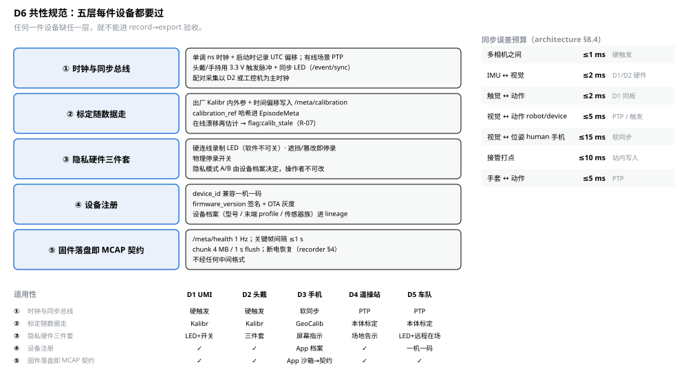

*图 D6　五层共性规范（时钟总线、标定随数据走、隐私三件套、设备注册、固件落盘即契约）、同步误差预算与逐设备适用方式。缺任一层不进 record→export 验收。*

## 7. 配对采集矩阵（控制点 2 的生产方式）

| 配对 | 产出 | 用途 | 里程碑 |
|---|---|---|---|
| D2 + D1 同时佩戴 | 视觉伪标签 vs 硬件真值 | 伪标签质量分刻度（index-replica-plan §4）、L4 消融 | H0 起 |
| D2 + 固定 exo 相机 | ego+exo 同步对 | 上身对齐动作块（U-33，100 h 探针） | H1 |
| D1 阵列 + 光学触觉并排 | 跨传感器配对帧 | 触觉迁移（FTP-1/HTT） | H1（500 h 对照集内） |
| D4 手套 + 本体复现 | 人手关节 vs 机器人关节 | 重定向误差、U-04 消融 | H0/H1 |
| D3 vs D2 同任务 | 手机 vs 头戴质量差 | 决定 Creator 任务库哪些任务只能用 D2 | H1 |
| D2 脱敏前 vs 后（方案 B 场地） | 手部可见率、MPJPE 差 | U-32 脱敏损伤基准 | H0 末 |

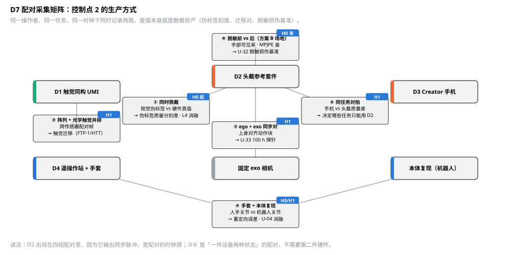

*图 D7　六组配对采集及其产出、用途与里程碑。D2 出现在四组里，因为它是配对的时钟源；③⑥ 是同一设备两种状态的配对。*

## 8. 预算、验收总表与治理

**12 个月设备预算（量级）**：D1 P0 ×2 $1k + EVT 触觉 ×4 $4–6k；D2 EVT 10–50 台 $6–30k（含 NRE 摊销）；D3 支架与 App 开发（平台/App 人力，见 program-plan §3）；D4 H0 1 站 $5–10k + H1 3–5 站 $20–40k（手套占大头）；D5 存储与固件人力。合计硬件 ≈$40–90k，比 program-plan §4 原口径少 $150–300k（PVT 冻结）。

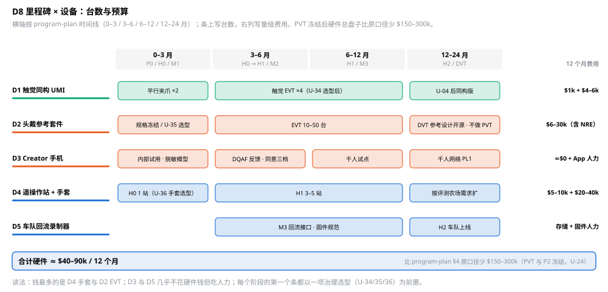

*图 D8　五件设备在 0–3 / 3–6 / 6–12 / 12–24 月的台数与量级费用；每个阶段的第一个条以一项治理选型（U-34/35/36）为前置。*

**总验收**：每件设备一条真实 episode 走完 record→export 并被 openpi/lerobot 不改代码读入；同步残差在 §6 预算内；`/meta/health` 与 `calibration_ref` 齐全；隐私模式与设备档案一致。

**治理**：U-34 触觉阵列与光学传感器选型（并排共装、供应商、许可）；U-35 D2 EVT 双目全局快门模组与 SoC 选型；U-36 数据手套选型（MANUS 级 vs 低成本 IMU 手套，≥200 Hz 为硬约束）。R-07（标定漂移）、R-14（速度带）、R-18（脱敏损伤）对本文全部适用。

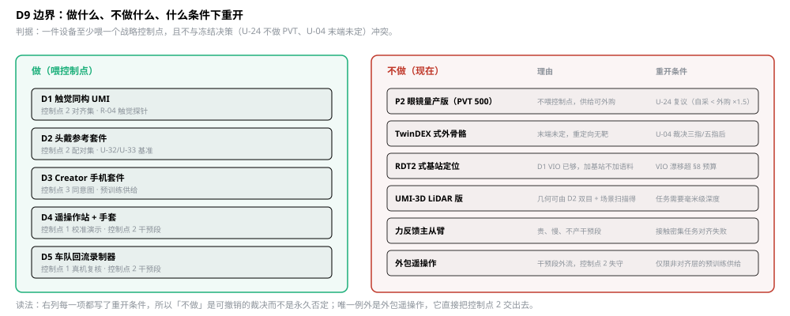

*图 D9　做的五件设备与现在不做的六类设备，每类不做都写明理由与重开条件；唯一不可重开的是外包遥操作。*

**回写**：[device-track-umi.md](device-track-umi.md) §1/§3（手指驱动、触觉、编码器替代 fiducial）；[index-replica-plan.md](index-replica-plan.md) §1 P1 表（不做 PVT、双目全局快门默认、同步脉冲输出）；[robot-track-teleop.md](robot-track-teleop.md) §2/§4（手套 ≥200 Hz、速度带节拍器、autonomy_tier/by 字段）；[runtime-and-deployment.md](runtime-and-deployment.md) §4（触发式固化窗口）；[data-format-contract.md](data-format-contract.md) §1.3（新增 topics）。
