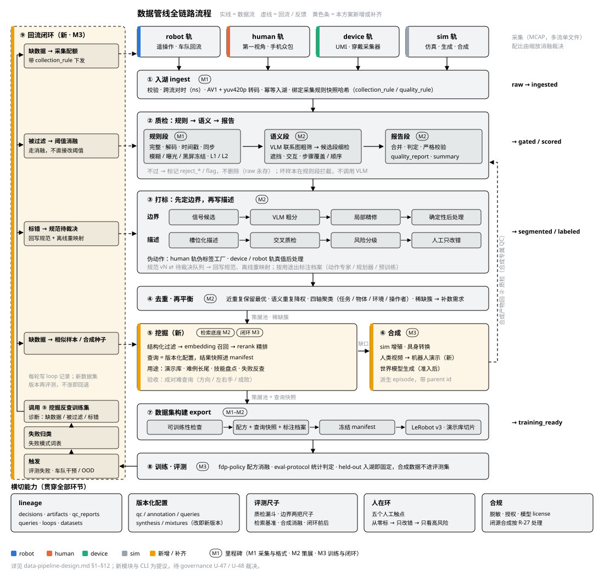

# 数据管线全链路设计方案（对照某大模型厂商 具身数据链路补齐）

> 2026-11-17。本文是数据管线的**全链路总图**：从采集入湖到训练回流，每个环节做什么、产出什么、由哪个模块负责、按什么顺序落地。已有规范的环节只写摘要并指向原文；本文新增的设计集中在**挖掘（§6）、人类视频转机器人演示与生成式合成（§7）、回流闭环（§9）、质检与打标的产品化（§4、§5）**四块。
>
> 对照对象是云厂商计算平台 + 某大模型厂商的具身数据链路（[research-vendor-robotics.md](research-vendor-robotics.md) §7，来源为非公开客户交流材料，所引数字均为公司自报 ⚠️，已登记 [governance.md](governance.md) D-33）。对照只借鉴环节划分和做法，不改变 [architecture.md](architecture.md) 与 CLAUDE.md 的贯穿性决策：双格式（MCAP / LeRobot v3）、四轨同 schema、分层采样率、清洗是标记不是删除、质量优先于吞吐。

## 0. 结论

1. 某大模型厂商把数据管线定义为一个飞轮：**入湖 → 质检 → 打标 → 挖掘 → 合成 → 训练评估 → 回流**。我们的五层（recorder → ingest → curation → export → viz）覆盖了前三环和导出，**缺的是挖掘、人类视频合成、回流闭环三环**，以及把质检和打标做成"有报告、有规范、有尺子"的交付物。
2. 补齐方式：不新增管线层和持久化格式。挖掘与合成作为 curation 层的新阶段（`curation.mining`、`curation.synthesis`），回流闭环作为跨层流程，用 lineage 表串起来。新增的模块和 CLI 均为提议，等 U-48 裁决。
3. 落地顺序跟某大模型厂商一致：**质检先交付**（规则段 M1、语义段 M2），打标其次（M2），挖掘的检索底座随 M2 演示库一起做，合成和回流闭环放 M3。理由与"质量优先于吞吐"相同：质检是唯一能在没有模型、没有本体的阶段就产生价值的环节。

## 1. 全链路总图



*图 P1　数据管线全链路流程。中间是主链路（采集四轨 → ① 入湖 → ② 质检 → ③ 打标 → ④ 去重再平衡 → ⑤ 挖掘 / ⑥ 合成 → ⑦ 数据集构建 → ⑧ 训练评测），右侧是各环节对应的 episode 状态，左侧是 ⑨ 回流闭环（失败归类后按"缺数据 / 被过滤 / 标错"分别回到采集、质检、打标、挖掘与合成），右侧虚线表示合成产物重新进入质检，底部是贯穿全部环节的横切能力。黄色条标出本方案新增或补齐的环节，圆角标签是落地里程碑。生成脚本：`work/diagrams/gen_pipeline_flow.py`。*

下面是同一流程的文字版，便于检索与纯文本阅读：

```
 采集（四轨，配比由消融裁决）
  robot 遥操/车队 · human 第一视角 · device UMI/穿戴 · sim 仿真/生成
        │  MCAP（多流单文件，append-only）
        ▼
 ① 入湖 ingest ───── 校验 · 跨流对时 · AV1 转码 · 幂等入湖 · 采集规则快照绑定
        ▼                                                        状态：raw → ingested
 ② 质检 QC ──────── 规则段（确定性，坏样本就地拦截）
        │             语义段（VLM 粗筛联系图 → 候选段细检）
        │             报告段（episode 质检报告 + 批次汇总）       → gated / scored
        ▼
 ③ 打标 ─────────── 边界（信号候选 → VLM 粗分 → 局部精修 → 确定性后处理）
        │             描述（固定边界上写槽位化描述 → 交叉质检 → 风险分级 → 人工只改错）
        │             伪动作（human 轨伪标签工厂；device/robot 轨真值后处理）   → segmented / labeled
        ▼
 ④ 去重 · 再平衡（既有五阶段策展的门③④）
        ▼
 ⑤ 挖掘（新）──── 结构化过滤 + embedding 召回 + rerank 精排
        │             用途：演示库检索 · 难例/长尾 · 技能原语盘点 · 按查询建训练集 · 评测失败反查
        ▼
 ⑥ 合成（补齐）── sim 增殖（既有）· 具身转换（既有，device 穿戴子形态）
        │             人类视频→机器人演示（新，human 轨）· 世界模型生成（既有 neural_trajectory，补候选与托管规则）
        ▼                                                        派生 episode，parent_episode_id 指回种子
 ⑦ 数据集构建 export ── 可训练性检查 → 配方（mixture yaml）+ 查询 + 策展决策 → 冻结 manifest
        │                LeRobot v3（parquet + mp4）· 演示库切片                  → training_ready
        ▼
 ⑧ 训练 · 评测（fdp-policy，training-pipeline / eval-protocol）
        ▼
 ⑨ 回流闭环（新）── 评测失败 + 车队干预 → 失败归类 → 挖掘查询
                      → 已有数据重加权 / 合成种子 / 采集配额 → 新数据集版本 → 再评测
                      （每一轮写一条 loop 记录，评测不涨则回退）
```

横切能力（§10）：lineage 与版本、评测尺子、人在环、合规、成本与可观测性。

## 2. 环节对照：某大模型厂商做法 · 我们已有 · 本文补什么

| 环节 | 某大模型厂商做法（某大模型厂商材料） | 我们已有的设计 | 缺口与本文章节 | 里程碑 |
|---|---|---|---|---|
| ① 入湖 | 三类数据进 云数据湖 全模态湖仓；统一时间基准、episode 切分、关键帧、标准化存储 | [ingest-spec.md](ingest-spec.md)、[data-format-contract.md](data-format-contract.md)、architecture §8 | 采集规则快照与样本绑定（§3） | M1 |
| ② 质检 | 四维 × 四形态框架；规则 / VLM / 报告三段；19 项指标；已对客户交付 | [curation-pipeline.md](curation-pipeline.md) §1（已补阈值、漏斗、流程指标） | 质检报告作为交付物、规则文件化、按轨矩阵（§4） | 规则段 M1，语义段与报告段 M2 |
| ③ 打标 | 四阶段打标；先定边界再写描述；规范变成机器可判定；人只改错 | curation §3.2、§4（已补解耦、后处理、槽位化） | 标注档案（按用途）、规范版本管理、打标评测集（§5） | M2 |
| ④ 去重再平衡 | 未单列 | curation §2 | 无 | M2 |
| ⑤ 挖掘 | Qwen3-VL-Embedding 召回 + Rerank 精排；corner case 挖掘 | 只有去重用的 embedding；演示库"按任务检索"只有一句话 | **整个环节**（§6） | 检索底座 M2，闭环 M3 |
| ⑥ 合成 | 人类视频六步合成 15 种本体演示；厂商世界模型 / 厂商合成模型 世界模型；闭源权重受保护联合训练 | [sim-track.md](sim-track.md)（含 neural_trajectory）、architecture §2.3 具身转换 | **human 轨的人→机合成**、合成数据的 QC 与托管规则（§7） | M3 |
| ⑦ 数据集构建 | 导出 LeRobot v3（state 104 / action 102 / action_mask / camera_fov）；多模态数据集版本化 | data-format-contract §2、curation §5、[data-platform.md](data-platform.md) §3 | 查询驱动的 manifest、可训练性报告（§8） | M1–M2 |
| ⑧ 训练评测 | 云机器学习平台 训练、Isaac 仿真评估、EAS 推理 | [training-pipeline.md](training-pipeline.md)、[eval-protocol.md](eval-protocol.md) | 无（本文只定义接口） | M3 |
| ⑨ 回流 | "数据驱动迭代"，评测结果反馈 | runtime-and-deployment 回流、curation §8 held-out | **闭环流程与记录**（§9） | M3 |
| 横切 | 云数据开发平台 血缘、多模态数据集管理、Data Agent | data-platform §2–§4、compliance-and-security | 新增 lineage 表、配置目录清单（§10） | 随各环节 |

## 3. ① 入湖

沿用 [ingest-spec.md](ingest-spec.md)：校验、跨流对时、AV1 + yuv420p 转码、幂等键、断点续传。本文只加一条：

- **采集规则快照绑定**：每个采集任务在下发时冻结两份规则文件，并把它们的哈希写进该任务下每条 episode 的元数据。
  - `collection_rule`：任务的标准步骤序列、允许的物体与场景、必需的流和相机。质检的流程指标（步骤覆盖率、顺序匹配率）和打标的边界先验都从这里读。
  - `quality_rule`：该任务适用的质检阈值版本与状态机。
  - 对应某大模型厂商的 `collection_rule.json` / `quality_rule.json`。目的是让质检结果可复现：规则改了，旧结论仍能对应到当时的规则。
  - 文件位置提议 `configs/qc/collection_rules/<task>.yaml`、`configs/qc/quality_rules/<version>.yaml`（实现时创建，改动 = 新版本，不覆盖）。哈希字段属于格式改动，进 data-format-contract 0.3 待入项（随 U-47 一并处理，见 §11）。

## 4. ② 质检：做成交付物

实施细节（各门方法、v0 阈值、VLM 漏斗、流程指标）已在 [curation-pipeline.md](curation-pipeline.md) §1。本节补三件事：按轨的检查矩阵、三段执行的边界、报告格式。

### 4.1 四维 × 四轨检查矩阵

某大模型厂商的框架是四个质量维度 × 四种数据形态。映射到我们的四轨，再把"标注本身"单列一列（标注也要被质检）：

| 维度 | robot | human | device | sim | 标注 |
|---|---|---|---|---|---|
| 完整性 | 本体型号与控制频率、多视角流、关节/末端/夹爪/底盘状态、干预事件 | 流完整、无丢帧、估计内参已写入 | 鱼眼视频 + IMU 原始流、夹爪标定、SLAM 轨迹连续 | 随机化配置哈希、种子 episode 可追溯 | 帧级索引一一对应、边界与描述都在、必填槽位不缺 |
| 有效性 | 画质、双臂时序与空间无冲突、静止与无效等待占比、任务成功 | 画质、手部可见率、动作有效性、静止占比 | SLAM 位姿与尺度一致、夹爪开合误差、快速运动模糊、重定位漂移 | 物理合理性、渲染有效、增殖成功判定（sim-track §5） | 边界精度（两把尺子）、指代正确率、描述无幻觉、多源一致性 |
| 可训练性 | 状态/动作空间按槽位布局、遥操作时延补偿、跨本体归一化 | 相机系 → 世界系约定、MANO 拓扑一致、伪动作维度对齐 | 位姿对齐到 TCP、夹爪宽度归一化、统一时间基准 | 与真机同槽位布局、动作语义约定一致 | 规范版本与 schema 版本可追溯 |
| 真实性与合规 | 非仿真冒充、非回放伪造；客户现场授权 | 采集授权与知情同意、人脸与敏感背景脱敏 | 场地与对象授权、环境脱敏 | 资产 license、生成模型 license | 自动标注所用模型许可、标注数据不出域、返修留痕 |

有效性一行里的具体指标和阈值见 curation §1.1–§1.5；可训练性一行即 curation §5 的"可训练性检查"；真实性与合规一行对应 curation §1.6 反欺诈与 [compliance-and-security.md](compliance-and-security.md)。

### 4.2 三段执行

| 段 | 内容 | 对应我们的门 | 计算 | 原则 |
|---|---|---|---|---|
| 规则段 | 文件完整、可解码、时间戳与丢帧、多路同步、模糊/过曝/过暗/黑屏冻结 | 技术门、视觉门、运动学门（L1）、统计门（L2） | CPU 为主，确定性 | 明显损坏的样本在这一段拦截，**不送入任何 VLM 调用** |
| 语义段 | 遮挡/畸变、手与交互物可见、交互区域偏离、无效动作、异常静止、步骤覆盖与顺序 | 语义审计（L3）、跨模态一致性门 | VLM，先粗后细 | 只对粗筛圈出的候选段做细检；输出必须过 schema 校验 |
| 报告段 | 合并规则段与语义段、去重叠、判定序列状态、严格校验、写报告 | — | CPU | 报告只读汇总结果，不重新计算 |

规则段随 M1 ingest 一起上线（不依赖任何模型），语义段与报告段随 M2。

### 4.3 质检产物

- **episode 质检报告** `quality_report.json`：采集指标、各路相机体检结果、候选段与序列评估、每项指标的分子分母、判定结论（pass / flag / reject 及原因码）、所用 `quality_rule` 版本与模型版本。存对象存储，路径写入 lineage `artifacts`（kind = `qc_report`）。
- **批次汇总** `summary.json`：按批次和采集任务汇总通过率、主要拒因分布、需要重采的序列数，给采集运营和验收使用。
- **指标进元数据库**：每项指标一行，供漏斗仪表盘（curation §7）和阈值消融切分使用。
- 报告面向两类读者：内部（漏斗、消融）和外部（采集供应商验收、PL3 策展即服务的客户交付，见 [data-strategy-roadmap.md](data-strategy-roadmap.md) §5）。所以报告格式要稳定、带版本号，字段只增不删。

## 5. ③ 打标：做成有规范、有尺子的能力

流程细节已在 curation §3.2（先定边界、确定性后处理、已知失效模式）和 §4.1（槽位化描述、指代优先抽检、采集事件下传）。本节补三件事。

### 5.1 按用途定义标注档案

同一份视频，训练用途不同，要的标注不同；三种用途的验收口径甚至互相矛盾（某大模型厂商自报：粒度与用途不匹配，训练效果下降 60% ⚠️）。所以标注不是一套规格，而是按**档案**（profile）产出：

| 档案 | 消费方 | 边界要求 | 描述要求 | 验收重点 |
|---|---|---|---|---|
| `action_expert` | 动作专家（S1） | 帧对齐，与连续轨迹一致 | 动词短语即可 | 严格 IoU 尺子、伪动作质量分 |
| `planner` | 规划器 / S2 语料 | 语义边界（子任务完成事件） | 槽位齐全，指代准确 | 指代正确率、指令可执行性 |
| `pretrain` | 0→1 预训练 | 覆盖面优先于精度 | 任务级 + 子任务级一句话 | 覆盖率、宽松尺子 |

- 档案是 export 的输入参数，不是三份独立标注：底层存的是同一份槽位化标注（边界 + 子边界 + 边界判据 + 槽位），按档案在导出时组装。
- 新增档案或改档案要求 = 改配置版本，靠离线重映射生成，不重标。

### 5.2 规范版本管理

- 标注规范是版本化文件（提议 `configs/annotation/spec/<version>.md` + 机器可读规则 `.yaml`），每条标注记录所用规范版本。
- 规范没有覆盖的情况进**待裁决队列**（curation §9），裁决结果写回规范，产生新版本，再离线重映射受影响的已有标注。
- 目标是逐步把规范从"人能读懂"变成"机器可判定"：每条规则要么能被确定性后处理执行，要么能被自动校验检查，否则它就是待裁决项。

### 5.3 打标评测集

- 每条轨、每个档案各维护一套**金标准小集**（几十条 episode 量级，按任务分层），由两名以上标注员独立标注并裁决。sim 轨 `planning_trace` 的谓词真值可以直接当边界金标准（curation §4.1）。
- 评测指标：两把尺子（宽松切点 F1 + 严格 IoU≥0.75 一对一 F1）、段数比、平均段长、**指代槽位正确率**、描述幻觉率。
- 任何打标模型、prompt、后处理规则或规范版本的变更，都先在金标准集上回归，不退步才上线（与 curation §7 伪标签抽检同一纪律）。
- 他方实测的失效模式（大量段超过 10s、模型间严格 IoU 共识约三成、短于 2s 的动作切不出来、人工标注段约四成需复核）是我们评测集要专门覆盖的切片 ⚠️。

## 6. ⑤ 挖掘（新增）

### 6.1 要解决的问题

| 用途 | 输入 | 输出 | 现状 |
|---|---|---|---|
| 演示库检索 | 自然语言或示例片段 | 3–12s 干净切片（in-context 演示、少样本适应） | curation §0 只有一句话 |
| 难例 / 长尾挖掘 | 失败模式描述、少量示例 | 存量中相似片段 → 补标、重加权、合成种子 | 无 |
| 技能原语盘点 | 原语词表 | 每个原语的小时数、场景数、操作者数 | 再平衡只做四轴聚类 |
| 按查询建训练集 | 保存的查询 + 过滤条件 | 冻结的 episode/片段清单（进 manifest） | 无 |
| 评测失败反查 | 评测失败片段 | 训练集中相近样本的分布（是缺数据还是数据有错） | 无 |

### 6.2 检索架构：过滤 + 召回 + 精排

```
查询（文本 / 片段 / 混合） + 结构化条件（track、任务、手别、成败、质量分层、split）
   │
   ├─ 结构化过滤：元数据库（Postgres），先缩小候选集合；held-out 默认排除
   ├─ 召回：片段级 embedding（子任务段 + 演示库切片两种粒度），向量库 Top-K
   └─ 精排：交叉编码器对 Top-K 逐一打分，区分方向、左右手、顺逆时针等细节
   ▼
结果集（带分数）→ 人工抽看 → 保存为查询结果快照
```

- 索引粒度：子任务段（来自打标）和演示库切片。整 episode 粒度只用于去重。
- 存储沿用 [data-platform.md](data-platform.md) §2：pgvector 起步，规模超过约 1e7 向量后换 Milvus/Qdrant。
- 去重用的 embedding 和检索用的 embedding 分开：去重只要"像不像"，检索要能分清动作细节（[cleaning-algo-selection.md](cleaning-algo-selection.md) §1.9）。

### 6.3 模型选型与验收

- 基线：SigLIP 帧特征聚合（Apache-2.0，已是去重默认）。
- 检索候选：Qwen3-VL-Embedding（召回）+ Qwen3-VL-Rerank（精排）。⚠️ license 与权重开放情况待核查，核查前只进研究分支（U-11 规则）。
- **验收用我们自己的标注构造检索基准**，不用对方的案例数字：从打标结果自动生成"成对难查询"（同任务但方向相反、左手 vs 右手、成功 vs 失败），看 Top-K 召回率和精排后 Top-1 正确率。这把尺子同时检验打标槽位的质量。
- 车企 corner case 案例的召回准确率（22 个标签平均 70%+）是驾驶图片场景，不能外推到操作视频 ⚠️。

### 6.4 查询即配置

- 保存的查询是版本化文件（提议 `configs/queries/<name>.yaml`：查询文本或示例片段引用、结构化条件、召回与精排模型版本、Top-K、阈值）。
- 查询结果快照（片段清单 + 分数）写入 lineage；训练集 manifest 可以引用查询快照，查询哈希随配方哈希一起进训练 run 的 lineage。
- 这样"这批训练数据是怎么挑出来的"可以复现，也能被删除请求沿链追到。

### 6.5 模块归属（提议，待 U-48）

- `src/fdp/curation/mining.py`，CLI `fdp curate --stage mine`（建索引）与 `fdp curate --query <name>`（执行查询、产出快照）。
- 不单开管线层：挖掘读的是 curation 的产物、写的是 curation 的决策与快照，归 curation 层最自然，也符合"CLI 子命令按层对应"的约定。

## 7. ⑥ 合成（补齐）

### 7.1 四种合成来源

| 来源 | 输入 | 观测 | 动作 | 归属 | 状态 |
|---|---|---|---|---|---|
| 仿真增殖 | 少量种子演示 + 资产 | 渲染 | 仿真真值 | sim 轨（`dexmimicgen` 等） | 已有，[sim-track.md](sim-track.md) §3 |
| 具身转换 | device 轨穿戴/头戴子形态 | 真实背景 + 人体抹除 + 机器人臂合成 | 硬件真值 | 派生 episode | 已有，architecture §2.3 |
| **人类视频 → 机器人演示** | human 轨第一视角视频 + 伪标签 | 真实背景 + 人手擦除 + 机器人臂深度合成 | 伪动作经重定向 + IK | 提议 sim 轨 `source=human2robot_composite`（U-47） | **新增** |
| 世界模型生成 | 文本/动作条件 + 首帧 | 生成 | IDM 伪动作 | sim 轨 `neural_trajectory` | 已有，本文补候选与托管规则 |

### 7.2 人类视频 → 机器人演示（新增）

对标 厂商论文 / 某大模型厂商预处理管线的六步：输入 → 重定向与平滑 → 手臂分割 → **人手擦除与修复** → 底座搜索 + IK → **深度引导的机器人合成**。他方自报规模是 1,933 小时人类视频生成 15 种本体共 24,808 小时演示（≈12.8×，D-11 已统一口径）。

- **前置条件**：输入必须已经通过 human 轨伪标签工厂（curation §4.2），且质量分达到门槛；伪动作不可重定向的段（curation §1.3 IK 门）不进合成。
- **归属**：观测是部分生成的、动作是伪标签，按 sim-track §6 的判据（"有伪动作且观测是生成的 → sim 轨"）提议归 sim 轨，`source = human2robot_composite`，`parent_episode_id` 指回 human 轨原始 episode。不新增 track（合成来源不是采集形态，决策 2）。裁决见 U-47。
- **合成专属 QC**：人手擦除残留（检测器在擦除后的帧上仍检出手 → 标记）、机器人臂与场景深度遮挡关系一致、合成臂姿态与动作序列逐帧一致（渲染姿态反投影误差）、IK 可行与自碰撞；不过的标 `reject_synthesis_*`，不删除。
- **与具身转换的关系**：两者流程同构（都是"抹人 + 合成机器人"），代码共用 `curation.synthesis`；区别只在输入轨和动作来源（device 真值 vs human 伪标签）。architecture §2.3 的"human 轨不经过具身转换"保持不变：human 轨走的是这条独立的合成支路，且产物落 sim 轨。
- **本体档案**：每种目标本体一份合成档案（URDF/网格、相机安装位姿、可达空间），版本哈希进 lineage。第一批只做我们自己的本体和二指兼容视图（与 U-46 一致），不追求 15 种。

### 7.3 世界模型生成

- 候选：厂商世界模型（27B，EWK 8.6M 视频-文本对）、厂商合成模型、Cosmos 系列。都受 U-29 / U-11 准入规则约束；对方给出的排名和效果均为自报 ⚠️。
- 用途优先级按 [data-strategy-roadmap.md](data-strategy-roadmap.md) §1.8 的判断：**评测代理 > 长尾补充 > 数据增殖**。世界模型只在专家动作分布内可信（WorldSimProbe/WorldEcho 反例），所以生成数据只补长尾场景，不当主力数据。
- 神经轨迹必须经 IDM 打伪动作并标质量分（sim-track §3 既有规则）。

### 7.4 闭源模型与受保护训练

某大模型厂商的合成模型以"闭源权重 + 受保护联合训练"交付：客户数据只读授权给平台、不可导出，训练后的模型按需导出或限定在其云上部署（research-vendor-robotics §7.6）。这和我们"raw 永存、lineage 全链可追溯、删除请求可沿链传导"的原则有冲突点，登记为 R-27。采用前必须先明确：

1. 合成数据和用它训出的模型权重归谁、能否导出到我们的存储与训练栈；
2. lineage 能否记录合成模型的版本与权重哈希（对方不给权重时至少要有不可变的版本标识与调用记录）；
3. 删除请求能否传导到对方平台上的副本。

三条任何一条不满足，该合成来源只进研究分支。

### 7.5 合成的触发与配比

- 合成不普遍铺开，由挖掘结果驱动：再平衡的稀缺簇（curation §2.2）、回流闭环的数据缺口（§9）决定合成什么、合成多少。
- 合成数据在配方里单独成组（按 `source` 分组设权重），配比由缩放消融裁决（L6，D-15）；评测集永不包含合成数据，种子来自 held-out 的 episode 不得用于合成（curation §8 泄漏规则的延伸）。

## 8. ⑦ 数据集构建

- **输入**：策展决策（哪些 episode 处于 `training_ready`）、配方（`configs/mixtures/*.yaml`）、可选的查询快照（§6.4）、标注档案（§5.1）。
- **步骤**：可训练性检查（curation §5，不过的 episode 不进分片，只标记）→ 按配方采样 → 按档案组装标注 → 导出 LeRobot v3 与演示库切片 → 生成冻结的 manifest。
- **manifest 内容**：episode 清单与内容哈希、配方哈希、查询快照哈希、标注档案与规范版本、`split_version`、合成数据占比。对应 data-platform §3 的 `datasets` / `dataset_episodes` 表。
- **导出格式**：沿用 data-format-contract §2。某大模型厂商导出里的 `camera_fov[2]` 与 per-hand 指令已列入契约 0.3 待入项；`action_mask` 已有。

## 9. ⑨ 回流闭环（新增）

### 9.1 一轮闭环的步骤

```
触发：评测报告（eval-protocol）或车队回流（干预、失败、OOD 事件）
  1. 失败归类：每个失败片段按失败模式词表打标（与 curation §1.5 运动质量评分卡同一词表）
  2. 反查：用失败片段做挖掘查询（§6），看训练集中相近样本的数量和质量
  3. 诊断，三选一或组合：
       数据少 → 采集配额（下发到采集任务，带 collection_rule）或合成种子（§7）
       数据有但被降权/过滤 → 检查对应阈值是否过严（走 curation §7 消融，不直接改）
       数据有但标错 → 打标规范待裁决 + 重映射（§5.2）
  4. 生成新数据集版本（§8），写 manifest
  5. 再评测：按 eval-protocol 的统计判定规则比较前后版本
  6. 评测不涨 → 本轮数据改动回退（与"指标不涨的严格化一律回退"同一纪律）
```

### 9.2 闭环记录

每一轮写一条 loop 记录：触发来源、失败归类统计、执行的查询及快照、采取的动作（配额 / 合成 / 重加权 / 重标）、产出的数据集版本、评测前后对比、结论（保留 / 回退）。这条记录是"数据飞轮转了没有"的唯一证据，也是给管理层汇报数据投入产出的依据。

### 9.3 节奏

M3 起按评测节奏运行（每个配方 A/B 周期一轮）；单任务部署场景（如 [laundry-sorting-brain-plan.md](laundry-sorting-brain-plan.md) 的每周难例集）可以更快，但仍走同一记录格式。

## 10. 横切能力

### 10.1 lineage 增补

在 [data-platform.md](data-platform.md) §3 现有表的基础上，提议新增（实现时同步改 data-platform）：

```
qc_reports(report_id PK, episode_id FK, quality_rule_hash, collection_rule_hash, verdict, uri, created_at)
annotation_specs(spec_version PK, uri, parent_version, created_at)          -- 规范版本链
arbitrations(arb_id PK, episode_id FK, question, decision, spec_version_out, decided_by, decided_at)
queries(query_hash PK, name, config_uri, embed_model_ref, rerank_model_ref, created_at)
query_snapshots(snapshot_id PK, query_hash FK, result_uri, created_at)
loops(loop_id PK, trigger, failure_stats JSONB, snapshot_ids[], actions JSONB,
      dataset_version_before, dataset_version_after, eval_delta JSONB, verdict, closed_at)
```

`artifacts.kind` 增加 `qc_report`、`synthesis`；`datasets` 增加 `query_snapshot_ids[]`、`annotation_profile`、`spec_version`。

### 10.2 版本化配置目录（提议，实现时创建）

| 目录 | 内容 | 本文章节 |
|---|---|---|
| `configs/qc/collection_rules/` | 任务标准步骤、允许物体/场景、必需流 | §3 |
| `configs/qc/quality_rules/` | 质检阈值、状态机、校验规则 | §4 |
| `configs/annotation/spec/` | 标注规范（人读 + 机器可判定规则） | §5.2 |
| `configs/annotation/profiles/` | 标注档案定义 | §5.1 |
| `configs/queries/` | 保存的挖掘查询 | §6.4 |
| `configs/synthesis/` | 合成本体档案、合成参数 | §7.2 |
| `configs/mixtures/` | 训练配方（已有） | §8 |

所有目录遵守同一规则：改动 = 新版本，不覆盖；文件哈希进 lineage。

### 10.3 评测尺子总表

| 环节 | 尺子 | 出处 |
|---|---|---|
| 质检 | 各门通过率漏斗、阈值消融（下游成功率） | curation §7 |
| 打标 | 两把边界尺子、段数比、指代正确率、幻觉率 | §5.3、curation §7 |
| 伪动作 | 金标准 MPJPE / 轨迹 RMSE、质量分 vs 真实误差 Spearman | curation §7 |
| 挖掘 | 成对难查询的召回率与 Top-1 正确率 | §6.3 |
| 合成 | 合成专属 QC 通过率、加入合成组后的消融增益 | §7.2、§7.5 |
| 闭环 | 每轮评测前后对比 | §9 |

原则：每把尺子先定口径再比较；只报宽松口径的结论不采信（某大模型厂商的单视频实证：同一对模型，宽松口径差 2.7 倍，严格口径差 7.5 倍 ⚠️）。

### 10.4 人在环

人工触点保持 curation §9 的五个，本文不新增触点，只新增两类工作量：挖掘结果的人工抽看（§6.2，每个查询快照抽样）和闭环的失败归类复核（§9.1）。方向与某大模型厂商一致：人从"从零标"到"只改错"，再到"只看高风险"。

### 10.5 合规

沿用 [compliance-and-security.md](compliance-and-security.md)。新增两点：自动标注、检索、合成所用模型的 license 和数据去向都要进 lineage（对应四维矩阵"真实性与合规"行）；合成数据和用闭源平台训练的产物按 R-27 处理。

## 11. 平台选型：自建 vs 采用云厂商

| 功能 | 我们的选型（data-platform §2） | 云厂商对应产品 |
|---|---|---|
| 对象存储 / 湖仓 | S3 兼容（OSS 或 MinIO） | OSS + 云数据湖 全模态湖仓 |
| 元数据与 lineage | PostgreSQL + 自建表 | 云数据开发平台 多模态数据集管理 + 全链路血缘 |
| 向量检索 | pgvector → Milvus/Qdrant | 云数据开发平台 智能搜索 / Milvus |
| 编排 | Prefect 或 Dagster + 队列 | 云数据开发平台 调度（含事件触发） |
| 批计算 | Ray / 单机 → K8s | 云数仓 + 云数仓 Python 框架、Ray、Spark |
| 训练 | 自有集群 / 云 GPU | 云训练服务 |
| 仿真评估 | Isaac Lab | 云机器学习平台 上的 Isaac Sim/Lab |
| VLM 调用 | 本地 Qwen-VL + 外部 API | 云模型服务 |

判断：

- 管线的**逻辑**（状态机、质检规则、打标规范、查询、配方、lineage 语义）必须留在本仓库，不管底座用谁。这是资产不贬值和可迁移的前提。
- 底座是采购问题，不是设计问题。若业务方已在云厂商上（例如客户合作要求数据不出其云），可以把对象存储、调度、批计算、训练托管到云厂商，本仓库的模块作为其上的作业运行；需要确认的是数据导出能力、lineage 能否完整记录、成本，以及 R-27 的三个问题。
- 裁决见 U-49，本文不预设结论。

## 12. 落地顺序

| 阶段 | 内容 | 依赖 | 验收 |
|---|---|---|---|
| **M1** | 入湖 + 采集规则快照绑定（§3）；质检 规则段 + 报告骨架（§4）；LeRobot 导出 | 无模型、无本体 | 外部样本数据集（U-43）跑通入湖→规则段→报告→导出；报告字段稳定 |
| **M2 前半** | 质检语义段与报告段；打标边界与描述两段 + 确定性后处理；标注规范 v1 + 待裁决队列；金标准集与两把尺子 | VLM 可用（本地 Qwen-VL 起步） | 金标准集上边界两把尺子与指代正确率有基线；质检报告可对采集供应商交付 |
| **M2 后半** | 去重再平衡；检索底座（SigLIP 基线 + 成对难查询基准）；演示库；查询即配置 | 打标槽位产出稳定 | 检索基准有基线；训练 manifest 可引用查询快照 |
| **M3** | 人类视频 → 机器人演示合成（U-47 裁决后）；世界模型生成接入（准入后）；回流闭环与 loop 记录；检索候选模型升级（license 通过后） | 训练与评测栈可用 | 至少一轮完整闭环且有评测前后对比；合成组的消融结论 |

某大模型厂商自己的成熟度标注可以作为参照：质检已交付，打标是成熟方案，挖掘是长期方案，合成是联合训练方案，多 agent 质检协同仍在孵化。我们的顺序与之一致。

## 13. 新增治理条目

已同步登记到 [governance.md](governance.md)：

- **U-47**：人类视频 → 机器人演示的合成产物归属（提议 sim 轨 `source=human2robot_composite`）与是否在 M3 启动；采集规则哈希字段进契约 0.3。
- **U-48**：挖掘模块归属与 CLI（提议 `curation.mining` / `fdp curate --stage mine|--query`）。
- **U-49**：平台底座自建 vs 托管云厂商。
- **R-27**：闭源合成模型与受保护联合训练带来的数据归属、lineage 与删除传导风险。
- **D-33**：本文所引某大模型厂商 某大模型厂商材料的自报数字（打标自动化 80–90%、轨迹叠加收益 3 倍、粒度不匹配下降 60%、跨形态差 2.6 倍、两把尺子 2.7×/7.5×、corner case 召回 70%+）。

## 14. 关联文档

系统层面（子系统、数据产品、容量、运营、建设路线、自建与采购）见 [data-system-plan.md](data-system-plan.md)。

[architecture.md](architecture.md) · [curation-pipeline.md](curation-pipeline.md) · [cleaning-algo-selection.md](cleaning-algo-selection.md) · [data-format-contract.md](data-format-contract.md) · [ingest-spec.md](ingest-spec.md) · [sim-track.md](sim-track.md) · [data-platform.md](data-platform.md) · [eval-protocol.md](eval-protocol.md) · [training-pipeline.md](training-pipeline.md) · [compliance-and-security.md](compliance-and-security.md) · [data-strategy-roadmap.md](data-strategy-roadmap.md) · [research-vendor-robotics.md](research-vendor-robotics.md) · [research-xsquare.md](research-xsquare.md)
