# 机器人数据技术战略路线图（CTO 视角）：态势 · 方向线条 · 实现路径 · 产品化

> 2026-09-09。本文是仓库全部设计文档之上的**战略层**：回答"一家机器人公司的 AI 负责人应当如何规划数据技术方向"，而不是重述各层怎么实现（那些在 [architecture.md](architecture.md) 与各规范文档里）。证据来自 2026-06 至 2026-09 的一次十维度扫描（前沿公司东西方、采集硬件、数据集/格式/工具、仿真/世界模型、训练趋势、评测、商业与监管、学术前沿、车队回流），原始扫描 304 条发现，去重压缩为 225 条进入来源清单（另有五个缺口的补漏检索结果单独标注"补漏检索 2026-09-09"，§7.4），每条按来源属性标注：**[官方]** 公司/机构一手材料、**[论文]** arXiv/会议、**[第三方]** 媒体/律所/分析、**[自报⚠️]** 公司未经独立验证的数字。属性标注的是来源类型；凡公司自述的性能/规模/续航/融资数字，即使出自一手页面，也追加（自报⚠️）。依赖自报数字的判断已登记进 [governance.md](governance.md) D 表；本文引出的新未决项为 U-23–U-33、新风险 R-14–R-19、新自报数字登记 D-13–D-19（§7.3，已同步 governance.md）。
>
> 阅读方式：只有 15 分钟看 §0、§2.5 与 §6，配图 1–11 各自对应一个战略支点；要排季度计划看 §3 与 §4；要谈商业化看 §5；要核对某个数字看 §7.1。

---

## 0. 执行摘要

**一句话判断**：2026 年下半年，机器人数据的瓶颈已从"采不到"变成"采到的东西对不齐、验不了、用不上"。原始供给（第一视角人类视频、无本体手持设备数据、训练场遥操作）已经过剩且价格崩到每小时个位数美元，而**把异构数据对齐成同一动作 schema、在段级而非 episode 级判定价值、用可校准的评测把数据收益变成可测的成功率**这三件事仍然稀缺。CTO 的资源应从"多采"转向"对齐、策展、评测"三个自研环节，把原始供给当作可外购的大宗商品。

**五个态势判断（细节与来源见 §1）**

1. 人类第一视角视频成为预训练主轴，机器人数据退为"对齐层"：GR00T N1.7 加入 2 万小时人类视频、Cosmos 3 的动作中训练集 67% 是人类第一视角、Riemann-1.0 每个真机任务只用 3 小时；同等小时数下人类视频优于遥操作（HumanScale）。
2. 供给过剩、可用稀缺：众包第一视角视频事实价 $6/小时，Figure Index 官方口径每秒入库 30 分钟（09-04 第三方转述 35 分钟）；但熟练采集员有效数据只有 1/3–1/2、QA 拒收 10–30%、Dyna 自报成功率 99.9% 而客户质量通过率只有 87%/46%。
3. 动作空间、格式、质量标准三线收敛：≥4 家独立收敛到相机系相对末端动作；LeRobot v0.6 把逐帧子任务/进度/奖励列与 12-bit 深度流做进标准格式；中国 YD/T 6771-2026 八维数据质量标准 2026-11-01 实施。
4. "不删只标"从原则变成方法：π0.7 用元数据条件化吃失败/自主 rollout 数据，Ambient Diffusion Policy 用次优数据在 OXE 上最多再涨 33%，Q-Planning 只靠自身 rollout 从 40% 到 90%，AgiBot World 2026 刻意保留失败轨迹与介入帧。
5. 评测与合规成为产品：NVIDIA RoboLab 的分级得分/平滑度/失败事件进入 Isaac Lab-Arena，世界模型评测器与真机相关 r=0.989 但只在专家动作分布内有效；欧盟产品法叠层（Data Act 09-12、CRA 09-11、PLD 12-09、机械法规 2027-01-20）与 Meta 眼镜旁观者集体诉讼把 lineage/同意/脱敏变成交付条件。

**三条主线与北极星**

| 主线 | 内容 | 自研 / 外购 |
|---|---|---|
| A 对齐层护城河 | robot + device + 干预数据、人→机对齐算法、段级策展、数据估值 | 自研 |
| B 供给层杠杆 | 人类第一视角众包（Creator App）、外部训练场/供应商、开源大集 | 外购为主，自建接口 |
| C 闭环层 | 可校准评测（仿真孪生 + 世界模型代理 + 真机农场）、车队回流、自改进 | 自研 |

北极星指标：**新任务上线成本** = 使一个新任务在真机分级得分达到 ≥90% 所需的真机小时数与全成本美元（§2.3）。它惩罚预训练弱与策展差两种失败；评测不准由独立指标约束（代理相关性门 G4 与 held-out 真机复核），北极星本身检测不到评测失真。

**12 个月交付**（沿用 [program-plan.md](program-plan.md) 的 M/H/P 时间线）：M1–M3 与 H0–H2 落地；human 轨占预训练小时 ≥50%；device 轨 ≥1e4 小时（自采 + 外购）；评测 CI 的仿真代理与真机相关 Pearson ≥0.8（U-20 口径）；YD/T 6771 八维报告器 v0 于 2026-11-01 前可出报告；Creator App 千人；对外第一条产品线 PL3（策展即服务）签 2 家训练场客户。

**10 项拍板决策**见 §6（2026-09-09 已逐项裁决）；其中最关键的三件：动作 schema 定为相机系相对末端（U-23）、原始人类视频供给外购而不自建头戴量产（P1 止步 DVT、P2 不立项，U-24）、评测团队先于采集扩张组建（U-27）。

---

## 1. 2026 年态势判断（证据与可信度）

每条判断给出：证据 → 对我们的含义。数字只用于排序与止损，不作为对外宣称。

### 1.1 人类第一视角视频成为预训练主轴，机器人数据成为对齐层

| 证据 | 来源 | 属性 |
|---|---|---|
| GR00T N1.7 GA：预训练加入 20,854 h EgoScale 人类第一视角视频，1k→20k h 任务完成度翻倍，报告"灵巧度对数线性缩放律" | NVIDIA GitHub / HF 博客 | 官方（20,854 h 与 1k→20k h 翻倍为自报⚠️） |
| Cosmos 3：动作中训练集 61.3K h，人类第一视角 67.4%、自动驾驶 16.3%、机器人 8.7% | arXiv:2606.02800 | 论文 |
| Riemann-1.0：230K+ h，其中 200K+ h 第一视角人类视频、12K h 手持穿戴、20K h 机器人；每个真机任务仅 3 h | arXiv:2608.27033 | 论文 |
| HumanScale：同为 5,000 h，经过滤/标注的人类视频预训练比遥操作数据验证损失低 24%、未见任务 OOD +90%，对数线性未饱和 | arXiv:2606.20521 | 论文 |
| ZimaBlue：具身视频预训练扩到 12 万 h，真机零样本 36.1%→77.8% 未见饱和 | arXiv:2609.00188 | 论文 |
| Dyna-2：100 万 h 人类第一视角视频、零机器人数据预训练，自称"首个真正的机器人 scaling law" | PR Newswire | 自报⚠️ |
| Figure Index：WAU 99（05-01）→69,943（09-04，Adcock X 帖）、入库 35 分钟/秒、已付 Creator $15M；官方称未来 12 个月在**数据 + 算力**上投入 >$1B（不是 Creator 报酬池）；Nscale 协议最多 10 万张 Vera Rubin GPU，官方称"受数据与算力双重约束" | Humanoids Daily 转述 Adcock；figure.ai/news/introducing-index、figure-and-nscale | 自报⚠️（WAU/入库/付款）+ 官方（Nscale、$1B 口径） |
| Figure Index 官方口径（补漏检索 2026-09-09，一手页面）：16M 视频、30 分钟/秒、"每天上传 4.9 年的人类工作"、"Generalization is a Data Problem"、"走向 100×"；App Store 页：Business 类、**18+ 年龄分级**、EN + 10 语言、5 条评分；Creator 流程为"申请 → 收到录制设备 → 按分钟计酬"，并已开放"预约 Creator 上门"双边侧；**费率、接受率、设备规格均未公开** | figure.ai/index-app、apps.apple.com（id6800436796） | 官方（数字自报⚠️） |
| 反例：ActiveMimic 指出人类视频劣于机器人数据的原因是丢弃了主动感知（相机运动即动作）；GRA 指出生成视频"几何幸存、控制信号丢失"，伪动作只能监督视觉不能监督动作头 | arXiv:2606.06194、2606.24448 | 论文 |
| 专家演示饱和：XR-2 单任务专家数据 120 h 后成功率停在 84%，三轮 DAgger 纠错 58%→93% | arXiv:2609.03591 | 论文 |


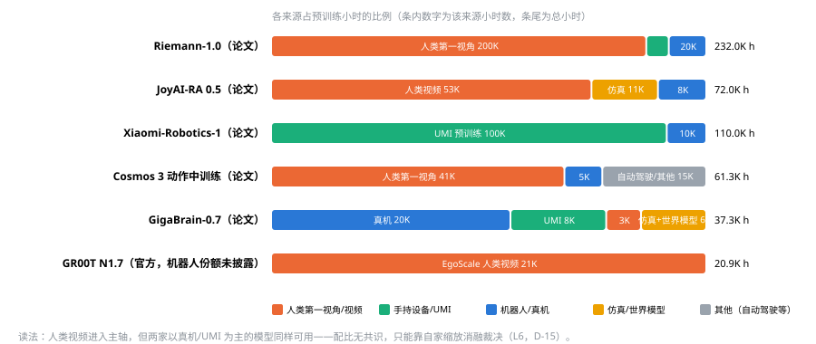

*图 1　六个 2026 年前沿模型的预训练小时构成（论文/官方自报）。Riemann、JoyAI、Cosmos 3 以人类第一视角为主；GigaBrain-0.7 与 Xiaomi-Robotics-1 以真机/UMI 为主同样可用。配比没有共识，只能靠自家缩放消融裁决（L6，D-15）。*

**含义**：预训练小时数的主体应来自人类第一视角视频，且**必须**经过过滤/标注（HumanScale 的前提）与相机运动保留；机器人数据的作用是对齐（每任务几小时）与纠错（DAgger/干预），不是堆小时。仓库的 human 轨从"规模腿"升级为"主轴"，robot 轨从"主体"降为"对齐层"——这与 [architecture.md](architecture.md) §1 的四源框架兼容，但配比要改（§3 L6）。

### 1.2 原始供给过剩，可用数据稀缺

| 证据 | 来源 | 属性 |
|---|---|---|
| 众包第一视角视频：$6/h 事实标准（$3–9 区间）；DoorDash Tasks 面向 800 万骑手，$5/任务、上限 $20–25/h；印度 ₹250/h（≈$2.6） | remowork.life、NBC、explainx | 第三方 |
| 遥操作全成本 $118/h（2026-03，2024 年为 $340）；操作员 $28–60/h；熟练 25–40 可用集/h vs 新手 8–12；QA 拒收 10–30% | RCSV、Dexset | 第三方（RCSV）+ 自报⚠️（Dexset 三组数字，D-21） |
| 中国：总体 200–500 元/h，真机 500–1000 元/h，无本体数据预期收敛至真机 1/2–1/3；觅蜂 MEgo 第 2 万套下线、累计 100 万+ h；穹彻 RoboPocket 50+ 城市、10 万+ h；京东两年 1000 万 h 目标；光轮提出 5 年 100 亿小时共建 | 澎湃/猎云、科学网、澎湃、新华网 | 第三方 + 自报⚠️ |
| 信通院《训练场研究报告（2026）》：全国建成 70+、在建 46，"卖数据难覆盖投入"，转向"训练即服务"；北京石景山训练中心暂停升级，理由是千万级轨迹"本质仍是实验室场景" | 财联社、科学网 | 第三方 |
| 北京人形创新中心：150 台真机/40 构型，熟练采集员有效数据仅 1/3–1/2 | 新浪 | 第三方 |
| Dyna：自报成功率 99.9%，但客户质量通过率 87%（新）/46%（旧） | PR Newswire | 自报⚠️ |
| Label Studio 1,228 篇 VLA 论文元分析：瓶颈已从"数据不够"转为"标注差、同质化、失败数据被丢、未验证"；0.31% 投毒即可植入 98–99% 后门 | labelstud.io | 第三方 |


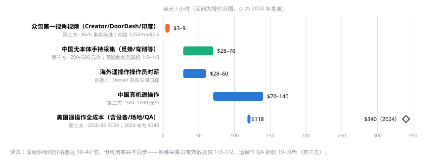

*图 2　各来源每小时价格阶梯（美元/小时，区间为报价范围，◇ 为 2024 年基准）。众包视频 $3–9，手持设备数据 $28–70，真机遥操作 $70–140，美国全成本 $118（2024 年 $340）。价格差 10–40 倍，但可用率不同步：熟练采集员有效数据仅 1/3–1/2、QA 拒收 10–30%。*

**含义**：不要把资本投在"再建一个训练场"或"自研头戴设备量产"上；原始小时是可以按小时采购的大宗商品，价格还在下降。护城河在过滤、对齐、估值与验证。这直接支持 CLAUDE.md 决策 6"质量优先于吞吐"，并要求把 P2 眼镜量产从计划里冻结为可选项（§6 决策 2）。

### 1.3 动作空间、数据格式、质量标准三线收敛

| 证据 | 来源 | 属性 |
|---|---|---|
| 相机系/相对末端动作作为人-机统一 schema：GR00T N1.7（相对 EEF）、UCAG-P（相机中心动作几何）、ACE-Ego-0、JoyAI-RA、ZETA（局部 EEF +15pp） | NVIDIA；arXiv:2608.26058、2606.17200、2608.05674、2609.02546 | 官方 + 论文 |
| LeRobot v0.6.0（2026-07-06）：12-bit HEVC 深度流、逐帧子任务/计划列、进度/奖励列（Robometer 4B，>100 万轨迹标注）；0.7 路线图"流优先"重设计 | HF 博客、GitHub issue #3832 | 官方 |
| `lerobot-dataset` 独立包停在 0.5.0，落后主线 | PyPI | 官方 |
| AgiBot World 2026：LeRobot v2.1 + 三层扩展标注 + error/intervention 帧 + 降级脚本；CC-BY-NC-SA；第三方称第三期 wrench/effort 必填，但公开卡片字段表未见（D-17 待核） | HF 数据集卡、CSDN | 官方 + 第三方 |
| ABC-130K 3,500 h Apache-2.0 直接以 LeRobot v3 发布；BEHAVIOR 2026 20k 演示 3.27 TB MIT，含逐相机位姿、深度、技能段 | arXiv:2606.27375、HF | 官方 |
| MCAP 作为记录系统：Foxglove 3.0 agentic 平台（$40M B 轮）；mcap python 1.4.0；Rerun 发布 .rrd 数据层 + Hub（第三种持久化格式候选） | Foxglove、GitHub、rerun.io、第三方报道（融资额） | 官方 + 第三方（$40M） |
| YD/T 6771-2026《人工智能 关键基础技术 具身智能数据集质量要求及评价方法》（2026-07-15 发布、2026-11-01 实施，备案 108001-2026，推荐性方法标准，约束力来自采购/验收合同）八维指标；YD/T 6770-2026 基准测试方法 2026-06-01 实施；ISO《人形机器人数据集》立项、中国专家任召集人；"一机一码"全生命周期规范 | 深圳政府网、新华网、人民网 | 官方 |

**含义**：仓库押注 MCAP + LeRobot v3 双格式是对的，且要**跟进 v0.6 的逐帧列**并把 wrench/effort 与三层标注做成契约字段；`lerobot-dataset` 独立包不再可靠，依赖应改回 `lerobot` 核心（§7.2）。动作 schema 需要一次性拍板为相机系相对末端（U-23）。YD/T 6771 报告生成器是 2026-11 前的硬交付。

### 1.4 "不删只标"从原则变成方法，次优与失败数据成为一等公民

| 证据 | 来源 | 属性 |
|---|---|---|
| π0.7：用 episode 元数据（质量、速度、来源）做条件化提示，把失败/自主 rollout/人类视频全部纳入训练；RL 专家蒸馏进通才 | pi.website、arXiv:2604.15483 | 官方 |
| Ambient Diffusion Policy：次优数据只在高/低扩散时刻参与训练，OXE 混合上比共训基线最多 +33% | arXiv:2606.12365 | 论文 |
| Q-Planning：仅靠自身 rollout（含失败）40%→90%，只用成功样本 SFT 停在 55% | arXiv:2608.21204 | 论文 |
| HELP：把自主 rollout 切成进展/空闲/致败/恢复段再入训练，吞吐 1.7–4.2×；SARM2 阶段感知密集奖励 58%→100%；WVM 世界价值模型 + 800 条次优轨迹基准 | arXiv:2607.09776、2606.10305、2606.24742 | 论文 |
| MMPF：改标错配语言标签优于删除；GO-1-Pro v2：任务多样性 > 每任务量，操作者多样性引入速度多模态反而有害；Geometric Entropy：一致性比多样性更重要 | arXiv:2608.07895、2507.06219、2606.20871 | 论文 |
| 数据估值：ATHENA 影响函数 313× 提速、50–67% 数据追平全量；SIEVE 原语级选数 50% 演示 + 50% 训练步超全量；SiMDex 从 3,200 万第一视角样本检索 <5% 47.7%→61.1%；ISR 信息等距重采样 +25% | arXiv:2606.16208、2607.06442、2608.04196、2606.22907 | 论文 |
| AgiBot World 2026 第二期刻意保留失败/非理想轨迹，第三期含 HG-DAgger 介入与 RL rollout | HF、CSDN | 官方 + 第三方 |

**含义**：策展的输出不是"保留/丢弃"而是**段级标签 + 估值分数 + 元数据条件**；仓库的"清洗是标记不是删除"在 2026 年得到三条独立验证。策展层需要新增段级状态机、密集进度/奖励伪标签和影响函数式排序器（§3 L3）；采集 SOP 要控制速度带，操作者多样性只服务人口/地域覆盖而不是策略性能。

### 1.5 评测走向分级、序贯与代理，并正在产品化

| 证据 | 来源 | 属性 |
|---|---|---|
| NVIDIA RoboLab：分级得分 + SPARC 平滑度 + 失败事件 + NPE 敏感性归因；70 次试验 90% 成功率的置信区间 80.5–95.9%，±2 点需 ~1,030 次；2026-08 进入 Isaac Lab-Arena | developer.nvidia.com | 官方 |
| TRI"超越二值成功率"：任意时刻有效的序贯检验最多省 70% 评测；主动因子评测 2,331 次真机试验省 20–40% | arXiv:2603.13616、2607.14439 | 论文 |
| 世界模型评测器：RoboWorld 与 RoboArena 真机榜 r=0.989（100 H100·h）；SC3-Eval 0.929；R2S-Eval Spearman 0.823；SimFoundry 0.911；Veo 评测器 1,600+ 次真机对照 | arXiv:2607.01060、2606.18610、2609.03276、2606.28276、2512.10675 | 论文 + 官方 |
| 反例：WorldSimProbe/WorldEcho 证明世界模型只跟随专家动作，对 off-expert 动作失效；仿真校准每任务 ~10 条真机演示把排序 Spearman 0.70→0.875，更多反而变差 | arXiv:2608.09298、2608.24885、2606.10366 | 论文 |
| RoboDojo：42 仿真 + 18 真机任务，最佳真机策略 8.8% vs 人类 76%；BEHAVIOR 2026：100 任务/20k 演示/1,950 h，BDDL 部分得分，2025 冠军 26% | arXiv:2607.04434、behavior.stanford.edu | 论文 + 官方 |
| 低成本真机农场：Armnet SO-101 并行评测 3,118 条三值标签；VLA-REPLICA 现货 BOM；XPolicyLab 接口把集成从 5 h 降到 30 min | arXiv:2607.24481、2605.20774、2608.09892 | 论文 |
| 第三方预测 2027 年"策略 QA"成独立产品品类；基础设施层 2025 融资 $2.1B | roboticscenter.ai | 第三方 |


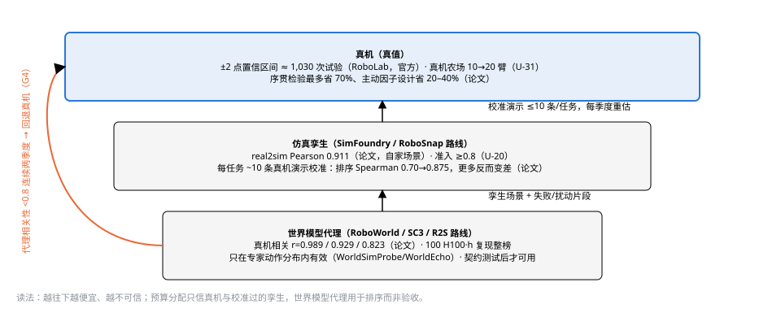

*图 3　评测三层代理与各自的可信度：真机是真值但每 ±2 点需约 1,030 次试验；仿真孪生用每任务约 10 条真机演示校准，排序相关 0.70→0.875；世界模型代理与真机相关最高 0.989，但只在专家动作分布内有效。代理相关性连续两季度 <0.8 即回退真机（G4）。*

**含义**：评测不再是训练的下游，而是采集预算的上游（"评测反向绑采集"，穹彻 DM3 与 Scale Up Strategically 都是这个方向）。仓库的 [eval-protocol.md](eval-protocol.md) 要加分级得分、序贯检验与世界模型代理层，并把评测能力做成可对外的产品线（§5 PL4）。

### 1.6 部署车队即采集车队，干预数据是最贵的对齐层

| 证据 | 来源 | 属性 |
|---|---|---|
| Figure：BotQ 产能 1 台/小时（120 天 24×，累计 350+ 台），官方称出厂机器人分配给内部研发、数据采集、端到端家务、商业用例**四类并列**用途，并称"车队越大，为 Helix 生成的数据越多"（未说明优先级）；7 月累计 >1,000 台（第三方股东信转述）；Helix-02 物流 8h→24h→~200h 连续运行、自动 reset 与换机（自报⚠️）；BMW Spartanburg 排序工位；第三方报道 Figure 03 单次充电 4–5 h、坞站充电 1 h、热插拔换机（humanoidsdaily "inside the campus"，未在扫描记录中，待核） | figure.ai/news/ramping-figure-03-production、BMW press、RoboStrategy 股东信、humanoidsdaily | 官方（产能）+ 自报⚠️（200 h）+ 第三方 |
| Apptronik Robot Park 9 万平方英尺：Apollo 2 定位为"数据采集平台，不是产品"，遥操作 + 自主混合为 Gemini Robotics 供数；Tesla 首批产线 Optimus 进"Optimus Academy"专做采数 | apptronik.com、第三方 | 官方 + 第三方 |
| 1X：三档自主（全自主 / 共享 / 全遥操），NEO 家庭部署以 Expert Mode 遥操作为主要数据来源，隐私靠模糊人脸 + 禁区 | 1x.tech、Humanoids Daily | 官方 + 第三方 |
| Agility S-4：65,000 Digit 运行小时 / 9 站点，2025 营收 $1.8M；Adamo 托管遥操作稳态 ~1 介入/机/小时，峰值 3–4×；AgiBot 第 1 万台，2026 目标 1000 万有效小时含 200 万真机 | SEC S-4、adamohq、新浪 | 官方 + 第三方 + 自报⚠️ |
| LWD：16 机车队离线到在线 RL，介入作为正优势转移，4 h ≈ 60 机器人小时到 95%；VLA-FAIL / SAFECAST 无需失败数据的运行时 OOD 探针 | arXiv:2605.00416、2606.21386、2608.04246 | 论文 |
| 没有任何厂商公开干预率；Figure"市场中不用遥操作"vs 1X"人在环"路线之争 | Humanoids Daily | 第三方 |


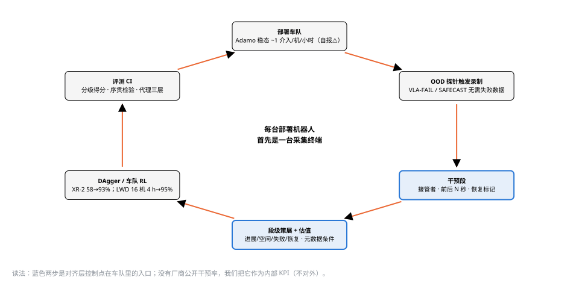

*图 4　车队数据飞轮：部署机器人在 OOD 探针触发下录制干预段（接管者、前后 N 秒、恢复标记），经段级策展与估值进入 DAgger/车队 RL，新 checkpoint 过评测 CI 再部署。蓝色两步是对齐层控制点在车队里的入口。*

**含义**：每台部署机器人首先是一台采集终端；干预段（谁在何时接管、接管前 N 秒、恢复后 N 秒）是所有数据中单位价值最高的一类。仓库的运行时回流（[runtime-and-deployment.md](runtime-and-deployment.md) §4）要升级为 L7 的一等线条，并把"干预率"作为内部 KPI（不对外宣称，除非附可复现日志）。

### 1.7 监管把 lineage、同意、脱敏变成交付条件

| 证据 | 来源 | 属性 |
|---|---|---|
| 欧盟《数字综合法案》(EU) 2026/1744：机械内嵌 AI 的高风险义务推迟到 2028-08-02 并改由机械法规承接；Data Act 数据可及性 2026-09-12；CRA 报告义务 2026-09-11；PLD 转化 2026-12-09；机械法规 2027-01-20；仍需公告机构第三方认证 | Cooley、CMS、金杜 | 第三方（律所，高） |
| Meta AI 眼镜诉讼（补漏检索 2026-09-09）：Bartone v. Meta（N.D. Cal. 3:26-cv-01897）2026-09-01 修订诉状新增**旁观者原告类**，"自动模糊会失效"本身成为证据；Alvarez v. Meta（N.D. Ill. 1:26-cv-10773）2026-09-04 以 BIPA 起诉眼镜生成面部生物特征签名；Hartman v. Meta 裁定加州法律选择条款不能排除 BIPA；Texas AG 2026-05-20 调查（LED 不亮、外包标注员可见私密画面）；ICO 去函、肯尼亚 ODPC 立案；Meta 固件改为遮挡 LED 即关相机。科罗拉多改 ADMTA（2027-01-01）；日本 APPI 2026-07-17 加严生物识别；美 FCC 2026-07 境外"先进机器人设备"清单（未核实） | medialaws.eu、Bloomberg Law、texasattorneygeneral.gov、BBC、DLA Piper、Skadden、金杜 | 第三方（律所/法院，高） |
| 中国：YD/T 6770/6771、一机一码、ISO 立项；工信部 + 国资委实景实训专项：省 ≥20 场景、年底万台级、明确"数据确权与共享"；人形机器人保险约 5,000 元/台/年 | 政府网、新华网、China Daily | 官方 + 第三方 |
| 中国标准四条并行流（补漏检索 2026-09-09）：YD/T 6771 备案 108001-2026、47 起草单位、三部分框架（生产操作规范 / 组织机制 / 八维指标），**全文在标准平台因版权不公开**，网传阈值（缺失率 ≤5%、时间戳偏差 <20 ms、标注一致 ≥95%、≥480p/30fps）均未核实；YD/T 6770 五指标含**人工干预率与场景扰动衰减率**、四种测试模式；GB/Z 218.1-2026《具身智能数据质量规范 第 1 部分：真实数据》与 GB/Z 220-2026《数据生成平台技术要求》2026-08-27 发布（CESI/SC42）；SJ/T 12250《具身智能 数据采集规范》报批稿；国家数据局系《高质量数据集 具身智能 面向训练基地》立项；ISO/CD 26264-1 处于 30.60 阶段，定位为生命周期/"数据集护照"标准而非文件格式；工信部《国家人形机器人产业标准体系建设指南（2026 版）》**征求意见至 2026-09-23** | hbba.sacinfo.org.cn、cqn.com.cn、std.samr.gov.cn、iso.org、miit.gov.cn、arXiv:2606.19769 | 官方（高）+ 第三方（阈值低） |
| ISO 13482:2026 服务机器人安全纳入软件/AI；AI 责任险额度 $15–25M | Intertek、reinsurancene.ws | 第三方 |
| 公开第一视角数据集多为非商用许可（Ego4D/EPIC/EgoDex）；Ego4D 隐私政策为"默认模糊 + 受试者同意例外（612 h 未模糊，约 17%）+ 事后申诉"；Build AI Egocentric-10K（工厂第一视角 1 万 h，Apache-2.0）强调手部可见率但对旁观者脱敏零说明；HumanNet 把隐私审查作为一等设计但未发布 | truelabel、ego4d-data.org、HF builddotai、arXiv:2605.06747 | 第三方 + 官方 + 论文 |
| 脱敏工具链现状：EgoBlur 2.0.1（PyPI 2026-04-15，Apache）Gen1 论文（arXiv:2308.13093，Aria Pilot）人脸召回 0.90（灰度）/0.94（RGB）但**截断人脸仅 0.43**，车牌模型有但论文摘录未单列召回（U-32 自测）；屏幕/文档 PII 最强开源候选（screenpipe，98.9% 零泄漏）为 CC BY-NC-4.0；OpenScrub（Apache，人脸 + 人体轮廓 + 车牌 + OCR）成熟度低；声纹脱敏有 VoicePrivacy 2026 基线（McAdams 无 GPU）与 EER/WER/UAR 三指标；视觉 token/去重 embedding 可推断隐私属性（TGAP）；**没有任何公开研究量化脱敏对第一视角手部可见率与动作伪标签的损伤** | GitHub facebookresearch/EgoBlur、HF screenpipe、voiceprivacychallenge.org、arXiv:2608.28691 | 官方 + 论文 |
| EU Data Act 第 3(1) 条 2026-09-12 起对新上市联网产品适用"设计即可访问"，"数据"明确含音视频；律所解读：导出义务只覆盖 readily available 的原始/预处理数据，对旁观者个人数据不提供 GDPR 法律基础 → 导出前必须先脱敏旁观者，脱敏须是 raw 之上**确定性、可重放的变换** | eur-lex、GamingTechLaw | 官方 + 第三方 |


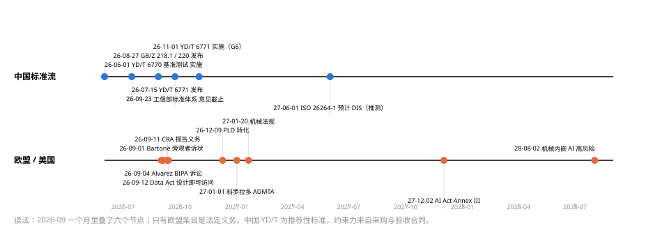

*图 5　2026-06 至 2028-08 的监管时间线：中国四条标准流（YD/T 6770/6771、GB/Z 218.1/220、工信部标准体系指南、ISO 26264-1）与欧盟产品法叠层（CRA、Data Act、PLD、机械法规、AI Act），以及 Meta 眼镜旁观者诉讼。2026-09 一个月叠了六个节点；只有欧盟条目是法定义务。*

**含义**：[compliance-and-security.md](compliance-and-security.md) 的区域矩阵与删除传导已经是正确方向，但需要三项升级：脱敏前置到 recorder/App（不是入湖后）、数据集 manifest 携带机器可读的同意与来源图（Data Act 09-12 起）、YD/T 6771 八维报告与"一机一码"设备注册进平台。这些是**产品功能**而不是法务文档。标准层面的两个具体动作：购买 YD/T 6770/6771 文本并把质量报告器做成"维度名可重映射"（四条标准流的词汇会收敛但验收主体不同）；在 2026-09-23 前就格式/同步/隐私条目向工信部标准体系指南提交意见。

### 1.8 仿真与世界模型的角色从"数据增殖"转向"评测 + 长尾 + 校准"

| 证据 | 来源 | 属性 |
|---|---|---|
| Cosmos 3 把仿真渲染视频作为 WFM 中训练的长尾补充并附消融；Isaac Lab 3.0 beta 多物理后端（PhysX/Newton/MJWarp）+ 可变形体；Isaac Lab-Arena v0.2 alpha | NVIDIA | 官方 |
| RoboDream 锚定生成：50 条真机 + 生成数据 36.3%→62.5%，收益在生成:真机 ≈4:1 饱和；IWS 约 6 h/任务真机数据训出的轻量世界模型可 1:1 替代等量真机数据（短任务）；RoboCasa365 合成:人类 2.7:1 | arXiv:2606.02577、2603.08546、2603.04356 | 论文 |
| Cosmos Policy sim2real：~800 条合成演示/任务零真机零样本 35%；OpenWAM 6,400 h 一阶段共训优于分阶段 | arXiv:2606.31101、2609.07398 | 论文 |
| 世界模型是新的投毒入口：触发信号藏进"看似安全"的遥操作数据，经增殖后植入后门 | arXiv:2606.09499 | 论文 |
| 立场论文：瓶颈是四个缺失接口——自动标注、重定向、3D 世界模型、奖励 | arXiv:2606.06556 | 论文 |
| SimFoundry：单视频 → 仿真孪生/数字表亲，real2sim 评测 Pearson 0.911，但 license 混杂（详见 [research-simfoundry.md](research-simfoundry.md)） | arXiv:2606.28276 | 论文 |

**含义**：sim 轨的第一用途是**评测孪生与校准**（每任务 ~10 条真机演示做校准），第二是长尾覆盖，第三才是数据增殖（上限 4:1）。神经轨迹/世界模型数据必须带 lineage 并过投毒审计。[sim-track.md](sim-track.md) 的定位需要按此重排优先级。

---

## 2. 战略框架

### 2.1 定位

机器人公司里的 AI 数据组织不是"采集部门"，而是**数据引擎**：它拥有从采集终端到评测闭环的全链路，产出三种资产——对齐数据（人↔机同任务配对、干预段、校准演示）、策展与估值模型、评测校准数据。原始小时是它的输入，不是它的资产。

### 2.2 三条主线

```
            ┌──────────────── C 闭环层（自研）──────────────┐
            │ 评测孪生 · 世界模型代理 · 真机农场 · 序贯统计     │
            │ 车队回流 · 干预段 · 自改进（HELP/SARM2/LWD）      │
            └──────────────┬─────────────────▲────────────────┘
      预算反向分配 ◄────────┘                 │ 分级得分/干预率
            ┌──────────────▼─────────────────┴────────────────┐
            │ A 对齐层护城河（自研）                             │
            │ 相机系相对末端 schema · 人→机伪标签与重定向         │
            │ 段级策展 · 数据估值 · 元数据条件化配方 · lineage    │
            └──────────────▲──────────────────────────────────┘
            ┌──────────────┴──────────────────────────────────┐
            │ B 供给层杠杆（外购为主）                           │
            │ Creator App 众包 · 外部训练场/供应商 · 开源大集     │
            │ 自采 robot/device 轨（只采对齐与校准所需的量）       │
            └─────────────────────────────────────────────────┘
```


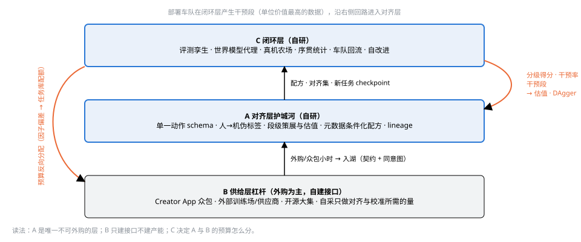

*图 6　三条主线的机制：供给层外购/众包小时经契约与同意图入湖；对齐层产出配方、对齐集与新任务 checkpoint；闭环层用分级得分、干预率与干预段回到对齐层，并按因子偏差把预算反向分配到任务库配额。*

- **A 对齐层与 C 的评测校准数据**是不可外购的两样东西：对齐集依赖自家本体的动作 schema、自家任务与自家车队的干预数据；校准数据是自家本体 × 自家任务的真机↔孪生↔代理配对。评测工具、公开榜与真机农场可以外购或接入（RoboDojo、XPolicyLab、Isaac Lab-Arena），校准数据不能。
- **B 供给层**只自建"接口"（Creator App、采集 SDK、数据契约），不自建"产能"（不做头戴设备量产、不建训练场）。理由见 §1.2。
- **C 闭环层**决定 A 与 B 的预算怎么分：评测先行，采集预算按因子偏差与代理相关性反向分配。

### 2.3 北极星与辅助指标

| 指标 | 定义 | 12 个月目标 | 24 个月目标 | 数据来源 |
|---|---|---|---|---|
| **北极星：新任务上线成本** | 新任务达标所需的（对齐/DAgger 采集真机小时 + 评测试次真机小时）× 全成本（含评测与微调算力）。达标 = 序贯检验在 α=0.05 下拒绝"分级得分 <85%"（或 Wilson 下界 ≥85%，点估计 ≥90%）；分级得分口径 = eval-protocol §1.2 任务进度分扩展为谓词部分分（M2 前补齐，补齐前用成功率 + 进度分替代） | ≤20 真机小时 / ≤$5k（采集 ≤$2k + 评测 ≤$3k）。**占位值**：M2 初用 H0 三任务簇实测的"真机小时 → 分级得分"曲线重定；隐含假设 human 预训练 + DAgger 使 XR-2 式饱和曲线左移 ≥5×；G2 未过则改为 ≤60 h | ≤5 真机小时 / ≤$1k（对齐 Gemini Robotics 2 "<200 条示范/数小时"（官方博客自述⚠️，D-20）、Riemann "3 h/任务"（论文，D-15）量级） | eval CI + lineage |
| 可用对齐小时 / 美元 | 通过策展并进入训练区的 robot + device + 干预小时 ÷ 全成本 | robot ≥0.01 h/$（即 ≤$100/h）、device ≥0.03 h/$ | 各再 ×2 | data-platform 成本模型 |
| 人类视频占比与质量 | human 轨占预训练小时比例；HumanScale 式等小时消融的 OOD 增益 | ≥50%；OOD 增益 >0（显著） | ≥70%；对数线性斜率非零 | mixture lineage + fewshot-bench |
| 评测代理相关性 | 仿真/世界模型代理与真机分级得分的相关性（Pearson 看幅度、Spearman 看排序；每季度重校准）。口径：准入门（U-20，换件后）Pearson ≥0.8；止损（G4）连续两季度 <0.8 | ≥0.8（与 eval-protocol §5、U-20 一致） | Spearman ≥0.85 且校准演示 ≤10 条/任务（2606.10366 上限 0.875，再高需新方法） | eval CI |
| 干预率 | 每 1,000 任务的人工接管次数（内部 KPI，不对外） | 基线建立 | 环比每季度下降 | 运行时回流 |
| 合规就绪度 | YD/T 6771 八维报告可自动生成；DPIA 完成区域数；删除 SLA 达成率 | 报告器上线；2 区域；100% | ISO 草案对齐；4 区域 | compliance 表 |


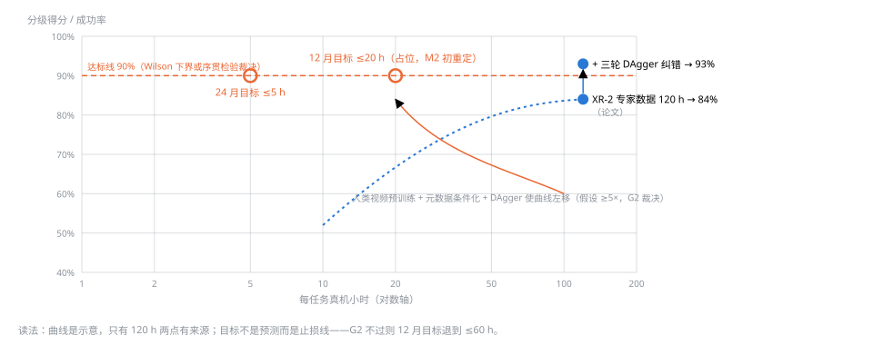

*图 7　北极星示意：每个新任务达到 90% 分级得分所需的真机小时（对数轴）。唯一有来源的两点是 XR-2：专家数据 120 h 停在 84%，三轮 DAgger 到 93%（论文）。12 个月 ≤20 h 为占位，M2 初用 H0 三任务簇实测曲线重定；G2 不过则退到 ≤60 h。*

### 2.4 原则（在 CLAUDE.md 七条之上新增五条，需在下一次 review 中裁决是否写入）

1. **单一动作 schema**：所有轨最终对齐到相机系相对末端 + 手部/夹爪状态（96 维槽位向量的子集），具身特异性放在提示与掩码里，不放在动作空间里。
2. **段级而非 episode 级**：策展、估值、奖励、回流都以段（进展/空闲/失败/恢复）为单位；episode 只是容器。
3. **评测先于对齐/校准/后训练采集**：robot/device 轨与任务库配额的任何新预算必须先有对应的评测任务簇与代理相关性；预训练供给（human 轨众包、开源大集）的扩量门改用 §4.2 规则 3 的缩放消融斜率（HumanScale 的收益恰在事先没有评测簇的未见任务上）。
4. **供给外购、对齐自研**：原始小时按市场价采购或众包，自采只做对齐与校准所需的量。
5. **元数据条件化优于过滤**：低质、失败、自主 rollout 数据带标签入训练，由模型学会区分；过滤只针对不可用（同步失败、隐私）与投毒。

### 2.5 战略控制点

战略控制点不是数据量，也不是模型，而是**"新任务上线成本"的定价权**：谁能最便宜、最可信地把一个新任务从零做到真机可用，谁就决定了链上其他人的数据值多少钱。它落在三个具体位置上，按可得性排序：

| 控制点 | 它控制什么 | 为什么别人绕不过 | 为什么复利 | 现状与可得时点 |
|---|---|---|---|---|
| 1 评测校准数据（自家本体 × 自家任务的真机↔孪生↔代理三层配对） | 定义"什么是好数据"，位于采购与验收的上游 | 每任务只需约 10 条真机演示校准（论文），但必须在自家本体上做；YD/T 6770 五指标与 RoboLab 分级得分都要落到自家校准上 | 每季度重估，相关性数据本身可售；评测越准采集预算越省（序贯检验最多省 70%） | 未持有；0–6 月可拿，不依赖车队（决策 5 的理由） |
| 2 对齐层语料（人↔机同任务配对集 + 干预段） | 新具身、新任务的适配速度 | 只有同时拥有本体、任务和采集通道的人能产出配对；干预段只在自家部署中产生，没有厂商公开 | 新具身只需约 5% 对齐数据（ZETA）；每次部署都在产干预段 | 配对集 H1 起步；干预段要等车队——先用配对集 + DAgger 替代，首批部署当采集车队而非收入来源 |
| 3 数据契约 + 同意/来源图 | 合规交付条件与标准话语权 | Data Act 09-12、CRA 09-11、YD/T 6771 11-01、ISO 26264-1 都要求机器可读的来源、同意与生命周期记录；四条中国标准流起草单位高度重叠 | 一旦成为训练场与 OEM 的交付格式，切换成本落在对方 | 契约 0.3 与八维报告器 v0 在 M1 内；标准参与窗口 2026-09-23 |


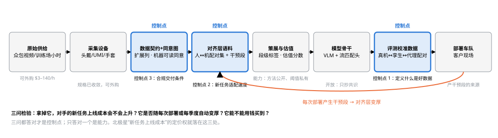

*图 8　价值链上的三个战略控制点（蓝色）：数据契约与同意图、对齐层语料、评测校准数据。灰色环节可外购或开放：原始供给（$3–140/h）、采集设备（规格已收敛）、模型骨干（只抄共识）、策展方法（公开）、部署车队（产干预段的来源）。橙色回路是每次部署让对齐层变厚的机制。*

**看起来像控制点、其实不是的**：原始小时数（众包视频 $3–9/h，供给以百万小时计）；头戴设备（规格收敛，EgoKit 一个 SDK 覆盖六种现成设备，决策 2 据此冻结 PVT）；模型骨干（开放或半开放，领先半年即被追平）；仿真引擎与世界模型（NVIDIA 与开源在供给，我们只控制校准层）；训练场（信通院已说卖数据难回本，它们是客户）。

**三问检验**：拿掉它，对手的新任务上线成本会不会上升；它是否随每次部署或每季度自动变厚；它能不能用钱买到。三问都答对才是控制点，只答对一个是能力，不值得战略级投入。

**对产品顺序的修正**：PL3 策展即服务现金流最早但不是控制点，PL4 评测即服务是控制点却排在 M3 后。保持 PL3 先收钱，但 PL4 的校准数据积累从 H1 起内部运行，对外可以晚，数据不能晚（§5.2）。

---

## 3. 数据技术方向线条（L1–L8）

每条线条按同一模板：仓库现状 → 2026 证据触发的改动 → 12/24 个月目标 → 技术选择（含负选择）→ 里程碑归属（M/H/P）→ 风险与止损 → 治理条目。线条之间的依赖：L2 是底座；L1/L4/L5 产数据；L3 处理；L6 消费；L7 裁决；L8 贯穿。


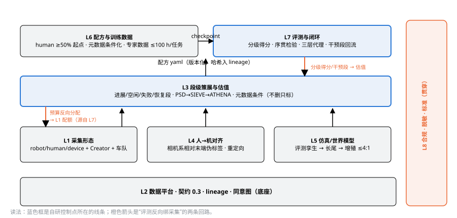

*图 9　八条方向线条的依赖：L2 平台是底座，L1/L4/L5 产数据，L3 段级策展与估值处理，L6 配方消费，L7 评测裁决并把分级得分/干预段送回估值、把预算反向分配到 L1 配额，L8 合规贯穿全部。蓝色框是控制点所在的线条。*

### L1 采集形态组合：从"四轨"到"四轨 + 众包 + 车队"

- **现状**：robot/human/device/sim 四轨同 schema（CLAUDE.md 决策 2）；human 轨含官方头戴与 Creator App 手机众包两种形态；device 轨 UMI P0；robot 轨 Quest 3/OpenTeach；采集矩阵见 [index-replica-plan.md](index-replica-plan.md) §1.0。
- **2026 触发**：无本体设备规格已收敛（觅蜂 MEgo：60FPS/1080P/双目/深度 + 硬同步 + 标定，裸手/腕带/UMI 夹爪三个子类）；手指驱动 UMI 变体（YUBI，BOM <$200，8,434 h 开源）与触觉 UMI（RealDexUMI：触觉 88.75% vs 无触觉 70%）；采集器-夹爪协同设计（Koala、Sunday 手套 ~100 次迭代）；XRZero-G0 背包式 93 集/h、85% 有效、10:1 混合；Isaac Teleop GA + MANUS 官方手套；手部动作含 >100 Hz 能量（T-800 800 Hz 手套）；GO-1-Pro 发现操作者多样性引入速度多模态反而有害；Sunday 要求采集员刻意放慢、机器人以 75% 人类速度运行。
- **目标**：12 个月：device 轨自采 + 外购 ≥1e4 h，其中触觉子集 ≥500 h；human 轨 Creator 试点千人；robot 轨对齐集每任务 ≤20 h。24 个月：车队回流成为 robot 轨最大来源；device 轨 ≥5e4 h（自采 ≤30%）。
- **技术选择**：
  - device 轨采集规格下限写进 [device-track-umi.md](device-track-umi.md)：双目 ≥60 fps、深度、硬触发同步、出厂标定文件随 EpisodeMeta；手部/手套流原生频率 ≥200 Hz（决策 3 豁免已覆盖）。
  - 采集器与目标夹爪/手协同设计（Koala 路线）：H1 中期 U-04 裁决后（P1 EVT 期内），采集器末端与本体末端同构，重定向误差归零；U-04 前 P0/EVT 初版沿用 UMI 平行夹爪。
  - 触觉作为 device 轨可选模态（R-04 的探针），先用 RealDexUMI 式指尖阵列做 500 h 对照集，并在同一 UMI 上并排共装阵列式与光学式传感器（HTT：跨传感器迁移未解，配对采集是公认补救）；已有的开放触觉语料（OpenNeoData 5,000 h、FTP-1 3,000 h 聚合）几乎全是非商用许可，自采的理由是许可与末端匹配而非"没有数据"。
  - 采集 SOP：速度带（慢/正常）作为元数据字段而非追求操作者多样性；采集员现场即时质量反馈（Siemens DQAF 式，做进 App）。
  - 恢复数据模式（TAMEn）：每个任务模板附带"扰动-恢复"子任务，专门产失败/恢复段。
  - **负选择**：头戴设备止步 EVT/DVT 参考设计（不做 H2 的 PVT 500 台），P2 眼镜形态不立项；不自建训练场；不采购动捕棚（动捕数据外购或合作，归 sim 轨，见 [sim-track.md](sim-track.md) §6）。
- **里程碑**：H0：手机 + UMI×2 + 1 台本体；H1：EVT 10–50 台头戴 + 触觉 UMI 对照集 + Creator 试点；M3：车队回流接口。
- **风险/止损**：R-02 单位经济；新增 R-14（速度多模态污染）；止损：H1 末 device 轨全成本 > 外购价 1.5× 则停自采改外购。
- **设备设计**：五件套（触觉同构 UMI、头戴参考套件、Creator 手机套件、遥操作站 + 手套、车队回流录制器）的规格、同步、契约映射、BOM 与验收见 [capture-devices-design.md](capture-devices-design.md)。
- **治理**：U-04（末端消融，承接协同设计）、U-24（头戴量产冻结；受影响的既有条目 R-04/U-06/U-08/D-04 与 index-replica-plan §8.2、device-landscape §7.4 见 §7.2）、U-25（触觉模态是否进默认 schema）。

### L2 数据平台、格式与 lineage：从"双格式"到"记录系统 + 训练态 + 合规图"

- **现状**：MCAP 采集 + LeRobot v3 训练态（决策 1）；EpisodeMeta 0.2；lineage 表结构（[data-platform.md](data-platform.md) §3）；R-10 认为 lerobot-dataset 独立包可锁版本。
- **2026 触发**：LeRobot v0.6 逐帧子任务/计划/进度/奖励列 + 12-bit 深度流；0.7 路线图流优先；`lerobot-dataset` 独立包停更；AgiBot 三层标注 + wrench/effort + 降级脚本；Rerun .rrd 数据层 + Hub；Foxglove 3.0 以 MCAP 为记录系统做语义检索；lakeFS 把 Git 式数据版本化定位为机器人合规需求；YD/T 6771 八维；Data Act 机器可读导出；一机一码。
- **目标**：12 个月：契约 0.3（逐帧列、wrench/effort、段级表、同意/来源图）；八维报告器；设备注册（一机一码兼容）；机器可读导出 API。24 个月：流优先导出（跟 LeRobot 0.7）；跨区域联邦目录。
- **技术选择**：
  - 训练态依赖改为 `lerobot` 核心包（锁 ≥0.6），废弃 `lerobot-dataset`；export 层 writer 接口保留以便 0.7 流优先迁移。
  - 采纳 v0.6 逐帧列作为段级标签的标准载体：`subtask`/`plan`/`progress`/`reward` 四列 + 自家 `fdp.segment_state`（进展/空闲/失败/恢复）扩展列。
  - wrench/effort/tactile 作为可空模态进契约：tactile 存传感器无关的 (N,6) 点集（对齐 LeRobot PR #4469）并可导出为社区约定的 `observation.tactile.<name>` [rows,cols] 或 [k,channels] 窗口；wrench 必带 `frame_id`（PRISM 的教训）；effort 标 measured/estimated（MuSe 电流估计路线）；每路触觉流标 传感器家族/功能区/型号（FTP-1 跨传感器迁移的前提）。LeRobot 0.7 周期内不会原生支持多频率触觉/音频，原生频率只存 MCAP，export 做窗口化。
  - Rerun .rrd **只作可视化缓存**，不作第三种持久化格式（维持决策 1）；但 R-10 需重开记录该裁决与 Rerun Hub 的观察项。
  - lineage 增加"同意图"：episode → consent 版本 → 区域 → 数据集 manifest → 训练 run，可导出为机器可读格式（Data Act）。
  - 八维报告器：把 [curation-pipeline.md](curation-pipeline.md) 的 L1–L3 QC 输出映射到 YD/T 6771 的八个维度（标准全文待取得，U-26）。
  - **负选择**：不自研对象存储/元数据库（沿用 data-platform §2 选型）；不做 Foxglove 式全功能语义检索，只做 embedding 目录。
- **里程碑**：M1（契约 0.3 字段预留 + 八维报告器 v0：L1–L3 QC 输出 → 八维映射，维度名可重映射，2026-11-01 前）、M2（段级表、报告器 v1 对照购得的标准正文）、M3（同意图导出）。
- **风险/止损**：R-10 重开；新增 R-15（LeRobot 0.7 破坏性变更）；止损：0.7 正式版若破坏 v3 读侧，冻结在 0.6 一个季度并评估自维护 reader。
- **治理**：U-03 改判（lerobot-dataset → lerobot 核心）、U-26（YD/T 6771 全文与阈值）、R-10 重开。

### L3 策展与自动标注：从"episode 级五阶段"到"段级估值"

- **现状**：五阶段策展 + L1/L2/L3 QC + 状态机（[curation-pipeline.md](curation-pipeline.md)）；VLM 分层标注；"清洗是标记不是删除"。
- **2026 触发**：§1.4 全部证据；VLM 子任务标注端到端 F1 仅 0.168 但成本是人工 1/19（WGO-Bench）；PSD 无需训练的演示排序；Siemens DQAF 现场反馈；Label Studio 元分析（5% coreset ≈ 85–90% 效果；0.31% 投毒）。
- **目标**：12 个月：段级状态机上线；估值分数（影响函数/medoid/PSD 三选一经消融）进入每个 episode；VLM 标注走"VLM 初标 + 人工分层校验"而非全自动；投毒审计含世界模型增殖路径。24 个月：估值分数驱动采集预算（与 L7 闭环）。
- **技术选择**：
  - 段级状态机：在 episode 状态机之下新增 segment 表（HELP 四态 + 子任务边界），密集进度/奖励伪标签用 SARM2/Robometer 式模型（license 待核查）。
  - 估值排序器：先做 PSD（零训练）与 SIEVE 式原语 medoid，再做 ATHENA 式影响函数（需十亿参数策略与训练梯度，M3 后）。
  - 重标签优于删除（MMPF）：语言-轨迹错配进"改标队列"；速度归一化（ISR 信息等距重采样）作为 export 选项而非默认。
  - VLM 标注质量门：VLM 标注只在人工抽检 F1 ≥0.6 的任务簇上自动通过，其余进人工；WGO-Bench 数字进 D 表。
  - 现场反馈：DQAF 式 episode 级评分在采集 App 上 30 s 内返回（依赖 L1 的 App 与 L2 的轻量 QC）。
  - 投毒防御：跨账户 embedding 碰撞 + 世界模型增殖前后触发探针（新）。
  - **负选择**：不做全自动 VLM 标注上线（F1 0.168）；不以操作者数量本身作为策略性能的再平衡目标（GO-1-Pro：速度多模态有害）——操作者轴保留用于人口/地域覆盖（R-11）与 held-out 组切分（curation §2.2/§8），速度带作为独立元数据轴。
- **里程碑**：M2 全部；影响函数 M3。
- **风险/止损**：新增 R-16（估值分数过拟合到当前策略）；止损：估值排序 top-50% 训练不优于随机 50% 则回退到 QC 门。
- **治理**：U-28（估值方法选型消融）、D-13（WGO-Bench F1/成本）、D-14（Label Studio 元分析数字）。

### L4 人类视频 → 机器人监督：对齐算法成为独立线条

- **现状**：human 轨"无动作标签 → 重定向伪标签"、具身转换可选阶段（architecture §2.3）、伪标签工厂（index-replica-plan §4）、Ego2Robot 放大 12.8×。
- **2026 触发**：相机系相对末端收敛（≥4 家）；ACE-Ego-0 可靠性加权伪标签；C2Dex/TopoRetarget 接触一致性重定向；Human-as-Humanoid ego+exo 同步到 60-DoF 上身控制；ActiveMimic 相机运动即动作；GRA 生成视频只监督视觉；ZETA 5% 目标具身数据 +13.4pp；JoyAI 指出朴素混合导致负迁移、需"隐式 + 显式"双重对齐；EgoWAM 预测目标选 DINO/3D 流。
- **目标**：12 个月：伪标签 v1（相对末端 + 手部 + 可靠性权重）、HumanScale 式等小时消融通过（OOD 增益显著）、5% 目标具身对齐集制度化。24 个月：ego+exo 配对采集 ≥1,000 h；接触一致性重定向进默认路径。
- **技术选择**：
  - 伪标签的训练目标 = 相机系相对末端位姿 + 手部关键点/夹爪开合 + 可靠性分数；训练目标不含关节空间（具身特异性留给 S1 的具身提示），但 L1 运动学门仍以目标具身做一次性 IK 可行性求解，只产标记不产标签（curation §1.3/§4.2 不变）。
  - 相机运动作为动作通道保留（ActiveMimic）：human 轨 EpisodeMeta 记录头部位姿流，不在策展中丢弃"抖动"帧。
  - 生成/增殖视频只进视觉预测目标（GRA/EgoWAM），不进动作头监督；lineage 标 `synthetic=true`。
  - 对齐集：目标具身数据占预训练小时 ≤5%（training-pipeline §2 Stage B 口径；ZETA 显示 5% 即 +13.4pp），但每个具身每季度至少采集满足该 5% 上限所需的同任务人类 + 机器人配对数据，作为对齐层。
  - 重定向：从 ORB-SLAM/手部估计基线起步，M2 末引入接触一致性方法；评测用 MPJPE + 接触命中率双指标。
  - **负选择**：不做"人类视频直接微调动作头"；不押注单一 WAM 路线（训练层保守，决策 7）。
- **里程碑**：H0 伪标签 v0 → 仿真收益门；M2 伪标签 v1；M3 对齐消融。
- **风险/止损**：R-04（无触觉天花板）；program-plan 止损：H0 末伪标签无仿真收益则转 UMI + robot 路线。
- **治理**：U-23（动作 schema 拍板）、U-33（ego+exo 采集是否进 H1）。

### L5 仿真、real2sim 与世界模型：定位改为"评测孪生 → 长尾 → 增殖"

- **现状**：[sim-track.md](sim-track.md) 以 Isaac Lab/DexMimicGen 增殖为主，SimFoundry 作场景来源与评测替身（U-20），神经轨迹归 sim 轨。
- **2026 触发**：§1.8 全部；Isaac Lab 3.0 多后端（需记录物理后端）；RoboDream 4:1 饱和；IWS 1:1 短任务；校准 ~10 条/任务；Cosmos-H-Dreams 训练集刻意含失败；WM 投毒；license 核实结果（补漏检索 2026-09-09）：GR00T N1.7 代码 Apache-2.0 但**权重为 NVIDIA Open Model License**且硬依赖 gated 的 Cosmos-Reason2-2B（README 第 70 行"fully commercially licensable under Apache 2.0"与许可节自相矛盾）；Cosmos 3 全系 **OpenMDW-1.1**（接近 MIT，但把训练数据权利清理责任推给使用者）；SimFoundry 依赖见 [research-simfoundry.md](research-simfoundry.md) §4。
- **目标**：12 个月：每个真机评测任务有仿真孪生（SimFoundry/RoboSnap 路线，换件后准入 Pearson ≥0.8，24 个月 Spearman ≥0.85）；仿真代理进评测 CI；增殖比例上限 4:1 写进配方。24 个月：世界模型代理（RoboWorld/SC3 式）进入三层校准，且带 off-expert 失效检测。
- **技术选择**：
  - 物理后端、资产版本、域随机化种子进 `/meta/sim`（Isaac Lab 3.0 后必需）。
  - 评测孪生优先于训练增殖：sim 轨预算 60% 给孪生与校准、30% 长尾、10% 增殖。
  - 世界模型代理必须附 WorldSimProbe 式"可观测模拟器契约"测试，只在专家动作分布内使用。
  - 神经轨迹/WM 数据：lineage `synthetic=true` + 增殖前后投毒探针 + 上限 4:1。
  - license 门控：默认路径只用 Apache/MIT/OpenMDW 资产（TRELLIS.2、SAM2、本地 Qwen-VL、Cosmos 3）；GR00T N1.7 权重按 NOML 处理（可商用但有护栏终止、单方面更新与"Built on NVIDIA Cosmos"署名义务，且每个 CI runner 都要在 HF 接受 NOML），只进研究分支直到 U-29 裁决是否接受 NOML 义务；NVIDIA 数据集（Open-H-Embodiment CC-BY-4.0）与 NVIDIA 权重分开登记。
  - **负选择**：不自研物理引擎/渲染器；不把世界模型当训练数据主来源。
- **里程碑**：M2 sim QC + 孪生；M3 代理评测；持续 license 复核。
- **风险/止损**：R-17（WM 代理在 off-expert 区失效导致误判）；止损：代理相关性连续两季度 <0.8 则评测回退真机 + 序贯检验。
- **治理**：U-20、U-29（GR00T N1.7 / Cosmos 3 / HumanNet / EgoLive 许可核实）。

### L6 预训练与后训练数据配方：元数据条件化的分层混合

- **现状**：[training-pipeline.md](training-pipeline.md) 四阶段课程；配方 yaml 版本化；Stage B 门槛 ≥1e3 h（S 档）/ ≥5e3 h（M 档）。
- **2026 触发**：GigaBrain-0.7 配比（真机 55% / UMI 22% / ego 8% / 仿真 + WM 15%，37,257 h）；Xiaomi-Robotics-1（10 万 h UMI 预训练 + 1 万 h 后训练，数据缩放 > 模型缩放）；τ0-VLA 40-维统一状态动作；Riemann/Cosmos 3 人类视频占大头；JoyAI 朴素混合负迁移；π0.7 元数据条件化；专家数据 ~120 h/任务饱和 + DAgger；Skild S1 上下文演示 1 条 ≈ 380 条后训练 episode；持续学习需经验回放；VLAct 20% 数据 + 16 GPU 超 GR00T N1.6（表征中心继续预训练）；Qwen-RobotManip 3.8 万 h 全部来自开源。
- **目标**：12 个月：Stage B（S 档）用"human ≥50% / device 20–30% / robot 10–15% / sim+WM ≤15%"的小时配比起步，配比经缩放消融裁决而非照抄；每个 checkpoint 带元数据条件（质量、速度、来源、成功/失败）；后训练以 DAgger/干预段为主。24 个月：M 档；上下文演示接口；持续学习回放集制度化。
- **技术选择**：
  - 配方 yaml 增加 `conditioning` 段：训练时把 episode 元数据（quality_score、speed_band、track、outcome）作为提示 token；推理时提示"高质量、正常速度、成功"。
  - 开源大集作为起点：ABC-130K（Apache-2.0，第一方遥操作；HF 仓库缺 LICENSE 文件，lineage 固定一份 README 许可声明）、BEHAVIOR 2026（MIT）、Unitree UnifoLM（Apache-2.0）、NVIDIA Open-H-Embodiment（CC-BY-4.0）、Build AI Egocentric-10K（Apache-2.0，1 万 h 工厂第一视角，入湖时自行脱敏并把来源合规状态写入 lineage）、社区 v3；NC 许可集（AgiBot、GRAIL、OpenNeoData）只进研究分支；HumanNet 未发布、EgoLive 无公开许可（JD Cloud 市场 gated）、EgoSuite-Open100K 为未公布文本的自定义 gated 许可、HiPHI 非商用——四者不得出现在配方 yaml。
  - 每任务专家数据上限 ~100 h（XR-2 饱和点），超出预算转 DAgger 轮次与干预段。
  - 缩放消融切分器按轨/小时/任务/速度带切分，拟合对数线性斜率；斜率为零的轨停止扩量。
  - 表征中心继续预训练（VLAct 路线）作为低算力对照，验证"数据 > 模型"是否在自家规模成立。
  - **负选择**：不复制任何一家的配比数字（全部自报或单篇）；不做多骨干并行。
- **里程碑**：M3；Stage B 门槛不变。
- **风险/止损**：Stage B 止损门（eval-protocol §4、training-pipeline §2：不低于 Stage A 微调对照）；R-03 自报数字。
- **治理**：D-15（GigaBrain/Xiaomi/Riemann 配比登记）、U-30（元数据条件化进配方 yaml 的字段集）。

### L7 评测与闭环：评测反向绑采集，车队回流一等化

- **现状**：[eval-protocol.md](eval-protocol.md) 指标字典/真机协议/消融判定/仿真基准/held-out；[runtime-and-deployment.md](runtime-and-deployment.md) OOD/reset/回流。
- **2026 触发**：§1.5 与 §1.6 全部。
- **目标**：12 个月：分级得分 + SPARC + 失败事件 + NPE 进指标字典；序贯检验替代固定 N；仿真孪生 + 代理进 CI；干预段回流入湖并进后训练；采集预算按因子偏差再分配一次。24 个月：真机农场（SO-101/VLA-REPLICA 式，10–20 臂）做并行评测；车队 RL（LWD 路线）在 ≥16 台上跑通；对外评测服务（§5 PL4）。
- **技术选择**：
  - 指标：分级得分（把 eval-protocol §1.2 的任务进度分扩展为 BDDL/谓词部分分，不另立指标）、平滑度、失败事件分类、扰动敏感性、人类相对吞吐（PhAIL HRT）；二值成功率降为派生量。
  - 统计：任意时刻有效的序贯检验（TRI）+ 主动因子设计；评测 N 由置信区间目标决定（±2 点 ≈ 1,000 次的量级写进协议）。
  - 代理：仿真孪生（每任务 ≤10 条校准演示）→ 世界模型代理（带契约测试）→ 真机；三层相关性每季度重估。
  - 回流：VLA-FAIL/SAFECAST 式无失败数据探针触发录制；干预段带接管者、前后各 N 秒、恢复标记；干预作为正优势转移（LWD）。
  - 预算闭环：Scale Up Strategically 式因子偏差诊断（颜色/物体/空间/动词/尺寸）每季度输出采集配额，写进 Creator 任务库（index-replica-plan §2）。
  - 标准对齐：YD/T 6770 基准方法的指标映射；对外宣称附可复现日志与干预率（R-03）。
  - **负选择**：不在 held-out 上做任何策展决策；不用世界模型代理判 off-expert 行为。
- **里程碑**：M2（指标与序贯）、M3（回流与代理）、24 月（农场与车队 RL）。
- **风险/止损**：R-17；干预率不对外。
- **治理**：U-31（真机农场 BOM 与规模）、D-16（RoboLab N 与 CI 数字）。

### L8 合规、治理与安全：从文档到产品功能

- **现状**：[compliance-and-security.md](compliance-and-security.md)、[governance.md](governance.md)、[open-source-strategy.md](open-source-strategy.md)。
- **2026 触发**：§1.7 全部。补漏检索的结论：脱敏正从"数据集层事后模糊"前移到"采集/实时流层"（1X 在操作员视图模糊、Meta 固件层 LED 篡改检测、EgoBlur 2.0 直接对容器写回）；诉讼与执法把"自动模糊会失效"当作可证事实，脱敏召回率与审计痕迹成为合规证据而非工程指标；Figure Index 官方文与 App Store 隐私标签均未提及旁观者脱敏、审核在用户级看原始样本——与 Meta 被诉模式同构，是本仓库可差异化的空白；脱敏对手部可见率/动作伪标签的损伤至今无人量化。
- **目标**：12 个月：脱敏前置到 App/recorder（端上人脸模糊默认开）；同意图与机器可读导出；YD/T 6771 报告器（维度名可重映射，兼容 GB/Z 218.1）；一机一码设备注册；DPIA 两区域；保险与责任边界写进部署合同。24 个月：ISO 26264-1"数据集护照"（生命周期、物理一致性记录：时间基准/同步方式/标定/坐标系图）对齐；欧盟机械法规准备（2027-01-20）；CRA 报告流程。
- **技术选择**：
  - 脱敏路线（决策 9）：端上脱敏**默认开**，入湖强制复检并补模糊（沿用 curation §1.1 与 compliance §3 的既有两级设计）；未脱敏帧只存在于端上与入湖前的 L3 受限暂存窗口，"raw 永存"的对象仍是脱敏后 episode（compliance §6 不变）；"可重放"指脱敏模型版本与参数进 lineage、可对脱敏后流复现，不承诺从未脱敏 raw 重放；脱敏前帧哈希 90 天。唯一例外是 **U-32 对照集**：内部受控场地、员工采集员、≥100 h，未脱敏帧在 L3 受限区保留到消融完成后删除，用于量化脱敏对伪标签的损伤并决定是否需要"脱敏前打标、脱敏后训练"的暂存窗口扩展（若需要，再改 compliance §3/§6/§9 与 index-replica-plan §2）。工具链：EgoBlur 2.0（Apache，人脸/车牌）+ 时序跟踪与人体轮廓级遮罩补截断人脸（召回 0.43 的短板）+ OCR/正则的屏幕文本层（非商用的 screenpipe 只进研究分支）+ 声纹 L1 McAdams / L2 神经方案；逐帧检测置信度进 QC；损伤指标（手部可见率、MPJPE 差、手-物接触一致性）进 QC。
  - BIPA 约束：人脸检测器限定为纯定位不生成面部几何（EgoBlur 声明口径）；去重 embedding 与视觉 token 纳入 L3 受限级（可推断隐私属性）；Creator 协议的法律选择条款不能替代技术脱敏（Hartman v. Meta）。
  - 采集设备硬件要求（P0 起）：硬连线录制指示灯 + 遮挡/篡改检测即停录（Meta 固件先例）；P1 预留旁观者拒拍信号接口；审核员只见脱敏预览流（对标 Index 的差异化点）；robot/fleet 轨记录远程在场披露与禁入区元数据。
  - 同意分级：通用任务 / 家居孪生 / 对外发布三档独立勾选（已在 compliance §3，扩展到 App 流程）。
  - 供应链与投毒：外购数据集入湖走同一审计（跨账户碰撞、触发探针）；权重哈希校验。
  - 标准参与：以数据契约与八维报告器对接 YD/T 6771、GB/Z 218.1/220 与 ISO 26264-1，争取成为参考实现；2026-09-23 前向工信部标准体系指南提交格式/同步/隐私意见；购买 YD/T 6770/6771 文本，网传阈值只作占位并在 U-26 标"待对照正文"。
  - 评测元数据承载 YD/T 6770 五指标（含人工干预率、场景扰动衰减率）所需的干预日志与扰动标签（与 L7 干预段规范同源）；sim 轨记录生成平台/物理参数/资产来源以同时满足 6771"真实性"与 GB/Z 220。
  - OpenLoong/国地中心目前无字段级 schema，事实参考是乐聚 LET 的 rosbag + HDF5 + 场景/任务/技能标记 JSON；需要时用 export 适配器输出该布局，不改内部契约。
  - **负选择**：不在未评估区域开放 App；不对外发布中国大陆采集数据。
- **里程碑**：H0/M1（端上脱敏、八维报告器 v0 于 2026-11-01 前）、H1（报告器 v1、同意图）、H2（≥2 区域）。
- **风险/止损**：R-01、R-11；新增 R-18（脱敏损伤伪标签）。
- **治理**：U-26、U-32（脱敏工具链选型与损伤基准）、D-19（Index 无旁观者脱敏声明，自报数字依赖）。

---

## 4. 实现路径

### 4.1 三段时间线（与 M/H/P 前缀对齐）

```
月     0          3          6          9          12         18         24
工程   M1 ────────►M2 ──────────────────►M3 ───────────────────►持续
硬件   H0 ────────►H1 ──────────────────►H2 ───────────────────►
设备   P0 ────────►P1 EVT ──────►P1 DVT（止步，不做 PVT）  （P2 不立项，按 U-24 复议）
线条   L2 底座 ─────► L1/L3/L4 产与理 ────► L5/L6/L7 闭环 ────► L8 贯穿；对外产品 PL3→PL4→PL1
```

| 阶段 | 目标（一句话） | 数据面交付 | 组织面交付 | 放行判据（可测） |
|---|---|---|---|---|
| **0–3 月**（M1 / H0 / P0） | 把底座与评测先立起来，再谈采集 | 契约 0.3 字段预留（逐帧列、wrench/effort/tactile 可空、段级表、同意/来源图）；`lerobot` 核心依赖切换；端上脱敏默认开 + 入湖复检；U-32 对照集通道（受控场地，L3 限时）；手机 + UMI×2 + 1 台本体走通 record→export；伪标签 v0；评测协议加分级得分与序贯检验；3 个任务簇的真机基线；**八维报告器 v0（2026-11-01 前）** | 评测负责人到岗（早于采集扩张）；license 登记表按 代码/权重/数据/骨干 四行拆分；外购 device 轨小时数询价（≥3 家） | 一条真实 episode 被 openpi/lerobot 不改代码读入；伪标签在仿真可见收益；分级得分与二值成功率排序一致性 ≥0.9；报告器 v0 可出报告；外购报价 ≤ 自采预估 ×(1/1.5)（与 G3 同阈值） |
| **3–6 月**（M2 / H1 / P1 EVT） | 对齐层与段级策展成型 | 段级状态机 + 密集进度伪标签；估值排序器（PSD 先上）；VLM 标注分层门；仿真孪生进 CI（准入 ≥0.8）；伪标签 v1 + HumanScale 式等小时消融；触觉 UMI 对照集启动；Creator App 试点（10 个内部场景 → 外部 Creator）；device 轨外购首批 ≥3e3 h；EVT 10–50 台 | 数据引擎部四组成形（平台、策展与对齐、评测与闭环、采集运营）；PL3（策展即服务）首个试点客户 | 每可用训练小时全成本 < 遥操作 1/5（H1 末，program-plan 口径；中间点 1/3）；human 轨 OOD 增益显著（G2）；U-04 末端消融裁决；多样性 KPI 环比提升 |
| **6–12 月**（M3 / H2 / P1 DVT） | 评测反向绑采集跑通一圈，闭环成型 | 干预段回流入湖并进 DAgger 后训练；世界模型代理（带契约测试）；Stage B（S 档）用元数据条件化配方跑一次；device 轨 ≥1e4 h（含外购）；触觉 500 h 对照集完成；Creator 千人；同意图机器可读导出；≥2 区域 DPIA；DVT 参考设计开源（不做 PVT 500 台）；采集预算按因子偏差再分配一次 | PL3 签 2 家训练场；PL4（评测即服务）内测 | 北极星 ≤20 真机小时/≤$5k；代理相关性 Pearson ≥0.8（U-20 口径）；干预率基线建立；真机 A/B 证明 human 轨显著收益（H2 验收）；欺诈率 <1% |
| **12–24 月**（持续） | 规模化与对外产品 | 真机农场 10–20 臂；车队 RL ≥16 台；Stage B（M 档）；持续学习回放集；ISO 26264-1 数据集护照对齐；欧盟机械法规准备 | PL4 上线；PL5 试点；标准参考实现 | 北极星 ≤5 真机小时/≤$1k；代理 Spearman ≥0.85；干预率季度环比下降 |

时间线沿用 [program-plan.md](program-plan.md) §1 的口径（H1 3–6 月、H2 6–12 月、M3 在 12 个月内），本文不重新基线；新增的是每段的线条交付与放行判据。


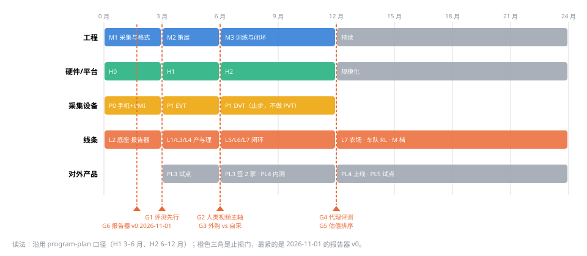

*图 10　0–24 个月时间线：工程 M1–M3、硬件 H0–H2、采集设备 P0→P1 EVT→P1 DVT（止步，不做 PVT）、线条推进、对外产品 PL3/PL4，橙色三角为止损门 G1–G6。沿用 program-plan 口径，最紧的是 2026-11-01 的报告器 v0。*

### 4.2 优先级规则（资源冲突时怎么裁）

1. **校准数据与对齐集 > 策展 > 评测工具 > 采集吞吐**：同一季度预算冲突时按此顺序保护；采集吞吐永远可以外购，自家本体 × 自家任务的评测校准数据与对齐集不能。
2. **先字段后实现**：任何新模态（触觉、力、音频）先进契约作可空字段并在 MCAP 原生频率落盘，export 只做窗口化（LeRobot 0.7 周期内不会原生支持多频率触觉/音频）。
3. **一次消融换一条线**：每条线条的扩量决定都要过 [eval-protocol.md](eval-protocol.md) §4 的消融判定；斜率为零就停。
4. **外购优先于自采，自采优先于自研硬件**：除非外购数据不满足动作 schema 或 license。

### 4.3 组织与人才

在 [program-plan.md](program-plan.md) §3 的 12 人核心之上，按线条重组为四个组，12 个月内到 ~20 人、24 个月 ~35 人（不含审核员与 Creator 运营）：

| 组 | 12 个月人数 | 负责线条 | 关键岗位（招聘顺序） |
|---|---|---|---|
| 数据平台与契约 | 4 | L2、L8 技术面 | 数据契约负责人（MCAP/LeRobot/lineage）→ 平台工程 ×2 → 合规工程 |
| 策展与对齐算法 | 6 | L3、L4 | **数据估值/影响函数研究员**（新岗，行业稀缺）→ 伪标签/重定向 ×2 → VLM 标注工程 → 触觉/力信号工程 |
| 评测与闭环 | 4 | L5、L7 | **评测负责人**（先于采集扩张招聘，U-27）→ 仿真孪生工程 → 统计/实验设计 → 运行时回流工程 |
| 采集与 Creator 运营 | 4 + 审核员 | L1、L8 运营面 | 采集硬件 ×2（协同设计、触觉 UMI）→ Creator 产品经理 → 运营 |
| 训练（沿用 training-pipeline） | 2–3 | L6 | 配方与消融工程 |

不设"数据标注团队"：标注走 VLM 初标 + 分层人工抽检 + 外包审核员（curation §9 的 5 人/千小时·月），避免形成固定成本中心。

### 4.4 预算（12 个月增量，叠加在 program-plan §4 之上，量级估算）

| 项 | 增量（12 个月） | 说明 |
|---|---|---|
| 外购 device 轨小时 | $250–600k | 12 个月 device 轨 ≥1e4 h 中外购 ≥70%（与 L1 "自采 ≤30%"同口径）≈7e3–1e4 h；单价按 §1.2 口径 200–500 元/h（无本体收敛价 170–330 元/h）或 $30–60/h 海外价混合，取 $25–60/h（≈7.1 CNY/USD）；human 轨众包计酬不在此行，已在 program-plan §4"Creator 计酬"（$5k/$50k/$500k–1M）；单价以 H0 的 ≥3 家询价为准，季度重算（R-02） |
| 评测基础设施 | $80–150k | 仿真孪生算力（SimFoundry 路线换件后 ≤2.5 GPU·h/场景）、真机农场 BOM（10 臂 SO-101/VLA-REPLICA 式 ≤$30k）、代理评测 GPU |
| 触觉 UMI 对照集 | $30–60k | 指尖阵列 ×4 + 配对光学传感器 + 500 h 采集人力 |
| 估值/影响函数算力 | $20–50k | ATHENA 式需策略梯度，M3 后 |
| 合规工程 | $40–80k | 端上脱敏、八维报告器、同意图导出、两区域 DPIA 外部法务 |
| **合计增量** | **≈$0.4–0.95M** | 与 program-plan 对账见下表 |

12 个月对账（不含人力，量级）：

| 项 | 金额 | 说明 |
|---|---|---|
| program-plan §4 基数（H0 + H1 + H2） | $1.6–3.3M | 已含 Creator 计酬（human 轨众包）、EVT/PVT 设备、本体、平台、训练算力、VLM、HITL、合规 |
| − H2 采集设备行（PVT 500 台） | −$150–300k | 决策 2 冻结 |
| + 本文增量（上表） | +$0.4–0.95M | device 外购、评测基础设施、触觉对照集、估值算力、合规工程 |
| **12 个月总量级** | **≈$1.9–4.0M** | 人力另计（program-plan §3 12 人 → 本文 §4.3 ~20 人） |
| 12–24 月新增（真机农场、车队 RL 算力、Stage B M 档 3–10 万 H100·h、持续学习、标准工作） | +$0.6–1.5M | 24 个月累计 ≈$2.5–5.5M |

节省项：不建训练场；不采购动捕棚；头戴止步 DVT（上表已扣 PVT）。

### 4.5 止损门（在 program-plan §4 两条之上新增）

| 门 | 时点 | 判据 | 触发后动作 |
|---|---|---|---|
| G1 评测先行 | 3 月末 | 分级得分协议 v1 与序贯检验未在 3 任务簇 × ≥3 个策略变体（零样本 / Stage A 微调 / 不同 checkpoint）上跑通并产出 run_id（分级得分与成功率的 Spearman 只作信息项，不设阈值） | 冻结采集扩量，只做底座 |
| G2 人类视频主轴 | 6 月末（H1 末） | HumanScale 式等小时消融 human 轨 OOD 增益不显著 | human 轨降回"规模腿"，预训练主体改 device + 开源大集 |
| G3 外购 vs 自采 | 6 月末（0–3 月先用报价/预估同阈值预判） | 自采 device 轨实测全成本 > 外购价 1.5× | 停自采改外购，采集硬件组转协同设计与触觉 |
| G4 代理评测 | 孪生进 CI 后第二个季度末（预计第 9–12 个月） | 仿真/世界模型代理 Pearson <0.8 连续两季度 | 评测回退真机 + 序贯检验，sim 轨预算减半 |
| G5 估值排序 | 12 月末 | 估值 top-50% 训练不优于随机 50% | 回退到 QC 门，影响函数线停 |
| G6 合规（商业口径） | 2026-11-01 | PL3 中国训练场客户要求八维报告而报告器 v0 未上线（YD/T 6771 为推荐性标准，约束力来自采购/验收合同，不是法定准入） | PL3 中国签约延后一季度，先签海外或先交 QC 原始指标；U-26 升级为阻塞项 |

### 4.6 外部合作与生态

- **训练场/供应商**：作为 device/robot 轨的外购来源与 PL3/PL4 的客户，不是竞争者；用数据契约 + 八维报告器降低他们的交付成本（信通院已指出他们卖数据难回本）。
- **学术**：EgoVerse 式协作平台（1,362 h / 2,087 示范者，多实验室迁移研究）——以对齐集与评测孪生换取跨实验室数据；BEHAVIOR 2026 与 RoboDojo 作为公开基准参赛。
- **标准**：以数据契约与八维报告器对接 YD/T 6771 与 ISO《人形机器人数据集》立项，目标是成为参考实现之一（[open-source-strategy.md](open-source-strategy.md) §4 的对标延伸）。
- **开源**：工具与规范开源（Apache-2.0）；数据集分级发布；估值阈值与配方版本化但不公开（open-source-strategy §5）。

---

## 5. 产品化方案

### 5.1 产品架构：一个内部引擎，五条对外产品线（产品线用 PL 前缀，与硬件成熟度 P0/P1/P2 不混用）

```
                 ┌──────────── 内部：数据引擎平台（本仓库 + data-platform）────────────┐
                 │ 采集 SDK/MCAP · 入湖/契约 · 段级策展 · 对齐/伪标签 · 评测 CI · lineage │
                 └───┬───────────┬───────────┬───────────┬───────────┬──────────────┘
                     ▼           ▼           ▼           ▼           ▼
               PL1 Creator  PL2 采集套件  PL3 策展即服务 PL4 评测即服务 PL5 配方与适配
                App/众包网络  (硬件+SDK)   (含八维报告)   (Policy QA)   (few-shot/ICL)
                供给产品       格式锁定      现金流最早     差异化最强     长期
```


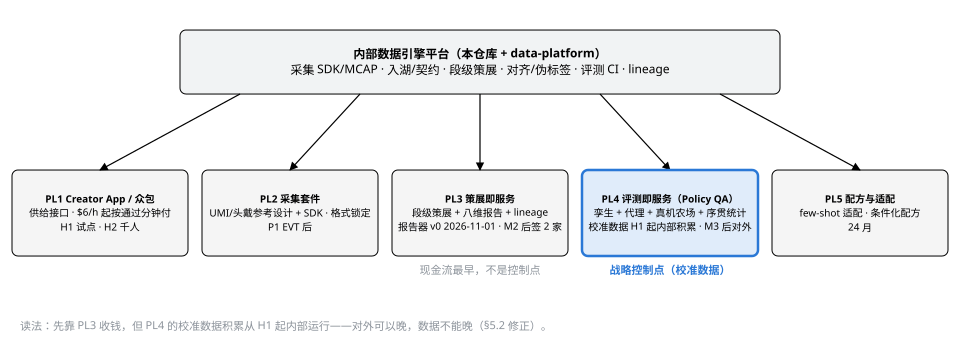

*图 11　一个内部数据引擎支撑五条对外产品线：PL3 策展即服务现金流最早，PL4 评测即服务是战略控制点（校准数据 H1 起内部积累），PL1/PL2 做供给接口与格式锁定，PL5 在 24 个月。*

| 产品线 | 客户 | 交付物 | 定价模型（量级） | 上线（program-plan 口径） | 对应线条 |
|---|---|---|---|---|---|
| **PL1 Creator App 与众包网络** | 自用为主；后期向 OEM/训练场开放白标 | 手机/头戴采集 App、任务库（含场景扫描→个性化任务→谓词验收）、按通过分钟计酬、信誉分级 | 自用：$6/h 市场价起、按通过分钟付；白标：平台费 + 抽成 10–20% | H1 试点、H2 千人 | L1、L8 |
| **PL2 采集套件** | 研究机构、训练场、OEM | UMI 变体（手指驱动/触觉可选）、头戴参考设计（EVT 规格开源）、多设备 SDK（EgoKit 式）、MCAP recorder | 套件成本价 + 10–20% 毛利，SDK 免费；目的是格式锁定而非利润 | P1 EVT 后（H1） | L1、L2 |
| **PL3 策展即服务** | 训练场、数据供应商、OEM（尤其中国 70+ 训练场"卖数据难回本"） | 入湖 + 段级策展 + 估值分数 + 脱敏 + 八维报告 + lineage/同意图；输出 LeRobot v3 | 按处理小时：$5–15/h（人工标注 1/10–1/20，参考 WGO-Bench VLM $2.64/h 成本）；报告器按数据集计费 | 报告器 v0 于 2026-11-01（M1 内）；完整服务 M2 后 | L2、L3、L8 |
| **PL4 评测即服务（Policy QA）** | OEM、模型公司、保险/认证机构 | 仿真孪生 + 世界模型代理 + 真机农场 + 序贯统计；分级得分/失败事件/扰动敏感性报告；YD/T 6770 映射 | 按评测活动：$5–30k/活动（取决于真机试次与孪生数）；年度订阅 CI 席位 | M3 后；第三方预测 2027 成独立品类 | L5、L7 |
| **PL5 配方与适配** | OEM、系统集成商 | few-shot 适配（上下文演示接口）、元数据条件化配方、持续学习回放集 | 按任务上线收费（对齐北极星：新任务 ≤5 真机小时）；或模型许可 | 24 月 | L4、L6 |

### 5.2 商业模式与顺序

1. **先内部后外部**：PL4/PL5 先在自家本体上跑通北极星再对外；PL3 是例外——它只依赖 M2 策展 + 报告器，不依赖北极星，可在 M2 后先对外（现金流最早、依赖最少、需求已被信通院报告证实）。
2. **原始小时不卖，能力与精策划资产卖**：原始小时价格在崩（§1.2），卖小时是亏本生意；卖策展、评测、对齐能力与合规产物，精策划数据集、对齐集与评测校准数据按 [open-source-strategy.md](open-source-strategy.md) §3/§5 分级发布或授权出售，是商业资产。
3. **格式先于平台**：PL2 套件与开源契约把生态锁进 MCAP + LeRobot v3 + 本仓库的段级/同意扩展列；PL3/PL4 在此之上收费。
4. **评测是杠杆**：谁定义"好数据"谁定价；PL4 与标准参与（YD/T 6770/6771、ISO）是同一件事的两面。
5. **控制点先于现金流**（2026-09-12 修正）：PL4 的校准数据（真机↔孪生↔代理三层配对）从 H1 起内部积累，不等 M3；对外服务可以晚，数据不能晚（§2.5）。

### 5.3 护城河：什么在复利

| 资产 | 为什么复利 | 谁拿不到 |
|---|---|---|
| 人↔机同任务配对集（对齐集） | 每个新具身只需 5% 对齐数据（ZETA），配对集越多新具身上线越快 | 只有人类视频的众包平台；只有机器人数据的训练场 |
| 干预段语料 | 每次部署都在产；单位价值最高；没有厂商公开 | 未部署车队的公司 |
| 评测校准数据（真机 ↔ 孪生 ↔ 代理三层配对） | 校准每任务只需 ~10 条，但要持续重估；相关性数据本身可售 | 只做仿真或只做真机的评测商 |
| 估值模型与配方版本历史 | 每次消融都在改进排序器；lineage 使其可复现 | 无 lineage 的对手 |
| 同意/来源图 | 合规交付条件；可机器读；撤回可传导 | 爬取或非商用数据集的对手 |

**不是护城河**：原始小时数、头戴设备、训练场面积。

### 5.4 竞品与差异化

| 对手类型 | 代表 | 他们强 | 我们的差异 |
|---|---|---|---|
| 封闭垂直整合 | Figure（Index + BotQ + Helix）、1X、Tesla | 车队规模、资本、自有 App | 开源工具与契约、可对外的策展/评测、多具身对齐 |
| 通用数据服务商 | Scale、Encord（$60M C）、Micro1、Perle | 众包规模、标注平台 | 段级估值、动作 schema 对齐、评测闭环；他们没有本体 |
| 设备优先 | 觅蜂 MEgo、穹彻 RoboPocket、Ropedia HOMIE、YUBI | 设备规格、小时数 | 我们不卖小时；用他们作供给，用契约与报告器做接口 |
| 重资产训练场 | 中国 70+ 训练场、Apptronik Robot Park | 真机与场景 | 他们是 PL3/PL4 客户 |
| 工具/格式 | Foxglove 3.0、Rerun、lakeFS、LeRobot | 记录系统、可视化、版本化 | 上游贡献而非对抗；差异在策展/估值/评测层 |
| 评测 | RoboDojo、RoboArena、XPolicyLab、NVIDIA RoboLab/Arena | 公开榜、接口标准 | 商业化的校准评测 + 标准映射 + 真机农场；接入而非替代 |

### 5.5 风险

- **开源自我冲突**：策展方法公开、阈值与配方不公开（open-source-strategy §5）；PL3 的核心是运营与校准数据，不是代码。
- **客户即竞争者**：训练场可能自建策展；对策是契约与报告器免费、估值与评测收费。
- **合规反噬**：对外服务承接客户数据的合规责任；PL3 只接受已脱敏或由我们脱敏的数据，合同写明 lineage 责任边界。
- **单一大客户**：OEM 采购集中；对策是 PL1/PL2 的生态面。

---

## 6. CTO 拍板决策清单

> 2026-09-09 逐项裁决完毕（最后一列）。9 项按建议采用，第 8 项（许可准入）改为先拆表、准入逐项等法务意见。裁决同步进 governance（U-03/U-23/U-24/U-25/U-27/U-28/U-30/U-32 closed，U-26 部分裁决，U-29 mitigating，R-19 mitigating）；各项引出的仓库回写见 §7.2。同日追加裁决四项非战略层未决项：U-33 ego+exo 100 h 探针进 H1；U-31 M3 建 10 臂真机评测农场、按需扩到 20；U-09 力信号代理双探针（EgoTac 式视频推断 + EMG/音频小实验，共用触觉对照集真值）；U-22 场景扫描 H0 内部试跑、H1 对外受 U-20 换件门控。

| # | 决策 | 建议 | 期限 | 若不拍板 | 治理 ID | 裁决（2026-09-09） |
|---|---|---|---|---|---|---|
| 1 | 统一动作 schema | 相机系相对末端 + 手部/夹爪状态；具身特异性进提示与掩码 | M1 契约 0.3 前 | 四轨对齐无共同目标，伪标签与配方各说各话 | U-23 | **采用**：相机系相对末端位姿 + 手部关键点/夹爪开合为四轨公共动作目标；关节空间只在 L1 门做 IK 可行性标记；具身特异性进提示与掩码。落地：契约 0.3 动作字段、curation §4.2、training §1.2 |
| 2 | 头戴设备量产冻结 | P1 止步 EVT/DVT（不做 H2 的 PVT 500+ 台），P2 眼镜形态不立项；参考设计开源；原始人类视频外购 + Creator App | 立即；H1 末复议 | $150–300k 沉没 + 硬件组分心 | U-24 | **采用**：P1 止步 EVT→DVT 参考设计并开源，不做 H2 的 PVT 500 台；P2 眼镜形态不立项；human 轨原始视频外购 + Creator App（手机/现成头显）。H1 末按 G2/G3 复议。回写：index-replica-plan §0/§1/§7/§8.2、program-plan §2/§4、device-landscape §7.4、R-04/U-06/U-08/D-04 |
| 3 | 触觉/力进默认 schema | 进契约作可空模态（tactile 点集 (N,6) + wrench 含 frame_id + effort 标 measured/estimated），MCAP 原生频率，export 窗口化；先做 500 h 对照集再定是否进默认配方 | M1 契约 0.3 | R-04 天花板无探针；上游 LeRobot 六个月未定格式 | U-25 | **采用**：契约 0.3 新增可空模态——tactile (N,6) 点集（可导出 [rows,cols]/[k,channels] 窗口）、wrench 含 frame_id、effort 标 measured/estimated、每路标 传感器家族/功能区/型号；MCAP 原生频率，export 窗口化；同步启动 500 h 触觉 UMI 对照集（阵列 + 光学并排共装，–60k）；是否进默认配方等对照集消融（R-04 探针） |
| 4 | 训练态依赖 | `lerobot` 核心（≥0.6）替代 `lerobot-dataset`；Rerun 只作可视化缓存 | M1 export 前 | 依赖停更包 | U-03 改判、R-10 重开 | **采用**：依赖 `lerobot` 核心 ≥0.6 并锁版本，采纳 v0.6 逐帧列作段级标签载体；writer 接口保留以承接 0.7 流优先（R-15）；Rerun .rrd 只作可视化缓存，双格式原则不变（R-10 观察项：Rerun Hub、0.7 破坏性变更） |
| 5 | 评测团队先行 | 评测负责人先于采集扩张到岗；G1 门不过不扩采集 | 0–3 月 | 采集预算无法反向分配 | U-27 | **采用**：评测负责人列入首批招聘（0–3 月）；G1 为交付门：分级得分协议 v1 + 序贯检验在 3 任务簇 × ≥3 策略变体上跑通并产出 run_id，不过则冻结采集扩量只做底座。回写：program-plan §3 招聘顺序 |
| 6 | 估值方法 | PSD（零训练）先上，SIEVE 式原语 medoid 第二，ATHENA 影响函数 M3 后；G5 止损 | M2 | 策展停留在 QC 门 | U-28 | **采用**：M2 先上零训练的 PSD 排序，再加 SIEVE 式原语级 medoid；ATHENA 影响函数等 M3 训练回路后做；G5 止损（估值 top-50% 不优于随机 50% → 回退 QC 门）；估值只排序不删除，held-out 上不做估值决策（R-16） |
| 7 | 配方起点 | human ≥50% / device 20–30% / robot 10–15% / sim+WM ≤15%，全部经消融裁决；元数据条件化替代过滤 | Stage B 前 | 照抄他家配比（全部自报） | U-30、D-15 | **采用**：Stage B（S 档）起点小时配比 human ≥50% / device 20–30% / robot 10–15% / sim+WM ≤15%，全部经缩放消融裁决、斜率为零的轨停扩；配方 yaml 新增 conditioning 段（quality_score/speed_band/track/outcome/source），低质/失败/自主 rollout 带标签进训练，只过滤不可用与投毒；每任务专家数据上限 ~100 h 转 DAgger/干预段 |
| 8 | license 登记表重构 | 每资产拆 代码/权重/数据/骨干 四行；GR00T N1.7 权重记 NOML（非 Apache）且骨干 Cosmos-Reason2-2B gated、Cosmos 3 记 OpenMDW-1.1、HumanNet 未发布、EgoLive 无许可、EgoSuite 自定义 gated、HiPHI 非商用、ABC-130K Apache 但 LICENSE 文件缺失、ABC 训练代码引入 DINOv3 许可 | M2 前 | ⚠️待核查项混入默认路径 | U-29、U-11 增行 | **部分采用**：M2 前完成 U-11 表按 代码/权重/数据/骨干 四行拆表；各资产准入不批量裁决，逐项等 LEGAL 出具意见（含 GR00T N1.7 的 NOML 义务、Cosmos 3 的 OpenMDW 数据权利条款、ABC-130K 缺失 LICENSE 文件）；意见出具前默认路径只用已核实为 Apache/MIT 的项，其余一律研究分支 |
| 9 | 合规硬交付与脱敏路线 | 端上脱敏默认开 + 入湖强制复检（既有两级设计），U-32 对照集在 L3 受限区限时保留未脱敏帧；八维报告器 v0 于 2026-11-01（M1 内）；同意图机器可读导出与一机一码设备注册 H1 | 报告器 v0：2026-11-01；其余 H1 | PL3 中国训练场客户缺少八维验收依据（YD/T 6771 为推荐性标准，约束力来自采购/验收合同），首批 2 家签约延后；欧盟 Data Act 2026-09-12 起的导出义务（法定）无法满足；U-32 消融无对照集 | U-26、U-32 | **采用**：端上脱敏默认开 + 入湖强制复检（既有两级设计）；U-32 对照集例外：受控场地、员工采集员、≥100 h，未脱敏帧在 L3 受限区限时保留、消融后删除（compliance §3/§6/§9 加一条）；八维报告器 v0 于 2026-11-01 前（M1 内）；同意图机器可读导出与一机一码设备注册 H1；采集硬件要求硬连线录制灯与篡改即停 |
| 10 | 对外第一条产品线 | PL3 策展即服务，目标 2 家训练场；PL4 随 M3 | 12 月 | 数据组织永远是成本中心 | R-19（客户即竞争者） | **采用**：PL3 策展即服务先行，M2 后对外、不等北极星，12 个月内签 2 家训练场；定价 ≥ 成本底 ×1.5（H1 口径成本底 ≈–15/h，M2 用自家漏斗实测替换），报告器与估值分数按数据集计费；PL4 随 M3；PL1 白标/PL2 套件作生态面。回写：open-source-strategy §1/§5 |

---

## 7. 附录

### 7.1 来源清单（按属性分组；完整 225 条在扫描记录中，此处列本文引用者）

**官方（公司/机构一手）**
- Figure：figure.ai/news/figure-and-nscale-sign-strategic-partnership；figure.ai/news/ramping-figure-03-production；figure.ai/news/helix-02-bedroom-tidy；Greenhouse 招聘页（Helix Data Creator $30/h、Pilot $32/h）
- NVIDIA：github.com/NVIDIA/Isaac-GR00T（N1.7 GA；README 与模型卡许可矛盾）；huggingface.co/nvidia/GR00T-N1.7-3B；huggingface.co/nvidia/Cosmos3-Edge（OpenMDW-1.1）；developer.nvidia.com/blog（RoboLab 评测）；github.com/isaac-sim/IsaacLab（3.0 beta）；github.com/isaac-sim/IsaacLab-Arena；huggingface.co/blog/nvidia/cosmos-3-for-physical-ai；huggingface.co/datasets/nvidia/PhysicalAI-Robotics-Open-H-Embodiment（CC-BY-4.0）
- Physical Intelligence：pi.website/blog/pi07；pi.website/research/rlt
- Google DeepMind：deepmind.google/blog/gemini-robotics-2-brings-whole-body-intelligence-to-robots
- 1X：1x.tech/discover/1x-world-model-lab；Apptronik：apptronik.com（Robot Park）；Agility：SEC S-4（经 The Robot Report）；BMW：press.bmwgroup.com（Spartanburg）
- Hugging Face LeRobot：huggingface.co/blog/lerobot-release-v060；github.com/huggingface/lerobot/issues/3832（0.7 路线图）；PR #4469（tactile 点集）；PR #3175（已关闭）；pypi.org/project/lerobot-dataset（停在 0.5.0）
- 数据集卡：huggingface.co/datasets/agibot-world/AgiBotWorld2026；XDOF/ABC-130k；behavior-1k/2026-challenge-demos；unitreerobotics UnifoLM-WBT；noitomrobotics/HiPHI（ModalityNet Open Research License v1.0）；LightwheelAI/EgoStandard（gated 自定义许可）；Voxel51/TaF-Tactile-Force（MCAP 触觉约定）
- 中国标准与政策：hbba.sacinfo.org.cn（YD/T 6771-2026 备案页，全文不公开；YD/T 6770-2026）；cqn.com.cn（信通院八维与三部分框架）；std.samr.gov.cn（GB/Z 218.1-2026、GB/Z 220-2026）；iso.org/standard/93011（ISO/CD 26264-1）；ncsti.gov.cn（ISO 时间线）；ciia.org.cn（高质量数据集立项）；miit.gov.cn（标准体系建设指南征求意见）；szzg.gov.cn、news.cn（YD/T 6770/6771 报道、一机一码）；peoplecen.com（ISO 立项）；shanghai.gov.cn（国地中心 + 华为样板点）；huggingface.co/datasets/LejuRobotics/LET-Base-Dataset（OpenLoong 事实布局）；工信部 + 国资委实景实训专项行动文件；it.sohu.com（YD/T 6771 网传阈值，低可信）
- 工具：github.com/foxglove/mcap/releases（1.4.0）；foxglove.dev/blog（3.0）；rerun.io/blog/data-layer-for-robot-learning；openmdw.ai/license/1-1；nvidia.com NOML 2025-10-24 版
- 隐私与脱敏：github.com/facebookresearch/EgoBlur（2.0.1）；ego4d-data.org/docs/privacy；voiceprivacychallenge.org（2026）；huggingface.co/screenpipe/pii-image-redactor（CC BY-NC）；github.com/austinmabry/OpenScrub（Apache）；huggingface.co/datasets/builddotai/Egocentric-10K；texasattorneygeneral.gov（Meta 眼镜调查）；eur-lex（Data Act 2023/2854）；figure.ai/news/introducing-index

**论文（arXiv，按主题）**
- 人类视频与对齐：2606.20521 HumanScale；2609.00188 ZimaBlue；2608.05674 JoyAI-RA；2606.17200 ACE-Ego-0；2608.26058 UCAG-P；2609.02546 ZETA；2606.06194 ActiveMimic；2606.24448 GRA；2608.07045 C2Dex；2606.32009 Human-as-Humanoid；2607.08436 EgoWAM；2609.07398 OpenWAM；2605.06747 HumanNet；2606.02800 Cosmos 3；2608.27033 Riemann-1.0；2607.15330 Xiaomi-Robotics-1；2608.15875 GigaBrain-0.7；2608.16885 τ0-VLA；2606.17846 Qwen-RobotManip；2607.24744 数据金字塔综述
- 策展与估值：2606.16208 ATHENA；2607.06442 SIEVE；2608.04196 SiMDex；2606.12365 Ambient Diffusion Policy；2606.22907 ISR；2608.07895 MMPF；2606.20871 Geometric Entropy；2507.06219 GO-1-Pro v2；2607.21582 Scale Up Strategically；2607.23108 Curse of Precision；2605.01544 PSD；2605.26349 Siemens DQAF；2607.09776 HELP；2606.10305 SARM2；2606.24742 WVM；2608.21204 Q-Planning；2609.03591 XR-2；2607.14047 Zero2Skill；2608.27550 VLAct；2605.26820 持续学习基准
- 评测：2607.04434 RoboDojo；2608.09892 XPolicyLab；2607.02642 GigaWorld-1；2607.01060 RoboWorld；2606.18610 SC3-Eval；2608.09298 WorldSimProbe；2608.24885 WorldEcho；2603.13616 TRI 序贯；2607.14439 主动因子评测；2609.03276 R2S-Eval；2606.10366 仿真-真机相关性；2607.06699 RoboSnap；2603.28545 ManipArena；2605.20774 VLA-REPLICA；2607.24481 Armnet；2605.29710 PhAIL；2609.07047 MEMOBench；2512.10675 Veo 评测器；2604.21192 BEHAVIOR 协议批评
- 仿真与世界模型：2606.02577 RoboDream；2603.08546 IWS；2603.04356 RoboCasa365；2606.31101 Cosmos Policy sim2real；2606.09499 WM 投毒；2603.14482 V-JEPA 2.1；2606.06556 立场论文（四个接口）；2606.28276 SimFoundry
- 采集硬件与触觉：2606.10244 YUBI；2606.06033 RealDexUMI；2608.20546 Koala；2604.13001 XRZero-G0；2605.16797 EgoKit；2604.07607 EgoVerse；2604.23570 EgoLive；2608.01834 Teleopit；2603.26403 T-800；2604.07335 TAMEn；2606.13102 FTP-1；2606.29948 HTT；2608.17962 PRISM；2606.04825 HapTile；2608.18701 SoftVTBench；2607.09190 TactiDex；2607.28625 ACE-Data-0；2608.29601 N0-Foundation/NeoData；2606.31694 RCT；2608.15060 EgoTac；2606.30988 MuSe；2606.17598 MuseVLA；2606.27375 ABC-130K
- 车队：2605.00416 LWD；2606.21386 VLA-FAIL；2608.04246 SAFECAST；2604.15483 π0.7
- 标准：2606.19769（ISO/TC 299/WG 16 成员对 26264-1 机制的说明：episode schema、物理一致性记录、数据集护照、能力档案）
- 隐私：2608.28691 TGAP（视觉 token 隐私）；2608.30969 DP-VOXLET；2603.26336（动作识别友好匿名化）；2605.29177 EvaluatAR；2608.21410（机器人隐私即具身边界工作）；2103.06191（ImageNet 人脸遮挡背景证据）

**第三方（媒体/律所/分析；数字需对冲）**
- Humanoids Daily（Index WAU、1X 路线、Sunday 手套）；The Robot Report；TechTimes；Business Insider（经转述）；NBC（DoorDash Tasks）；CNN；remowork.life（众包价）；truelabel.ai（供应商综述）；explainx（印度价）；RCSV roboticscenter.ai（遥操作成本、2027 预测）；Dexset；spheron（Cosmos 成本）；adamohq（介入率）
- 中国媒体：澎湃/猎云/腾讯新闻（价格）；科学网（觅蜂/穹彻/石景山）；财联社与新浪（信通院报告、北京创新中心）；新华网（光轮）；盖世（优必选中标）；艾邦（供给侧样本）
- 律所/法院报道：Cooley（EU 综合法案）；CMS（欧盟叠层时间表）；金杜（出海合规）；Skadden（科罗拉多）；medialaws.eu（Bartone v. Meta）；Bloomberg Law（Alvarez v. Meta）；DLA Piper（Hartman v. Meta）；BBC（Sama/ICO）；GamingTechLaw（Data Act 导出范围）；Intertek（ISO 13482:2026）；reinsurancene.ws（AI 责任险）；China Daily（保险）
- Label Studio（1,228 篇元分析）；Macrodata（WGO-Bench）

**自报⚠️（登记进 D 表，不作决策唯一依据）**
- Dyna-2（100 万 h、99.9%）；Skild（万亿仿真 episode；S1 "1 条 ≈ 380 条 / 66% vs 9%"）；Generalist（50 万 h、9,000 末端变体）；GR00T N1.7（20,854 h、1k→20k h 翻倍）；Figure（Index WAU/35 min/s/$15M；"$1B 数据 + 算力"为官方博客自报；Helix-02 ~200 h 连续运行）；Gemini Robotics 2（<200 条示范）；Dexset 遥操作单价与拒收率；觅蜂 100 万 h；穹彻 10 万 h；京东 1000 万 h 目标；光轮 100 亿小时；AgiBot 1000 万有效小时目标；Micro1 16 万 h/月；NeoData 30,000 h

### 7.2 与仓库文档的映射（本文引出的回写）

| 本文 | 回写目标 | 改动 | 状态 |
|---|---|---|---|
| §1.3、L2 | [research-opensource.md](research-opensource.md) §1/§7/末段、governance U-03/R-10 | `lerobot-dataset` 停更 → 依赖 `lerobot` 核心；Rerun .rrd 作为观察项 | 本次已改 |
| §1.1 | [research-generalist-dora.md](research-generalist-dora.md) | "9,000 种任务变体" → 末端执行器变体 | 本次已改 |
| L2、决策 3 | [data-format-contract.md](data-format-contract.md) | 契约 0.3：逐帧 subtask/plan/progress/reward 列、tactile (N,6) 点集与 [rows,cols] 窗口、wrench frame_id、effort measured/estimated、段级表、同意/来源图 | 待 M1 |
| L3 | [curation-pipeline.md](curation-pipeline.md) | 段级状态机、估值排序器、VLM 分层门、速度带、触觉按接触序列切分 | 待 M2 |
| L4 | [architecture.md](architecture.md) §2.3、[index-replica-plan.md](index-replica-plan.md) §4 | 伪标签目标改相机系相对末端；相机运动保留；生成视频只监督视觉 | 待 M2 |
| L5 | [sim-track.md](sim-track.md) | 优先级重排（孪生 → 长尾 → 增殖）；4:1 上限；`/meta/sim` 物理后端；WM 契约测试 | 待 M2 |
| L6 | [training-pipeline.md](training-pipeline.md)、configs/mixtures | `conditioning` 段；配比起点；专家数据上限 | 待 M3 |
| L7 | [eval-protocol.md](eval-protocol.md)、[runtime-and-deployment.md](runtime-and-deployment.md) | 分级得分/SPARC/失败事件/NPE；序贯检验；代理三层；干预段规范 | 待 M2/M3 |
| L8 | [compliance-and-security.md](compliance-and-security.md) | 端上脱敏前置；同意图导出；八维报告器；一机一码 | 待 H1 |
| §4.3–4.5 | [program-plan.md](program-plan.md) | 组织四组、预算增量、G1–G6 止损门 | 待下次季度复检 |
| §6 决策 8 | governance U-11 | license 表按 代码/权重/数据/骨干 拆行并增补本次核实结果 | 本次已登记 U-29，拆表待 M2 |
| §1.1 | [architecture.md](architecture.md) §1 表、governance R-04 | human 轨角色"精度腿/规模腿" → "预训练主轴 / 对齐层"；R-04 状态 accepted → mitigating，对策加触觉 UMI 500 h 对照集（U-25）与按任务簇拆分的 human 增量消融（G2） | 本次已改 R-04；architecture §1 待 M2 |
| L1、决策 2 | [device-track-umi.md](device-track-umi.md) §3、[index-replica-plan.md](index-replica-plan.md) §0/§1/§7/§8.2、[program-plan.md](program-plan.md) §2/§4、[device-landscape.md](device-landscape.md) §7.4、governance R-04/U-06/U-08/D-04 | 采集规格下限（双目 ≥60 fps、深度、硬触发、手套 ≥200 Hz）；产品定义去掉头戴量产（P1 止步 DVT、H2 不做 PVT 500 台、P2 不立项）；受 P2 冻结影响的条目改挂 U-04/U-09 | U-24 已裁决 2026-09-09，待回写 |
| L2 同意图 | [data-platform.md](data-platform.md) §3 | 新增 consents / consent_graph 表（episode → consent 版本 → 区域 → manifest → run） | 待 M2 |
| L3 | [curation-pipeline.md](curation-pipeline.md) §2.2 | 操作者轴保留用于覆盖与切分，速度带独立成轴 | 待 M2 |
| L4 | [training-pipeline.md](training-pipeline.md) §2 Stage B、[curation-pipeline.md](curation-pipeline.md) §1.3/§4.2 | 目标具身 ≤5% 口径不变；IK 可行性只产标记 | 待 M2 |
| L7 干预段 | [robot-track-teleop.md](robot-track-teleop.md) §4/§6 | 干预段字段（接管者、前后各 N 秒、恢复标记）扩展现有 `/event/intervention` 与前后 5 s 约定 | 待 M3 |
| L8 U-32 对照集 | [compliance-and-security.md](compliance-and-security.md) §3/§6/§9、[index-replica-plan.md](index-replica-plan.md) §2 | 若消融证明需要"脱敏前打标"，扩展入湖前 L3 暂存窗口并改 raw 定义；否则不改 | U-32 已裁决 2026-09-09：例外条款待写入 compliance |
| §5 | [open-source-strategy.md](open-source-strategy.md) §1/§5 | PL1 白标与 PL2 套件硬件开放边界 | 待对外首单前 |

### 7.3 新增治理条目（已登记进 [governance.md](governance.md)）

- **U-23** 统一动作 schema（相机系相对末端）；**U-24** P2 眼镜量产冻结；**U-25** 触觉/力/效应进契约的字段形态与采样约定；**U-26** YD/T 6771 全文与八维阈值获取；**U-27** 评测负责人先于采集扩张到岗；**U-28** 估值方法选型消融（PSD / SIEVE / ATHENA）；**U-29** GR00T N1.7 / Cosmos 3 / HumanNet / EgoLive / EgoSuite / HiPHI / ABC-130K 许可核实结果与默认路径准入；**U-30** 元数据条件化进配方 yaml 的字段集；**U-31** 真机农场 BOM 与规模；**U-32** 脱敏工具链选型与对伪标签的损伤基准；**U-33** ego+exo 配对采集是否进 H1。
- **R-14** 采集速度多模态污染；**R-15** LeRobot 0.7 流优先重设计的破坏性变更；**R-16** 估值分数过拟合当前策略；**R-17** 世界模型代理在 off-expert 区失效导致误判；**R-18** 脱敏损伤手部可见率与伪标签；**R-19** 对外服务的客户即竞争者。
- **D-13** WGO-Bench VLM 标注 F1 0.168 / $2.64/h；**D-14** Label Studio 元分析（5% coreset、0.31% 投毒）；**D-15** GigaBrain-0.7 / Xiaomi-Robotics-1 / Riemann-1.0 配比；**D-16** RoboLab 置信区间与试次数；**D-17** AgiBot World 2026 wrench/effort"必填"说法（公开卡片未见，待开 tarball 核实）；**D-18** Cosmos 3 训练数据"商用许可"为 NVIDIA 自述；**D-19** Figure Index 16M 视频 / 44k WAU / $15M / 多样性计数均为自报，且官方文与 App Store 隐私标签无旁观者脱敏声明；**D-20** Gemini Robotics 2 "<200 条示范/数小时适配新具身"为官方博客自述，用于北极星 24 个月目标量级；**D-21** Dexset 遥操作单价、有效集/h、QA 拒收率为供应商自报，用于 §1.2 与 robot 轨成本目标，以 H0 的 ≥3 家询价替换。

### 7.4 方法说明

2026-09-09 以十个维度并行检索 2026-06-01 至 2026-09-09 的公开材料（arXiv HTML、公司博客、HF 数据集/模型卡、GitHub、政府网、律所简报、行业媒体），原始 304 条发现，去重压缩为 225 条进入来源清单；随后由一名批评者列出五个缺口（Index 经济参数、YD/T 6771 全文、默认路径资产许可、触觉/力模态、脱敏工具链），补做检索；三份不同角度（数据护城河 / 产品与收入 / 前沿能力）的草稿经三名评审打分后合成本文。未能取得的材料（YD/T 6771 标准全文、Index 费率与 Creator 条款、Lightwheel 许可文本、EgoLive 许可、HumanNet 发布、EgoBlur Gen2 独立基准、Bartone 案 docket）在 §7.3 以 U/D 条目登记，不以推测填补。所有数字保留原始口径，未做换算的地方注明单位。
