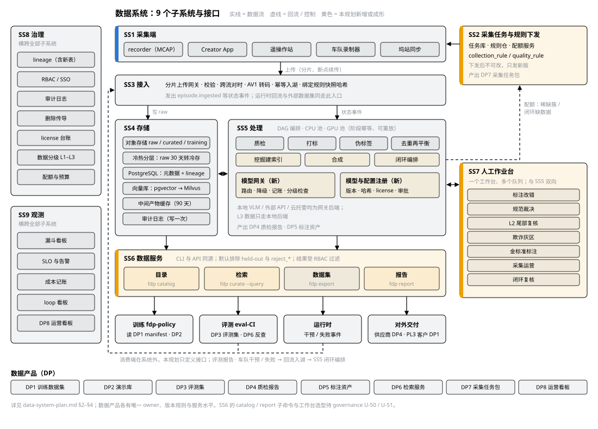

# 数据系统规划：子系统 · 数据产品 · 接口 · 容量 · 运营 · 建设路线

> 2026-11-17。在 [data-pipeline-design.md](data-pipeline-design.md)（管线：数据按什么顺序被处理）之上，回答**系统**层面的问题：要建哪些子系统、它们之间怎么接、产出哪些数据产品给谁用、要多大容量、谁来运营、按什么顺序建、哪些自建哪些采购。
>
> 已有规范不重复：容量与成本基线、组件选型、lineage 表、SLO 见 [data-platform.md](data-platform.md)；数据分级、RBAC、保留期见 [compliance-and-security.md](compliance-and-security.md)；里程碑验收、人力、预算见 [program-plan.md](program-plan.md)；战略线条、组织扩张、产品线见 [data-strategy-roadmap.md](data-strategy-roadmap.md) §4–§5。本文只写这些文档之间缺的部分，并标出对它们的增补。

## 0. 结论

1. **系统 = 9 个子系统**：采集端、接入、存储、处理、数据服务、人工作业台、治理、观测，加上它们服务的消费端（训练、评测、运行时、对外交付）。其中 4 个现有文档没有成形，是本次要补的：**采集任务与规则下发**、**处理模型与配置注册**、**数据服务接口**（目录、检索、数据集、报告）、**人工作业台**（标注、审核、裁决、采集运营）。
2. **系统对外交付 8 类数据产品**（§2），每类有 owner、版本规则和服务水平。数据产品是规划的单位：先定义产品和消费者，再倒推子系统。
3. **容量的新变量是 VLM 调用量和向量索引**，不是存储。按某大模型厂商公开的单次验证口径外推，H1 规模的语义质检约需 6 个持续并发槽，量级可控；但打标和合成的算力还没有可信口径，M2 前半必须自测（§6）。
4. **建设顺序**：M1 交付"接入 + 存储 + 规则质检 + 报告 + 数据集导出"的最小闭环；M2 补齐处理模型注册、工作台、检索服务；M3 接合成和回流编排。每阶段有可测的出口条件（§10）。
5. **自建边界**：状态机、规则、规范、查询、配方、lineage 语义一律自建并留在本仓库；存储、编排、向量库、标注界面、云底座优先采购或用开源（§11）。

## 1. 系统目标与边界

### 1.1 服务对象

| 对象 | 要什么 | 通过哪个数据产品 |
|---|---|---|
| 训练团队 | 可复现的训练集、演示库、评测集 | DP1 训练数据集、DP2 演示库、DP3 评测集 |
| 评测团队 | 冻结评测集、失败反查 | DP3 评测集、DP6 检索服务 |
| 采集运营 | 采集任务、配额、质检反馈 | DP4 质检报告、DP7 采集任务包 |
| 采集供应商 / 训练场 | 验收结论、拒因 | DP4 质检报告 |
| 策展即服务客户（PL3） | 处理后的数据与报告 | DP1（客户版）+ DP4 |
| 管理层 | 投入产出、闭环是否在转 | DP8 运营看板 |
| 合规 / 法务 | 同意、脱敏、删除可追溯 | 治理子系统的审计视图 |

### 1.2 边界

- **在系统内**：从采集任务下发到训练集交付的全部数据处理、数据管理和人工作业；回流数据的接收与闭环编排。
- **在系统外**：策略训练与推理（fdp-policy 独立仓库）、机器人运行时、Creator App 的计酬与支付（只接收其任务完成事件）、设备固件。
- **接口在边界上**：训练读数据集 manifest；运行时把干预/失败事件写进接入层；App 从任务下发系统拉任务、向接入层上传。

### 1.3 北极星与指标树

北极星沿用 [data-strategy-roadmap.md](data-strategy-roadmap.md) §2.3 的**新任务上线成本**。数据系统对它的贡献拆成四个可直接管理的指标：

```
新任务上线成本（北极星）
 ├─ 可用训练小时/月 ········· 入湖量 × 漏斗通过率（质检、打标）
 ├─ 每可用训练小时全成本 ···· 采集计酬 + 设备摊销 + 平台 + VLM + 人工（eval-protocol §1.1）
 ├─ 采集 → 可训练时延 ········ 上传完成到 training_ready 的 P50 / P95
 └─ 闭环有效率 ··············· 回流 loop 中评测提升的轮次 / 总轮次（data-pipeline-design §9）
```

辅助指标：多样性计数、质检一致性（同一样本两次质检结论一致率）、标注返修率、检索基准 Top-1、删除请求按期完成率。定义进 [eval-protocol.md](eval-protocol.md) §1.1 指标字典（本文 §9 列出增补项）。

## 2. 数据产品目录

| 编号 | 数据产品 | 内容 | 生产子系统 | 消费者 | 版本规则 | 服务水平 |
|---|---|---|---|---|---|---|
| DP1 | 训练数据集 | LeRobot v3 分片 + 冻结 manifest（配方、查询快照、标注档案、规范版本） | 数据服务 · 数据集 | 训练、PL3 客户 | `dataset_version`，只增不改 | 按需构建，H1 规模 ≤24 小时 |
| DP2 | 演示库 | 3–12s 干净切片 + embedding + 槽位化描述 | 处理 + 数据服务 · 检索 | 训练（in-context）、fewshot-bench | 随索引版本 | 检索 P95 ≤2 s |
| DP3 | 评测集 | held-out 清单（入湖即固定）+ 真机/仿真任务集 | 治理 + 数据服务 | 评测 | `split_version` 冻结 | 永不回流训练 |
| DP4 | 质检报告 | episode 报告 + 批次汇总 | 处理 · 质检 | 采集运营、供应商、客户 | 报告 schema 版本，字段只增不删 | 规则段：上传后 ≤1 小时；完整报告 ≤24 小时 |
| DP5 | 标注资产 | 边界、子边界与判据、槽位化描述、伪动作、规范版本 | 处理 · 打标 + 工作台 | 数据集构建、检索 | 规范版本 + 离线重映射 | 金标准回归不退步才发布 |
| DP6 | 检索服务 | 结构化过滤 + 召回 + 精排，查询快照 | 数据服务 · 检索 | 训练、评测、闭环、采集运营 | 查询哈希 + 模型版本 | P95 ≤2 s（Top-K ≤200） |
| DP7 | 采集任务包 | 任务说明、collection_rule、quality_rule、配额 | 采集任务下发 | Creator App、采集员、供应商 | 规则文件版本化 | 下发后不可改，只能发新版 |
| DP8 | 运营看板 | 漏斗、成本、时延、多样性、闭环记录、SLO | 观测 | 管理层、各 owner | — | 日更 |

每个数据产品有唯一 owner（§8.2）。对外交付（DP1 客户版、DP4）额外过 [open-source-strategy.md](open-source-strategy.md) §3 的发布前检查单与 compliance 的区域规则。

## 3. 系统总体架构



*图 DP2　数据系统的 9 个子系统。从上到下是数据主流：采集端 → 接入 → 处理（读写存储）→ 数据服务 → 消费端；人工作业台和治理、观测横跨各层。黄色条标出现有文档里没有成形、本规划新增的子系统。生成脚本：`work/diagrams/gen_system_architecture.py`。*

| 子系统 | 职责 | 主要组件 | 现有规范 | 本规划增补 |
|---|---|---|---|---|
| SS1 采集端 | 录制、本地缓冲、上传；接收任务 | recorder（MCAP）、Creator App、遥操作站、车队录制器、坞站同步 | [recorder-sync-and-storage.md](recorder-sync-and-storage.md)、[capture-devices-design.md](capture-devices-design.md) | — |
| SS2 采集任务与规则下发（新） | 任务库、规则快照、配额、下发与回执 | 任务库、规则仓（collection_rule / quality_rule）、配额服务 | index-replica-plan §2 任务库（概念） | §4.1 |
| SS3 接入 | 上传网关、校验、对时、转码、幂等入湖 | 分片上传网关、ingest worker | [ingest-spec.md](ingest-spec.md) | 绑定规则快照哈希（data-pipeline-design §3） |
| SS4 存储 | raw / curated / training 三区、元数据、向量、中间产物缓存 | 对象存储、PostgreSQL、pgvector→Milvus、缓存 | [data-platform.md](data-platform.md) §1–§3 | 资产目录（§5）、索引容量（§6.2） |
| SS5 处理 | 质检、打标、伪标签、去重再平衡、挖掘建索引、合成 | DAG 编排、CPU 池、GPU 池、**模型网关**、**处理模型与配置注册**（新） | [curation-pipeline.md](curation-pipeline.md)、data-pipeline-design §4–§7 | §4.2、§4.3 |
| SS6 数据服务（新） | 目录查询、检索、数据集构建与导出、报告分发 | 目录 API、检索 API、数据集服务、报告服务 | data-format-contract §2（导出格式） | §4.4、§7 |
| SS7 人工作业台（新） | 标注改错、审核、规范裁决、采集运营、欺诈灰区 | 统一工作台（多个队列视图） | curation §9（触点定义） | §4.5 |
| SS8 治理 | lineage、权限、审计、删除传导、license 台账、配额与预算 | lineage 表、RBAC/SSO、审计写一次存储、删除编排 | data-platform §3、compliance §4–§6、governance U-11 | 新 lineage 表（data-pipeline-design §10.1） |
| SS9 观测 | 漏斗、SLO、成本、闭环记录、告警 | 指标库、看板、告警 | data-platform §4 | SLO 增补（§7.1）、看板定义（DP8） |
| 消费端 | 训练、评测、运行时回流、对外交付 | fdp-policy、eval-CI、PolicyServer | training-pipeline、eval-protocol、runtime-and-deployment | 只定义接口（§5） |

## 4. 新增子系统设计

### 4.1 SS2 采集任务与规则下发

- **任务包**（DP7）= 任务说明（文字 + 示范视频引用）+ `collection_rule`（标准步骤序列、允许物体与场景、必需流与相机、时长范围）+ `quality_rule` 版本 + 配额（场景 × 物体 × 操作者的目标小时数）+ 有效期。
- **下发后不可改**：改任务 = 发新版本，旧版本已采集的数据仍按旧规则质检。规则文件进 `configs/qc/`（data-pipeline-design §10.2），任务包只引用哈希。
- **配额来源**：再平衡的稀缺簇（curation §2.2）和回流闭环的"缺数据"出口（data-pipeline-design §9）。配额服务把两者合并成每周任务清单，人工确认后下发。
- **回执**：App / 采集端上报任务开始、完成、失败、重拍、换道具事件，进 MCAP `/event/task`，入湖后随片段送到标注端（curation §4.1）。
- 和 Creator App 计酬的接口：本系统只输出"通过策展的分钟数"（按 episode、按任务包），计酬在 App 侧算（index-replica-plan §2）。

### 4.2 SS5 模型网关

所有处理阶段调用模型（VLM、手部重建、SLAM、embedding、rerank、合成）都经过同一个网关：

- **路由**：同一能力可以挂多个后端（本地模型、外部 API、云厂商托管），按阶段配置选择；API 超时或错误率超限时自动降级到本地后端（data-platform §4 已有的规则推广到所有模型）。
- **记账**：每次调用记录阶段、模型版本、输入规模（帧数/token）、耗时、费用估算，汇总到观测子系统，是 VLM 成本的唯一来源（§6.1）。
- **限流与预算**：按阶段设日预算与并发上限；超预算时语义质检降为抽样，打标排队，不影响规则段。
- **数据去向控制**：外部 API 只接收 L2 及以下数据（脱敏后，compliance §4）；L3 数据只能走本地后端。网关在请求前检查数据分级。

### 4.3 SS5 处理模型与配置注册

- **模型注册**：每个被处理阶段使用的模型登记名称、版本、权重哈希（或 API 版本标识）、license、允许的数据分级、负责人。未登记或 license 未通过 U-11 的模型，网关拒绝在默认路径调用。
- **配置注册**：`configs/` 下所有版本化文件（质检规则、标注规范与档案、查询、合成档案、配方、域随机化）在注册表里有一条记录：哈希、父版本、发布人、发布时间、关联的消融或裁决记录。
- **变更流程**：阈值、规范、档案的变更必须带证据（消融报告或裁决记录），由对应 owner 批准（§8.2）。注册表是 lineage `artifacts.model_version` 与 `decisions.config_hash` 的取值来源。

### 4.4 SS6 数据服务

对内对外统一四类接口（CLI 与 API 同源，CLI 是 API 的薄封装）：

| 服务 | 主要操作 | CLI（提议） | 说明 |
|---|---|---|---|
| 目录 | 按 track / 任务 / 状态 / 质量层 / 区域 / 同意版本查 episode 与片段；查 lineage | `fdp catalog` | 只读；结果受 RBAC 过滤 |
| 检索 | 执行查询、保存快照 | `fdp curate --query`（U-48） | data-pipeline-design §6 |
| 数据集 | 按配方 + 快照 + 档案构建、冻结 manifest、导出 | `fdp export` | 已有命令扩展参数 |
| 报告 | 取 episode 质检报告、批次汇总、数据集说明卡 | `fdp report` | 对外交付的唯一出口 |

- 新增 CLI 子命令 `catalog`、`report` 是对"CLI 子命令按层对应"约定的扩展：它们属于数据集层的读服务，不新增管线层。登记 U-50。
- 所有读接口默认排除 held-out 与 `reject_*`，需要时显式打开并记录在调用日志里。

### 4.5 SS7 人工作业台

把 curation §9 的五个人工触点和采集运营放进**同一个工作台、多个队列**，而不是五个工具：

| 队列 | 进入条件 | 操作 | 产物 |
|---|---|---|---|
| 标注改错 | 打标风险分级为高、交叉质检分歧 | 改边界 / 改槽位 / 确认 | 标注修订（带规范版本） |
| 规范裁决 | 规范未覆盖的情况 | 裁决 → 回写规范 | 新规范版本、重映射任务 |
| L2 尾部复核 | 统计门尾部 1% | 通过 / 标记 | decision |
| 欺诈灰区 | 反欺诈模型灰区 | 判定 + 账户处置 | decision、信誉分更新 |
| 金标准标注 | 金标准集建设与扩充 | 双人独立标注 + 裁决 | 金标准版本 |
| 采集运营 | 质检批次不过、配额缺口 | 联系采集方、重发任务 | 任务包新版本 |
| 闭环复核 | 失败归类抽查 | 确认 / 改类 | loop 记录 |

- 界面需求只有两条硬约束：能直接读 MCAP / LeRobot v3，数据不出自有存储（[research-rd-tooling.md](research-rd-tooling.md) §8 的判断）。现成工具（Label Studio、Encord、Foxglove 等）按这两条试用后再定，登记 U-51。
- 审核员只见脱敏预览流（compliance §9）；每条操作写 lineage，供 VLM 审计和打标模型再训练使用。
- 工作量口径沿用 curation §9：5 人/千小时·月，随风险分级成熟而下降。

## 5. 数据资产目录与接口

### 5.1 资产目录

在 compliance §4 的分级和 §6 的保留期基础上，按资产列全：

| 资产 | 生产者 | 存储 | 分级 | 保留 | 可重算 |
|---|---|---|---|---|---|
| raw episode（MCAP，脱敏后） | SS3 接入 | 对象存储 raw 区（30 天后冷存） | L2（脱敏前帧哈希 L3） | 永久（删除请求例外） | 否 |
| 转码视频（AV1 存档 / 训练分辨率 / 预览） | SS3 接入 | raw / training / 预览 | L2 / L1 | 存档永久，其余随数据集 | 是 |
| episode 元数据 | SS3、SS5 | PostgreSQL | L2 | 永久 | 否 |
| 质检报告与指标 | SS5 质检 | 对象存储 + 指标表 | L2 | 永久 | 是（但保留原报告作证据） |
| 标注资产 | SS5 打标、SS7 | PostgreSQL + 对象存储 | L2 | 永久 | 部分（人工修订不可重算） |
| 伪动作、重建中间产物 | SS5 | 对象存储缓存 | L2 | 90 天 | 是 |
| embedding 与索引 | SS5 挖掘 | 向量库 | L2 | 随索引版本 | 是 |
| 查询快照 | SS6 检索 | 对象存储 + 表 | L2 | 被 manifest 引用即永久 | 否（结果依赖当时数据） |
| 合成 episode | SS5 合成 | curated 区 | L2 | 永久，种子删除时级联 | 是（需模型版本仍可用） |
| 数据集 manifest 与分片 | SS6 数据集 | training 区 | L1 | 永久 | 分片可重建，manifest 不可变 |
| 评测集清单 | SS8 | training 区 | L1 | 永久 | 否 |
| 审核与裁决记录 | SS7 | PostgreSQL + 写一次存储 | L2 | 3 年 | 否 |
| loop 记录 | SS5 / SS9 | PostgreSQL | L2 | 永久 | 否 |
| 审计日志 | SS8 | 写一次存储 | L3 | 3 年 | 否 |

"可重算"决定缓存策略和删除成本：可重算的资产在删除传导时直接删，不可重算的要逐条处理。

### 5.2 状态事件

子系统之间用 episode 状态变化事件解耦（已有状态机见 curation §0）：

| 事件 | 发出 | 订阅 |
|---|---|---|
| `episode.uploaded` | SS3 | SS3 ingest worker |
| `episode.ingested` | SS3 | SS5 规则质检；SS9 |
| `episode.gated` / `episode.scored` | SS5 | SS5 打标；SS2（批次质检回执）；SS7（复核队列） |
| `episode.labeled` | SS5 | SS5 去重、挖掘建索引 |
| `episode.training_ready` | SS5 | SS6 数据集；SS9 |
| `episode.rejected` / `episode.flagged` | SS5 | SS2（采集运营）；SS9 |
| `dataset.frozen` | SS6 | 训练；SS8（lineage） |
| `eval.reported` / `fleet.intervention` | 消费端 | SS5 闭环编排 |
| `deletion.requested` | SS8 | 全部子系统（按资产目录传导） |

事件只带 id 与版本，不带数据本体；消费者回查存储。每个事件写 lineage，重放即可重建状态。

### 5.3 外部接口

| 对象 | 输入 | 输出 | 约定 |
|---|---|---|---|
| 采集供应商 / 训练场 | MCAP 或约定格式 + 任务包引用 | 质检报告（DP4）+ 拒因清单 | 验收按报告结论；计价不能单纯按段数或时长（curation §9） |
| 策展即服务客户（PL3） | 客户原始数据 | DP1 客户版 + DP4 | 数据驻留按合同；处理所用模型 license 随报告披露 |
| 云平台（若托管，U-49） | — | — | 逻辑留在本仓库；托管前回答 R-27 三问 |
| 外部开放数据集 | 下载包 + license | 走同一入湖与质检，`source` 标外部 | license 未核实的不进默认路径（U-11） |

## 6. 容量与成本增补

data-platform §1 已算存储、转码、感知模型和平台托管。本节补三个新变量。

### 6.1 VLM 调用量

- **某大模型厂商的单次验证口径**（自报 ⚠️，research-vendor-robotics §7.3）：44 个样本、176 路视频、共 2.2 小时，语义段 8 并发耗时 1,403 秒。折算为**每小时四路视频约需 1.4 个并发槽·小时**。
- **外推到我们**：语义质检只处理通过规则段的数据。H1 原始上传约 3,000 小时/月（data-platform §1.2 的 3H 口径），按 70% 通过规则段计，约 2,100 小时 × 1.4 ≈ 2,900 槽·小时/月，即约 **4 个持续并发槽**；留 50% 余量按 6 个规划。H2 线性放大 10 倍。
- **打标**：四阶段打标每个 episode 调用 LLM 2 次 + 每段 1 次（data-pipeline-design §5），按段数线性。没有可信的耗时口径，**M2 前半用 50 小时样本实测**每小时视频的调用次数、token 数和耗时，结果写进本节和 data-platform §1.3。
- **成本控制手段**：粗筛联系图把细检压到约 30% 的片段；规则段先拦坏样本；本地模型优先、API 只仲裁分歧（data-platform §1.3 已有口径）；模型网关按阶段设日预算（§4.2）。

### 6.2 向量索引

- 子任务段按 5–10 秒计，每可用小时 360–720 段；H1（1,000 可用小时/月）每月新增约 0.4–0.7M 向量，一年 4–9M。
- 向量维度按 1024、float32 计，每条 4 KB，一年 16–36 GB（不含索引结构）；维度可裁剪的模型（如 Qwen3-VL-Embedding 64–2048 维）可以按需降维。
- **切换点**：pgvector 到 1e7 条（data-platform §2）。H1 约在第一年末到达，H2 起直接用 Milvus/Qdrant。演示库切片与子任务段共用索引，用元数据区分。

### 6.3 合成算力

人类视频 → 机器人演示的六步里，人手擦除修复、深度合成、IK 都按帧算；世界模型生成按视频秒算。两者都没有可信的公开口径，**M3 启动前用 10 小时样本实测** GPU·h / 合成小时，再决定合成量的上限。规则：合成的单位成本超过同等数据的采集成本时，不扩量。

### 6.4 规模分档与切换触发

| 组件 | H0（100 h/月） | H1（1,000 h/月） | H2（10,000 h/月） | 切换触发 |
|---|---|---|---|---|
| 处理计算 | 单机 + 1–2 GPU | K8s + GPU 池 | 多池，按阶段隔离 | DAG 积压 >24 小时连续一周 |
| 编排 | Prefect / Dagster 单实例 | 同左，队列独立 | 高可用部署 | 调度延迟 P95 >5 分钟 |
| 向量库 | pgvector | pgvector | Milvus / Qdrant | 向量数接近 1e7 |
| VLM | 本地模型为主 | 本地 + API 仲裁，约 6 并发槽 | 本地集群 + API | 网关记账的排队时长 |
| 元数据库 | 单实例 | 主从 + 按月分区 | 分区 + 只读副本 | 查询 P95 >1 s |
| 工作台 | 内部 1–2 人 | 5 人/千小时·月 | 按入湖量线性，风险分级降比例 | 队列积压 >3 天 |

## 7. 非功能要求

### 7.1 SLO 增补（在 data-platform §4 之上）

| 指标 | SLO | 告警 |
|---|---|---|
| 规则段质检报告（上传完成 → 报告可取） | P95 ≤1 小时 | >4 小时 |
| 完整质检报告（含语义段） | P95 ≤24 小时 | >48 小时 |
| 打标周转（gated → labeled） | P95 ≤72 小时 | >7 天 |
| 采集 → 可训练时延 | P50 ≤3 天，P95 ≤7 天 | P95 >14 天 |
| 检索 API | P95 ≤2 s（Top-K ≤200） | >5 s |
| 数据集构建（H1 规模） | ≤24 小时 | >48 小时 |
| 质检一致性（同一样本重跑结论一致） | ≥98% | <95% |
| 工作台队列积压 | ≤3 天 | >7 天 |
| 删除请求完成 | 30 天（compliance §4） | 第 21 天未完成 |
| 闭环周期（触发 → 再评测结论） | 一个配方 A/B 周期内 | 超过两个周期 |

### 7.2 可靠性与可复现

- 所有处理阶段幂等、可重放（curation §6）；事件可重放重建状态（§5.2）。
- 任何训练集都能由 manifest + 注册表中的配置和模型版本重建；做不到的（外部 API 模型下线）在 manifest 里标注"不可完全重建"。
- 质检与打标模型升级不改历史 decision，只追加新版本；数据集按版本选用。

### 7.3 安全

沿用 compliance §4–§7。本规划新增两点：模型网关的数据分级检查（§4.2）；工作台只读脱敏预览（§4.5）。

## 8. 运营与组织

### 8.1 角色增补

在 program-plan §3 与 data-strategy-roadmap §4.3 的组织之上，不新增团队，只明确四个**责任角色**（可由现有人员兼任）：

| 角色 | 负责 | 建议由谁兼任 |
|---|---|---|
| 数据产品负责人 | DP1–DP8 的定义、优先级、服务水平；对接训练和对外客户 | 数据平台与契约组负责人 |
| 质检规则 owner | quality_rule 与阈值变更、质检报告 schema | 策展算法 |
| 标注规范 owner | 规范版本、裁决队列、金标准集、标注档案 | VLM 标注工程 |
| 数据运营负责人 | 采集任务包、配额、供应商验收、工作台排班 | 采集与 Creator 运营 |

不设固定标注团队的原则不变（data-strategy-roadmap §4.3）。

### 8.2 关键流程的责任分工

R = 执行，A = 批准，C = 咨询，I = 知会。

| 流程 | 数据产品负责人 | 质检规则 owner | 标注规范 owner | 数据运营 | 训练 / 评测 | 合规 |
|---|---|---|---|---|---|---|
| 质检阈值变更（须带消融报告） | I | A/R | — | I | C | — |
| 标注规范变更（须带裁决记录） | I | — | A/R | I | C | — |
| 标注档案新增 / 修改 | A | — | R | — | C | — |
| 任务包发布 | I | C | C | A/R | — | C |
| 训练数据集冻结与发布 | A | I | I | — | R | C |
| 对外交付（DP1 客户版、DP4） | A/R | C | C | C | — | A |
| 删除请求处理 | I | — | — | R | I | A |
| 回流闭环一轮 | A | C | C | R（配额） | R（评测） | — |
| 新处理模型上线 | A | C | C | — | — | C（license） |

### 8.3 运营节奏

| 频率 | 内容 | 主持 |
|---|---|---|
| 每日 | 漏斗与 SLO 看板；死信与积压处理 | 数据运营 |
| 每周 | 数据评审：本周拒因 Top 5、工作台积压、裁决队列、配额执行 | 数据产品负责人 |
| 每个配方 A/B 周期 | 回流闭环一轮，写 loop 记录 | 数据产品负责人 + 评测负责人 |
| 每月 | 成本与单位经济（每可用小时全成本）、欺诈红队、供应商质检汇总 | 数据产品负责人 |
| 每季度 | governance 三表复检、license 增量核查、容量切换点复核（§6.4） | 项目管理 |

## 9. 指标增补

建议进 [eval-protocol.md](eval-protocol.md) §1.1 数据侧指标字典的新指标：

| 指标 | 定义 | 用途 |
|---|---|---|
| 采集 → 可训练时延 | 上传完成到 `training_ready` 的 P50 / P95 | 系统效率 |
| 质检一致性 | 同一样本、同一规则版本重跑，结论一致的比例 | 质检可信度 |
| 标注返修率 | 进入人工改错队列的段 / 总段数，按档案分 | 打标质量与人工成本 |
| 指代槽位正确率 | 金标准集上容器、目标位置、结果状态槽位的正确率 | 打标质量 |
| 检索 Top-1 | 成对难查询基准上精排后的 Top-1 正确率 | 挖掘质量 |
| VLM 每可用小时成本 | 模型网关记账 / 可用训练小时 | 成本 |
| 闭环有效率 | 评测提升的 loop 轮次 / 总轮次 | 飞轮是否在转 |
| 删除按期完成率 | 30 天内完成的删除请求 / 总数 | 合规 |

## 10. 建设路线

按子系统列出每个里程碑的交付，出口条件可测。和 [program-plan.md](program-plan.md) §2 的验收矩阵叠加使用。

| 子系统 | M1 / H0（0–3 月） | M2 / H1（3–6 月） | M3 / H2（6–12 月） |
|---|---|---|---|
| SS1 采集端 | recorder、P0 设备 | 头戴 EVT、App 试点 | DVT/PVT、车队录制 |
| SS2 任务与规则下发 | 规则文件格式 + 手工下发 | 任务库 + 配额服务（稀缺簇驱动） | 闭环驱动配额自动生成、人工确认 |
| SS3 接入 | ingest 全规范 + 规则快照绑定 | 分片上传网关、断点续传 | 多区域路由 |
| SS4 存储 | 三区 + Postgres + pgvector | 冷热分层、按月分区 | Milvus 切换、只读副本 |
| SS5 处理 | 规则段质检；DAG 骨架 | 语义质检、打标四阶段、伪标签、去重再平衡、挖掘建索引；**模型网关与注册** | 合成支路、闭环编排 |
| SS6 数据服务 | `fdp export` + manifest；`fdp report`（规则段报告） | 目录与检索 API、演示库；报告完整版 | 客户交付通道（PL3） |
| SS7 工作台 | 无（内部用 rerun 检视） | 统一工作台：改错、裁决、复核、金标准 | 欺诈灰区、闭环复核、采集运营队列 |
| SS8 治理 | lineage 核心表、RBAC | 新 lineage 表、删除传导演练、license 台账 | 审计抽查常态化、多区域合规 |
| SS9 观测 | 漏斗与 ingest SLO | 全部 SLO（§7.1）、成本记账、DP8 看板 | loop 看板、单位经济自动报表 |

**出口条件**：

- **M1**：一个外部开放数据集（U-43）和一批自采数据走通"入湖 → 规则段质检 → 报告 → 导出 → 训练读入"；规则段报告字段冻结为 v1；lineage 能从任一训练分片追到 raw。
- **M2**：语义质检与打标在 50 小时样本上跑通并完成 §6.1 的实测；金标准集上两把尺子与指代正确率有基线；工作台承接全部人工触点；检索基准有基线；SLO 达标两周。
- **M3**：至少一轮完整回流闭环并有评测前后对比；合成支路完成 §6.3 实测与一次消融；删除传导演练（含合成派生数据）通过。

**前 8 周**：

1. 冻结质检报告 schema v1 与规则文件格式（SS2、SS5）。
2. ingest 接上规则快照哈希；规则段质检落地，阈值用 curation §1.1–§1.2 的临时值（SS3、SS5）。
3. lineage 核心表与事件表上线，跑通 U-43 外部数据集的端到端（SS4、SS8）。
4. 模型网关最小版：本地 VLM + 记账，为 M2 的成本实测铺路（SS5）。
5. 工作台选型试用（U-51），只用两条硬约束筛选（SS7）。
6. 指标字典增补（§9）与 DP8 看板骨架（SS9）。

## 11. 自建与采购

| 子系统 / 组件 | 自建 | 开源 / 采购候选 | 云厂商对应（若托管，U-49） | 原则 |
|---|---|---|---|---|
| 状态机、质检规则、标注规范、查询、配方、lineage 语义 | **自建** | — | — | 资产不贬值、可迁移的前提 |
| 对象存储 | — | SS3 / MinIO | OSS + 云数据湖 | 采购 |
| 元数据库 | 表结构自建 | PostgreSQL | RDS / 云实时数仓 | 开源 |
| 向量库 | — | pgvector → Milvus / Qdrant | Milvus 托管 / OpenSearch | 开源 |
| 编排与队列 | DAG 定义自建 | Prefect / Dagster | 云数据开发平台 调度 | 开源 |
| 批计算 | worker 自建 | Ray | 云数仓 + 云数仓 Python 框架 | 开源 |
| 模型网关与注册 | **自建**（薄层） | — | 云模型服务（作为后端之一） | 自建：记账、分级、降级是我们的规则 |
| 工作台 | 队列与规则自建 | Label Studio / Encord / Foxglove 等（U-51） | — | 界面采购，队列自建 |
| 可视化 | — | rerun、Foxglove | — | 开源 |
| 训练与评测算力 | — | 自有集群 / 云 GPU | 云训练服务 | 采购 |

## 12. 新增治理条目

已同步登记到 [governance.md](governance.md)：

- **U-50**：数据服务新增 CLI 子命令 `fdp catalog`、`fdp report`（提议；属数据集层读服务，不新增管线层）。
- **U-51**：人工作业台选型（自建界面 vs Label Studio / Encord / Foxglove 等），硬约束：直接读 MCAP / LeRobot v3、数据不出自有存储。
- **R-28**：VLM 调用成本随视频量线性增长，语义质检与打标规模化后可能超出平台预算。对策：模型网关记账与日预算、粗筛漏斗、本地优先，M2 前半实测后定上限。
- **R-29**：子系统数量超出 12–20 人团队的运维能力。对策：采购优先（§11）、工作台合一（§4.5）、按 §10 分阶段建，M1 只建最小闭环。

## 13. 关联文档

[data-pipeline-design.md](data-pipeline-design.md) · [architecture.md](architecture.md) · [data-platform.md](data-platform.md) · [compliance-and-security.md](compliance-and-security.md) · [program-plan.md](program-plan.md) · [data-strategy-roadmap.md](data-strategy-roadmap.md) · [curation-pipeline.md](curation-pipeline.md) · [ingest-spec.md](ingest-spec.md) · [eval-protocol.md](eval-protocol.md) · [open-source-strategy.md](open-source-strategy.md) · [research-rd-tooling.md](research-rd-tooling.md) · [research-vendor-robotics.md](research-vendor-robotics.md)
