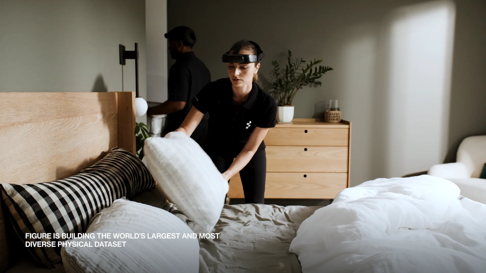
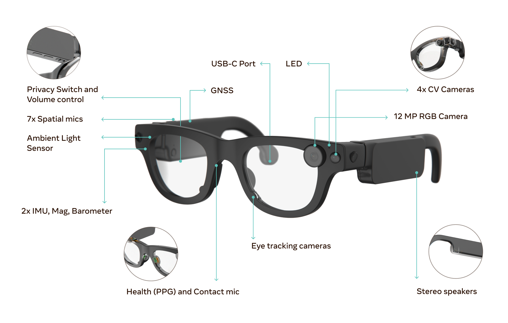
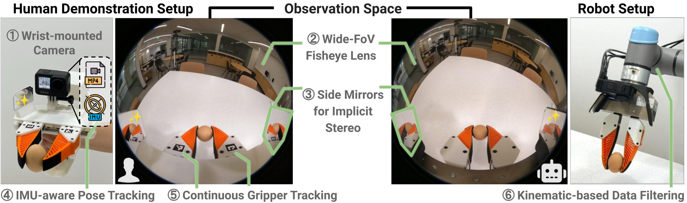
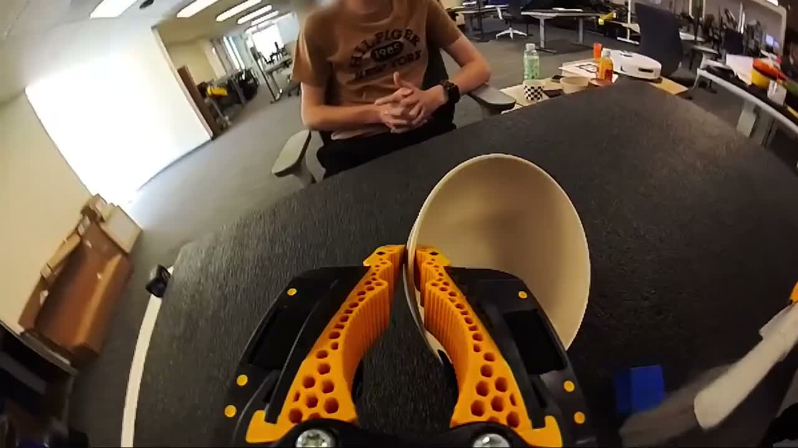
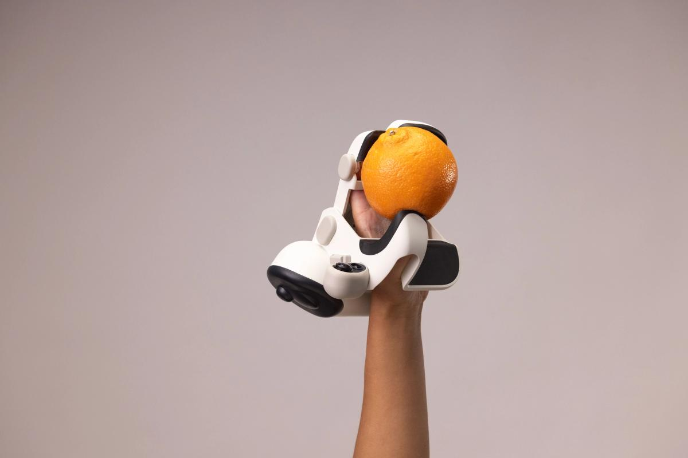
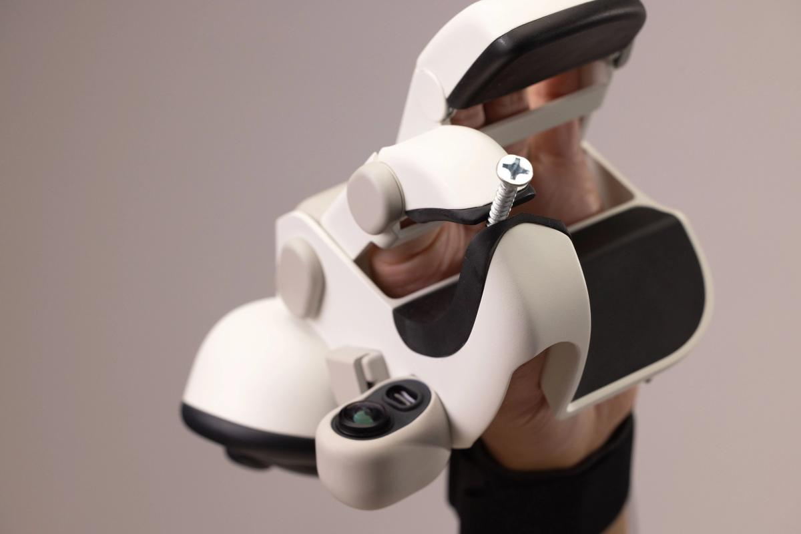
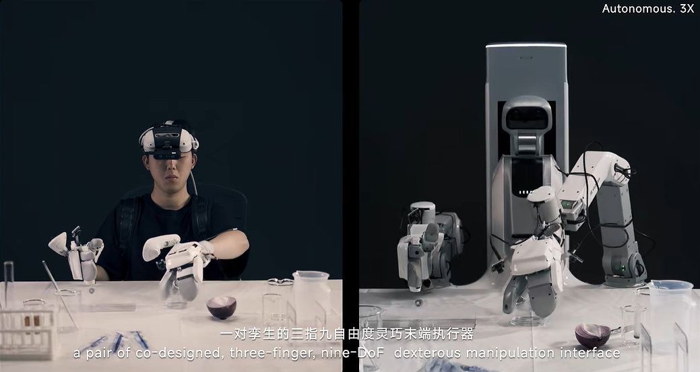
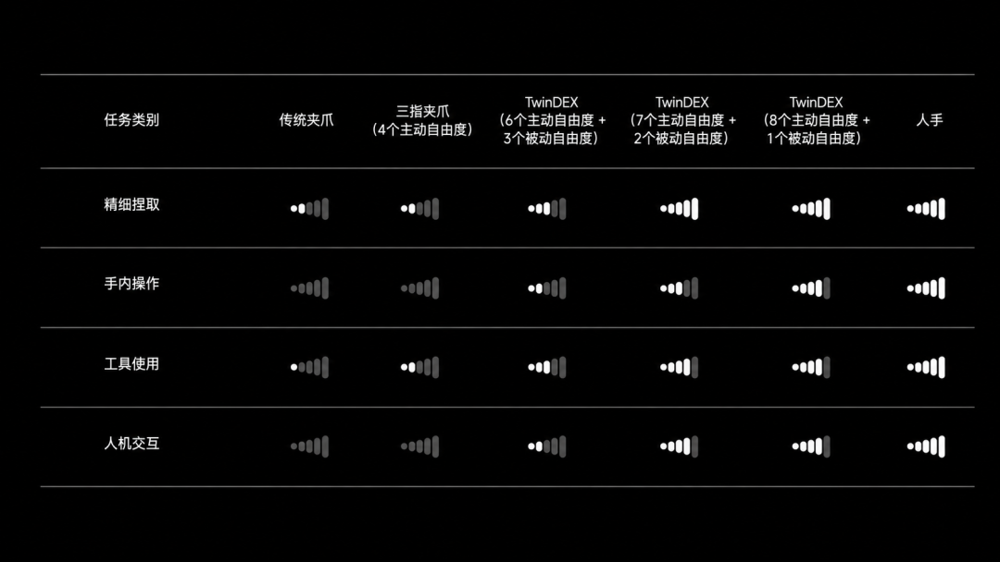
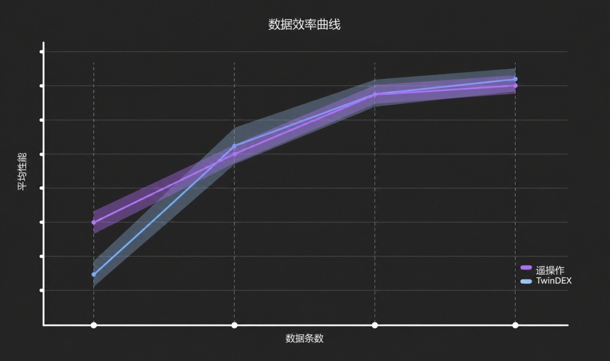
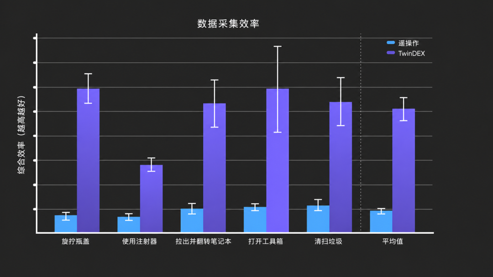

# 领先采集设备横评：硬件构型 · 工作原理 · 任务成功关键链

> 2026-09-04。对当前领先的人形/操作数据采集设备做构型级分析：每台设备从硬件设计到"下游机器人任务成功"的因果链。图片均标注来源；公司自报数字已在各 research-*.md 标注可信度。多角度视图见各节图集。

## 0. 分析框架：设备设计 → 任务成功的因果链

一台采集设备最终能否让机器人任务成功，取决于五个因子（后文每台设备按此拆解）：

```
F1 观测同构度   训练时模型看到的画面 vs 部署时机器人看到的画面差多少
                （差多少，就要靠算法/数据弥合多少）
F2 动作真值等级 无标签(纯视频) < 视觉伪标签 < 硬件真值(EE级) < 硬件真值(逐指级)
F3 力/接触信号 有无直接或隐式的力信息（接触密集任务的天花板）
F4 规模经济    单设备成本 × 操作自然度 × 是否与机器人数量解绑 → 每可用小时成本
F5 任务覆盖    该形态能演示的任务集合大小
```

**没有设备五项全优**——F1/F2/F3 与 F5 存在结构性冲突（末端越同构、真值越硬，任务覆盖越窄）。这就是多轨采集矩阵（[index-replica-plan.md](index-replica-plan.md) §1.0）的根本依据。

---

## 1. Figure Index 头戴设备（human 轨代表）



*正面/侧面佩戴视图（图源：Figure 官方素材 via Humanoids Daily / figure.ai/index-app）*

**构型**：头带式结构 + 前额横置相机单元（规格未公开；采集网络实际以**手机优先**，头戴为补充——官方管线图第一环节即 Mobile capture）。无任何手部传感器。

**原理**：纯被动视觉记录。动作信息完全靠后处理恢复（官方管线图确认产出 "head & hand tracks"——头部位姿 + 手部轨迹伪标签）。

**任务成功关键链**：
- 成功依赖 **F4/F5 极大化**换 F1–F3 的全面妥协：设备近乎零门槛（手机即可）→ 108 国众包、每秒 30 分钟入库 → 用规模和多样性喂预训练；
- F1 弱（人手入画 vs 机器人爪）→ 靠重定向/中间表征弥合，Go-Big 证明导航可行（SE(2) 指令域差小），操作深度未证明；
- F2 是天花板：伪标签精度决定其对动作专家的价值——Figure 的策略是**只把它当预训练规模腿**，动作真值靠遥操作/车队封顶；
- 关键教训：**五阶段策展是设备的一部分**——没有质量门/欺诈审计/再平衡，众包规模是负资产。

## 2. Meta Aria Gen 2（研究级头戴标杆）


*官方标注图（图源：[Meta AI 博客](https://ai.meta.com/blog/aria-gen-2-research-glasses-under-the-hood-reality-labs/)）：4× CV 相机 + 12MP RGB、双 IMU+磁力计+气压计、7 麦阵 + 接触麦、眼动相机、PPG 心率、GNSS、**硬件隐私开关 + LED**、眼镜形态 ~75g、6–8h*

**构型/原理**：传感器最全的头戴参考设计——120dB HDR 全局快门 CV 相机（VIO/SLAM 专用）与 RGB 分工、双 IMU 冗余、眼动提供注意力信号。**没有手部真值**，同属被动视觉。

**任务成功关键链**：它的价值不在动作真值而在**观测质量的上限示范**：全局快门+HDR 解决运动模糊与逆光（伪标签第一误差源）；多相机+双 IMU 是位姿恢复精度的硬件保障；硬件隐私开关是合规设计标杆。我们 P1 头戴设备的规格表（index-replica-plan §1）就是"Aria 减配研究传感器、强化手部覆盖"。

## 3. UMI / Generalist Data Hands（手持夹爪）


*UMI 全标注图（图源：[umi-gripper.github.io](https://umi-gripper.github.io/)）：人持端、观测空间（鱼眼+侧镜+fiducial）、机器人端同构安装*


*Generalist Data Hands 唯一公开影像（GEN-1.5 视频抽帧）：双手持黄黑点阵结构夹爪，UMI 同构。⚠️ 无产品照/规格，多角度视图暂不可得*

**构型**：3D 打印平行夹爪 + 软指 + 腕装 155° 鱼眼相机（GoPro）+ IMU + 指尖 fiducial 标记 + 侧镜；Data Hands 为其产业化（双手成对）。

**原理**：**观测-动作接口具身无关**——腕相机视角里只有夹爪+物体（本体不入画），动作=VIO 恢复的 EE 相对位姿 + 标记追踪的开合度；机器人装同款夹爪+同位相机。

**任务成功关键链**（详见 [architecture.md](architecture.md) §6.5）：
- F1 由构造满分：训练/部署观测同构，"泛化"不需要模型努力；
- F2 硬件真值（EE 级）；F3 隐式（软指形变编码抓握力）；
- F4 优：$400/只、与机器人解绑；F5 是短板（平行夹爪任务子集）；
- 规模验证：RDT2 用 1 万小时 UMI 数据出跨具身零样本；Generalist 50 万小时出物理提示涌现；
- **失败模式**：弱纹理 SLAM 跟丢、长遮挡、夹爪自重拖慢演示、目标机器人 IK 不可行段——全部要在质量门拦截（device-track-umi §3）。

## 4. Sunday Skill Capture Glove（穿戴孪生夹爪手套）



*抓握视图与特写（图源：[sunday.ai/technology](https://www.sunday.ai/technology)）。特写可见关键构型细节：**手套本体集成广角相机 + USB-C**（腕侧吊舱），拇指/对掌两片宽平软垫指面——即 Memo 机器人夹爪的孪生几何；操作时人的拇指与四指分别驱动两片指面*

**构型**：软手套复刻 Memo 三指简化夹爪几何（"glove 与机器人手共享完全相同的几何与传感器布局"），宽平软垫指面 + **手套集成广角相机**（此前调研只知"相机帽"，产品图证实手套自带腕视角相机——同时具备 UMI 式近手观测与头戴式场景观测的双视角）。传感器套件未披露。

**原理**：人手驱动孪生夹爪几何 → 夹爪级动作真值；观测=手套相机 + 头戴相机；**Skill Transform** 模块做具身转换（抹除入画人体、归一化跨采集员运动学，自报 90%+ 转换成功率）。

**任务成功关键链**：
- 定位在 UMI 与 TwinDEX 之间的**成本-覆盖甜蜜点**：$200–400/只、软手套佩戴自然（F4 最优）；
- F1 是**混合策略**：手部接口对齐（几何孪生）+ 视觉表征对齐（Skill Transform 抹人体）——成功高度依赖转换模块质量，这是它区别于 UMI 的核心风险与核心资产；
- "手套优先、机器人围绕手套设计"（迭代约 100 版）：把 F4（人戴着能自然演示）放在硬件决策链最上游；
- 验证：ACT-1"零机器人数据"+ ACT-2 未见家庭叠衣 99.1%（自报）；1,000 万条轨迹、2,000+ 采集员。

## 5. TwinDEX（穿戴孪生外骨骼灵巧手）


*穿戴端（操作员：头显 + 双前臂外骨骼三指手，肩带承重）与机器人端（同构三指末端）双视图（图源：自变量官方视频 via IT之家）*


*官方自由度消融：传统夹爪 / 三指4DoF / TwinDEX 6+3、7+2、8+1 主被动组合 / 人手，按精细捏取·手内操作·工具使用·人机交互四类任务打分——**7 主动+2 被动为选定甜蜜点***



*左：无本体数据与遥操作数据训练的策略随数据量同速收敛（"等效性"核心证据）；右：逐任务综合采集效率，TwinDEX 均值 ≈ 遥操 5.3×（图源：自变量官方 via IT之家）*

**构型**：一对孪生三指九自由度手（7 主动+2 被动）：穿戴端为**前臂外骨骼**（人手指直接驱动，肩带分担自重）+ 头显（观测/视觉反馈）；机器人端同构安装。

**原理**："人穿机器人的手"——动作真值直接是机器人手的关节空间（**逐指级、零重定向**）；一致性指标从下游性能反向设计（运动/接触/视觉/精度四维对齐）。

**任务成功关键链**：
- F2 全场最高（逐指硬件真值）+ F1 高（末端同构入画）→ 无本体数据"几乎 100% 替代遥操作"（自报，见效率曲线）；
- 自由度消融图值得单独记住：**主被动自由度组合是设计变量**——7+2 在四类任务上贴近人手表现而复杂度可控；
- 代价：F4 中等（外骨骼佩戴负担 > 手套 > 手持）、F5 锚死在私有三指形态；"几百条数据完成后训练"隐含 WALL 系强基座，硬件不可单独复现该效率。

---

## 6. 横向对比矩阵

| 设备 | F1 观测同构 | F2 动作真值 | F3 力信号 | F4 规模经济 | F5 任务覆盖 | 已证明的下游成绩 |
|---|---|---|---|---|---|---|
| Index 头戴/手机 | 低（人手入画） | 伪标签 | 无 | **最优**（手机零门槛） | **全任务** | 导航零样本（Go-Big）；操作未证明 |
| Aria Gen 2 | 低 | 伪标签 | 无 | 中（研究设备） | 全任务 | 观测质量/合规标杆，非量产采集器 |
| UMI/Data Hands | **满分**（构造保证） | EE 级真值 | 隐式（软指形变） | 优（$400、解绑） | 平行夹爪子集 | RDT2 万小时跨具身零样本；GEN-1.5 物理提示涌现 |
| Sunday 手套 | 中（几何孪生+Skill Transform 补） | 夹爪级真值 | 疑似（未披露） | **优**（$200–400、佩戴自然） | 简化夹爪子集 | ACT-2 未见家庭叠衣 99.1%（自报） |
| TwinDEX | 高（末端同构） | **逐指真值** | 有（外骨骼可测） | 中（外骨骼成对） | 三指灵巧子集 | 24 子动作化学实验；5.3× 效率（自报） |

## 7. 对我们设备设计的反推结论

1. **行业收敛的三条构型公理**：① 观测同构度每提高一档，下游对算法的依赖就降一档（UMI 满分构型是所有孪生方案的原型）；② 动作真值等级决定数据在金字塔中的位置（伪标签=预训练腿，硬件真值=微调腿）；③ 佩戴/持握自然度直接进入单位经济（TwinDEX 外骨骼 5.3× vs Sunday 手套的"迭代 100 版优先舒适"殊途同归）。
2. **主被动自由度组合与三指简化是被消融验证过的设计变量**（TwinDEX 7+2 表；Sunday 三指夹爪）——我们目标末端选型必须做同款消融，不默认五指。
3. **"手套集成相机"启示**：Sunday 把 UMI 的腕视角与头戴场景视角合并在一套穿戴里——我们 P1 若走穿戴孪生路线，**手套/外骨骼自带近手相机 + 头戴场景相机**的双视角应为默认构型（近手视角同构给动作专家，场景视角给 S2/导航）。
4. **P0→P2 路线复核**（不变，依据更强）：P0 手机+UMI 双端 → P1 自研头戴 + 评估 Sunday 式手套（与头戴共用硬件，human 轨升 device 轨只加一只手套）→ P2 评估 TwinDEX 式外骨骼（若灵巧手任务的消融证明需要逐指真值）。
5. **多角度视图缺口**：Generalist Data Hands 仅有 POV 抽帧、TwinDEX 无特写细节图、Index 设备无官方规格——这三家的构型分析部分基于影像推断，已在各节标注；后续有新影像随时补。
