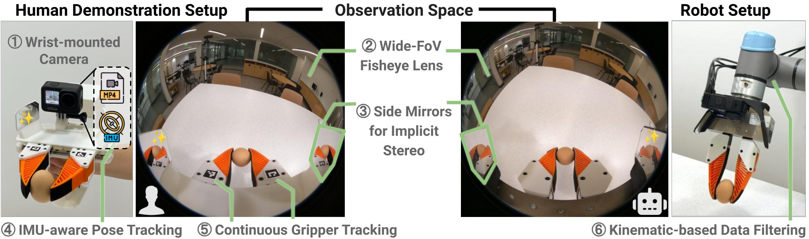

# device 轨落地清单：UMI 式手持夹爪采集（P0 可执行）

> 2026-08-29。Generalist Data Hands 未公开硬件细节，本清单基于其学术源头 UMI（[arXiv:2402.10329](https://arxiv.org/html/2402.10329v3)）及后继开源方案。目标：P0 阶段 1–2 对设备跑通 device 轨，产出带硬件动作真值的数据并校准 human 轨伪标签。

## 1. 硬件方案对比（按投入递增）

| 方案 | 组成 | 成本/夹爪 | 优 | 劣 |
|---|---|---|---|---|
| **原版 UMI**（首选起步） | 3D 打印平行夹爪 + 软指 + GoPro（155° 鱼眼）+ 指尖 fiducial 标记 | ~$400（含 GoPro） | 图纸/软件全开源、社区最大、单 MP4 落盘 | VIO 依赖纹理，长遮挡/弱纹理会跟丢 |
| Fast-UMI | GoPro（观测）+ RealSense T265（专职 6DoF 位姿）+ 指尖标记 | 略高 | 位姿与观测解耦，硬件无关性好、更稳 | T265 已停产需替代（如 ZED Mini/自算 VIO） |
| UMI-3D | 3D 打印夹爪（$50）+ Livox MID-360 LiDAR + Hikrobot 工业相机（$650） | ~$700 | 3D 空间感知、弱纹理稳 | 重量上来了，影响演示自然度 |
| RDT2 车队级 | 工业相机（全局快门 249fps）+ 4× VIVE Tracker 光学定位 + 工控机 | 高 | 位姿精度天花板、可复现夹爪几何 | 需布基站，失去"随处可采"优势 |

**P0 决策**：先原版 UMI ×2（双手成对，对齐 Generalist"夹爪对"），弱纹理场景多再评估 Fast-UMI 改型。

## 2. 关键技术点（原版 UMI 的实现细节）

*UMI 论文硬件图（图源：[umi-gripper.github.io](https://umi-gripper.github.io/)）：左为人持演示端（①腕装 GoPro→MP4+IMU），中为观测空间（②155° 鱼眼、③侧镜隐式立体、⑤fiducial 连续夹爪追踪），右为机器人端同构安装（⑥运动学过滤）——人机观测空间完全同构是其泛化基础。*

- **位姿**：GoPro IMU + 视觉惯性 SLAM（UMI 原配 ORB-SLAM3，**GPLv3 ⚠️**：仅允许服务端处理、不得进设备固件或分发件；商用发行前须切到 BSD 的 Basalt 或完成 GPL 合规评估，裁决项 governance.md U-10），真实米制尺度；视觉短暂跟丢（运动模糊/缺纹理）时靠 IMU 惯性外推维持。
- **夹爪开合**：指尖 fiducial 标记连续追踪指宽——**软指形变还隐式编码了抓握力**（这是纯视觉头戴方案完全拿不到的信号）。
- **视觉上下文**：155° 鱼眼保证操作物与周边场景同框；侧镜（原版设计）提供隐式立体。
- **已知局限**（采集任务设计时要避开）：目标机器人运动学可行性需事后过滤（人手能做的姿态机器人未必能到）；弱纹理表面（白墙、玻璃）SLAM 会挂；长时间遮挡不行；夹爪自重导致演示动作比裸手慢/僵。

## 3. 接入 fdp 管线

- **schema**：`track=device`；SignalStream 至少三路——`ee_pose`（6DoF，**按传感器原生频率入湖，≥50Hz**：VIO 输出通常 60Hz 随视频帧率，`rate_hz` 如实填写；export 不上采到 100–200Hz，这是 CLAUDE.md 决策 3 明示的 device 轨豁免，训练取帧时按 curation-pipeline §5 规则对信号流做线性插值）、`gripper_width`（标记追踪频率 = 视频帧率）、`imu`（≥200Hz，原生高频流，可供 VIO 重算与插值参考）；VideoStream 一路鱼眼主视角。GoPro MP4 + 遥测在 ingest 层拆流转 MCAP，统一 ns 时间戳。
- **device 轨专属质量门**（并入五阶段策展的门①）：SLAM 跟踪置信度/跟丢时长占比、尺度漂移检查（回环）、指尖标记可见率、目标机器人 IK 可行性过滤（对标 Ego2Robot L1）。
- **双重身份**：device 轨数据既进训练分片（动作真值），也进**演示库**（GEN-1.5 物理提示形态，3–12 秒切片）。
- **校准 human 轨**：同一操作者同一任务，头戴设备与 UMI 夹爪**同时佩戴采集**，得到"纯视觉伪标签 vs 硬件真值"配对——这比动捕手套方案更便宜地给伪标签质量分定刻度（动捕方案仍留作全手关节级金标准）。

## 4. 风险与边界

1. UMI 形态只覆盖"平行夹爪可完成"的任务子集——灵巧手任务（对标 Figure 逐指控制）仍需 human 轨 + 动捕兜底；P1/P2 阶段评估**穿戴孪生灵巧手路线**（TwinDEX 式：人穿与机器人端同构的三指外骨骼，逐指动作真值、零重定向，见 [research-twindex.md](research-twindex.md)）；P1 还应评估更低成本的**穿戴孪生夹爪手套路线**（Sunday Skill Capture 式：软手套复刻目标夹爪几何 + 头戴广角相机，可与 human 轨头戴设备共用硬件，但需 Skill Transform 式具身转换模块抹除人体入画，见 [research-sunday.md](research-sunday.md)）。device 轨定位是动作专家的预训练/微调主力，不是全任务覆盖。
2. GoPro 时间戳与 IMU 同步有已知抖动，ingest 校验要做时间一致性检查。
3. 规模化后（几十对以上）设备标定一致性成为主要误差源——每台设备标定文件随数据走（同头戴设备的规矩）。

参考：[UMI](https://arxiv.org/html/2402.10329v3) · [Fast-UMI](https://arxiv.org/html/2409.19499v2) · [UMI-3D](https://arxiv.org/html/2604.14089v1) · [RDT2](https://arxiv.org/pdf/2602.03310) · [Trossen 的 UMI 综述](https://www.trossenrobotics.com/post/what-is-umi-data-collection)
