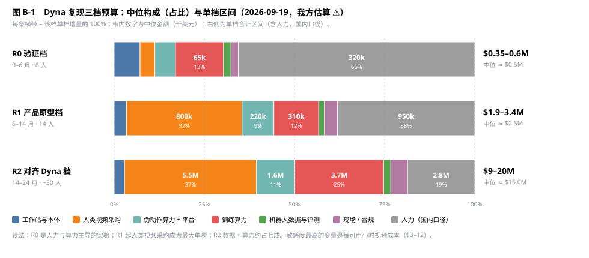

# Dyna 模式复现方案：工程 · 软件 · 模型 · 训练数据 · 预算范围

> 2026-09-19。目标：按 Dyna 公开的实现方式（三层模型 + 世界-动作模型 DYNA-2 + 头戴人类视频预训练 + 每任务 ≤10 h 机器人后训练 + 奖励模型引导的持续改进），在本仓库的数据管线上做一个自己的复现版本，并给出分档预算。**当前执行口径见 §12（2026-09-20 收敛版：洗衣四任务、仅后训练 + VLM 大脑、自有人形 6 台）**。依据：[research-dyna-comparison.md](research-dyna-comparison.md)、[research-model-recipes.md](research-model-recipes.md) §2、[research-sensor-layouts.md](research-sensor-layouts.md)、[research-end-effector-torso.md](research-end-effector-torso.md)；一手原文见 `sources/dyna/`。金额是量级估算，用于排序与止损，不是采购报价，口径与 [program-plan.md](program-plan.md) §4、[data-platform.md](data-platform.md) §1 一致；Dyna 未披露骨干来源、参数量、训练算力、λ、分辨率，这几项全部是我方估算 ⚠️（登记 governance R-21）。

## 0. 复现什么，不复现什么

Dyna 的公开材料里，可证伪、值得花钱复现的主张只有四条 [D:dyna-2]，其余是商业结果，外部无法复现：

| # | 主张（自报 ⚠️，D-22） | 复现判据 | 最低需要的档位 |
|---|---|---|---|
| C1 | 联合去噪未来视频 + 动作，在 39/39 个机器人任务上胜过只预测动作；只预测动作的配方随数据增大过拟合 | 同数据、同步数，三种配方（action-only / joint / video co-training）在留出机器人数据上的零样本 MSE 与 Acc@0.5 | R0 |
| C2 | 只用人类视频预训练，留出机器人数据上的零样本指标随小时数呈幂律，且比人类侧陡 4–7 倍 | 1K / 3K / 10K（/100K）小时嵌套子集，等步数 checkpoint，拟合指数与 R² | R0（三点）→ R1（四点） |
| C3 | 动作标签固定、只扩无标签视频，跨具身迁移单调上升（视频是独立的缩放轴） | 固定伪动作小时数，视频 0 / 1× / 3× / 10× | R0 末 → R1 |
| C4 | 每任务 ≤10 h 机器人数据、无联合训练，真机归一化性能随预训练规模单调上升（20→28→45→53%） | 5 个（R0）→ 14 个（R1）任务，盲测，每任务 ≥10 次 | R0（5 任务）→ R1 |

不复现的：客户质检 46→87%、100 万小时规模本身、1 kHz System 0 全身 RL 控制器（固定双臂用不上）、五指手拧瓶盖（R2 才碰）。Dyna 联创 Jason Ma 的外推是"到 99% 需要约 10^10 小时"（第三方转述 ⚠️，未见于一手页，research-dyna-comparison §2.2），所以这个复现的目的不是追平他们的规模，而是用最小成本裁决 U-37（训练层要不要走 WAM 分支），并拿到自家的人→机器人迁移指数。

**与本仓库原则的关系**：CLAUDE.md 决策 7 要求模型决策只抄 ≥2 家独立验证的共识、不自研骨干。WAM 目标已有四家独立验证（U-37），骨干取开放权重，本方案不违反；但它仍是**可选分支**，不替换 [training-pipeline.md](training-pipeline.md) 的默认 VLA 栈，两条线共用同一份数据与同一套评测，差异只在配方 yaml 的 `objective` 开关。

## 1. 总体结构：Dyna 的四层与我们的替代

Dyna 首页图给出的分层是 System 2 DYNA-VLM ~1 Hz → System 1 DYNA-2 ~10–15 Hz → System 0 ~1 kHz → DYNA-SAUR 本体（视觉·触觉·本体感知）[D:home]。

| 层 | Dyna 的做法（一手） | 我们的复现 | 自研 / 外取 |
|---|---|---|---|
| System 2 任务推理 ~1 Hz | DYNA-VLM，来源未披露 [D:home] | 本地开放权重 VLM（Qwen-VL 4B 级，training-pipeline §1.1 的 M 档骨干）做 SOP 分步、子任务指令下发、异常判定；只输出文本指令 | 外取 + 提示工程，R1 起做轻量 SFT |
| System 1 操作策略 ~10 Hz | DYNA-2：视频扩散骨干上的 mixture-of-transformers，视频与动作各自一套 DiT 层，流匹配，推理不生成视频 [D:dyna-2] | **本方案主体**，见 §4 | 骨干外取，动作 DiT 与训练配方自研 |
| System 0 控制 ~1 kHz | "DYNA RL Controller"，全身控制 [D:home] | 固定双臂阶段用厂商关节阻抗 / 位置环 + 动作块插值，不训练；移动半人形之前不立项 | 外取 |
| 本体 | 固定双臂 6-DoF YAM + 平行夹爪；头部、躯干、腕部相机；五指手可选 [D:dyna-2] + [research-sensor-layouts.md](research-sensor-layouts.md) §2（相机位置取自视频截帧 ⚠️） | 同构：双臂 6-DoF + 平行夹爪，相机槽位 `head / torso / wrist_l / wrist_r`，见 §2 | 外购 |
| 奖励模型 / 持续改进 | DYNA-1 的基础奖励模型估计任务进度，引导自主运行与错误恢复，六周从 5 分钟崩溃到 24 小时 [D:dyna-1] | 进度回归头 + QC 成功 / 失败 / 介入标记训练的奖励分类器，即 training-pipeline Stage D 的 reward-trainer；R1 才启用 | 自研（小模型） |
| 数据基础设施 | MCAP + H.264 大 GOP、按读取模式分组 topic、Airflow 三段 DAG、列式 mmap 清单、NVMe 页级缓存 [D:infra] | 本仓库 M1–M2 已覆盖大半，缺口见 §3 | 自研 |

## 2. 工程：工作站与本体

一台**双臂工作站**（cell）是复现的最小硬件单位。Dyna 的评测平台是两台不同的固定双臂 YAM [D:dyna-2]，外部 27 个评测任务来自 xdof 的 ABC 数据集，同样是 YAM 双臂；ABC-130K 以 Apache-2.0 发布（governance U-11 表第 30 行）。**选同款臂的直接收益是 3,500 h 的公开同构机器人数据可以当留出评测集，C1–C3 的离线评测不需要自己采一条机器人数据。**

| 组成 | 规格 | 单价量级 ⚠️ 待询价 |
|---|---|---|
| 从动臂 ×2 | 6-DoF、YAM 级、负载 ≥1 kg、关节电流可读（Dyna 用电流遥测做硬件退化归因，D-26） | $3–5k / 臂 |
| 主动臂 ×2（遥操作） | 同构缩比主手，关节映射；按 [robot-track-teleop.md](robot-track-teleop.md) §1 的接管打点规范出 `intervention_ts_ns` | $1–3k / 对 |
| 平行夹爪 ×2 | 弧形指尖、开合度可读（对应伪动作的拇指-食指开合度标量 `grasp_aperture`） | 含在臂内或 $0.5–1k |
| 相机 ×4 | 头部、躯干各 1 路全局快门 RGB，腕部 2 路广角；硬触发同步（architecture §8） | $0.2–0.5k / 路 |
| 机架、桌面、急停、光照 | 可复现的固定外参；标定板常驻 | $2–4k |
| 工控机 + 推理 GPU | 采集用 x86 工控机；推理 R0 用 1 × 消费级 24–32 GB GPU，R1 的 5B 档需 48–80 GB 级 | $5–12k |
| **单台合计** | | **$18–35k** |

| 档位 | 台数 | 用途 | 硬件合计 |
|---|---|---|---|
| R0 | 1 台 + 备件 | 5 个后训练任务、盲测 | $25–45k |
| R1 | 4 台（2 台采集、1 台评测专用、1 台试点现场） | 14 任务、评测机与采集机物理隔离（防止评测场景泄漏进训练） | 累计 $90–150k |
| R2 | 10–12 台 + 五指手 1–2 对 + 移动底盘 1–2 台 | 车队与两个客户现场；Dyna 截帧里可见 ≥8 台 ⚠️ | 累计 $0.4–0.7M |

工程侧的三条硬要求，都来自 Dyna 的一手教训：硬件退化指数先于策略归因（"a worn gripper and a bad policy look the same in an episode"[D:product]）；连续运行没有清晰的 episode 边界，录制器必须支持触发式固化窗口（runtime-and-deployment §4）；评测机不参与采集。

## 3. 软件：在现有管线上要补的东西

本仓库 M1–M3 的模块表（architecture §7）已覆盖采集、入湖、策展、导出。按 Dyna 基础设施页 [D:infra] 对照，复现需要新增或提前的只有七项：

| # | 模块 | 内容 | 依据 | 档位 | 人月 |
|---|---|---|---|---|---|
| S1 | 伪动作工厂（human 轨） | 3D 手姿 → 腕位姿（相机系增量）+ 拇指-食指开合度；Savitzky-Golay + SLERP 平滑；手部缺失 / 遮挡质量门；未过门的视频标 `pseudo_action=null` **保留**，只进视频目标 | [D:dyna-2]；index-replica-plan §4；research-model-recipes §7 | R0 | 3 |
| S2 | 连续帧序列导出 | export 按 `frame_pair_stride` 输出长连续窗口；训练态视频用大 GOP；MCAP 按读取模式分组 topic（data-format-contract §1.1 / §2.1 已写入契约，待实现） | [D:infra]：存储 −68%、读延迟 2.9× | R0 | 2 |
| S3 | 列式 mmap 训练清单 + 嵌套子集切分 | 1K / 3K / 10K / 100K 嵌套且保持任务比例；清单哈希进 lineage；这就是决策 6 的缩放消融切分器 | [D:infra]：首批次 48 h → <1 min | R0 | 2 |
| S4 | WAM 训练栈 | MoT 前向、两条边际速度场的流匹配损失、`objective` 开关、FSDP + 激活重算、视频 VAE 潜变量离线缓存 | [D:dyna-2] §架构 | R0 | 6 |
| S5 | 推理运行时 | 只跑动作去噪（观测视频 token 做 KV 缓存，不生成未来帧）；动作块 + 时间集成；各层延迟写回 episode（research-model-recipes §7） | [D:dyna-2]："at inference time the model stays reactive" | R0 | 3 |
| S6 | 入湖 DAG 与 NVMe 缓存层 | 转换 / 质检 / 特征富化三段独立配资源、可重放；GPU 节点本地 NVMe 页缓存 | [D:infra]：14k → 440k episode-小时 / 周 | R1 | 4 |
| S7 | 奖励模型与 SOP 自动标注 | 进度回归 + 成功 / 失败 / 介入分类；System 2 的 SOP 分步打分即部署内评测 | [D:dyna-1]；[D:product] | R1 | 5 |

软件总量 R0 约 16 人月，R1 追加约 9 人月加持续维护。一步蒸馏出视频（10,203 → 110 ms [D:dyna-2]）只用于分析与可视化，不进任何档位的必做项。

## 4. 模型：DYNA-2 式世界-动作模型的复现设计

### 4.1 结构（全部按一手描述，未披露处标明是我方选择）

- **骨干**：开放权重的视频扩散 Transformer。候选 A：Cosmos 3 小杯（OpenMDW-1.1，governance U-11 表第 25 行已准入默认路径）；候选 B：Wan 2.x 系 1.3B / 5B / 14B（NVIDIA DreamZero 用的就是 Wan 2.1-I2V-14B，research-dyna-comparison §6；许可 ⚠️ 待 U-11 核查，核查前只在研究分支）。Dyna 未披露自己的骨干来源 [D:dyna-2]。
- **动作分支**：独立的一摞 DiT 层，比视频分支浅，只在骨干的前若干层与视频 token 互相注意；本体感知分词后直接进动作分支；动作 token 双向自注意并读取**观测帧**的视频 token；视频 token 因果；文本只交叉注意到视频 token，不直连动作 token。我方起步规模 0.1–0.3B（未披露 ⚠️）。
- **目标**：流匹配，两条边际速度场共享主干，`L_co = E‖u_vid(z_t; t, c) − (z − ε_z)‖² + λ·E‖u_act(a_t; t, c) − (a − ε_a)‖²`；动作速度场不读加噪的未来视频潜变量，所以推理时是反应式策略。λ 未披露 ⚠️，R0 扫 {0.1, 1, 10}。
- **动作空间**：相机系增量末端位姿 + `grasp_aperture` 标量，落进 training-pipeline §1.2 的定长槽位 + 掩码；人类伪动作与机器人真值同槽位，这是零样本离线评测能成立的前提。
- **输入**：3 路视角（Dyna 的一步蒸馏样例是"三秒、三视角"[D:dyna-2]）；人类视频只有 1 路头戴视角，其余视角掩码。分辨率与帧率未披露 ⚠️，我方取 ~320–384 px、10 fps、过去 2 帧 + 未来 3 s。

### 4.2 三档模型与训练步骤

| 步骤 | R0 | R1 | R2 |
|---|---|---|---|
| 骨干规模 | 1–2B | ~5B | ~14B |
| 预训练数据 | 1K / 3K / 10K h 人类视频（嵌套） | + 100K h | + 1M h |
| 配方对照 | action-only / joint / video co-training 三种 × 三个规模，等步数 | joint 与 co-training 两种 × 最大规模；C3 的视频轴四点 | 单一胜出配方 |
| 零样本离线评测 | ABC-130K 留出（27 任务同构）+ 自采 5 任务 | + 自采 12 任务基准 | 同左 |
| 后训练 | 每任务 ≤10 h，仅机器人数据，无联合训练；5 任务 | 14 任务；每任务 10 次盲测、评测者不参与开发（照抄 Dyna 协议） | + 五指手、现场任务 |
| System 2 / 奖励模型 | 不做，人工下指令 | VLM 分步 + 奖励模型，连续运行 8 h → 24 h 爬坡 | 车队持续改进（升级阶梯 T0–T2） |
| VLA 对照基线 | fdp-policy S 档（training-pipeline §1.1）同数据同步数 | M 档；对应 Dyna 的 DYNA-1 vs DYNA-2 七任务对照（1.55×，D-22） | — |

### 4.3 训练算力估算（我方推算 ⚠️）

口径：视频 VAE 时空压缩 4×8×8、2×2 分块，384×320 输入约 480 token / 潜帧，3 s 片段 + 上下文约 10 潜帧 ≈ 5K token / 视角·样本；每样本 FLOPs ≈ 6 × 参数量 × token 数；H100 有效吞吐按 2.5×10^14 FLOPs/s（约 40% 利用率）；1 小时视频 ≈ 1,200 个不重叠片段；多视角与注意力开销再乘 1.5。

| 档位 | 单次过一遍数据 | 主训练 + 阶梯 / 消融 / 调试 | 云价 $2–2.5 / H100·h |
|---|---|---|---|
| R0（2B，10K h） | ~1.5K H100·h | 9 个等步数 run × ~3K + 30% 调试 ≈ 20–40K H100·h | $40–90k |
| R1（5B，100K h） | ~30K H100·h | 主 run 60K + 阶梯与 C3 视频轴 40–80K + 后训练 5K ≈ 100–150K H100·h | $220–400k |
| R2（14B，1M h） | ~0.9M H100·h | 1–2M H100·h（B200 等效折算） | $2.5–5M |

R1 档与 program-plan §4 已列的"Stage B（M 档）3–10 万 H100·h"同量级，二者可以合并成同一笔算力预算下的两条配方分支，而不是两笔钱。

## 5. 训练数据

| 数据 | Dyna | 我们的来源 | 单价口径 | R0 | R1 | R2 |
|---|---|---|---|---|---|---|
| 头戴人类视频（预训练） | 100 万+ h，"数据伙伴 + 自采"，设备、人数、单价未披露 [D:dyna-2] | ① Build AI Egocentric-10K（工厂场景 1 万 h，Apache-2.0，旁观者脱敏无说明 → 入湖先过隐私门，data-strategy-roadmap §1.7）；② 自家 human 轨（H0/H1 已有预算）；③ 外购众包 | 众包事实价 $6/h（$3–9），熟练采集员有效率 1/3–1/2、QA 拒收 10–30%（第三方，data-strategy-roadmap §1.2）→ 按通过分钟计酬后每**可用**小时 $6–12 | ①全量 + ② 1–2K h：$10–30k | 补到 100K 可用小时：$0.5–1.1M | 补到 1M：$3–8M（量大议价，下限按 $3–4 / 可用小时） |
| 伪动作与质量门算力 | 手姿提取 + 黑屏 / 抖动 / 手部缺失过滤 [D:infra] | S1 + curation L1；~0.5 GPU·h / 原始小时（data-platform §1.3） | 推理卡 $0.5–1 / GPU·h | $10–25k | $80–200k | $0.5–1.2M |
| 存储与平台 | PB 级，NVMe 缓存 [D:infra] | raw 永存转冷、训练分辨率热存（data-platform §1.2） | 冷 $1–4 / TB·月，热 $20 / TB·月 | $8–15k | $60–100k / 年 | $0.5–1M |
| 机器人后训练数据 | 每任务 ≤10 h，拧瓶盖约 10 分钟 [D:dyna-2] | 自家遥操作，robot 轨 | 全成本 $118/h（第三方，RCSV） | 5 任务 × ≤10 h + 评测：$5–10k | 14 任务 + 12 任务基准 ≈ 250–350 h：$25–50k | 现场任务与干预段：$0.2–0.4M |
| 留出机器人评测集 | 39 任务 = 12 内部 + 27 ABC [D:dyna-2] | ABC-130K（Apache-2.0，LICENSE 文件缺失，lineage 固定 README 声明） | 免费 | 0 | 0 | 0 |

两条数据纪律：预训练语料里**零机器人数据**（否则 C2 的"跨具身零样本"不成立）；held-out 的 ABC 任务与自采基准在清单层面硬隔离，由 curation §8 的泄漏检查保证。

我们比 Dyna 多一张牌：device 轨带硬件动作真值。R0 的配方对照里加一个第四臂"joint + 5% device 轨真值"，成本近零，直接检验战略文档 §2.2 三条主线的分工假设：少量硬件真值能否替代一个数量级的伪动作小时。

## 6. 团队

| 档位 | 周期 | 编制 | 人年 |
|---|---|---|---|
| R0 | 第 0–6 月 | 训练 / 模型 2、数据层与伪动作 2、机器人与遥操作 1、评测兼项目 1 = 6 人 | 3 |
| R1 | 第 6–14 月 | + 训练 2、平台 / 运维 2、采购与数据运营 1、现场工程 1、操作员 2 = 14 人 | ~9 |
| R2 | 第 14–24 月 | 30 人上下（训练 8、数据 6、平台 4、机器人 / 现场 8、运营与合规 4） | ~25 |

人力成本按地区差异大，给两个口径：国内全成本 $85–140k / 人年（约 60–100 万元），美国 $250–400k / 人年。

## 7. 预算范围



*图 B-1　三档预算的中位构成（含人力，国内口径）与区间。R0 是人力与算力主导的实验；从 R1 起人类视频采购成为最大单项，到 R2 数据 + 算力约占七成。全部为我方估算 ⚠️。*

| 项（单档增量，$） | R0 验证档（0–6 月） | R1 产品原型档（6–14 月） | R2 对齐 Dyna 档（14–24 月） |
|---|---|---|---|
| 工作站与本体（§2） | 25–45k | 65–105k | 0.3–0.55M |
| 人类视频（§5） | 10–30k | 0.5–1.1M | 3–8M |
| 伪动作算力 + 存储平台（§5） | 18–40k | 140–300k | 1–2.2M |
| 训练算力（§4.3） | 40–90k | 220–400k | 2.5–5M |
| 机器人数据与评测（§5） | 5–10k | 25–50k | 0.2–0.4M |
| 试点现场、合规与采购法务 | 5–10k | 60–120k | 0.4–1M |
| **小计（不含人力）** | **≈$0.1–0.2M** | **≈$1.1–2.2M** | **≈$7–16M** |
| 人力，国内口径 | 0.25–0.4M | 0.75–1.2M | 2.1–3.5M |
| **单档合计（国内口径）** | **≈$0.35–0.6M** | **≈$1.9–3.4M** | **≈$9–20M** |
| 累计 | ≈$0.35–0.6M | ≈$2.2–4M | ≈$11–24M |
| 累计，美国人力口径 | ≈$0.85–1.4M | ≈$4.4–7.5M | ≈$18–36M |

参照系：Dyna 公开融资合计 $143.5M（种子 $23.5M + A 轮 $120M，PR Newswire 官方，research-dyna-comparison §1）。R2 累计约为其融资额的 1/6–1/10，但 R2 只对齐模型与数据规模，不含他们的客户交付团队。

**与现有预算的重叠**：program-plan §4 的 12 个月总盘（不含人力 ≈$1.6–3.3M）已经包含 Creator 计酬、平台、Stage B 训练算力和 3–5 台本体。R0 + R1 中真正的增量只有三块：同构双臂工作站（若 U-04 选型另有所属）、WAM 训练栈的人力（S4、S5 约 9 人月）、以及把 human 轨采购从 H2 的 1 万 h / 月口径提前并放大到 100K h 的差额。粗算增量不含人力约 $0.4–0.9M。

**最敏感的三个变量**：每可用小时的人类视频成本（$3 与 $12 差 4 倍，决定 R1 / R2 的一半预算）；骨干规模（5B → 14B 算力 ×3）；等步数阶梯的 run 数（每多一个对照臂 R1 多 $40–70k）。

## 8. 门与止损

| 门 | 时点 | 通过判据 | 不通过 |
|---|---|---|---|
| G-R0a | 第 3 月 | S1–S5 打通；2B 模型在 1K h 上 joint 与 action-only 两个 run 完成；单卡推理 ≥10 Hz | 推理达不到 10 Hz → 减视角或换更小骨干，不进真机 |
| G-R0b | 第 6 月 | C1：joint 在 ABC 留出任务上胜 action-only ≥80% 任务；C2：三点零样本 MSE 单调下降；C4：5 任务后训练 10K 档优于 1K 档，序贯检验显著（eval-protocol §3） | C1 不成立 → U-37 裁决为"不纳入"，WAM 分支关闭，损失封顶在 R0；C1 成立而 C2 不成立 → WAM 目标保留，但不为它买 100K h |
| G-R1 | 第 14 月 | 四点幂律拟合 R² ≥0.85；WAM 对同数据 VLA 基线成对胜率 ≥60%；一个试点现场连续运行 ≥8 h；R-20 的转化率曲线有第一个可测点 | 不进 R2；资源回到默认 VLA 栈 + device 轨 |
| G-R2 | 立项前 | 外部资金或客户预付覆盖 ≥50%；每可用小时视频成本 ≤$5 | 不自费做 1M h |

**建议**：现在只批 R0（≈$0.35–0.6M，6 个月，6 人），它同时完成 U-37 的裁决、自家迁移指数的第一次测量和 M3 训练栈的一半工程。R1 以 G-R0b 为条件。R2 不建议自费：按 Dyna 联创的外推（第三方转述 ⚠️），纯视频路线到部署精度还差四个数量级，我们的差异化应当押在"少量硬件真值 + 高质量策展替代小时数"，即 §5 末尾那条第四对照臂。

## 9. 风险

| 风险 | 说明 | 对策 |
|---|---|---|
| 复现参数全凭估算（R-21） | 骨干、参数量、算力、λ、分辨率、动作分支深度都未披露 | R0 把它们当超参扫；预算留 30% 调试余量，已含在 §4.3 |
| 自报数字不成立（D-22） | 39/39 与幂律无同行评审；作者自认 VLA 对照按 VLA 管线调参 | G-R0b 用公开 ABC 数据复核，结论可对外发布 |
| 许可 | Wan 系骨干未入 U-11 表；Egocentric-10K 隐私处理不明；ABC 基线代码依赖 DINOv3 | 默认路径只用已准入的 Cosmos 3；其余走研究分支，LEGAL 逐项出意见（U-29 流程） |
| 伪动作质量 | 无手指关节、无接触力、无触觉（Dyna 自认 [D:dyna-2]）；平行夹爪零样本迁移优于高自由度手 | 末端先用平行夹爪；五指手推到 R2；伪动作金标准 MPJPE 报告是 M2 验收项 |
| 飞轮不自转（R-20） | Dyna 十个月部署无自加速 | 不把车队回流写进 R1 的收益假设；只测转化率 |
| 推理延迟 | 视频骨干比 VLA 重，10 Hz 是硬约束 | 观测 token KV 缓存、动作分支少步去噪、只在骨干早层互注意；G-R0a 专门设门 |

## 10. 回写

- governance：新增 **U-39**（是否立项 R0、骨干候选 A / B）、**R-21**（复现参数为估算）；U-11 表加 Wan 2.x 与 Egocentric-10K 两行。
- program-plan §4：训练算力行注明 Stage B（M 档）与本方案 R1 共用预算。
- training-pipeline §2：`objective` 开关与第四对照臂进 Stage B 配方（待 R0 立项后）。

## 11. 来源

一手归档：[D:dyna-2]、[D:dyna-1]、[D:infra]、[D:home]、[D:product]。价格与可用率：data-strategy-roadmap §1.2（第三方）；算力与存储单价：data-platform §1；训练档位：training-pipeline §1.1、program-plan §4。Dyna 融资：PR Newswire 官方稿（research-dyna-comparison §1）。

## 12. 收敛版（2026-09-20）：洗衣四任务 · 仅后训练 + VLM 大脑 · 自有人形 6 台

范围由负责人于 2026-09-19/20 收敛：任务只做洗衣服、叠衣服、晾衣服、摆放衣服；不自己预训练，只做开放权重 VLA 的后训练并叠加一个 VLM 大脑；本体自有，不新购。本节取代 §2 的工作站采购与 §7 的 R0/R1/R2 作为**当前执行口径**，§0–§11 保留为"补预训练"的后备选项（触发条件见 §12.6）。全部金额为我方估算 ⚠️，含人力按国内口径。

> **2026-09-20 追加**：任务范围与顺序已由负责人改为六项、两次交付——交付一：脏衣服分类 → 洗衣服 → 烘干（第 0–6 月）；交付二：晾衣服 → 叠衣服 → 收纳（第 6–11 月）；方案 B 的决策点移到第 7 个月（叠毛巾探针）。按步骤 × 按类型的预算（美元、台湾地区人力成本）以 [laundry-two-plans-brief.md](laundry-two-plans-brief.md) §4、§8 为准；本节 §12.3、§12.5、§12.6 的任务顺序、金额与门为上一版口径，仅保留作推算依据。

### 12.1 自有本体（负责人口述，规格待按厂商资料核对 ⚠️）

| 项 | 现状 | 对方案的含义 |
|---|---|---|
| 本体 | 轮式人形 × 6 台；上肢控制 ≥200 Hz；接口为 DDS / ROS 节点；关节电流可读；本体自研；上肢目前仅位控，力控开发中；腰部可升降 | 轮式底盘无跌倒风险，试点不需要吊架；200 Hz 正好落在决策 3 的状态 / 动作流 100–200 Hz 档，原生频率入湖不重采样；关节电流进状态流，供硬件退化归因 [D:product]；底盘移动与升降以离散站位原语调用，VLA 只管到位后的双臂操作 |
| 控制模式 | 上肢位控（力控开发中）；夹爪已有力控 | 叠、摆、晾对位控足够，柔顺由夹爪力限位承担；洗衣机筒内取衣是接触最重的子技能，位控下用关节电流阈值做碰撞保护并排在最后做；策略输出末端增量位姿 → IK → 关节位置指令；每条 episode 记 `controller_version`，力控上线视为新版本，先做新旧数据混训消融再合并 |
| 升降腰 | 有 | 晾杆与洗衣机站位不需改造环境；每个站位一个高度预设，由大脑层以原语调用，升降关节只进状态不进策略动作空间 |
| 机载算力 | NVIDIA Jetson Thor | VLA（3B 级，动作块 ≥10 Hz）与 8B 级 VLM 大脑（~1 Hz）同机运行，需量化并实测显存与延迟 ⚠️；达标则不需要外挂推理 GPU；各层推理延迟写回 episode（research-model-recipes §7） |
| 遥操作 | VR 遥操作已自研完成 | 不再采购套件；需要补的只有接管打点：`intervention_ts_ns` 与操作员 ID 按 robot-track-teleop §1 写入同一条 MCAP |
| 采集中间件 | ROS 2 / DDS | recorder 可直接用 rosbag2 的 MCAP 存储后端，U-01 在本体上倾向"ROS 节点 + MCAP"而非自写采集循环；时间戳取消息头的采样时刻而非接收时刻（architecture §8），topic 按读取模式分组写 chunk（data-format-contract §1.1） |
| 末端 | 二指夹爪，带力控 | 与 Dyna "平行夹爪迁移优于高自由度手"同向 [D:dyna-2]；夹持力作状态流（`grip_force`，可空，100–200 Hz）入 MCAP，并作抓取成败的自动标签与奖励模型信号 |
| 腕部相机 | RealSense D405 × 2 | 近距立体深度，适合抓布点；RGB 进 VLA，深度只录不喂，供大脑层判平整度 / 折边对齐；深度流无损 16 位存储 |
| 头部相机 | RealSense D457 | 全局视角，供大脑层与 VLA；桌面作业距离接近其深度下限，深度可用性需实测 ⚠️ |
| 相机槽位 | `head / wrist_l / wrist_r` | 与 Dyna 截帧观察到的头 + 腕布局一致（research-sensor-layouts §2 ⚠️）；D457 与 D405 接口不同，按 architecture §8 的跨时钟域对时处理，先按软同步 <5 ms 预算实测 |

### 12.2 结构

```
VLM 大脑 ~1 Hz（文本指令 + 站位原语 + 洗衣机联网接口）
   → 后训练的开放权重 VLA（双臂末端增量位姿 + 夹爪，动作块）
   → 厂商关节 / 全身控制器
```

- **大脑**：识别衣物种类与状态 → 选 SOP → 逐步下发子任务指令 → 每步判成败（头部 RGB + 腕部深度 + 夹持力）→ 失败重试或先摊平 → 异常求助。先用现成 Qwen-VL 8B 级 + 提示词 + SOP 状态机，不训练；试点前用几千条洗衣标注做 SFT。形态参照 Harness VLA（冻结 VLA 作可重试原语 + 解析原语 + 规划器，论文自报 ⚠️，未归档）。
- **小脑**：基座候选 π0.5（主）、GR00T N1.7（对照，NOML 许可，只在研究分支，U-29）；二者同数据同步数对照一轮后定稿。许可逐项走 U-11。
- **站位切换是解析原语**："到叠衣台 / 蹲到洗衣机前 / 站到晾杆前"，VLA 不学行走。
- **洗衣机程序走联网控制**，机器人只做装卸；客户机型不支持时回到任务清单，多 3–5 个子技能。

### 12.3 任务顺序与数据

| 顺序 | 任务 | 子技能数 | 遥操作小时 | 档 |
|---|---|---|---|---|
| 1 | 叠（毛巾 → T 恤 → 裤子） | 5–6 | 40–60 | P-A |
| 2 | 摆放（入筐 / 上架 / 分类） | 2–3 | 10–20 | P-A |
| 3 | 晾（衣架穿入、挂杆、夹子） | 4–5 | 50–80 | P-B |
| 4 | 洗（装 / 卸、放洗涤剂） | 3–4 | 40–70 | P-B |

每个子技能 ≤10 h（Dyna 口径 [D:dyna-2]）；人形 VR 遥操作有效产出低于主从臂，成本按 ×1.3–1.5。部署后只回流干预段与失败段（R-20），走升级阶梯 T0（提示库 / 规则）→ T1（干预段 SFT）。湿衣分布必须自采。人类洗衣视频按最低档持续采集（每月几百小时，$3–6k / 月），保住日后补预训练的选项。

### 12.4 六台的分工

| 阶段 | 采集（遥操作 / 干预回流） | 评测专用 | 开发联调 | 试点现场 | 轮换备机 |
|---|---|---|---|---|---|
| P-A（0–3 月） | 2 | 1 | 1 | — | 2 |
| P-B（3–9 月） | 2 | 1 | — | 2（1 运行 + 1 热备） | 1 |

评测机不参与采集，评测衣物与场景不进训练清单（curation §8）。六台同时是一个小车队：每台独立 `device_id` 与标定版本；评测按"训练未见过的那台机"单独报一列，测跨机差异。连续运行的试点站位外接电源（轮式，无需吊架），本体停机与策略失败分开记账，避免污染转化率 KPI。

### 12.5 预算

| 档 | 周期 · 人数 | 花在哪 | 不含人力 | 含人力 |
|---|---|---|---|---|
| **P-A** | 0–3 月 · 4 人 | 工作台与标定件、外接电源、2–3 种指尖 $3–10k（VR 遥操作已有）；遥操作 50–80 h $8–15k；微调 10–20 个 run 共 2–8K H100·h $5–20k；大脑提示词 + 状态机 $1–5k | $17–50k | **$0.1–0.19M** |
| **P-B** | 3–9 月 · 6–7 人 | 洗 + 晾环境件（洗衣机、晾杆、货架、备件）$10–30k；遥操作 150–250 h + 干预段 $35–60k；微调算力 $20–50k；大脑 SFT、成败判别与进度模型 $60–170k；洗衣房试点 $50–100k | $0.18–0.41M | **$0.46–0.87M** |
| **累计 9 个月** | | | **$0.2–0.46M** | **$0.55–1.05M** |

之后扩站不需要再买本体：六台可支撑 1–2 个站点，每站集成与驻场约 $50–100k。对照：洗衣版自己预训练到 R1 累计 $1.7–2.8M、14 个月。

### 12.6 门

| 门 | 时点 | 通过判据 | 不通过 |
|---|---|---|---|
| G-PA | 第 3 月 | 叠毛巾 + T 恤：质检通过率 ≥80%、每百条干预 ≤10 次；大脑层成败判别与人工一致率 ≥90%；评测机上复现 | 卡在布料泛化 → 启动洗衣版 R0 补预训练（§4、§5 收敛到 1 万小时、洗衣视频 ≥3 千小时），工作站、遥操作数据、评测集全部复用；卡在遥操作质量 → 先修采集，不动模型 |
| G-PB | 第 9 月 | 四任务全流程在试点站连续运行 ≥8 h；客户质检通过率 ≥90%；R-20 转化率有第一个可测点 | 不扩站；按失败模式本体回到对应子技能 |

节拍目标（Dyna 自报 95–100 条 / 小时 ⚠️，D-26）待 P-A 实测后再定，人形双臂预期低于固定双臂。

### 12.7 待补信息

具身档案草案已落 [`configs/embodiments/inhouse_wheeled_humanoid_v1.yaml`](../configs/embodiments/inhouse_wheeled_humanoid_v1.yaml)。其中标 TBD 的待补：每臂自由度与关节顺序、限位、夹爪最大开度、IK 方案、控制器版本号、相机同步实测残差、Thor 上 VLA + VLM 同机实测延迟、干 / 湿衣夹持力阈值；2026-09-20 评审补入：**每臂有效负载、关节电流保护阈值、双臂有效工作空间、停靠重复精度、逐台可用率**（[plans-review-hard-points.md](plans-review-hard-points.md) §4）。2026-09-20 已确认：自研轮式人形 6 台、上肢位控 ≥200 Hz（力控开发中）、升降腰、DDS / ROS、Thor、电流可读、VR 遥操作已有。

[D:dyna-2]: sources/dyna/dyna-2.txt
[D:dyna-1]: sources/dyna/dyna-1.txt
[D:infra]: sources/dyna/dyna-2-infrastructure.txt
[D:home]: sources/dyna/home.txt
[D:product]: sources/dyna/scaling-customer-deployments.txt
