# 历史推演：同构末端设计与图像迭代（2026-10-26）

> 历史档案，不是当前实施规范。三节/9 关节、A6 联动及多版相机位置均有后续修订；用户评审不通过的图不能当作设计依据。当前以 [两节构型与接入设计](inhouse-isomorphic-end-effector.md) 及其中选图为准。下文原样保留当时的推演文字，旧状态表述不代表当前批准状态。

# 自研同构采集末端与机器人接入设计

> **当前需求更新（2026-10-26，同日后续）**：三组指体加粗、增加明确手掌承载面；T 拇指、I 独立食指、S 后三指合组均允许两节，本轮采用两节候选。此前三节/9 关节/A6 联动方案保留为历史，不再自动适用于当前候选。

> 2026-10-26 · 系统方案 v0.5，待本体参数与硬件评审；不是已实现接口或硬件验收记录。
> 构型修订 v0.2：用户确认分组为拇指、食指、后面三指（中指/无名指/小指）；第三组为宽面合指承托结构；不是另一根细长食指。旧 v0.1 图保留作历史，主展示采用第三指修订图。
> 阅读入口：§10 给出完整首版推荐（A6：6 主动轴 / 9 运动关节），§1–9 保留需求、接口边界和 A9 能力对照。
> 本次目标：把与自研机器人末端匹配的采集器接入现有数据管线，形成“人工示范 → 数据集 → 策略 → 真机评测 → 回流”的闭环。

## 1. 已确认方向与既有基线

延续 [D1-H 既有设计](capture-devices-design.md#11-d1-h自研轮式人形同构版2026-09-20) 和 [自研本体档案](../configs/embodiments/inhouse_wheeled_humanoid_v1.yaml)：双臂轮式本体，二指力控夹爪，腕部 D405，上肢位控，ROS 2 接口，目标控制率 200 Hz。以上是仓库记录，尚未对照当前实机核验；档案中的 TBD 不用估计值补齐。

**用户已确认（2026-10-26）：升级三指，采集器与机器人末端共同设计；三指、每指三节，构型参考 Sunday。** 主方案为 **D1-H3**，原二指 D1-H2 保留为已有本体与对照数据基线，不再作为本次首版交付。旧具身档案保持原样，三指使用独立的新版本档案。

设计解释：每指三段指体、三个可动关节（根部 J1、中间 J2、末端 J3）。三节不自动决定驱动数量；每手记录 **9 个关节角**；§10 推荐首版采用 **6 主动轴 + 3 联动关节**，9 独立驱动作为能力对照，不能从三指三节直接推定 9 台电机。拇指根部先采用可调安装角形成对掌，对侧为独立窄食指与宽面第三指；如果捏取、旋拧或手内调整的工作空间不足，再评估额外的对掌/侧摆轴，不把 9 自由度写成最终上限。

人工端为手指直接驱动、关节测量的外骨骼；机器人端为对应电驱末端。两端共享关节轴、连杆长度、指面几何/材料及传感布局的设计基准，驱动机构可以不同。需要测量两端受力挠曲、摩擦、回差和延迟，不能把名义同构写成零迁移误差。穿戴适配通过接触托和绑带调节，不能为适配手型静默改变已标定的连杆长度。

证据现状：`src/fdp/schema.py` 实现 schema 0.2；recorder / ingest / export 等仍为骨架。文档已规划的 0.3 字段、硬件规格、采样率与规模不是当前软件支持或设备实测证据。

## 1.1 Sunday 构型参考与自研差异

用户指定 Sunday 作为构型参考，优先级高于此前泛化的逐指外骨骼建议。参考来源：[Sunday 调研 §1.1](research-sunday.md)、[官方原文归档](sources/sunday/no-robot-data.txt)、[手套特写](assets/sunday-glove-closeup.jpg)。官方文字确认采集端与机器人端共享几何/传感布局；宽软接触垫、腕带、近手相机吊舱是图片观察。公开材料不足以确认其内部关节数、三节机构、驱动数或传动设计，因此不能称本方案为 Sunday 内部结构复刻。

**修订后的布局提案**：拇指 T + 独立窄食指 I + 宽面合指 S。第三指不是另一个中指形状的窄指，而是容纳人手中指、无名指、小指的共同承托结构，三指一起驱动一条宽面机械运动链；机器人端采用相同宽面三节结构。宽面部件的参考依据是 Sunday 归档照片中的不对称接触面，具体人指分配、三节运动与驱动是我们的设计提案，不作为 Sunday 已公开内部参数。

- **接触面**：参考可见的宽软垫与圆角包覆；独立食指承担精细接触，第三指整条运动链形成宽面承托，各自保留接触区和感知。指间保留独立运动间隙，避免接触垫跨缝限制关节。末节收薄用于捏布角，掌侧与中节保留宽面用于握持。
- **穿戴方式**：优先腕带承重、掌部支撑、指托驱动的紧凑穿戴采集器；拇指与食指各自驱动，第三指由中指/无名指/小指共同承托驱动，保留跨手型内衬适配，避免三个人指被共同壳体夹伤。与外壳轮廓共同评审手型适配，不要求照搬外观尺寸。
- **三节运动**：指节弯曲形成包络抓握，末节也参与接触调整；同时比较远端耦合与独立驱动。耦合方案仍测量真实关节角，记录主动/被动与耦合关系，不用理想联动关系替代实测而隐去误差。
- **相机布置**：参考近手拇指侧固定掌根吊舱，优先看见指尖和物体接触区。D405 是现有硬件候选，不是 Sunday 已确认型号；与腕部位置一起做遮挡、碰撞、重量和视场测试，再冻结两端相同的安装变换。
- **设计顺序**：先用可调无动力样机验证人能否舒适地捏、握、拧、拉，再冻结接触几何和指节布局；机器人驱动版同步做传动、工具负载与闭环可实现性检查。采集端和执行端都通过后才冻结共用版本。

首轮产物为三节运动样机、穿戴试验记录、抓握工作空间、接触区布局与传动候选对照表。Sunday 的外观不能提供电机力矩、编码器精度或可制造尺寸，这些参数由我们的任务负载与台架测量决定。

## 2. 机械、电气与控制分工

| 部件 | 人工采集端 | 机器人端 | 首版要求 |
|---|---|---|---|
| 指部与接触面 | 三指 × 三节的穿戴外骨骼，拇指/独立食指/宽面合指 | 新设计三指 × 三节电驱手 | 共用指体与指垫设计基准；干、湿工况分别标定；记录版本与磨损 |
| 关节驱动 | 人手驱动，9 路关节角独立测量，可调阻尼 | 9 运动关节；优先比较耦合与独立驱动，布局待负载/热测试 | 关节正方向、零位、限位相同；关节速度、加速度与力矩包络约束数据使用 |
| 力与接触测量 | 每指指腹/指尖直接测力；保留接触区标识 | 对应接触区装同类传感器，另记录驱动电流 | 接触力与关节力矩分开；电流估计不标为实测接触力 |
| 腕部相机 | D405，按本体相机到 TCP 的变换安装 | 现有 D405 | 内参、外参、曝光策略、视场与遮挡检查；同型号不等于观测一致 |
| 位姿定位 | 朝向环境的定位相机 + IMU；基准标记辅助 | 编码器与 FK | 人工侧保留跟踪质量与不确定度；双手必须落入同一参考系 |
| 头部视角 | 配套头戴相机 | 本体头部相机 | 分别标定，保留视角差；是否进默认策略由消融决定 |
| 计算与存储 | 腰包/桌面主机录制 MCAP | 机上 recorder 与控制器 | 首版不为小型化牺牲可诊断性；无上传回执不覆盖原始文件 |

CAD 评审输入：双臂 STEP/URDF、腕部安装法兰与负载/惯量上限、三指工作空间、指节长度、关节限位/速度/力矩包络、D405 安装变换、供电与通信接口。输入未齐前不冻结尺寸、驱动选型、BOM 报价或量产数量。

## 3. 数据与执行链

```text
人工侧：三指三节同构指部 + 相机 + 位姿/9 路关节角/接触力测量
   → 设备适配器 → recorder → MCAP（track=device）
   → ingest（完整性、时间/标定校验）
   → curation（跟踪质量、动作可行性、任务结果）
   → export（LeRobot v3，动作/状态掩码）→ 策略训练
   → 真机适配器 → IK/控制器 → 自研机器人
   → MCAP（track=robot，实际指令/状态/干预）→ 同一管线
```

离线数据适配器不发送机器人动作。真机执行路径中的限位、碰撞、速度与急停由机器人控制栈负责；数据 QC 不能替代实时控制检查。

## 4. 流与现有契约的映射

以下为目标接口设计；topics 的采用需先更新 [数据格式契约](data-format-contract.md)，再实现 recorder / ingest / export。本草案不使现有 schema 自动支持新字段。

| 流 | 目标采集率 | 语义与导出 |
|---|---|---|
| `/video/wrist_left`、`/video/wrist_right` | 按配置原生帧率记录 | 对应两侧策略腕部视图；实际帧率写入元数据 |
| `/video/ego` | 按配置原生帧率记录 | 头戴视图；不直接改名为机器人 `head` 并宣称同域 |
| `/video/slam_left`、`/video/slam_right` | 按定位模块原生帧率 | 仅定位与 QC，不默认进策略观测 |
| `/imu/wrist_left`、`/imu/wrist_right` | 目标 200 Hz | 定位与同步质量检查 |
| `/signal/ee_pose_left`、`/signal/ee_pose_right` | 目标 ≥50 Hz，保留原生频率 | 公共参考系中的 TCP 位姿，导出为 `ee_pose_left/right` 槽位 |
| `/signal/glove_joint_left`、`/signal/glove_joint_right` | 目标 200 Hz | 人工端每手 9 维实测角，单位 rad；映射到 `hand_left/right` 的 0–8 位，其余位置 mask=false |
| `/signal/hand_joint_left`、`/signal/hand_joint_right` | 目标 200 Hz | 机器人每手对应 9 维实测角；与命令流分别记录 |
| `/signal/hand_command_left`、`/signal/hand_command_right` | 控制器原生频率，目标 200 Hz | A6 每手六个主动轴目标（A9 为九个），含命令时间；不能用实测角冒充已下发命令 |
| `/signal/contact_force_left`、`/signal/contact_force_right` | 按传感器原生率，目标 200 Hz | 指区、坐标系、N 与 measured / estimated 必须声明；首版走原始模态，不充当动作指令 |
| `/event/task`、`/event/sync`、`/meta/health` | 事件或原生频率 | 任务边界、同步、掉帧与设备状态 |

现有 device 轨最小流集合使用单路 `ego_wrist`、`ee_pose`、`gripper_width`、`imu/wrist`。三指 profile 需要用关节角必选集合代替旧版夹爪开度集合，同时支持左右双侧与“策略相机 / 定位相机分离”；在契约中按 profile 定义必选集合和验证规则，保留二指旧版校验路径。三指不生成一个虚构的 gripper_width，`gripper_left/right` 槽位保持无效。没有真实传感器的流不伪造，也不靠升采样满足频率门槛。

元数据复用 `device_id`、`session_id`、`operator_id`、`calibration_ref`、`firmware_version`、`scene_id`。`robot_model` 在 device 轨代表目标本体，而非采集时有机器人在场，该语义需先写入契约。`end_effector_profile`、控制器版本、传感器来源与质量信息尚未完整实现，不通过 Pydantic 忽略额外字段的行为偷偷写入；先做兼容版本扩展。

设备 profile、标定与映射文件都采用新版本文件，哈希写入标定引用与 lineage；双手 session 记录两只设备身份。数据持久化继续采用 MCAP / LeRobot v3 双格式。

## 5. 坐标、时间与动作语义

1. 定义 `W` 为采集场地公共坐标系、`C` 为策略参考相机、`E_l/r` 为左右 TCP、`B` 为机器人基座。约定 `T_A_B` 将 B 系点变换到 A 系，记录长度 m、角度 rad、轴方向与左右手性。
2. 原始记录包含 `T_W_E_l/r(t)`、`T_W_C(t)` 及可追溯标定。计算 `T_C_E(t) = inverse(T_W_C(t)) · T_W_E(t)`；动作位移在 t 时刻的参考相机系表达，不能直接相减两个不同相机时刻的坐标。
3. 对动作时距 Δ，先求 W 系 TCP 位移，再用 t 时刻相机旋转变换；相对旋转明确乘法方向与参考系，测试纯相机运动时静止 TCP 的动作应为零。原始 pose 可用四元数，训练槽位依契约使用 6D 旋转表示。
4. 关节角为“实际测量状态”。把未来关节角作为示范动作目标时声明预测时距与延迟补偿，首版采用关节绝对位置目标而非手指增量；机器人记录的命令、实际状态和人工示范标签分别保留，不能混称命令真值。指区接触力先作观测/结果标签，是否作为动作需控制器与训练契约共同支持。
5. 两只采集器的独立 VIO 轨迹不能直接拼成双手真值；初始化、重定位后都要恢复到同一 W 系。丢跟踪、跳变与重定位边界打标，不跨边界生成增量标签。
6. 时间戳遵循 [架构 §8](architecture.md)：原生采样时间与落盘时间分开；曝光中点、控制命令发出、执行状态反馈分别计时。软同步作为当前本体基线，硬同步为待验证增强项；不假定 D405 支持所需触发链路。视觉—动作 ≤5 ms 为初始目标，验收报告给出残差分布、P95/P99 与超限比例。
7. 可达性检查使用冻结的 URDF、关节限位和控制器包络；静态 IK 可行不能证明完整轨迹动态可执行，仍需连续碰撞、速度/加速度检查及真机验证。不可行段保留 raw，动作目标 mask 掉；视频用途另经质量与授权规则判定。

## 6. 标定、采集与质量门

每次开机：设备身份/固件核验 → 双手公共坐标初始化 → 每指 J1/J2/J3 零位/限位 → 力传感器零点 → 相机与 TCP 重投影检查 → 时间同步检查 → 校准短任务。更换指垫、机械装配或定位重置触发相应重标定，旧 episode 始终引用旧版本。

| 门 | 检查 | 不通过的处理 |
|---|---|---|
| 入湖完整性 | MCAP CRC/哈希、topic 集合、时间单调性、标定存在 | 按 ingest 规则拒收或隔离；保留诊断回执 |
| 动作有效性 | 跟踪丢失、左右相对位姿、关节角范围、时间残差 | 段级标记与动作掩码；未实现段级契约前不导出训练动作 |
| 本体可执行性 | IK、连续碰撞、速度/加速度、三指关节与接触力包络 | 不作为该本体的动作训练标签；保留失败原因 |
| 任务结果 | 操作员结果 + 可观测完成判据 + 抽检 | 区分 success / failure / unknown；指部抓住不等于任务完成 |
| 训练准入 | 来源、掩码、版本、split、控制配置一致 | 任一关键项未知不能标记 training_ready |

力标定先以独立参考测力计测两侧，再比较曲线。误差必须给量程、负载点和绝对误差；近零点不用相对误差。湿布与干布分别测滑移、夹持损伤与摩擦变化。

## 7. 最小验证与验收

首轮制作 1 对采集器和 1 对配套机器人执行手，选择 1 台可用本体，不沿用旧文档的扩量目标作为采购授权。硬件输入冻结后再给排期与报价。

| 阶段 | 交付与原始证据 | 放行条件 |
|---|---|---|
| P0 台架 | 机械装配、参考测量、标定文件、同步与掉帧记录 | 9 路关节角/接触力/定位误差曲线和包络已知；未达目标说明可用任务范围 |
| M1 离线链路 | 合成 fixture + 实际短 episode 的 MCAP、导出集、lineage | 旧 schema 可读；左右侧与单位无误；失败注入、丢流、重定位可被识别；状态/动作不混淆 |
| H0 真机复现 | 采集轨迹、机器人命令/状态、视频与失败标签 | 低速校验后逐步进入目标速度；任务与轨迹误差都报告；90% 为既有草案目标，不是当前成绩 |
| 训练收益 | 固定预算的训练日志、checkpoint、held-out 真机 rollout | 相比 robot-only 基线，增加 device 数据的收益与失败模式可复核，再决定扩量 |

初始任务：夹取并放置干布、湿布提起、双手展开、搭杆/衣架挂放。第一轮先选择机器人已能遥操完成的两项；不能完成的任务先归因末端、控制或感知瓶颈。

对照分两类：A 为等人工时间，比较每小时可用数据及全成本；B 为固定 robot 数据底座与训练计算预算，比较 robot-only / robot+device。场地、操作者、布料实例分组切分 held-out，不能让同一次演示的切片跨集合。每组预登记任务、样本量、种子、评测次数与通过阈值，报告成功率区间；单次演示成功不作为训练验收。

原始实验记录放 `data/experiments/<run_id>/`，保存录制、标定/profile 哈希、软件版本、配置、拆分清单、训练/评测日志、结果表、失败片段索引和存储回执。合成、离线、仿真、真机结果分开标记；仓库只提交说明与配置，不提交私有采集数据。

## 8. 三指三节关节布局与真机接入

本节给出 9 独立驱动能力对照的候选布局，实际传动按 §1.1 的 Sunday 参考方向评审；设计方向已确认，尺寸、限位、传动与电机尚未冻结。

| 每手槽位索引 | 关节 | 候选驱动/测量 |
|---|---|---|
| 0 / 1 / 2 | 拇指 J1 / J2 / J3 | 三个独立驱动关节；人工侧对应三个角度传感器 |
| 3 / 4 / 5 | 食指 J1 / J2 / J3 | 同上 |
| 6 / 7 / 8 | 宽面合指 J1 / J2 / J3 | 宽面共同承托结构，由中指/无名指/小指驱动；内部压力分布需穿戴测试 |
| 9–15 | 预留 | mask=false；新增对掌轴需新 profile，不静默改变顺序 |

三节均可动，首版不以固定末节冒充三节运动能力。首轮即比较“9 个运动关节 + 耦合传动”候选，但需显式记录驱动维数、耦合关系、实测/推算状态和动作掩码；被动角不能写成独立电机命令。

建议新具身 ID：`inhouse_wheeled_humanoid_three_finger_v2`（设计名称，尚未注册到运行时）。每侧状态 `q[9]`、速度 `dq[9]`、可用力矩/电流与接触传感分流；独立驱动对照命令为 `q_target[9]`，耦合版命令维数按主动轴数定义，版本化映射到可执行关节目标。命令包含时间戳、有效掩码、profile/控制器版本和序列号。新 profile 不完整或版本不匹配时执行器拒绝动作，不能沿用旧二指标量开度控制接口。

A9 能力对照策略动作：左右手腕相对位姿 + 左右三指关节绝对位置目标；A6 的状态/动作掩码差异见 §10.6。数据导出采用现有 96 维布局的 `ee_pose_left/right` 与 `hand_left/right` 子集，`gripper_left/right` 无效；旧二指数据仅保留其原有开度槽位。若使用 32 维训练视图，每手 3 平移 + 6 旋转 + 9 关节共 18 维，双手共 36 维，不能截断进 32 维；需要适配动作头或使用 96 维视图。契约必须先明确手指绝对目标与手腕增量的混合语义。

左右三指新末端各需 URDF、碰撞模型、关节限位和质量/惯量；机械臂重做工具负载、TCP 与碰撞配置，再验证闭环性能。单手通过台架与装臂测试后，再进入双手协作。采集端逐指测量链和执行端逐关节闭环均需验证，不能直接把人为驱动的自然力感知当作机器人的力控能力。

首轮验收补充：三指各关节的覆盖范围/角度误差与耦合；对掌捏取、三点稳定抓握、松手释放、接触转换；长时负载热、回差、指垫滑移、穿戴疲劳。先确定负载和可达空间，再定指节尺寸、力矩与重量目标。二指可完成的任务用于迁移对照，三指新增能力用旋拧、薄物捏取或手内调整任务单独测试。

## 9. 待补工程输入与实施边界

- 首轮目标物、最大质量、干/湿工况、最小捏取厚度与必需手内操作。
- 双臂 URDF/STEP、腕法兰、额定负载/工具惯量、关节限位与控制周期。
- 三指手的指长/开口工作空间候选、主动轴/耦合传动候选与电气接口；D405 安装空间。
- ROS 2 topic/消息样本、命令/状态时间戳定义、控制器版本及接触传感器方案。

用户确认的设计方向解除本次方案“先证明二指不足才设计三指”的前置条件；性能、成本与量产仍按原始实验结果评审。本文不代表采购、部署或实机验收完成。

## 10. 系统方案 v0.2：从末端到采集的首版推荐

### 手背侧补图：固定座与向内镜头

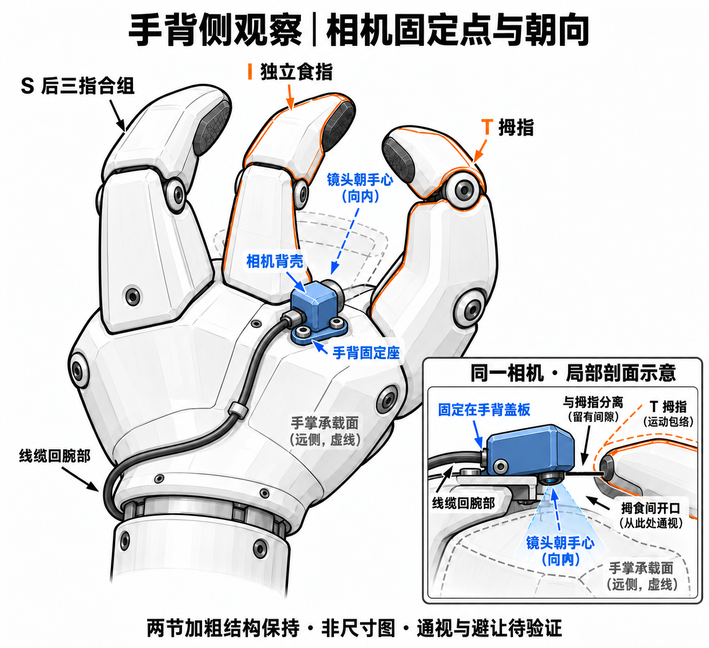

按用户要求补手背视角。相机固定脚置于独立手背盖板，靠近 T/I 根部间；镜头在内侧/下侧，经开口向手心看，线缆沿背侧回腕部。图示不能替代支座与活动拇指分离、开口通视及三维尺寸核验。[检查与提示词](assets/three-finger-two-segment-v01/README.md)。

### 当前：两节加粗、完整手掌与背侧拇食间相机

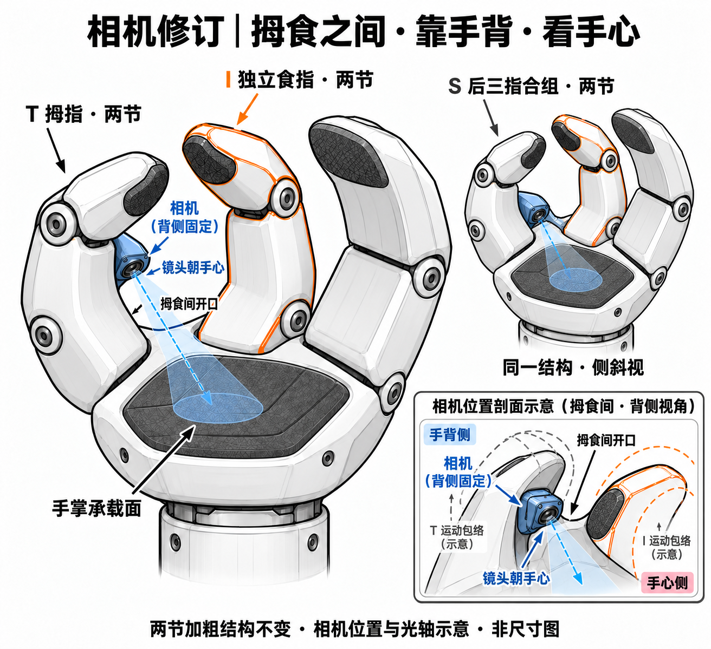

相机需求由用户进一步明确：放在 T/I 之间、靠手背，但看向手心。固定在背侧掌座，镜头经拇食间开口斜向掌心/抓取区域，不装在活动拇指或食指上，也不占据掌面承载垫。该要求覆盖此前掌侧/拇指侧前伸的候选位置。主图的固定连接和剖面光路是示意，必须验证外参、实际开口通视、两指全运动范围及快拆路径。[图像说明与提示词](assets/three-finger-two-segment-v01/README.md)。

### 两节加粗与手掌承载基线

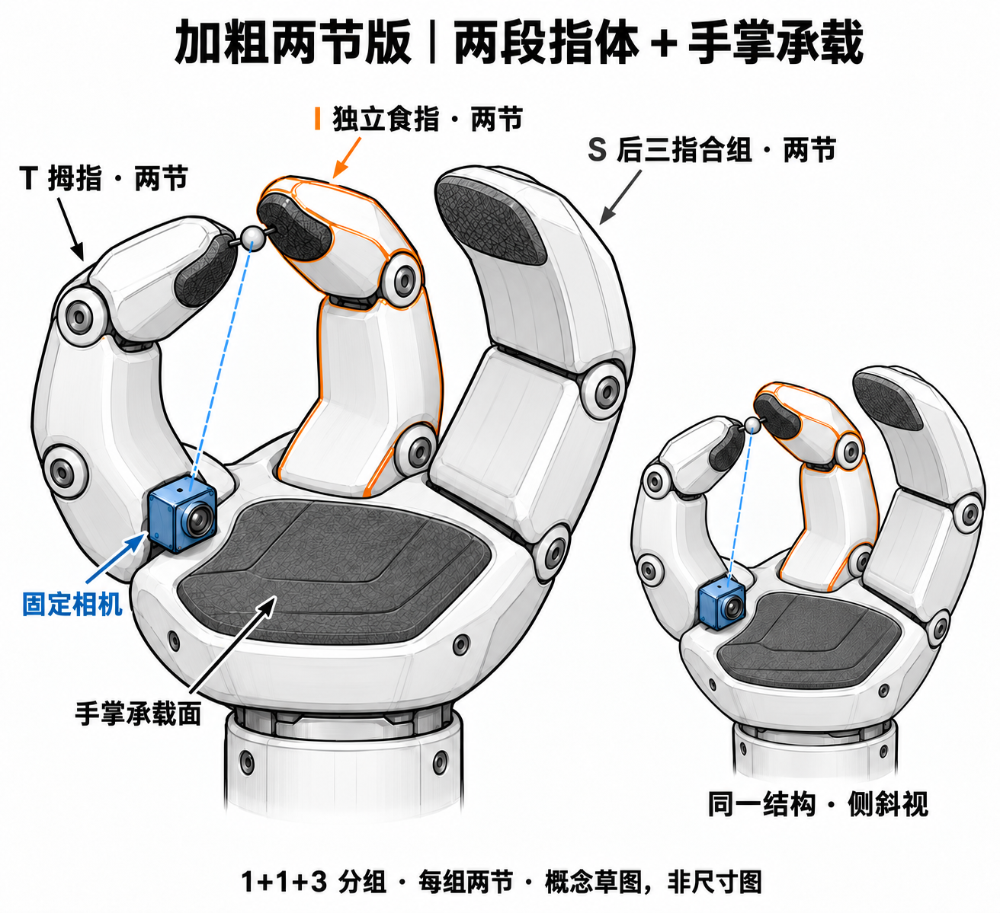

用户更新需求：T/I/S 三组指体加粗、补完整手掌，均可两节。本轮采用两段指体：根部连接近节、中间铰轴连接末节；保留 T/I 精捏与旁侧 S 合组，不将 T 扩成整排下颚。[提示词与检查](assets/three-finger-two-segment-v01/README.md)。

若每条链按根部屈伸+中间屈伸建模，则共六个弯曲关节状态；拇指对掌轴是否额外增加仍待可达性验证，不能将“两节”直接当作总自由度已冻结。旧三节候选的九路状态、J2/J3 联动与掩码不能直接沿用。应使用独立 profile/映射版本，现有二指档案和 schema 代码本轮未修改。

### 历史：按用户手势重画的三节精捏草图

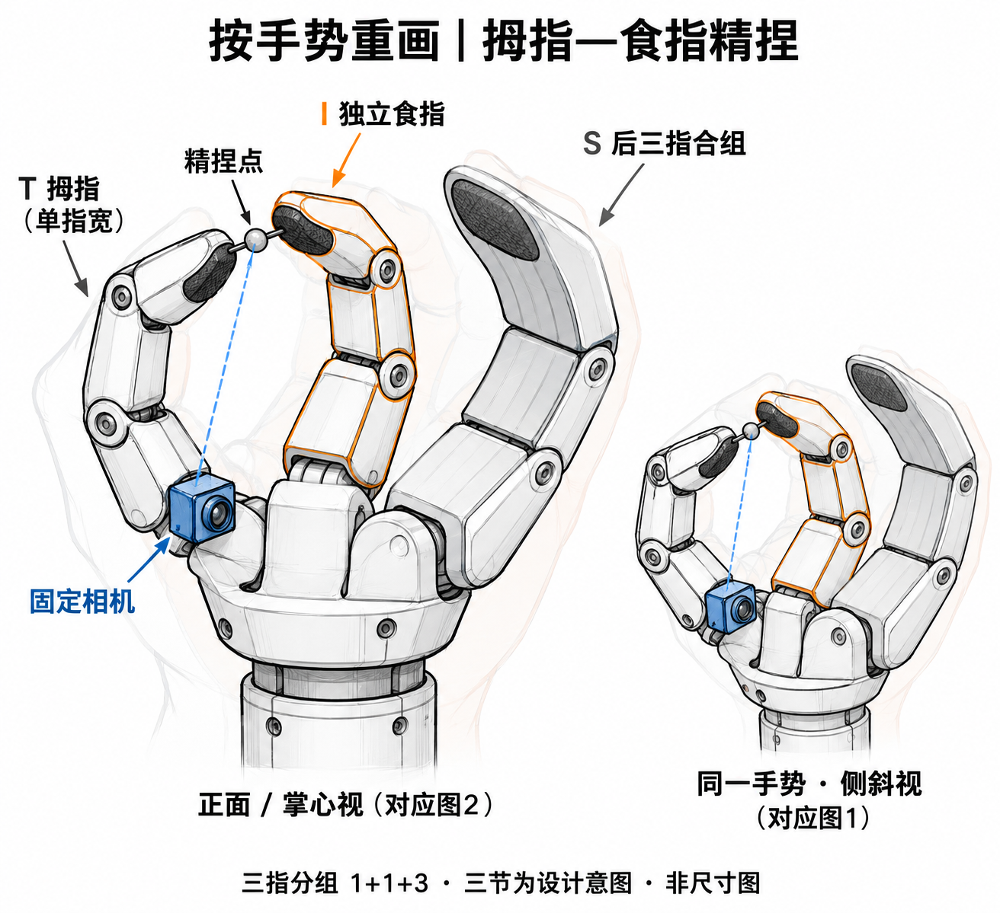

用户随后用两张实际手势照片澄清：T 是单指尺度，以对掌姿态与 I 形成小捏合环；旁侧 S 合组三个人指可保持较张开。此前将 T 画成横跨整个 S 的宽下颚、将整体画成上下大夹爪的图不再作为当前构型基准。三节与主动轴方案仍需在此手势范围内重新做运动学/对掌可达性验证；图中相机外观朝向未等同真实光轴。[提示词和检查](assets/three-finger-gesture-v01/README.md)。

### 历史：侧视夹持关系简图

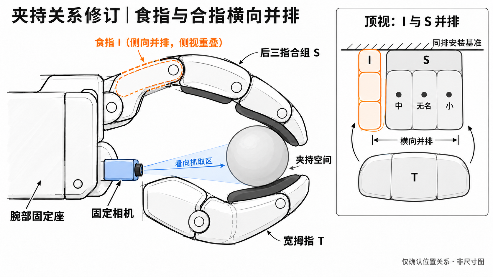

用户要求先回到简图确认构型，并指出 v0.1 食指位置错误。v0.2 明确 I 与 S 横向并排、根部同排，侧视重叠，不能形成位于 S 下方的第三层夹爪。本图只说明 T 宽拇指与 S 宽面合指对夹、I 独立操作，以及相机侧看手内抓取空间；图中的分缝/关节圆不是已冻结的三节运动链。[提示词与适用范围](assets/three-finger-grip-sketch/README.md)。V06/V07 均被用户指出偏差，不作为设计通过依据。

### V07 历史相机与指部修订板（用户评审不通过）

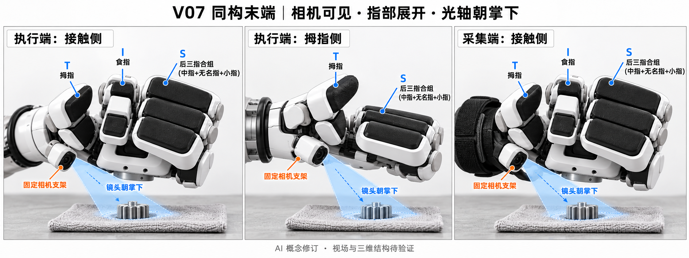

针对 V06 用户反馈重做为执行端接触侧/拇指侧与采集端接触侧三个大面板，明确相机与掌下光轴，避免强行展示被遮挡手指导致扭曲。[提示词与视觉检查](assets/three-finger-v07/README.md)。仅是构型示意，未通过参数 CAD 的几何一致性、视场和干涉验收。

### V06 历史多视角图组（用户评审不通过）

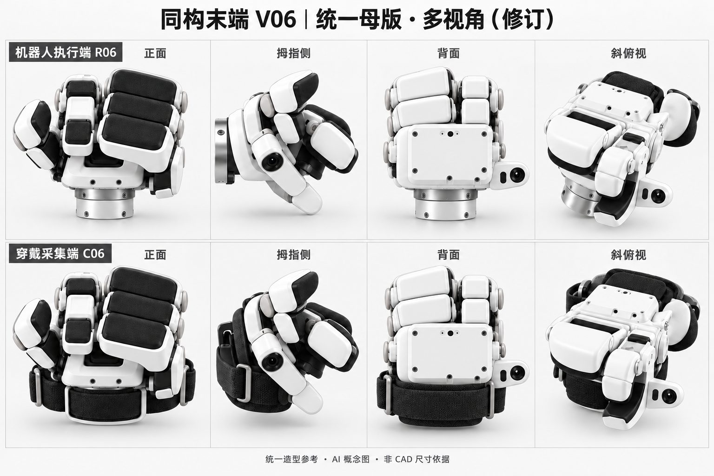

用户指出该图组相机不可辨认、指部扭曲、相机方向错误，本组不作为当前设计依据。原生成过程为：先生成修订母版，再以同一母版生成执行端和采集端细节视图。[全部图组、提示词与一致性检查](assets/three-finger-v06/README.md)。图组是外形评审参考，关节分缝、遮挡和相机位置仍存在生成偏差；严格几何一致需同一三维模型出图，不能替代 v0.5 的结构/光轴设计要求。

### v0.5 掌下视野设计意图

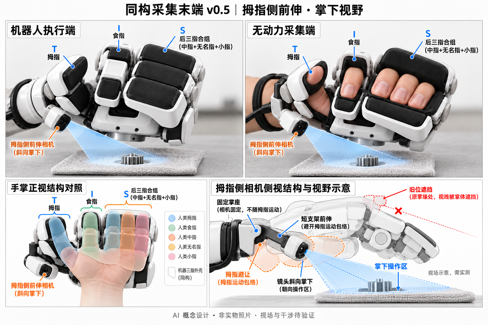

用户反馈 v0.4 看不到掌下，本版把镜头布置改为固定掌座上的拇指侧短支架前伸、斜向掌下，增加侧视视锥与遮挡对照。图中光路和拇指避让是示意，需实际 CAD 扫掠/光学检查与实拍。[完整提示词及检查记录](assets/three-finger-v05/README.md)。

### v0.4 历史硬件概念板

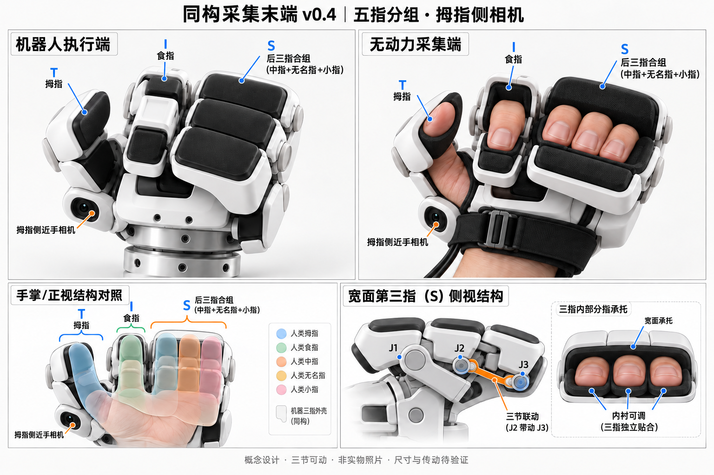

已修正穿戴图多余手指，明确 1+1+3 共五指；相机移到固定掌根拇指侧，原小指侧相机取消。两端相机同位置为设计要求，实际光轴、视场和拇指扫掠余量需 CAD/实拍验证。[完整提示词与图像检查](assets/three-finger-v04/README.md)。

### v0.3 历史硬件概念板

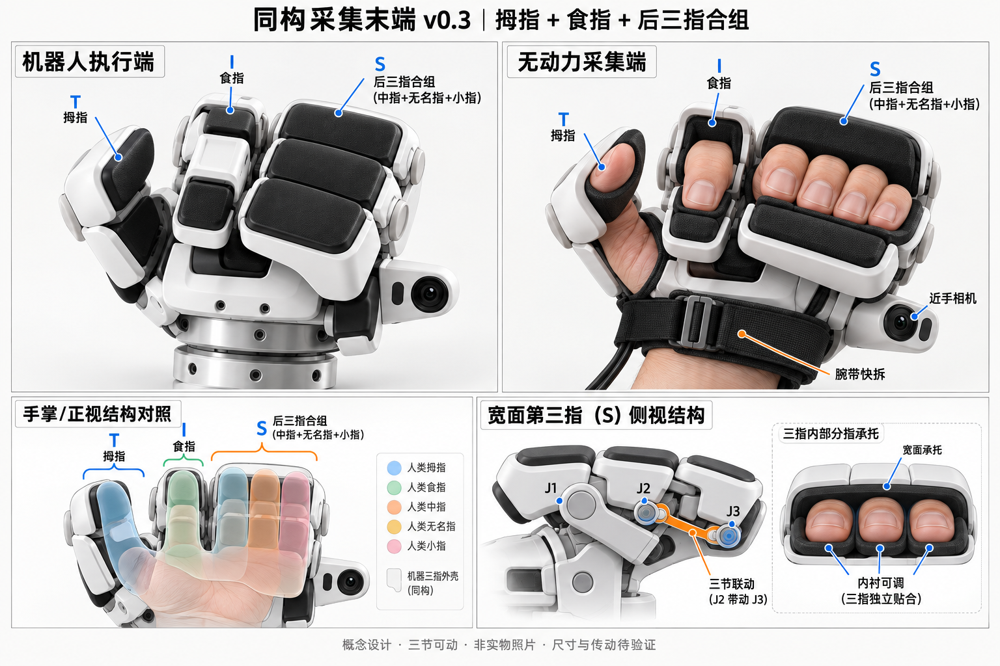

此版右上人手存在多余指尖，已由 v0.4 修正，不作为当前人体结构依据。T 拇指、I 独立食指、S 后三指合组，展示执行端、穿戴端及分组/联动示意。紧凑壳体与小型相机舱尚未完成器件包络检查；J1/J2/J3 的轴定义以后续 CAD 为准。[图像检查与完整提示词](assets/three-finger-v03/README.md)。

### v0.2 历史硬件结构草图

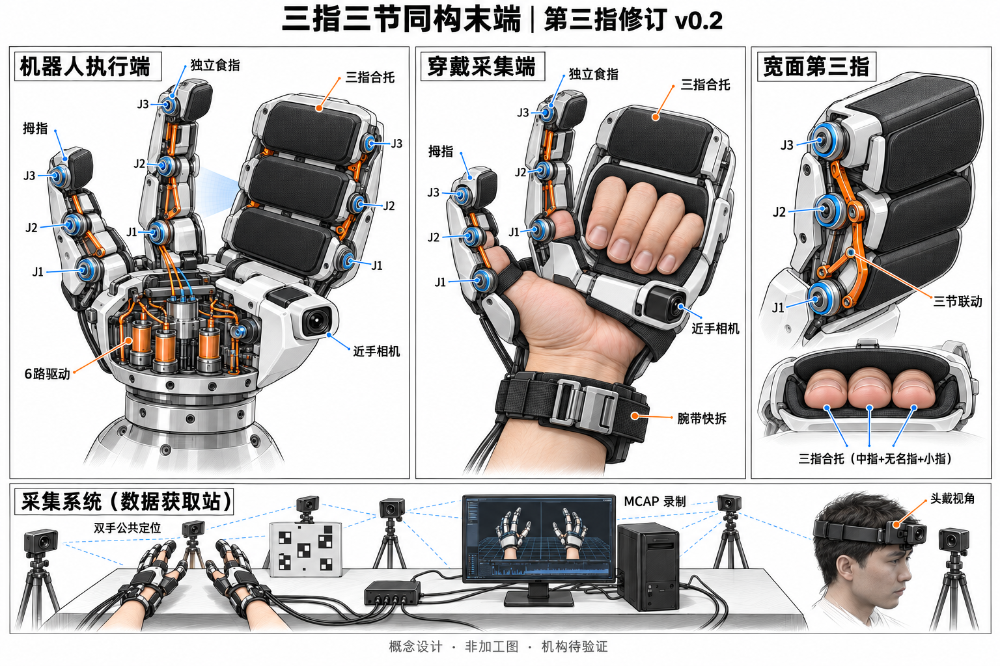

图示覆盖机器人执行端、无动力穿戴采集端、单指联动与采集站。AI 生成概念图用于构型评审，不是加工图；四连杆闭环、实际牵引路径、指托适配、相机视场和装配空间需由 CAD 与样机验证。生成方式、提示词和图像说明见 [修订图与提示词记录](assets/three-finger-v02/README.md)。

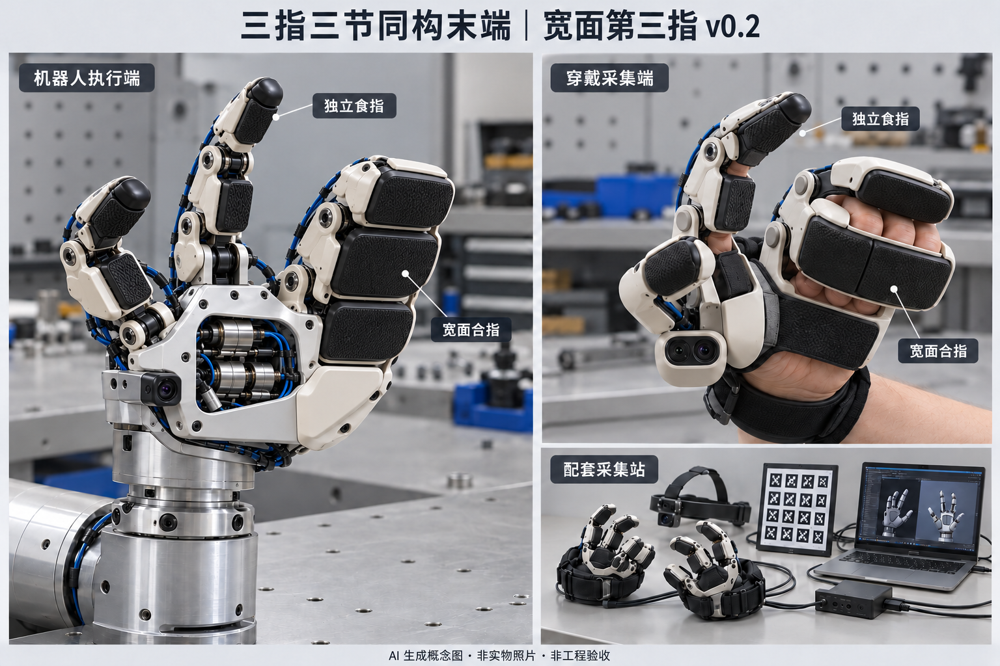

写实效果图同样为 AI 生成，非实际制造照片。不同视图的指长比例、相机位置与指托仍有生成差异，不能据此认定已实现精确同构；下一步应以同一套参数 CAD 统一。

本节将前文候选收敛成一套可开展机械/电气/软件评审的系统方案。**已确认需求**是三指三节、Sunday 构型参考、两端共设计、自有管线与本体；下列驱动、尺寸和验收数值均是**工程建议/试验目标**，未经过硬件测试，不是冻结图纸或产品性能承诺。本节的首版选型优先于 §8 的 9 独立驱动能力对照。

### 10.1 系统组成与边界

| 子系统 | 首轮数量 | 交付边界 |
|---|---|---|
| R-Hand 机器人执行手 | 左右各 1 只；先完成单手验证 | 三指三节、驱动与闭环控制、法兰、传感、URDF/碰撞与负载配置 |
| C-Hand 人工采集手 | 左右各 1 只 | 同构无动力穿戴手、角度与接触采集、定位标识、腕带/指托与快拆 |
| 采集站 | 1 套 | 头戴视角、外部定位基准、录制主机、同步与存储、任务操作界面 |
| 标定工装 | 1 套 | 关节零位夹具、角度参考、测力参考、标定板、时序测量与加载治具 |
| 软件接入 | 1 条最小闭环 | 设备适配 → MCAP → QC → 数据集 → 策略 → 真机 → 回流 |

第一轮以已有洗衣任务为工作假设：捏取布角、提布、双手展开、搭杆/挂放；另用瓶盖或工具柄检查三指接触转换。任务集可调整，但先围绕这些任务设计，不同时追求精密装配与高负载搬运。


### 10.2 指部结构：一指对两指，6 主动轴 / 9 关节

推荐 **A6 首版**：每指 J1（根部屈伸）独立驱动，J2（中节屈伸）独立驱动，J3（末节屈伸）通过连杆与 J2 联动；三指合计 6 主动轴、9 个转动关节。末节真实转动，但不是独立控制轴。采集端使用同一套联动几何和限位，接触面之外的驱动结构允许不同。

- 布局：拇指 T 对掌；对侧 I 为独立窄食指，S 为容纳中指/无名指/小指的宽面合指。S 的根/中/末三段全宽承托，不仅加宽指尖；各段采用共同铰轴与双侧支撑板，整条运动链共用 J1/J2/J3。拇指基座预留可调安装角，调完机械锁定，变更即新标定/profile；首版不设置额外主动侧摆轴。
- 指段：根节提供包络、中节承托、末节做薄圆角捏取。三段均可参与接触；可更换弹性体指垫，左右侧与两种设备使用同一配方、纹理和版本。
- 联动：优先短连杆约束 J3=f(J2)，记录完整运动学函数与有效范围，避免在指尖接触前后出现奇异位置。它比欠驱动弹簧差动更容易定义两端一致的动作，但会限制独立末节调整。
- 磨损：销轴/轴承、指垫和牵引件可更换；接触垫不跨关节缝；护罩覆盖穿戴侧夹点。采集器有单手可脱的机械快拆，不能依赖软件开锁。
- 尺寸起点：指长分段用总长比例约 0.45/0.32/0.23 做可调样机，总长度、指宽、两对侧指间距和拇指安装角通过目标物与手型工装确定。比例只是 CAD 探索起点，不是人体尺寸结论。
- 负载选型：先测对象最大质量 m、最小摩擦系数 μ、单手承载比例与接触布局。简化静态两面夹持只作为下界估算，按 N_each ≥ S·m·g/(2μ)；三指实际分配、偏心力矩、动态惯性与柔性布料必须实测。关节力矩由 τ=J(q)^T·f 加上传动损耗与动态余量计算，不能把总抓力平均除给电机。

| 候选 | 驱动数/每手 | 优点 | 代价与采用条件 |
|---|---|---|---|
| **A6 推荐首版** | 6 | 三指独立控制，末节联动，减少驱动与线束 | 不能独立调末节；联动约束必须在采集端复现 |
| A9 能力对照 | 9 | 各指三个关节独立，接触姿态覆盖更广 | 重量、热、线束与穿戴对齐更复杂；A6 的失败明确来自末节联动时再升级 |
| A3 低成本备选 | 3 | 每指一路弯曲驱动 | 难同时控制根节/中节，先作成本对照，不作为本轮主交付 |

这不是 Sunday 驱动方案的事实陈述。参考的是它的宽软接触、紧凑穿戴与两端接口共同设计；传动由本项目自行设计。

### 10.3 R-Hand：机器人执行端

首版电机/减速器集中在掌根或近腕执行舱，减少末节体积；通过短腱索/牵引传递到 J1/J2，J2 再联动 J3。选型必须比较牵引回差、走线摩擦、反向恢复与热漂；若达不到位置精度目标，优先把驱动移近关节或换短刚性传动，而不是靠滤波隐藏误差。

控制层分三层：电机驱动器完成电流与换相内环；手部 MCU 目标 200 Hz 读关节角、执行主动关节位置环和包络限制；机器人主机以策略原生频率发动作块，控制器按时间戳插值。200 Hz 是外部状态/目标接口设计值，不是已验证的电流环频率。

- 每手 9 个关节角直接测量，包括 J3；电机编码器/电流另存。腱索弹性导致电机角不等于关节角，不能只在电机侧测量。
- 每指末节与中节各预留一个接触模块位，共 6 区/手。首版优先选可标定的法向载荷传感，记录单位 N 与坐标/区域；如果增加阵列或三轴触觉，先扩充模态契约。单点法向力不能标成完整触觉图或剪切力。
- 接触限力先作为低层夹持上限/缓停与故障监测；是否支持真正的稳定力闭环由硬件测试决定。策略首版仍输出位置目标，避免把“有力读数”升级成“力控已实现”。
- 外部通信优先 CAN-FD + 腕部 USB/以太网网关，ROS 2 适配器只在主机侧。总线选择是设计候选；需用消息尺寸×频率计算负载并测拥塞/丢包，再冻结。
- 供电由本体腕部能力反推；先记录峰值/连续电流及上电浪涌、再确定 DC/DC 与线束。首轮使用台架电源，避免假定现有腕口能驱动新手。
- 命令状态机：disabled → homing → ready → executing；异常进入 hold / fault，由故障类型决定限力保持或受控释放。断电可能掉落物体，急停策略需区分带载保持与松手，不能一律自动张开。
- 命令超时、profile 不匹配、角度越界、编码器失效、过温/过流、联动残差异常均由低层处理；阈值以驱动与关节额定值标定。每次故障产生时间戳事件，采集与控制使用同一身份版本。

### 10.4 C-Hand：人工采集端

人工侧不安装主动电机，采用指托、腕带与掌背支撑，把人的拇指、食指分别传给 T/I，中指/无名指/小指共同传给 S；三个人指位于同一宽指托内，运动间隙与压强单独评审。腕带承担主要重量；指托位置可调，但接触件、轴线和指长不随操作者改变。首轮桌面工控机录制，有线优先；背包、电池与无线上传在稳定录制后再做。

**关键约束：人在操作时必须通过机器指的外侧指垫接触物体。** 若裸手或未测量部位偷偷支撑物体，该段不算可直接迁移示范。界面提示接触区异常，抽检视频记录原因。

- 与 R-Hand 共享 A6 运动学、J2/J3 联动、限位与指垫版本；每手 9 路关节编码、6 区接触测量，模块尽量同型号。
- 可调阻尼用于限制过快手指动作，但不宣称等效电机力矩。腕部与手指的速度包络实时提示；越界段写 QC，不强行把人手轨迹改成合格轨迹。
- 两端指垫受力路径不同，需要分别做加载标定；采集器测到的力作为条件/监督候选，部署时仍需真实接触闭环。
- 采集按钮放在可由助手/脚踏/语音操作的位置，避免开始/停止录制本身改变握持；录制灯、会话状态与存储余量始终可见。
- 先做多种手型的无动力穿戴试验，记录穿脱时间、单次连续时长、压痛、动作覆盖、掉跟踪与任务完成率；未通过不进入整班采集。

### 10.5 视觉、位姿与同步

**P0 固定工作台**：一套有标定基准的外部相机系统追踪双手刚性标识，近手相机拍接触，头戴相机拍任务。外部标记和相机是标注/质控工具，不默认进策略输入；两手与头部都需落到同一 W 系。视野遮挡时直接降级/标记，不能凭短时外推继续产出高置信标签。

**P1 可移动采集**：外向定位相机 + IMU 做 VIO，再用共同标记或受控初始化统一坐标。先与 P0 参考系统配对测漂移、重定位和双手相对误差，再放开场地。这样可以先验证末端与管线，不让移动定位成为第一台样机的前置阻塞。

| 传感路径 | 首版配置建议 | 核验重点 |
|---|---|---|
| 近手视觉 | 每手 1 个侧置相机舱，D405 为既有候选；按实际能力选 30/60 fps | 最小工作距离、指尖遮挡、干湿布表面、相机-TCP 变换、带宽 |
| 全局任务视觉 | 头戴 1 路 RGB，原生帧率记录 | 手与目标物可见性、人体视觉域差、曝光与快运动 |
| 外部定位 | 标定相机 + 双手/头部刚性标识，频率目标 ≥50 Hz | 两手公共系、遮挡恢复、绝对尺度与动态延迟 |
| 关节/接触/IMU | 关节与 IMU 目标 200 Hz，力按原生率 | 全链路采样时刻、传感器内部延迟、丢包和温漂 |

主机单调时钟为会话基准；MCU 保留本地 tick 与序列号，通过同步事件估计 offset/drift。支持硬触发的设备才使用硬触发，不支持的相机测软件时间戳与时延残差。P0 目标视觉—动作 P95≤5 ms、P99≤10 ms；不达标先分析系统误差与尾延迟，未通过的动作样本不能直接进入训练。到达同一 USB 主机不代表同步。

### 10.6 状态、动作与耦合一致性

A6 每手状态 `q9=[T1,T2,T3,I1,I2,I3,S1,S2,S3]` 全部实测。主动坐标 `u6=[T1,T2,I1,I2,S1,S2]`，J3 用机械联动函数约束。**采集动作只能覆盖这个可执行流形**，不能让训练目标任意生成 9 个独立角度。

- 统一 96 维训练视图：`hand_left/right` 状态槽位 0–8 有效，动作槽位只启用 0、1、3、4、6、7；2、5、8 的动作 mask=false，预测值不下发。控制适配器从六路目标计算联动结果，再检查限位与状态残差。
- 推算的 J3 与实测 J3 的残差用于发现回差、松动、装配变化；不通过时隔离相应段。缺少实测编码器不能用推算值冒充 measured。
- 手腕动作是相机系位姿增量，手指动作是绝对主动关节位置；在导出配置中分别声明单位、预测时距、动作步长、掩码与延迟。
- 部署动作先经过 profile 适配，再进入机械臂 IK/手部控制器。训练动作 mask、在线关节限位与低层电流/温度保护都要存在，职责不能互相替代。
- 如独立导出紧凑动作视图，A6 为每手 9 位姿 + 6 主动关节=15，双手 30 维，可在验证模型接口后放入 32 维；A9 为双手 36 维，不能放入 32 维。紧凑视图不是默认 96 维槽位的简单截取，必须有显式索引与反向映射。
- 不把 device 轨成功当机器人成功；不把人工接触力复制成机器人命令真值；不把同构手外的机械臂、头部或躯干差异当作已经消除。

### 10.7 recorder 到训练的接入工作包

| 模块 | 需做的具体工作 | 本次交付性质 |
|---|---|---|
| 契约/profile | 定义 A6/A9 的关节表、主动/从动、单位、传感来源、双手设备身份、必选 topic、动作 mask 与版本迁移 | 接口设计；实现前先修改 data-format-contract |
| 设备适配 | MCU 传感消息转标准流；相机/外部定位桥接；seq、tick、采样时间和状态透传 | 待实现 |
| recorder | 多流订阅、异步写 MCAP、分段、CRC、断电恢复、健康状态与任务按钮 | 待实现，不把 ROS bag 落盘当作已满足完整契约 |
| ingest | 校验哈希、profile/标定引用、时钟漂移、丢流与重定位；按版本规则登记 | 待实现 |
| QC | 可执行流形、FK/工作空间/碰撞、速度与力、人体偷接触、失败/恢复标签 | 待实现；估计值与实测值分别审计 |
| export | 96 维状态/动作与不同 mask；视频时差；未来动作时距；支持旧二指数据 | 待实现 |
| 训练/部署 | robot-only 对照、device+robot 消融、动作适配器、数据与控制配置哈希 | 待实验 |
| 回流 | 实际机器人命令/状态、接触、结果、接管、故障和策略版本回到同一 MCAP 管线 | 待实现与实机验证 |

P0 不要求全自动语义标注先完成：先采用任务模板、人工子任务打点与复核，把精力放在真实多流、正确标签和可复现导出。头戴域转换先比较“近手视角主导”与“加入头部视角”，再决定是否引入视觉转换模型；生成/变换图像保留来源和质量门，不能改写 raw。

### 10.8 采集 SOP 与结果判据

1. **班前**：设备身份、固件/profile、机械磨损、剩余容量、穿戴、公共坐标与零位检查；执行标定短任务。
2. **任务准备**：固定任务模板与成功条件；登记物体实例、布料干湿、光照、操作者、场地；先分配训练/held-out 组。
3. **录制**：先确认所有流正常再起 episode；成功、失败、中止都结束并打结果；定位丢失时暂停动作标签，记录恢复边界。
4. **现场反馈**：只报告可测指标——掉帧、定位质量、同步、关节/速度越界、接触异常；任务成功仍按任务判据复核。
5. **落盘与上传**：完成 MCAP 关闭/恢复校验、哈希与回执；上传失败可重试；未经校验回执不覆盖原始文件。
6. **复核与交付**：检查任务完整、裸手支撑、失败原因和恢复段；失败不删除，按训练用途分流。

初始任务判据示例：布角捏取=指定层数/区域提起且保持指定时长；双手展开=达到预定义角点关系且无掉落；挂放=布料/衣物脱手后稳定留在目标支撑上。层数、时间和几何阈值按任务模板预登记，不用“力传感器有读数”代替这些结果。

### 10.9 初始指标、测试证据与阶段门

以下是设计目标，需在首轮台架测出可达值；若不能达到，变更范围/传动/传感后再冻结，不直接宣传为性能。

| 指标 | 建议初始目标 | 测法与限制 |
|---|---|---|
| 关节测量 | 代表性量程内绝对误差 ≤1°，重复性 ≤0.5° | 独立角度参考，多姿态、带载/空载、温度前后；各关节分别报告 |
| J2/J3 联动残差 | P95≤2° | 两端分别测，动态反向与加载覆盖；不靠推算自证 |
| 两端指尖 FK 差 | 标定姿态集 P95≤3 mm | 独立参考测量；不是公共系定位误差或真机任务成功率 |
| 接触测量 | 校准范围内误差 ≤满量程的5% | 全量程与饱和点记录，近零噪声另报；不使用未经定义的相对误差 |
| 双手相对位姿 | 工作区内 P95≤5 mm / 2° | P0 独立参考轨迹；不能让定位器用自身重投影残差代替外部误差 |
| 同步 | 视觉—动作 P95≤5 ms、P99≤10 ms | 独立时序事件/探针，连续录制与主机负载覆盖 |
| 录制 | 连续 2 h 无不可恢复 episode；视频丢帧目标 <1% | 故障注入断电/拔线/盘满/重连；恢复文件仍标 abnormal_end |
| 穿戴 | 首轮至少 5 名不同手型参与短时试验 | 记录不适、穿脱与任务覆盖，出现压伤/夹点则返工；不外推为长期工效验证 |
| 真机操作 | 按任务登记成功率、区间、耗时与干预率 | 每条件至少 30 次作为初步探针；不能用此小样本证明量产可靠性 |

**G0 设计输入**：法兰/负载、目标物范围、接口与接触任务确认，可开始样机。
**G1 单指**：一条三节运动链的联动、带载、传动回差和角度/力测量通过，再复制到三指。
**G2 单手与穿戴**：一只 C-Hand 与一只 R-Hand 匹配，9 状态/6 命令链可测，指间碰撞与对掌范围通过。
**G3 双手离线**：公共定位、多流录制、故障恢复、QC 与正确导出通过。
**G4 真机与学习**：先受控回放再训练策略；robot-only 与加入 device 的对照在未见物体/操作者/场地切分上比较，记录置信区间和失败模式。
**G5 扩量**：只有实测单位有效小时成本、真机收益与维护/穿戴数据支持时再增加设备。

### 10.10 计划、分工与成本核算

建议 8–10 周作为输入齐备后的首轮工程规划假设，不是交付承诺：第 1–2 周输入冻结/单指 CAD 与台架；第 3–4 周单手穿戴与执行原型、MCU 与消息接口；第 5–6 周双手定位/录制/离线导出；第 7–8 周真机回放与初步学习对照；额外 1–2 周留给传动、热或定位返工。采购交期和已有软件骨架可能使工期延长；每阶段依赖前一阶段门，不按日历自动放行。

| 责任 | 主要产物 |
|---|---|
| 机械/末端 | 单指→三指 CAD、联动/传动、法兰、指垫、穿戴、工装、维护说明 |
| 电气/固件/控制 | 传感 PCB/线束、驱动/电源、MCU、通信、保护、闭环与时间戳 |
| 感知/标定 | 相机/定位、公共坐标、外参、时延与独立误差测量 |
| 数据平台 | 契约/profile、录制、入湖/QC、导出、版本与回执 |
| 机器人/训练/评测 | 工具负载与控制集成、任务模板、回放、消融、结果审计 |

首轮 BOM 按模块询价：机器人手×2（共12主动轴）、采集手×2、四只手共36个关节角测量通道、按每手6功能区配置共24功能区接触测量（宽面第三指可能分列增加实际单元，BOM 待偏载试验冻结）、每只手独立相机安装件、定位/头戴设备、MCU/网关/主机、标定工装、备用指垫与传动件。相机模块能在阶段间复用时需明确复用清单，不能同时算在两套完整在线系统中。

当前不编造供应商报价。预算拆为一次性研发/工装、每手材料装配测试、采集站、备件、采集人工与 QA、存储/传输、训练评测。有效数据小时成本=(设备摊销+操作+校准/维护+QA+计算存储)/通过准入的小时；学习价值再按每单位成本获得的真机成功率提升评估，不能只看名义采集小时。

### 10.11 下一次工程评审应拿到的包

- R-Hand / C-Hand 装配图、单指剖面、轴定义、联动曲线、接触区/相机视场、线束和快拆路径。
- A6 版本 profile：9 状态/6 主动轴、正负方向、量纲、限位、耦合、相机外参、传感标定与控制器兼容范围。
- 接口清单：录制 topic、采样/日志时间、序列号、故障事件、命令到执行时序、状态机与数据使用条件。
- 单指带载、穿戴、同步/定位、MCAP 恢复、导出映射与真机任务的原始记录和复核报告。

本次完成系统方案和评审清单；CAD、电路、固件、数据管线实现、训练和实机验收仍是下一阶段交付。

### 10.12 第三指形态修订与结构影响（v0.2）

上一版生成图将两根对侧指都画成窄长指，未体现 Sunday 参考图中的不对称宽面构型，不能用于冻结指型。新图要求 T 拇指、I 独立窄食指、S 宽面合指清楚可辨；S 全长三段均加宽，不能只把末端指垫放大。

宽度探索起点为 S 约为 I 的 2.3–2.8 倍（本项目样机比例候选，非 Sunday 测量结果）；由实际三个人指并排宽度、压强和目标物决定最终尺寸。采集端设三个软衬承托位但只对应一条机械关节链；机器人端复现同一外部接触几何。三个人指共同施力会产生偏载，S 需双侧轴承/支撑、扭转刚度与偏心加载测试。

状态仍为每手 9 个机械关节角，A6 控制仍为 6 个主动轴；不把合托中的三个人指分别当成额外机器人关节。宽面接触建议分左右或三列测量以辨认偏载；因此原来每指两区、每手六区仅为功能分区，实际传感单元数需按 S 的空间分辨要求更新 BOM。

工作空间验证新增：拇指—食指精捏时 S 不挡住相机/捏取区；包络抓握时 S 能稳定承托；S 在不同手型下不夹住较短的小指。单手脱离、指托脱出、过屈限位和操作者主动松开分别验证。

### 10.13 v0.3：紧凑合指式构型收敛

需求固定为 T 拇指、I 独立食指、S 后三指合组，三条机械运动链各三节。参考 Sunday 的紧凑、宽软接触与穿戴形态，将 v0.2 的长骨架指和敞开驱动架收敛成短弧指体、低掌部与封闭掌根驱动舱；不改变 A6 候选的六主动轴/九测量关节语义。这里的紧凑化是设计目标，图像不能证明驱动器已能装下。

| 模块 | v0.3 结构提案 | 冻结前必须验证 |
|---|---|---|
| T 拇指 | 掌侧斜置对掌，宽软指腹，末节圆角薄缘 | 能分别与 I 精捏、与 S 包络，避免根部自碰撞 |
| I 食指 | 独立窄指，适度长于 S；保留三节与指腹接触 | 捏布角、按压与工具触发时，S 不干涉也不遮挡 |
| S 合指 | 三段通体宽面，双侧支撑共同铰轴；容纳中/无名/小指 | 偏载扭转、轴挠曲、共同运动与手型差异 |
| 穿戴内侧 | 三个人指分别有软衬承托位，长度/厚度可调或滑移补偿 | 小指较短，不强行对齐三个人指关节轴；不适/压伤则返工 |
| 掌根 | 执行端闭壳驱动舱，采集端无动力开架/指托 | 六驱动与传动路径、电源和散热有真实体积预算 |
| 相机 | 拇指侧固定掌根小型相机舱，朝向捏取区并避开拇指与腕部运动范围 | 实际相机包络、工作距离、遮挡、两端外参匹配 |

先在 CAD 中按现有电机/传感器/相机的真实包络建立占位模型，再收敛壳体。不能为了符合效果图而缩小实际器件。若 D405 无法满足该相机舱包络，保留可拆大舱作为工程样机，不把图中小镜头当成已选 D405。

S 合指的三个软衬承托位只改善受力与长度适配，不增加机器人自由度；人的个体手指没有完全独立运动能力是该构型的明确代价。穿戴端先试捏布、握柄、放手、脱手四种动作，确认无勉强贴合后再制作机器人驱动版。

v0.3 概念板同时展示执行端、无动力采集端、1+1+3 分组示意与宽指三节机构；不再用旧窄指采集站缩略图解释结构。图像只用于形态评审，尺寸、联动闭环和布线以后续参数 CAD 为准。

### 10.14 v0.4：五指解剖与拇指侧相机修订

用户指出 v0.3 穿戴主图多出一个手指：宽面指托中错误出现四个指尖，叠加独立拇指/食指成为六指。该图不作为穿戴人体结构依据。新版检查必须明确 T 一根拇指、I 一根食指、S 三根手指，总数五；S 为中指/无名指/小指共托，不能再增加一根或隐藏重复指尖。

相机按用户要求移到**拇指侧**。安装基准选固定掌根的桡侧，位于拇指根部附近、略靠近腕侧；不安装在活动拇指指节上，不占据虎口或捏取间隙。原小指侧相机座取消，同一只设备只有这一处近手相机候选位。

- 观测目标为拇指—食指捏取点与宽面 S 的接触区域。镜头斜向朝向这些区域，具体位置/俯仰角由视场仿真和实拍决定，不凭效果图冻结角度。
- 对 T 全关节范围和腕部工作范围做扫掠检查，相机及线缆均留出运动余量；指托快拆/穿脱路径不被相机架阻挡。
- R-Hand/C-Hand 以相同固定掌系定义 `T_palm_camera`，两端逐件标定。相机固定在掌部，不随拇指改变姿态；左右手使用镜像安装档案，不能直接复制左右外参。
- 图像生成核验：主穿戴图总五指、S 三指尖；主机器人图/主穿戴图/底部分组图的相机均在拇指侧；旧侧镜头完全移除。所有图中的小相机外形仍不是 D405 已适配的证据。

### 10.15 v0.5：拇指侧前伸相机与掌下视野

用户指出 v0.4 相机位置看不到掌下。更正：相机不只需要在拇指侧，还必须让光学中心越过掌壳的遮挡边界，并朝向掌下操作区；图中面向展示视角的镜头不能当作正确光轴。

推荐固定掌座的拇指侧短折臂：向接触/操作侧适度前伸、略靠掌下外侧，镜头斜向内下方，覆盖掌下桌面区域与拇指—食指/宽面合指前方操作区。支架不随拇指运动，不伸入虎口夹持间隙；外侧圆角护框、线缆沿固定支架回腕部。P0 用可锁紧俯仰调节结构调试，选择可行视场后固定并标定 `T_palm_camera`。

前伸量/高度/内倾角不凭概念图指定：以实际镜头入瞳、FOV、最近工作距离、器件尺寸和拇指全运动包络为输入，在 CAD 中扫描位置/角度。前伸超过防碰撞边界或需要长悬臂才能看到目标时，优先调整固定掌座/镜头方案，不以过长支架补偿。采集端与执行端使用同一位置定义，逐件标定；相机外参变化要产生新版本。

验证步骤：

1. 在桌面放掌下标定网格、布角和常用目标物，定义真正要看的三维操作区，不以看见整只手为目标。
2. 对张开、精捏、包络、提布、腕部俯仰姿态采图，分别报告目标可见率、掌壳/手指遮挡、指尖接触区域可见性和深度有效范围。
3. 同时检查拇指扫掠、指托快拆、桌面/物体碰撞及线缆；前伸后如果桌面碰撞风险增加，调整位置而非只扩大视场。
4. 单相机无法穿透掌壳、手指或物体，真正接触面仍可能不可见。必要时用头戴视角补充任务上下文；只有掌下视场测试明确不足时再评估第二近手视角，不能宣称单相机全覆盖。

新版图必须有侧视光轴/视锥示意，清楚画出从新镜头到掌下目标的无遮挡路径。AI 图只解释设计意图，不能代替实测视场或光线追踪。
