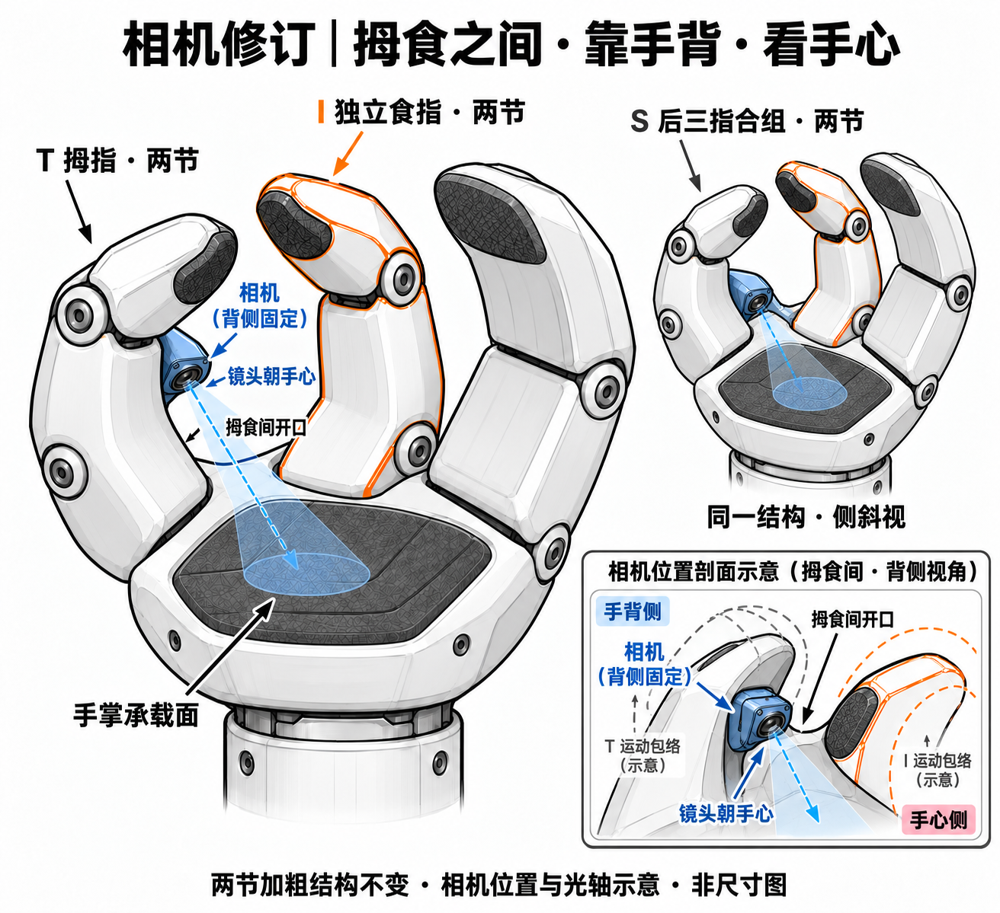
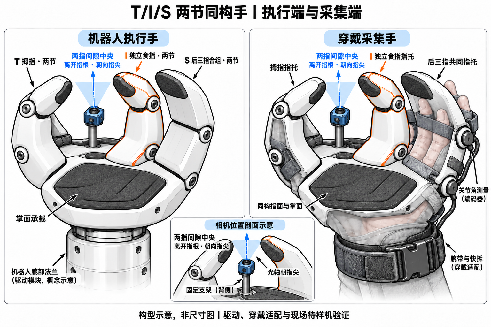

# 自研同构末端与数据接入设计：T/I/S 两节版

> 2026-10-26 · 当前构型参考已获用户方向认可；工程参数与实现待验证。
> 本文为当前设计入口。此前三节/9 关节、A6 末节联动和图像迭代保留在 [历史推演](inhouse-isomorphic-end-effector-history-20261026.md)，不作为当前实施要求。

## 1. 当前认可的构型与范围

用户明确选中下图，反馈“这个基本是对的，把这个也加到我们数据和机器人设计里”。采用这张原图作为方向参考，不用后续手背图或其他生成图替换。



[图像身份、哈希与认可范围](assets/inhouse-hand-reference-20261026/README.md)。图像来自 AI 概念生成，不是 CAD、实物照片或硬件验证。用户认可的是结构方向，不是图中的每处装配和角度。

| 结构 | 当前要求 | 功能 |
|---|---|---|
| T 拇指组 | 加粗、单指尺度、两段指体；根部具备所需对掌姿态 | 与 I 精捏，也可与 S 配合包络；不是横跨整个 S 的宽下颚 |
| I 食指组 | 加粗、独立、两段指体；与 S 根部横向相邻 | 独立精细操作；可比 S 弯得更多，不能画成 S 下方第三层夹爪 |
| S 后三指合组 | 中指/无名指/小指共用一条宽面机械链，两段指体 | 宽面支撑、包络；内部三个指托不等于三根独立机械指 |
| 手掌 | 明确的承载结构、可换掌垫与固定基座 | 提供物体承托、指根安装和载荷传递，不能只剩腕部细环 |
| 近手相机 | T/I 开放间隙中央、离开两侧指根；由掌体背侧固定支撑，镜头朝指尖捏取区 | 不装在活动指体上，不占掌垫；不是固定朝世界坐标下方拍桌面 |

每组“根部连接近节 + 中间铰轴连接末节”作为运动学起点。两段指体不自动等于两个独立电机；拇指对掌轴、主动/从动关系、传动与测量轴均待评审。原三节候选的 9 维状态与 J2/J3 联动不能直接沿用。

## 2. 采集端与机器人端共同设计

| 对齐项 | 穿戴采集端（device 轨） | 机器人执行端（robot 轨） |
|---|---|---|
| 接触几何 | T/I/S 指体、指垫、掌垫、限位及共同参考系 | 同版本外部接触几何；驱动舱可以不同 |
| 驱动 | 首版无动力、人手通过指托驱动；腕带/快拆承重 | 电驱候选，按工具载荷和关节力矩选型，低层闭环与保护 |
| 测量 | 实际机械关节角、接触信号、手掌/末端位姿与质量 | 实际关节状态、实际命令、可用电流/力、控制与故障事件 |
| 相机 | 背侧掌体固定支撑、相机离开两侧指根，镜头朝指尖捏取区 | 相同掌系安装定义，逐件标定，不凭同型号宣称观测完全一致 |
| 本体与数据身份 | 设备/profile/操作者/标定/固件版本 | 本体/工具/profile/控制器/策略/部署版本 |

采集时物体通过机器指和掌垫接触；裸手额外支撑须标注。合指内衬可调以适配不同手型，但不能静默改变外部指长、轴线或标定。两端摩擦、回差、挠曲与延迟仍需测量，同构不等于零误差。

既有 [二指本体档案](../configs/embodiments/inhouse_wheeled_humanoid_v1.yaml) 继续表达原设备。当前方向使用独立的两节工具/具身 profile 候选；图像认可不改变实机已安装的末端。不要覆盖旧档案或把旧数据改标签冒充新末端。


### 2.1 更新配套结构图

**最新位置澄清（v05）**：用户说明“中间”是两指开放间隙的中部，要离开拇指根部和食指根部，不是两指根的中点。相机移向该空隙中央，镜头朝指尖捏取区；固定支撑连接掌体，不随指运动。图中的立柱只表达位置，支架与捏合干涉待工程验证；此前根部安装的图保留历史。



按用户要求同步更新两端：执行手保留腕部驱动舱与法兰；采集手增加拇指/食指指托、后三指共同指托、机械关节角测量与腕带快拆。两端沿用相同三组两节接触结构、掌面及朝指尖捏取区的相机。图中的穿戴透视用于解释装配关系，不是已验证的人机工程布局；本次更新图仍待用户审阅，原图的认可记录保留。见[生成与边界记录](assets/tis2-paired-hand-v05/README.md)。

## 3. 相机、定位与标定

- 固定支撑从掌体背侧引出，相机位于 T/I 开放间隙中央并离开两侧指根；镜头通过拇食间开口看向两指指尖之间的捏取区，支架与活动 T/I 清楚分离。逐姿态检查两指扫掠、夹持空间、快拆与线缆。
- 定义左右各自的固定手掌系 `palm_left/right`、TCP、相机系、场地公共系 W 与机器人基座系 B。记录 `T_palm_camera`、`T_palm_tcp`、相机内参/畸变、单位/轴向、时间偏移、标定/profile 哈希。左右手分别标定，不直接复制外参。
- 掌心相机的语义名为 `palm_left/right`，与物理背侧安装不矛盾；名称表达观察手内操作区域。已有腕部相机可保留，但不能把两者混为同一外参。
- D405 只是旧本体的现有候选，不是本相机舱的冻结型号；需验证尺寸、工作距离、视场与深度有效性。完整掌垫存在时，光路不能穿过实心掌壳。
- P0 先用受控工作台公共定位测双手；移动 VIO 作为后续候选。掌心相机看运动物体，不默认承担环境定位。
- 原生采样与落盘时间分开，记录时钟域/同步残差，不用升采样伪装传感器频率。视觉—动作 ≤5 ms 是既有初始目标，报告实测分布与尾延迟，未达标不得直接作为动作训练标签。

## 4. 数据链与流定义

```text
两节同构采集器 + 掌心视觉 + 双手公共定位
  → 设备适配器 → recorder → MCAP（track=device）
  → ingest（完整性/时间/标定）→ QC（可达/限位/接触/结果）
  → export（LeRobot v3、状态/动作/掩码）→ 策略训练
  → 机器人适配器/控制器 → 自研本体 + 配套两节执行手
  → MCAP（track=robot，命令/实际状态/视觉/干预/结果）→ 同一数据管线
```

不新增 track 或第三种持久化数据格式。设计承接 [架构](architecture.md)、[数据格式契约 §1.4](data-format-contract.md#14-tis2-两节同构末端档案扩展设计待实现)、[device 轨](device-track-umi.md) 和 [robot 轨](robot-track-teleop.md)。当前 schema 0.2 与各管线骨架不因写入设计自动具备新接口。

| 流 | 候选 topic | 内容/用途 |
|---|---|---|
| 手内视觉 | `/video/palm_left`、`/video/palm_right` | T/I 间朝指尖捏取区的相机，原生帧率；导出 `observation.images.palm_left/right` |
| 机械手状态 | `/signal/hand_joint_left`、`/signal/hand_joint_right` | 采集器/机器人实际机械关节角，单位 rad；来源由 track/profile 区分 |
| 实际命令 | `/signal/hand_command_left`、`/signal/hand_command_right` | 仅在真实发送命令时录制，含控制语义与时刻；人工侧不伪造 |
| 位姿 | `/signal/ee_pose_left`、`/signal/ee_pose_right` | TCP 位姿、公共系/质量；原生率，目标 ≥50 Hz |
| 接触 | `/signal/contact_force_left`、`/signal/contact_force_right` | T/I/S/掌区标识、N、传感来源；按原生率，可缺省 |
| 事件 | `/event/task`、`/event/sync`；robot 另有 `/event/intervention` | 任务/同步/接管和重定位边界；故障语义按控制器契约补齐 |

关节/控制接口目标 200 Hz，但实际 `rate_hz` 如实记录；相机不预设未经验证的帧率。新增 topic/profile 必须先有契约、版本校验和 fixture，再实现 recorder、ingest 与 export。

## 5. 状态、动作与版本隔离

最小屈伸模型候选为每手六个状态：`[T_root, T_mid, I_root, I_mid, S_root, S_mid]`。这不是已冻结轴表；若对掌轴/耦合需要更多状态或不同命令维度，必须建立新 profile，不能只靠“两节”推定动作维数。

- 人工侧记录机械状态；未来关节状态可派生为示范目标，但需注明预测时距与目标语义，不标为机器人已执行命令。
- 机器人命令、实际反馈、测量力与电流估计分别保留。主动/从动/推算状态在 profile 与来源信息中明确，缺测不能用推算冒充实测。
- 关节进入既有 `hand_left/right` 槽位；布局由 profile 定义，未使用位置 mask=false。此工具不写虚构的夹爪标量，`gripper_left/right` 保持无效。
- 手腕增量与手指绝对目标若混合，必须在导出配置分别声明。既有契约的通用增量措辞不自动适用于该候选。
- 二指、旧三节与新两节数据按各自 profile/映射/归一化处理，原始记录不改写；跨 profile 混训必须有显式映射和消融。
- `end_effector_profile`、控制器版本、驱动关系、传感来源等尚未完整落入 schema 0.2 的部分列为待实现；不能利用忽略额外键的行为写入后静默丢失。

## 6. 机械、控制与数据验收

| 层次 | 下一步交付 | 验收证据 |
|---|---|---|
| 机械 | 统一参数 CAD：指体/掌垫/法兰/相机座/快拆、碰撞与质量模型 | T/I 精捏、S 支撑、掌部承载、全行程干涉和器件真实包络 |
| 穿戴采集 | 一对两节采集器、指托/内衬、标定工装 | 不同手型、合指偏载、穿脱、手掌接触、疲劳与异常退出记录 |
| 机器人执行 | 配套电驱手、工具负载、关节轴表、状态/命令接口 | 台架闭环、低速装臂、故障处理、温升/回差与实际载荷测量 |
| 视觉/定位 | 相机内外参、真实开口光路与公共双手坐标 | 手心/精捏/包络姿态下的可见率、遮挡与同步残差；图中视锥不作成绩 |
| 数据 | profile 必选流、MCAP、QC、LeRobot 导出与旧版兼容 | 丢流/重定位/失配隔离、掩码/单位/方向正确、原始哈希和 lineage |
| 学习 | 固定预算 robot-only 对照与加入 device 数据消融 | 未见物体/操作者/场地切分，真机成功率区间、干预/失败与单位有效小时成本 |

失败段保留 raw 并分流用途；不能把“有力读数”当成功，不能把静态 IK 当动态可执行，不能把可视化或导出成功当训练/实机验收。

## 7. 实施边界与工程输入

本次范围是把认可构型纳入数据与机器人设计，不含新一轮出图、采购、固件/驱动实现或实机部署。首轮拟一对采集器、一对执行手和一台已有本体，先单指/单手台架再双手，不按旧扩量计划自动采购。

待补：本体法兰与腕负载/惯量、关节/工具接口、目标物质量和干湿条件、T 对掌可达空间、传动/传感/相机选型、限位与相机光路。当前图像只锁定概念方向；这些输入决定 CAD、BOM 与排期。

## 8. 关联文档与历史

- [采集设备设计 §1.2](capture-devices-design.md#12-d1-tis2两节同构穿戴采集器2026-10-26)：采集硬件与配套执行手。
- [robot 轨 §1.1](robot-track-teleop.md#11-自研两节同构末端当前方向)：本体工具升级与真机回流。
- [数据格式契约 §1.4](data-format-contract.md#14-tis2-两节同构末端档案扩展设计待实现)：topic/profile、时间/来源与兼容边界。
- [治理登记](governance.md)：用户方向认可与工程未决项分别记录。
- [历史推演](inhouse-isomorphic-end-effector-history-20261026.md)：旧三节、A6/A9、生成图、错误图与相机迭代，均不覆盖本文当前方向。
