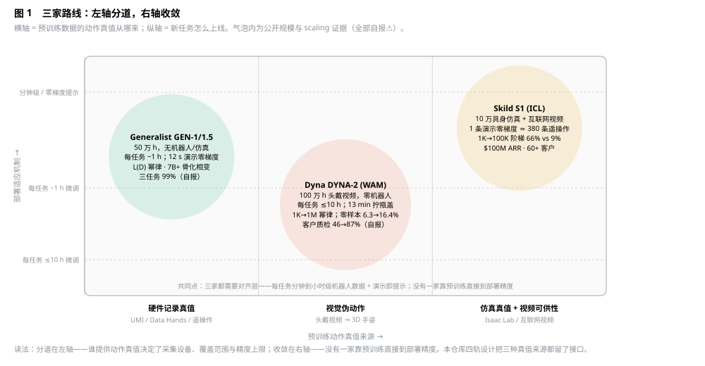
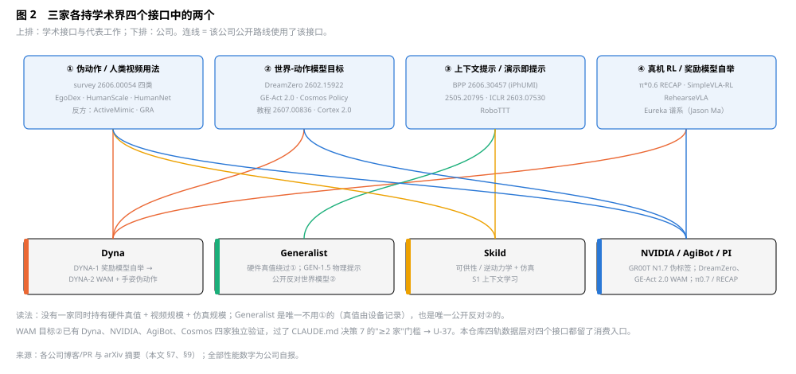

# Dyna Robotics 模型与数据方案调研，及与 Generalist / Skild / 其他厂商 / 学术界的对比（2026-09-14）

> 抓取说明：dyna.co 经 WebFetch 被拦截，但 2026-09-14 11:16 用 curl 直接抓到研究页（dyna.co/dyna-2，31 min 长文）、DYNA-1 页（dyna.co/research/dyna-1）与基础设施页（dyna.co/research/dyna-2-infrastructure）三份一手全文（已归档为 [sources/dyna/dyna-2.txt](sources/dyna/dyna-2.txt)、[dyna-1.txt](sources/dyna/dyna-1.txt)、[dyna-2-infrastructure.txt](sources/dyna/dyna-2-infrastructure.txt)）；本文 §2 数字已按一手页面核对并修正（第三方转述的 6.3→16.4% 实为 6.7→15.9%、"13 分钟"实为"约 10 分钟"、"+133%"未见于一手页）。generalistai.com、humanoidsdaily.com 仍被拦截。Generalist 一手条目沿用 [research-generalist-dora.md](research-generalist-dora.md)，本次新增 GEN-1 博客一手数字。Skild 一手博客超时，数字来自 The Robot Report、NVIDIA 博客、unite.ai、Humanoids Daily 对博客的转述。所有性能数字均为公司自报⚠️，无独立复现；已登记 governance D-22–D-24。 Dyna 的产品化页面《Not Just a Model, But a Product》（2026-08-27）与 DYNA-1i / DYNA-1 预训练两篇短文的精读见 [research-four-routes.md](research-four-routes.md) §2。

## 0. 一句话结论

三家头部初创在 2025-11 到 2026-08 的 10 个月里，各自把一条学术主线放大了 10–50 倍并给出了 scaling 曲线：**Generalist** 把"UMI 式手持夹爪 + 统一流模型"做到 50 万小时并得到物理提示涌现；**Dyna** 把"头戴人类视频 + 世界-动作模型（WAM）"做到 100 万小时并给出人→机器人迁移幂律；**Skild** 把"仿真 + 互联网视频 + 上下文学习（ICL）"做到 10 万小时阶梯并给出"1 条演示 ≈ 380 条遥操作"。三条路线在**数据的动作真值来源**上分道（硬件记录 / 视觉伪动作 / 仿真真值），在**部署适应**上却收敛到同一件事：每任务几分钟到一小时的机器人数据 + 演示即提示。对本仓库，这印证了战略文档 §1.1 的判断（人类视频为预训练主轴、机器人数据为对齐层），并新增两条要回写的东西：训练层要给 WAM 目标留接口（U-37），伪动作 schema 要补"抓取开合度"标量（回写 U-23）。

## 1. Dyna Robotics 速览

| 项 | 事实 | 来源 · 属性 |
|---|---|---|
| 公司 | 2024 年成立，Redwood City；创始人 Lindon Gao（CEO）、York Yang（二人此前创办 Caper AI，2021 年以约 $350M 售予 Instacart）、Yecheng Jason Ma（UPenn GRASP 博士，曾在 Google DeepMind / NVIDIA / Meta，Eureka、DrEureka 作者） | PR Newswire 官方；note.com 第三方 |
| 融资 | 种子 $23.5M（2025-03，CRV、First Round）；A 轮 $120M（2025-09，Robostrategy 领投，CRV、First Round、Salesforce Ventures、NVentures、Amazon Industrial Innovation Fund、Samsung Next、LG TV 参投）；估值 >$600M 为 Bloomberg 报道未经确认 | PR Newswire 官方；估值第三方 |
| 硬件（DYNA-SAUR 层） | 固定双臂 6-DoF YAM 臂 + 平行夹爪；双臂 + WUJI-2 20-DoF 五指手；"半人形"移动上身原型；移动底盘 2026 年由外购转自研；感知含视觉、触觉、本体 | note.com 转述官方；explainx 转述研究页 |
| 部署 | 酒店、餐厅、洗衣房、健身房；Monster Laundry（Sacramento）3 个月折 20 万+ 条毛巾、10 个客户；Red Bull Mirage（Coachella 2026-04）8 小时 700+ 杯；单机每天运行 16 小时 | X 帖（CyberRobo 转述）、heise、note.com · 第三方/自报⚠️ |
| 商业 KPI（2026-08 自报） | 洗衣 100 件/h、98%+ 可出货；餐饮 180 件/h；装配 200 件/h、±2 mm；早期口径为"人类 60% 吞吐" | note.com 转述官方 · 自报⚠️ |
| 四层栈 | System 2 DYNA-VLM（推理）/ System 1 DYNA-2（灵巧操作）/ System 0（全身控制）/ DYNA-SAUR（硬件感知） | note.com 转述官方 |
| 公开性 | 无权重、无 API、无云服务；"Distribution is King" | note.com 第三方 |

CEO 的一句话定调了他们的数据观："客户从没问过成功率，只问 ROI"（Lindon Gao，第三方转述）。

## 2. Dyna 的模型路线：DYNA-1 → DYNA-1i → DYNA-2

### 2.1 DYNA-1 / Dynamism v1（2025-04-29）

- **定位**：自称"首个商用就绪的机器人基础模型"，灵巧操作，固定双臂。
- **数据与训练**（研究页一手 + 官方稿）：DYNA-1 是 Qwen3-VL-4B 初始化的 mixture-of-transformers 式 VLA（DYNA-2 研究页披露）；核心卖点是**自研基础奖励模型（RM）**，能对餐巾折叠这类双手灵巧任务估计任务进度，用于自主探索、错误恢复与"自主运行生成高质量训练数据"——即真机 RL 自举，与 Jason Ma 的 Eureka 谱系一致。研究页给出 **RM-in-the-loop 的六周曲线**：第 1 周单次成功但 5 分钟后崩溃；第 2 周无人 1 小时但误差累积无法恢复；第 3 周 8 小时但每小时只折 6–7 条；第 4 周首次 24 小时；第 6 周 24+ 小时约 800 条且达生产级质量；内部 VLA 基线始终陷入灾难性失败态。研究页另一句对本仓库重要：**"连续部署环境里的机器人数据天然没有清晰的 episode 边界"**——这正是 D5 车队录制器触发式固化窗口与段级状态机要解决的问题。
- **结果**：24 小时连续折餐巾 800+（后期口径 850+/900+）条，成功率 99.4%，零干预，约人类 60% 速度；宣称零样本环境泛化。
- **DYNA-1i**：面向未知环境，约 40 件衣物/h（第三方转述，无一手）。
- **真实交付质量**：在客户严格质检口径下 DYNA-1 通过率仅 **46%**（对比 99.4% 的自测成功率）——这个差距是理解 Dyna 转向的关键。

### 2.2 DYNA-2（2026-08-10）：世界-动作模型 + 100 万小时人类视频

**架构**（研究页一手）
- 单一生成模型，**联合或分别去噪未来视频与未来动作**，建于视频扩散骨干之上（未披露骨干来源与参数量）；**mixture-of-transformers**：每种模态（视频、动作）各自分词并拥有独立的 DiT 层，层间用注意力互通；本体感知分词后直接进动作 transformer；视频 token 因果掩码，动作 token 双向自注意力并读取观测上下文的视频 token；视频 token 交叉注意文本，**文本不直接作用于动作 token**；流匹配训练，视频与动作各有边际速度场。
- 推理时策略是反应式的：动作头不以预测视频为输入，视频损失只塑造共享表征。视频生成本身经一步蒸馏后单卡 H100 从 10,203 ms → 110 ms（三秒三视角片段，约 90×），FVD 121。
- 与 NVIDIA DreamZero（Wan 2.1-I2V-14B 骨干）、AgiBot GE-Act 2.0（从零初始化）同属 WAM 线（§7）；Dyna 引用了 Cosmos Policy 与 mimic-video 作为相关工作。

**预训练数据**
- **100 万+ 小时头戴第一视角人类视频**，零机器人数据；内容为做饭、整理、折叠、装配等日常手工任务；来源为"数据伙伴 + 自采"，未披露采集设备、人数、地域、单价（官方稿只说"video is everywhere"）。
- **伪动作**：从视频提取 3D 手姿，**腕位姿 → 末端轨迹，拇指-食指开合度 → 连续抓取信号**。不含手指关节、接触力、触觉（研究页自认）。
- 四级嵌套子集 1K / 10K / 100K / 1M 小时，保持比例。

**scaling 结果**（研究页一手数字，自报⚠️，D-22；离线评测集 = 39 个机器人任务：12 个内部 YAM 双臂基准 + 27 个 xdof ABC 任务，两台固定双臂 YAM）

| 评测 | 指标 | 幂律指数（R²） | 1K→1M 变化 |
|---|---|---|---|
| 留出人类数据 | MSE | −0.0184（0.919） | 0.062 → 0.054（−13%） |
| 留出人类数据 | Acc@0.5 | +0.0203（0.865） | 0.40 → 0.47 |
| **从未见过的机器人数据（零样本离线）** | MSE | −0.0713（0.884） | 0.180 → 0.117（−35%） |
| 从未见过的机器人数据（零样本离线） | Acc@0.5 | +0.139（0.918） | 0.067 → 0.074 → 0.136 → 0.159（2.4×） |
| 后训练（每任务 ≤10 h 机器人数据，14 任务） | 归一化性能 | — | 20% → 28% → 45% → 53% |

- 机器人侧指数比人类侧陡 4–7 倍："人类数据的 scaling law 蕴含了未见机器人数据的 scaling law"（官方 X 帖）。
- 关键消融（一手）：三种配方 action-only / joint（同一数据上同时预测动作块与未来视频）/ video co-training（joint + 等量无动作标签视频）在 5K、50K、100K 动作小时上对照，39 任务零样本评测：**任何形式的未来预测都大幅胜过 action-only，joint 在 39/39 任务、每个规模上全胜**；action-only 随数据增大出现严重且不可预测的过拟合。再把动作标签固定在 50,000 小时、只扩无标签视频 0/1K/10K/50K 小时（并在 250K 动作 + 0/250K/750K 视频上复验），跨具身迁移随视频量单调上升 → 视频是独立于动作标签的新 scaling 轴。推理时策略保持反应式，**不生成也不读取预测视频**（视频损失只塑造共享表征）。这是全文最重要也最需要外部复现的可证伪主张。
- 跨具身迁移在 10K–100K 小时之间涌现；平行夹爪的零样本迁移优于高自由度手。
- Jason Ma 的外推：达到 99% 需要约 10^10 小时（"超过全部 YouTube"）——公司自己承认纯视频预训练不能独立到达部署精度。

**真机与商业结果**（自报⚠️）
- 同数据同步数对比 DYNA-1：完成次数 1.55×、评级 1.12×、成对比较胜率 65%。
- 高精度制造任务 20% → 80–90%，仅靠预训练规模、后训练数据不变。
- 客户现场同条件质检通过率 46% → **87%**（单站点、单任务族）。
- 两只五指手拧瓶盖：约 10 分钟遥操作数据（研究页；媒体稿写 13 分钟），成功率随预训练规模 10% → 40–50%；钥匙转动 1M 小时下 90%；语言跟随取饮料 58% → 83%。媒体稿的"指令跟随 +133%"未见于一手页。
- 每任务 ≤10 h 机器人数据、14 任务、每任务 10 次（语言任务 12 次）盲测，评测者不参与模型开发；WAM vs VLA 的 7 任务对比中 DYNA-1 是 Qwen3-VL-4B 初始化的 MoT 式 VLA，且实验管线按 VLA 调参（作者自认对 WAM 不利，结果读作下界）；未做算力与参数量 scaling；无同行评审。

### 2.3 数据基础设施（一手：《Training Dyna-2 at million-hour scale, repeatably》2026-08 + Alluxio 客户案例）

这一页对本仓库的价值超过研究页本身——Dyna 在百万小时规模上**放弃 H5 逐帧 JPEG，改用 MCAP 作 episode 容器**，与本仓库决策 1 完全同向：

| 环节 | Dyna 的做法与数字 | 对本仓库 |
|---|---|---|
| episode 容器 | 旧：H5 存逐帧 JPEG（约 80 MB/相机·分钟，无帧间压缩，无原生可视化）；新：**canonical MCAP + H.264**，GOP 放大（WAM 读长连续序列，一个关键帧摊到多帧；VLA 读短稀疏窗口则每样本都付 seek 代价）；**topic-group chunking**：MCAP 默认把所有 topic 按日志时间交错写进共享 chunk，而训练采样是不对称的（几帧相机 + 一长段稠密状态），于是把**读取模式相同的 topic 分组、各组时间主序写入**——相机们交错在一个流，本体感知与动作在另一个流，两组永不共享 chunk，加相机或加状态 topic 不再增加一次往返；存储 80.3 → 25.1 MB/相机·分钟（−68%），读延迟 27.0 → 9.4 ms/样本（2.9×），chunk 抓取 11.33 → 3.29 次/样本（3.4×） | 验证决策 1 与决策 3 的分层采样率；data-format-contract §1.1 已加"按读取模式分组 topic、组内时间主序、组间不共 chunk"备注 |
| 入湖 | 单 Kubernetes 作业 → **Airflow DAG**（转换 / 质检 / 特征富化三段，按步骤独立分配 CPU/GPU/内存、错峰启动、装箱批处理、状态落持久存储可重放）；吞吐 **14,000 → 440,000 episode-小时/周**；质检过滤：相机黑屏、关节抖动、手部缺失/遮挡、坏帧 | 对应本仓库 ingest 层与 curation L1；"手部缺失/遮挡"是 human 轨专属门 |
| 策展清单 | 元数据库（事务型，在采集/标注关键路径上）与**分析仓库**分离；训练清单改 **列式 + mmap**，1M 小时清单曾超出 2 TB 节点内存；首批次时间 **48 h → <1 min** | data-platform §3 元数据库 vs 分析库分离；本仓库消融切分器每次实验都要重建清单，正是同一问题 |
| 交付 | PB 级语料不复制到各集群，用 GPU 节点自带 NVMe 做 **Alluxio 页级缓存**，约 2 GB/s/节点，GPU 利用率 98%；一 PB 单读一遍 57.9 天（云存储）vs 5.8 天（本地缓存） | data-platform §1.3 成本模型的缓存层 |
| 训练 | B200 节点，NVLink 1.8 TB/s/GPU vs InfiniBand 慢一个量级 → 拓扑感知优化器分片约 3×；预检剔除坏节点、自动从最新检查点重启 | 训练层，M3 |
| 更早口径（Alluxio 案例） | 每天数十 TB、数万 H5 文件；GCS + Cloudflare R2；16 × H100、88 TB 缓存；开训要扫 10 万文件 | 即上表"旧"状态，已被 MCAP + 清单方案替代 |

读法：Dyna 把"最多的时间花在等数据"写成了结论——"更多 GPU 或 CPU 都解决不了，瓶颈从存储格式移到入湖再移到训练清单"。本仓库把格式契约与分片/幂等规范放在 M1 而不是 M3，是对的。

### 2.4 Dyna 数据观的三条自述

1. **"每天 1 万小时高质量、一致的数据，比蛮力 100 万小时更有价值"**（note.com 转述）——与 §2.2 的 100 万小时口径并存，说明他们把"预训练规模"和"对齐层质量"当两件事。
2. **车队数据只用于微调，不进预训练**：部署机器人每天 16 小时产生的数据用于后训练。
3. **York Yang（2026-05）承认 10 个月真实运营没有产生自加速飞轮**，"部署没有自我加速"，并称全行业同此——这是迄今最坦率的一手反证，直接对应本仓库 R-20（新登记）。

## 3. Generalist：GEN-0 → GEN-1 → GEN-1.5（补一手 GEN-1 数字）

沿用 [research-generalist-dora.md](research-generalist-dora.md)，本次新增 GEN-1 博客（2026-04-02）一手内容：

| 项 | GEN-1 一手口径 | 属性 |
|---|---|---|
| 预训练 | **50 万小时真实数据、无机器人数据**，从零训练；数据来自穿戴/手持设备（Data Hands，UMI 谱系） | 官方自报⚠️ |
| 每任务机器人数据 | **约 1 小时**；比 GEN-0 少 10× 任务数据达同等性能 | 官方自报⚠️ |
| "掌握"三要素 | 可靠性、速度、即兴智能 | 官方 |
| 成功率 | 三任务平均 GEN-1 **99%** / GEN-0 64% / 无预训练 19%（吸尘器维护 99/50/2，折箱 99/81/13，装手机 99/62/42） | 官方自报⚠️（D-24） |
| 速度 | 折箱 12.1 s vs GEN-0/π0 ~34 s（2.8×）；总体"约 3× SOTA"，对比对象含 π0、π*0.6 | 官方自报⚠️ |
| 长时运行 | 汽车件配套 1 h 连续；T 恤 86 次；装块 1,800 次 | 官方自报⚠️ |
| 自认限制 | "不是所有任务都能到这个成功率"；涌现行为带来"精确引导用户偏好"的对齐问题 | 官方 |
| 未披露 | 参数量、算力、训练时长 | — |

与 Dyna 的根本差别：Generalist 的 50 万小时**每一小时都带硬件记录的动作真值**（夹爪开合 + SLAM 位姿），所以它不需要伪动作，也不需要世界建模目标来"补"动作；代价是采集必须用专用设备、覆盖只到手持夹爪能做的任务形态。Dyna 的 100 万小时**没有任何动作真值**，用手姿伪动作 + 视频预测目标补偿，覆盖到裸手任何任务，代价是伪动作精度上限和 10^10 小时的外推。

## 4. Skild AI：omni-bodied 仿真 + 互联网视频 + S1 上下文学习

> 2026-09-14 晚：skild.ai 已可达，全部 11 篇博客归档于 [sources/skild/](sources/MANIFEST.md)，逐条核对与新增内容见 [research-skild.md](research-skild.md)；本节数字经核对与一手一致（66% / 9%、380 条、$1:$3），并补充 seen 任务 96%、2,000 条后 VLA 86%、L1–L5 扰动阶梯。

| 项 | 事实 | 来源 · 属性 |
|---|---|---|
| 融资/商业 | A 轮 $300M（2024-07）；C 轮 $1.4B、估值 $14B、SoftBank 领投（2026-01）；2026-09-09 宣布 **$100M ARR**，首次商用部署后 10 个月；2025 年营收约 $30M；**60+ 付费客户、数百台机器人**；收购 Zebra 机器人部门（原 Fetch）；与 ABB、UR、MiR、NVIDIA、Foxconn（Blackwell 装配：双臂装母线、拧 16 颗螺丝） | Skild 博客列表 + Bloomberg/TNW 转述 · 官方/第三方 |
| omni-bodied 路线（2025-09） | 一个模型控制 **10 万个仿真机器人**（人形、四足、机械臂）；"数天内一千年仿真经验"；目标是"万亿级轨迹"（"全地球人口采集也要数年才到 100 万亿条"）；用 Isaac Lab + Cosmos Transfer 做增广 | Skild 博客 / NVIDIA 案例 · 官方自报⚠️ |
| 人类视频（2026-01） | 头戴第一视角 + YouTube 教学视频，"把人当生物机器人"提取可供性（affordance）；自认缺失力/触觉、具身鸿沟；微调只需 <1 h 机器人数据 | Skild 博客 · 官方 |
| **S1（2026-08-18）** | 从头按上下文学习者设计：输入一段任务演示视频，零权重更新执行；预训练为"外环学会从上下文学"、推理为"内环"；预训练用**逆动力学模型**跨视角/场景/具身；演示被当作**目标规格而非轨迹** | Robot Report / Humanoids Daily / NVIDIA 转述博客 · 官方 |
| S1 scaling 阶梯 | 在过滤后的预训练池上 1K→100K 小时阶梯：已见任务 96%；**未见长视野任务（≤10 min）逐步成功率 66% vs 语言 VLA 基线 9%**（同 10 万小时）；差距随规模指数扩大；"逐步成功率"非端到端完成率 | 同上 · 自报⚠️（D-23） |
| 演示效率 | **1 条上下文演示 ≈ 380 条后训练遥操作示例**（VLA 2,000 条到 86%）；380 条 4–10 分钟演示 ≈ 50–100 小时遥操作 | 同上 · 自报⚠️ |
| 数据引擎 | 多源：遥操作（贴近硬件、多样性低、可扩性低）、UMI（三项中等）、第一视角视频（贴近度低、多样性高、可扩性高）、仿真（贴近中、多样性低、可扩性高）；**每 $1 采集配 $3 质控**；每条进预训练的数据都筛低层精度、任务连贯性、标注保真 | Robot Report 转述博客 · 官方 |
| 限制 | 五级扰动中"需换到对侧手臂"时显著退化；5–30 秒短任务不需要 ICL；"视觉提示能否达到工业可靠性仍是开放问题"；无论文、无代码 | 同上 · 官方自认 |

## 5. 三家横向对比

*图 1　Dyna、Generalist、Skild 在"预训练动作真值来源"与"部署适应机制"两轴上的位置，叠加各自公开的规模与 scaling 证据。三家在左轴分道、在右轴收敛。*

| 维度 | Dyna | Generalist | Skild |
|---|---|---|---|
| 预训练主体 | 100 万 h 头戴人类视频，零机器人数据 | 50 万 h Data Hands（UMI 式）+ 机器人自身数据，无仿真 | 仿真（10 万具身、万亿级目标）+ 互联网/头戴人类视频 |
| 动作真值来源 | **视觉伪动作**（腕位姿 + 拇食开合） | **硬件记录**（夹爪开合 + SLAM） | **仿真真值** + 视频可供性（无真值） |
| 模型范式 | WAM：联合去噪未来视频 + 动作，MoE 视频扩散 | 统一流 Harmonic Reasoning，唯一目标=下一动作；明确反对世界模型与分层 | ICL 策略 + 逆动力学预训练 |
| 公开 scaling 证据 | 1K→1M h 幂律；零样本机器人 Acc 6.3→16.4%；后训练 20→53% | L(D) 幂律；1B/6B/7B+ 骨化相变 | 1K→100K h 阶梯；未见任务 66% vs 9% |
| 部署适应 | 每任务 ≤10 h，13 min 拧瓶盖 | 每任务 ~1 h；3–12 s 演示零梯度 59%，10 步微调 83% | 1 条演示视频零梯度；<1 h 微调 |
| 真机质量口径 | 客户质检 46%→87%；自测 99.4% | 三任务 99%；"不是所有任务" | 逐步成功率 66%/96%；工业可靠性"开放问题" |
| 车队回流 | 只做微调，不进预训练；"飞轮未自加速" | 未披露 | 60+ 客户数百台；未披露回流用法 |
| 商业 | 洗衣/餐饮/装配，RaaS 式部署，$143.5M 融资 | $400M 融资、$2B 估值；卖模型/合作 | **$100M ARR**、$14B 估值、收购 Fetch |
| 硬件 | 自研臂+手+底盘，四层栈 | 只做模型，"千手"跨末端 | 只做脑，omni-bodied |
| 对本仓库最有用的一点 | 伪动作 = 腕 + 开合度；视频预测目标补动作缺口 | 演示库；L(D) 幂律进验证模块 | $1:$3 采集质控比；演示 ≈ 380 条的换算 |

**三家共同承认的事**：预训练规模不能独立到达部署精度（Dyna 的 10^10 h 外推、Generalist 的"不是所有任务"、Skild 的"开放问题"）；对齐层每任务几分钟到一小时的机器人数据仍然必要；演示即提示是共同的产品形态。

## 6. 与本仓库已研究的其他厂商对照

| 厂商 | 数据主轴 | 动作真值 | 模型 | 与三家的关系 |
|---|---|---|---|---|
| Figure（[research-figure.md](research-figure.md)） | Index 众包第一视角 16M 视频 + BotQ 车队；官方"数据+算力 >$1B" | 视觉伪标签 + 车队真值 | Helix 分层（S2/S1/S0） | 与 Dyna 同选"裸手人类视频"，但 Figure 走分层 VLA 而非 WAM；Index 规模 vs Dyna 100 万 h 量级相当 |
| Physical Intelligence（[research-vla-pretraining.md](research-vla-pretraining.md) §1、战略 §1.1） | 跨具身遥操作为主，π0.5 目标域 2.4%；π0.7 元数据条件化吃失败/自主 rollout | 遥操作真值 | π 系 VLA + RECAP 真机 RL | Dyna 的 RM 自举与 π*0.6 RECAP 同源；PI 尚未把人类视频当主轴 |
| NVIDIA GR00T N1.7 / DreamZero / Cosmos Policy | 20,854 h EgoScale 人类视频进预训练；DreamZero WAM 14B（Wan 2.1 骨干）RoboArena 1750 Elo > π0.5 1622 | 相对 EEF 伪标签 | VLA（N1.7）与 WAM（DreamZero）并行 | Dyna 官方把自己定位为"EgoScale 的 50 倍 + 零样本机器人评测"；DreamZero 是 WAM 路线的第二家独立验证 |
| AgiBot GE-Act 2.0（arXiv:2609.05588） | 300→30,000 h 协同训练；目标具身 <2% 仍大幅受益 | 真机 + 无动作视频 | 从零初始化的 WAM（控制导向自编码 + 视觉规划 + 逆动力学） | WAM 第三家；证明不用视频生成器骨干也能 scaling |
| Xiaomi-Robotics-1 / GigaBrain-0.7（战略 §1.5，D-15） | 10 万 h UMI / 真机 55%+UMI 22%+ego 8%+仿真 15% | 硬件真值为主 | VLA | Generalist 同路（硬件真值），配比公开 |
| 1X（[research-vla-pretraining.md](research-vla-pretraining.md) §2.2） | 家庭 NEO 车队，Expert Mode 遥操作 | 车队真值 | 世界模型做评测器 | 与 Dyna 的"车队只做微调"相反，1X 把车队数据推向世界模型 |
| Sunday / TwinDEX（[research-sunday.md](research-sunday.md)、[research-twindex.md](research-twindex.md)） | 穿戴孪生夹爪 / 孪生灵巧手 | 硬件真值 | 未公开 | Generalist 路线的两个变体，把接口对齐推到灵巧手 |
| Qwen 机器人栈（[research-qwen-robotics.md](research-qwen-robotics.md)） | Ego2Robot 1,933 h → 24,808 h | 视觉伪标签 | 三维对齐 VLA | Dyna 路线的中国样本，规模小 40× |

## 7. 学术界方向对照

*图 2　三家产业路线各自对应的学术主线与代表工作。产业界没有发明新范式，而是各挑一条学术线放大 10–50 倍并给出曲线；反方证据（ActiveMimic、GRA）和统一综述（IJCAI 2026 survey）仍来自学术界。*

**7.1 人类视频怎么用**：IJCAI 2026 综述（[arXiv:2606.00054](https://arxiv.org/abs/2606.00054)，Feng 等，含 Oier Mees、Marc Pollefeys）把方法分四类：潜动作表征、预测式世界模型、显式 2D 监督、显式 3D 重建。三家对号入座：Dyna = 世界模型 + 3D 手姿（第二、四类），Skild = 可供性/潜动作（第一类）+ 逆动力学，Generalist = 不用视频推动作，硬件直接记录（绕过全部四类）。综述列的三个开放问题——非结构化视频组织成 episode、视频监督到机器人动作的具身/视角鸿沟、评测协议预测真实部署——正好是本仓库 curation、U-23、eval-protocol 三份文档的题目。

**7.2 世界-动作模型（WAM）线**：DreamZero"WAM 是零样本策略"（[arXiv:2602.15922](https://arxiv.org/abs/2602.15922)，NVIDIA）、GE-Act 2.0（AgiBot）、Cosmos Policy、Dyna-2 四家在 2026 年 2–9 月独立收敛：联合预测未来帧与动作，把动作学习从"稠密状态-动作模仿"改为"与预测视觉未来对齐的逆动力学"。教程（[arXiv:2607.00836](https://arxiv.org/abs/2607.00836)）与综述（[arXiv:2605.00080](https://arxiv.org/abs/2605.00080)）已把它标准化；Cortex 2.0（[arXiv:2604.20246](https://arxiv.org/abs/2604.20246)）把"在潜空间生成候选轨迹 → 打分 → 只执行最高分"落到工业杂乱场景。NVIDIA 技术博客（2026-06-15）的配方建议是**视频预测目标与机器人微调协同训练**，而不是先视频后动作两段式。→ 按 CLAUDE.md 决策 7 的"≥2 家独立验证"门槛，WAM 目标已过线，可进训练层共识候选（U-37）。

**7.3 人类视频 scaling**：HumanScale（同 5,000 h 人类视频优于遥操作，验证损失 −24%）、HumanNet（100 万小时人类视频学习）、ZimaBlue（12 万 h 未饱和）、EgoScale/GR00T N1.7（1k→20k h 翻倍）、EgoDex（[arXiv:2505.11709](https://arxiv.org/abs/2505.11709)）——Dyna-2 是这条线的产业极值，其"机器人侧指数比人类侧陡 4–7 倍"是新结论。**反方**：ActiveMimic（人类视频丢弃主动感知）、GRA（生成视频几何幸存、控制信号丢失），以及 Dyna 自认伪动作缺手指关节与力——这些正是本仓库 U-25 触觉对照集与 U-33 ego+exo 探针要回答的。

**7.4 上下文学习 / 演示即提示**：Behavior Prompting Policy（[arXiv:2606.30457](https://arxiv.org/abs/2606.30457)，Shuran Song 组，用 iPhUMI 手持接口采数据，"任务多样性是提示能力的首要因素"）、人类演示视频作提示（[arXiv:2505.20795](https://arxiv.org/abs/2505.20795)）、ICLR 视觉推理式上下文模仿（[arXiv:2603.07530](https://arxiv.org/abs/2603.07530)）、RoboTTT（Skild 博客引用）——GEN-1.5 与 S1 是这条线的产业化，两家都说"未显式训练 ICL / 从头按 ICL 设计"，但结论一致：多样性而非小时数决定提示能力（与 Lin 等的多样性幂律同向）。

**7.5 真机 RL 自举**：DYNA-1 的自研奖励模型 + 自主探索恢复，与 π*0.6 RECAP、SimpleVLA-RL、RehearseVLA 同线（[research-vla-pretraining.md](research-vla-pretraining.md) §4.4）。产业界的差别在于奖励模型是私有资产，不公开。

**判断**：学术界在 2026 年给出的是**四个可组合的接口**（伪动作、世界建模目标、上下文提示、奖励模型），三家公司各持其二；没有一家同时拥有硬件真值 + 视频规模 + 仿真规模。本仓库的四轨（robot/human/device/sim）设计恰好是"把四个接口都留出"的数据层——这是它相对任何单家路线的结构性位置。

## 8. 对本仓库的启示与回写

1. **训练层给 WAM 目标留接口（新 U-37）**：Dyna-2、DreamZero、GE-Act 2.0、Cosmos Policy 四家独立验证"联合预测未来帧 + 动作"，已满足决策 7 的"≥2 家"门槛。training-pipeline 的 Stage B/C 需要一条"next-frame 协同目标"的可选分支；数据层不需要改——human 轨视频本来就在，只要 export 保留**连续帧对**而不是只抽关键帧（回写 data-format-contract §3 视频抽帧规则）。
2. **伪动作 schema 补"抓取开合度"标量（回写 U-23）**：Dyna 的伪动作 = 腕位姿 + 拇食开合度；本仓库 U-23 裁决的"相机系相对末端 + 手部状态"里，手部状态应显式包含一个与夹爪宽度同义的 `grasp_aperture`（0–1 或 mm），使 human 轨伪动作与 device 轨 `gripper_width` 可对齐——这是 D2+D1 同戴配对（capture-devices-design §7 ①）的直接消费者。
3. **采集与质控预算比**：Skild 自报 $1 采集 : $3 质控。本仓库 program-plan §4 的策展/标注预算与采集预算之比目前约 1:1，需在 G2 前用自家数据复核（不照抄，登记 D-23）。
4. **演示 ≈ N 条的换算进评测**：Skild "1 条演示 ≈ 380 条遥操作"、Generalist "3–12 秒零梯度 59%"、Dyna "13 分钟拧瓶盖"——eval-protocol 的少样本适应维度应报告三个刻度：零梯度 1 条演示、10 步微调 1–5 分钟、≤10 h 全量，与北极星"新任务上线成本"同口径。
5. **车队数据的用途定位**：Dyna 明确"回流只做微调不进预训练"，1X 把回流推向世界模型评测器；本仓库 D5 录制器的干预段进对齐层（控制点 2）与 Dyna 一致，OOD 段还可以进世界模型评测器（L7），两者不冲突。
6. **飞轮不自加速（新 R-20）**：York Yang 的坦白是第一条来自头部厂商的一手反证——部署 10 个月、多客户、每天 16 小时，数据没有自动变成能力。对本仓库的意思是 L7 闭环层的 KPI 不能只看回流小时数，要看"干预段 → 下一版本成功率增量"的转化率；PL5 的商业假设也要按此打折。
7. **可信度**：三家全部数字为自报，Dyna-2 的核心数字甚至只见于第三方转述；已登记 D-22（Dyna-2 scaling 与 46→87%）、D-23（Skild S1 66/9%、380 条、$1:$3）、D-24（GEN-1 99%/1 h）。任何一条进入设计前置条件都要走 D 表"若不成立"分支。

**回写清单**：governance（U-37、R-20、D-22–D-24，本次已登记）；training-pipeline §2（WAM 分支，待 M3）；data-format-contract §3（连续帧对导出、`grasp_aperture`，待契约 0.3）；eval-protocol §3（少样本三刻度，待 M2）；program-plan §4（质控预算比复核，待 G2）；data-strategy-roadmap §1.1 Dyna-2 行（已加本文链接）。

## 9. 来源

**官方（一手）**：PR Newswire — DYNA-1 发布（2025-04-29，302441437）、$120M A 轮（2025-09-15，302556817）、DYNA-2 发布与更正（2026-08-10，302847114）；Skild 博客列表（skild.ai/blogs，抓取成功）；Generalist 博客 GEN-1（generalistai.com/blog/gen-1，抓取成功）与博客列表；NVIDIA 技术博客 WAM（2026-06-15）；NVIDIA 案例页 Skild；Alluxio 客户案例（合作方稿）。
**官方（经转述）**：dyna.co/dyna-2 研究页 → explainx.ai（2026-08）、note.com 香川友志（2026-08-20）、ActionTrajectories；skild.ai/blogs/s1 → The Robot Report、Humanoids Daily、unite.ai、NVIDIA 博客；Dyna 官方 X 帖（2026-08-10，经搜索摘要）。
**第三方**：Interesting Engineering、Robotics 24/7（403）、heise、Bloomberg/TNW（Skild ARR）、CyberRobo X 帖（Monster Laundry）。
**论文**：arXiv 2606.00054、2602.15922、2609.05588、2607.00836、2605.00080、2604.20246、2606.30457、2505.20795、2603.07530、2505.11709；其余见 [data-strategy-roadmap.md](data-strategy-roadmap.md) §7.1。
