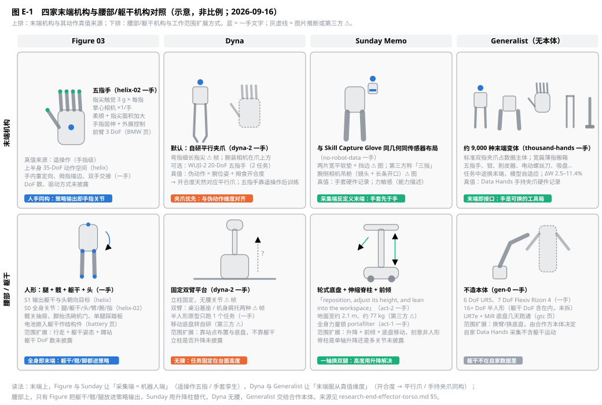

# 四家末端机构与腰部机构对比（Figure 03 / Dyna / Sunday Memo / Generalist）

> 2026-09-16。承接 [research-sensor-layouts.md](research-sensor-layouts.md)（传感器）与 [research-four-routes.md](research-four-routes.md) §5.3（本体分歧）。全部事实指向 [sources/MANIFEST.md](sources/MANIFEST.md) 归档文本；来自图片或第三方的标 ⚠️。本文直接服务 governance U-04（三指简化 vs 五指）与 [robot-track-teleop.md](robot-track-teleop.md) §1 本体选型。

[F:figure-03]: sources/figure/introducing-figure-03.txt
[F:helix]: sources/figure/helix.txt
[F:helix-02]: sources/figure/helix-02.txt
[F:bedroom]: sources/figure/helix-02-bedroom-tidy.txt
[F:living]: sources/figure/helix-02-living-room-tidy.txt
[F:laundry]: sources/figure/helix-learns-to-fold-laundry.txt
[F:bmw-prod]: sources/figure/production-at-bmw.txt
[F:bmw]: sources/figure/f-03-at-bmw.txt
[F:battery]: sources/figure/f-03-battery-development.txt
[F:helix-logistics]: sources/figure/helix-logistics.txt
[D:dyna-2]: sources/dyna/dyna-2.txt
[D:product]: sources/dyna/scaling-customer-deployments.txt
[D:home]: sources/dyna/home.txt
[S:act-1]: sources/sunday/no-robot-data.txt
[S:act-2]: sources/sunday/act-2-preview.txt
[S:technology]: sources/sunday/technology.txt
[G:hands]: sources/generalist/towards-machines-with-a-thousand-hands.txt
[G:gen-0]: sources/generalist/gen-0.txt
[G:gen-1]: sources/generalist/gen-1.txt
[G:gen-1.5]: sources/generalist/gen-1.5.txt
[G:preview]: sources/generalist/research-preview.txt
[G:gtc]: sources/generalist/the-real-breakthrough-behind-our-gtc-demo.txt
[G:commonsense]: sources/generalist/physical-commonsense.txt
[K:omni]: sources/skild/omni-bodied.txt

## 0. 一句话结论

末端机构的分歧不是"几根手指"，而是**谁服从谁**：Figure 与 Sunday 让采集端等于机器人端（遥操作五指手 / 手套孪生手），末端由"人能演示什么"定义；Dyna 与 Generalist 让末端服从动作真值的维度（拇食开合度 → 平行夹爪 / 手持夹爪同构），五指手只是可选后训练目标。腰部机构上四家彻底分开：Figure 把躯干、髋、腿全部放进策略输出，Sunday 用升降脊柱加前倾替代双腿，Dyna 干脆无腰、把任务固定在台面高度，Generalist 把躯干交给合作本体。对本仓库，这意味着 U-04 的裁决变量不是三指或五指，而是"目标本体的末端能否与采集设备同构"。

*图 E-1　上排末端机构与其动作真值来源，下排腰部/躯干机构与工作范围扩展方式。蓝色标签为一手文字，灰虚线为图片推断或第三方。*

## 1. 末端机构对照

| | Figure 03 | Dyna | Sunday Memo | Generalist |
|---|---|---|---|---|
| 形态 | 五指手 [F:helix-02]；前臂 3 DoF [F:bmw-prod] | 默认自研平行夹爪；可选 WUJI-2 20-DoF 五指手；半人形原型 [D:dyna-2] | 与 Skill Capture Glove 同几何同传感器布局的手 [S:act-1]；两片宽平软垫 ⚠️ 图；第三方称"三指" ⚠️ | 约 9,000 种末端变体：标准双指夹爪、五指手、钳、削皮器、电动螺丝刀、吸盘、宽扁薄指等 [G:hands] |
| 手指级控制 | S1 输出手指屈伸与外展 [F:helix]；S0 输出到单指关节 [F:helix-02] | 平行爪：开合度；五指手：2 个任务用遥操作后训练（10 分钟拧瓶盖）[D:dyna-2] | 未披露；"multi-finger movements" 叠袜子 [S:act-1] | 由末端决定，模型条件化于"眼前的手" [G:hands] |
| 传感 | 每指尖触觉 3 g、掌心相机、加大柔顺与指尖面积 [F:figure-03] | 腕装相机 ⚠️ 图；触觉列于图示 [D:home] | 腕侧相机吊舱 ⚠️ 图；力敏感为能力描述 [S:act-1] | 腕装相机与 Data Hands 同位 [G:gen-1.5]；其余未披露 |
| 动作真值来源 | 遥操作，手指级 [F:helix] | 人类视频伪动作：腕位姿 + 拇食开合度 [D:dyna-2] | 手套硬件记录 [S:act-1] | Data Hands 手持夹爪硬件记录 [G:gen-1.5] |
| 末端与采集端关系 | 采集端 = 机器人端（遥操作同一只手） | 采集端是人手，机器人端是夹爪；开合度是两者的公共维度 | 采集端 = 机器人端（手套镜像） | 采集端 = 机器人端（手持夹爪与机器人夹爪同构）；其他末端靠混合数据条件化 |
| 一手展示的能力 | 手内重定向、拇指描边、捏角、双手交接、抽单张药片、注射器定量 [F:helix-02][F:laundry][F:living] | 单张抽纸、拧瓶盖、叠衣 [D:dyna-2] | 单手持两只酒杯、单手拿两件餐具、叠袜、锁 portafilter [S:act-1] | 双手拧盖、卡住乐高换手取下、中途换末端继续任务 [G:gen-1.5][G:hands] |
| 换末端 | 无 | 任务间换（夹爪 ↔ 五指手）[D:dyna-2] | 无 | 任务中途物理换末端，同一模型继续运行 [G:hands] |
| 未披露 | 手 DoF 数、驱动方式、成本 | 夹爪行程/力、五指手来源（WUJI 为外购品牌名） | 手指数、DoF、触觉、成本 | 各末端的传感配置 |

三点判读：

1. **"五指手是否必要"四家给了三种答案**。Figure 说必要且已量产 [F:helix-02]；Generalist 说"五指手将是众多工具之一，只限于它是想象力的失败" [G:hands]；Dyna 与 Sunday 用夹爪级末端做出了商用叠衣 [D:product][S:act-2]。四家都没有五指对夹爪的同任务对照数据，U-04 的消融仍然只能自己做。
2. **末端形态由真值维度决定**。Dyna 的伪动作只有腕位姿加一个开合度标量 [D:dyna-2]，平行夹爪是这组维度的自然载体，五指手要靠遥操作后训练补维度；Generalist 的 Data Hands 是双指夹爪，所以"标准双指夹爪占数据主体" [G:hands]。本仓库 U-23 裁决的公共动作目标（相机系相对末端 + 手部关键点/开合度）与这两家一致，意味着 P0/H0 的平行夹爪末端不是权宜，是与真值维度匹配的选择。
3. **换末端是 Generalist 独有的数据策略**。约 9,000 种变体、微调时权重位移 2.5–11.4%、中途换末端模型自适应 [G:hands]，把末端当作"接触物理的采样器"而不是产品部件。这与 Figure 一只手打天下、Sunday 手套定义唯一一只手正相反。

## 2. 腰部 / 躯干机构对照

| | Figure 03 | Dyna | Sunday Memo | Generalist |
|---|---|---|---|---|
| 机构 | 人形：腿 + 髋 + 躯干 + 头；电池嵌入躯干作结构件 [F:battery] | 固定双臂平台，立柱固定 ⚠️ 帧；双臂立于桌沿基座或机身肩托两种 ⚠️；半人形原型 [D:dyna-2] | 轮式底盘 + 伸缩脊柱 + 前倾 [S:act-2]；地面至约 2.1 m、约 77 kg（humanoid.guide ⚠️） | 不造本体；6 DoF UR5、7 DoF Flexiv Rizon 4、16+ DoF 半人形 [G:gen-0][G:preview]；UR7e + MiR 底盘 [G:gtc] |
| 躯干进不进策略 | 进：S1 输出躯干与头朝向目标 [F:helix]；S0 输出腿/躯干/头/臂/腕/指全部关节 [F:helix-02] | 不适用（无腰）；System 0 全身控制 ~1 kHz 针对半人形 [D:home] | 未写明；"whole-body strength"、"lean into the workspace" 说明升降与前倾由策略或规划驱动 [S:act-1][S:act-2] | 取决于合作本体；自家 Data Hands 数据不含躯干运动 |
| 工作范围扩展方式 | 行走、躯干姿态、蹲站；髋关抽屉、脚抬洗碗机门、单腿踩踏板 [F:helix-02][F:bedroom] | 站点布置 + 底盘（第三方称转自研 ⚠️），任务固定在台面高度 | 升降 + 前倾 + 底盘移动，"刻意非人形" [S:act-1] | 换臂 / 换底盘，由合作方决定 |
| 全身作为工具 | 是：髋、脚、肩（毛巾甩到肩上腾出手）[F:helix-02][F:living] | 否 | 部分："whole-body strength" 锁 portafilter [S:act-1] | 否（数据里没有） |
| 一手展示的范围 | 拉带脚轮的重推车、走到洗碗机再走回柜子 [F:bmw][F:helix-02] | 台面叠衣、抽纸、装箱 [D:product] | 桌面到洗碗机、地面衣物回收 [S:act-1][S:act-2] | 桌面任务为主 |
| 未披露 | 躯干 DoF 数 | 立柱是否升降、底盘规格 | 脊柱是单轴升降还是多关节 | — |

三点判读：

1. **Figure 是唯一把躯干当末端用的**。髋关抽屉、脚踩踏板、肩扛毛巾 [F:helix-02][F:bedroom][F:living] 都要求策略输出覆盖腿和躯干，这也是 S0 存在的理由；其他三家的策略输出到臂和末端为止。
2. **Sunday 用一根升降柱换掉双腿**，代价是失去人形的工作空间变形能力，换来约 77 kg、目标售价低和"每户零适配" [S:act-2]。它的 ACT 模型把导航（地图条件）和操作放在一个网络里 [S:act-1]，升降与前倾就是这个网络的"腰"。
3. **Dyna 无腰，是产品决策而非能力缺口**：客户 SOP 固定在工作台高度，每站每天 >1 TB 的数据全部来自同一台面几何 [D:product]；半人形原型只跑了 1 个语言跟随任务 [D:dyna-2]。这与 R-20（部署飞轮不自加速）互为注脚：没有躯干的机器人也没有躯干数据。

## 3. 与采集设备的对应

| 公司 | 采集端 | 机器人端 | 差距在哪 |
|---|---|---|---|
| Figure | 遥操作五指手（同一只手）；Index 人类视频（人手）[F:helix] | 五指手 | 遥操作零差距；人类视频要重定向到五指（未公开方法） |
| Dyna | 头戴人类视频，人手 [D:dyna-2] | 平行夹爪 / 五指手 | 人手 → 开合度标量，手指信息被压缩 |
| Sunday | Skill Capture Glove（手套 = 手）[S:act-1] | 同几何手 | 手零差距；"the rest of the embodiment remains a variable"，靠 Skill Transform 抹人 |
| Generalist | Data Hands 手持双指夹爪 [G:gen-1.5][G:commonsense] | 同构夹爪 + 其他末端 | 双指零差距；其他末端靠机器人自采 |

Skild 不在此表：它把本体当变量，omni-bodied 页演示锯掉小腿去掉 4 个 DoF 后 7–8 秒内自适应 [K:omni]，末端与腰部都由合作本体决定。

## 4. 对本仓库的启示

1. **U-04 的裁决变量改写**：不是"三指 vs 五指"，而是"末端能否与 device 轨采集设备同构"。四家里三家做到了同构（Figure 遥操作、Sunday 手套、Generalist Data Hands），只有 Dyna 靠压缩维度跨过去。建议 U-04 消融加一列"采集设备同构可得性"（P0 UMI 平行夹爪：同构可得；五指：需数据手套 U-36 且重定向误差未知）。
2. **P0/H0 平行夹爪不是权宜**：与 U-23 的公共动作目标（相对末端 + 开合度）匹配，也与 Dyna、Generalist 的数据主体一致；五指手进入默认路径要等 U-04 消融和 U-36 手套选型。
3. **躯干 DoF 进契约但不进 H0 本体**：robot-track-teleop §1 的"可选躯干 1–2 DoF"保留；EpisodeMeta 的具身档案应显式记录躯干/升降轴（Sunday 式）或髋（Figure 式）是否存在，训练时作掩码槽位，不因 H0 本体无腰而省掉字段。
4. **换末端作为数据策略值得进 sim 轨与 device 轨**：Generalist 的中途换末端证明混合末端数据能让模型条件化于末端 [G:hands]；本仓库的 device 轨 UMI 变体（触觉版、手指驱动版）和 sim 轨的末端随机化可以刻意制造这种混合，配比进 configs/mixtures。
5. **诚实性**：末端 DoF、驱动、力、成本四家都未披露；本文位置与形态一半来自图片。写进设计文档时保留 ⚠️。

## 5. 来源

一手：本文顶部 24 个引用键，对应 [sources/MANIFEST.md](sources/MANIFEST.md)。图片：docs/assets/sources/dyna/、docs/assets/sources/sunday/。第三方 ⚠️：humanoid.guide（Memo 尺寸、重量）、note.com（Dyna 移动底盘转自研）。
