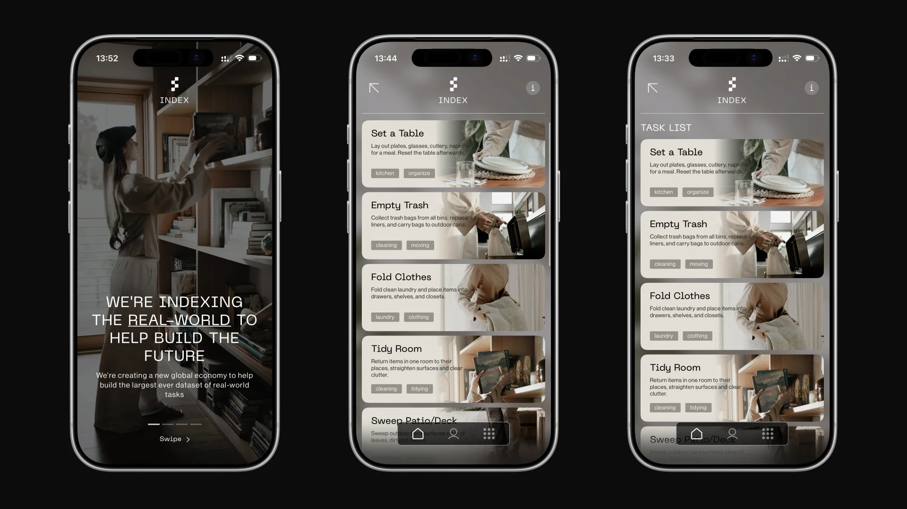
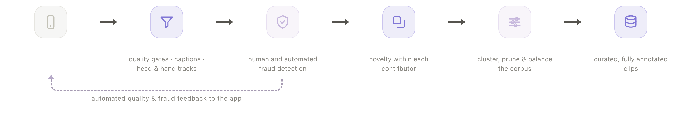
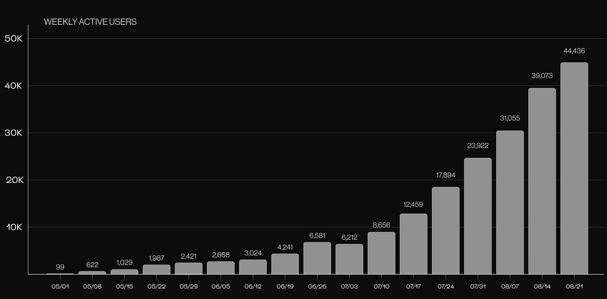

# Figure AI 数据采集与数据管线技术调研报告

> 调研时间：2026-08-29。事实均来自公开搜索/官网抓取结果；不确定处已标注。Figure 未开源任何代码或数据集，其数据管线内部细节（清洗、切分、存储格式）公开信息有限，本报告将"官方确认"与"第三方推断"严格区分。

---

## 1. Helix VLA 模型的数据需求

### 1.1 双系统（现为三系统）架构

**Helix（初代，2025-02 发布）** — 来源：[Figure 官方 Helix 博客](https://www.figure.ai/news/helix)

| 组件 | 规格 | 频率 | 职责 |
|---|---|---|---|
| System 2 (S2) | 7B 参数，开源开放权重 VLM（互联网规模预训练） | 7–9 Hz | 语义理解、场景推理、语言指令解析 |
| System 1 (S1) | 80M 参数，cross-attention encoder-decoder Transformer 视觉运动策略 | 200 Hz | 实时连续动作输出 |

- 动作空间：**35 自由度，200 Hz** 全上半身控制——手腕位姿、单指屈曲/外展、躯干与头部朝向，外加一个"任务完成百分比"合成输出维度。
- 部署在机器人本体的**双嵌入式低功耗 GPU** 上，S1/S2 各占一颗，异步解耦运行。
- 解耦设计的明确动机：S1、S2 可**独立迭代**，无需统一观测空间或动作表征——对管线设计意味着两套数据消费接口。

**Helix 02（2026-01 发布）** — 来源：[Figure 官方 Helix 02 博客](https://www.figure.ai/news/helix-02)

- 新增 **System 0：10M 参数神经网络，1 kHz** 执行器级控制（平衡/全身协调），取代了 109,504 行手写 C++ 控制代码；S1 输出 200 Hz 全身关节目标，S0 以 1 kHz 下发执行器指令。
- S0 **完全在仿真中训练**：20 万+ 并行环境 + 大规模域随机化；并使用**超过 1,000 小时关节级重定向（retargeted）人体动捕数据**。
- 控制范围从上半身扩展到全身（行走+操作+平衡统一），动作跨"四个数量级"（毫米级手指精度到房间级移动）。

### 1.2 训练数据规模与类型

- 初代 Helix：约 **500 小时**高质量、**多机器人、多操作员**遥操作演示数据（官方称仅为此前 VLA 数据集的 <5%，强调质量优先）。来源：[figure.ai/helix](https://www.figure.ai/news/helix)、[The Robot Report](https://www.therobotreport.com/figure-humanoid-robots-demonstrate-helix-model-household-chores/)
- 数据类型（官方确认）：机载相机分段视频片段 + 本体感知状态（**手腕位姿、手指位置**）+ 遥操作动作。Figure 03 之后策略输入还纳入**掌心相机、指尖触觉（3 克力分辨率）、力反馈**（见第 5 节）。
- 物流任务的数据缩放实验（来源：[Scaling Helix logistics](https://www.figure.ai/news/scaling-helix-logistics)）：分别用 10/20/40/60 小时演示轨迹训练，60 小时相对 10 小时**吞吐量 +58%**，条码朝向成功率 88.2%→94.4%；官方结论是仍处"低数据区间"（low data regime），数据越多收益越稳定。另据 [Helix Logistics](https://www.figure.ai/news/helix-logistics)，**仅 8 小时精策划数据**即可得到可用的包裹搬运策略。

---

## 2. Figure 的数据采集方式

### 2.1 遥操作

- **官方确认**：Figure 有专职 "Pilot" 团队通过遥操作设备引导机器人完成行为并上传到内部 Helix "数据工厂"；招聘岗位包括 humanoid robot pilot、teleoperation hardware technician、AI data operations lead、data quality manager、Helix data creator 等。来源：[New Market Pitch 汇总](https://newmarketpitch.com/blogs/news/humanoid-robotics-figure-update)（基于 Figure 招聘信息，可信度中等）。
- ⚠️ **不确定**：Figure 的具体遥操作硬件方案（VR 头显型号、是否用外骨骼/动捕手套）**从未公开披露**。搜索中出现的 "Quest 3 + GELLO 式外骨骼" 方案来自学术论文（如 [Open-TeleVision](https://arxiv.org/pdf/2407.01512) 等），**不是 Figure 的方案**，请勿混淆。合理推断：35-DoF 上半身+双手灵巧操作需要手部重定向精度很高的采集端，大概率是 VR/动捕混合，但无实证。

### 2.2 车队数据（Fleet Data）与 BotQ 量产

- BotQ 一期产线设计产能 **12,000 台/年**，供应链规划可扩至 **100,000 台**车队。来源：[Figure BotQ 官方页](https://www.figure.ai/news/botq)、[The Robot Report](https://www.therobotreport.com/figure-ai-unveils-botq-high-volume-humanoid-manufacturing-facility/)
- 2026 年产能爬坡：从 1 台/天提升到 **1 台/小时**（<120 天内 24 倍），已下线 350–500+ 台（不同来源口径不一，⚠️不确定）。来源：[Interesting Engineering](https://interestingengineering.com/ai-robotics/figure-humanoid-robot-production-scale-up)、[TechTimes](https://www.techtimes.com/articles/316632/20260514/figure-ais-helix-02-robots-complete-full-8-hour-autonomous-shifts-humanoid-race-intensifies.htm)（第三方，可信度中等）
- **Figure 03 的车队学习硬件设计**（来源：[Introducing Figure 03](https://www.figure.ai/news/introducing-figure-03)）：**10 Gbps mmWave 毫米波无线数据下卸**——机器人回到充电坞即可在班次间隙上传 **TB 级数据**，支撑全车队持续学习。这是其数据管线最重要的公开硬件事实：**采集端按"回坞批量卸数"设计，而非实时流式回传**。
- 2026-05 报道：Helix-02 机器人完成 8 小时全自主工厂班次直播（BMW 部署场景积累真机数据）。来源：[TechTimes](https://www.techtimes.com/articles/316632/20260514/figure-ais-helix-02-robots-complete-full-8-hour-autonomous-shifts-humanoid-race-intensifies.htm)（第三方）。

---

## 3. Project Go-Big：人类第一视角视频预训练 + Brookfield 合作

来源：[Figure 官方 Project Go-Big](https://www.figure.ai/news/project-go-big)、[PR Newswire 官方通稿](https://www.prnewswire.com/news-releases/figure-announces-strategic-partnership-with-brookfield-to-scale-ai-infrastructure-and-build-worlds-largest-humanoid-pretraining-dataset-302558414.html)、[The Robot Report](https://www.therobotreport.com/brookfield-partners-figure-ai-develop-humanoid-pre-training-dataset/)

- 目标：构建**世界最大人形机器人预训练数据集**——在真实环境中**被动采集人类第一视角（egocentric）目标导向行为视频**。
- Brookfield 提供采集场地：**10 万+ 住宅单元、5 亿平方英尺商业办公、1.6 亿平方英尺物流空间**；Brookfield 同时投资并共建 AI 基础设施（GPU 算力）。
- 已验证成果：**100% 使用人类第一视角视频、零机器人演示数据**，训练 Helix 实现自然语言导航（"Walk to the kitchen table"、"Go water the plants"），人类导航策略直接迁移到机器人控制，导航与操作出自**同一个统一网络**。
- ⚠️ 官方未披露：数据集总小时数/条目数、采集设备（推测为头戴/胸戴相机，未证实）、标注方式。

### 3.1 Index：Go-Big 的产品化（2026-08-25 发布）

*Index 官方头戴录制设备（正面清晰视图）：头带式结构 + 前额相机单元，两名 Creator 佩戴整理床铺（图源：Figure 官方 Index 宣传素材，via [Humanoids Daily](https://www.humanoidsdaily.com/news/figure-ai-unveils-index-crowdsourcing-real-world-human-video-to-train-helix)）*

*Index Creator 佩戴官方头戴录制设备整理书架（图源：[figure.ai/index-app](https://www.figure.ai/index-app)）*

*Index App 实际界面：任务列表（Set a Table / Empty Trash / Fold Clothes / Tidy Room…）带任务说明与分类标签——即"任务市场 + 任务模板"的实现形态（图源：via Humanoids Daily）*

*Index 官方策展管线图（图源：[figure.ai/news/introducing-index](https://www.figure.ai/news/introducing-index)）。三个此前文字报道未披露的细节：① 第一环节图标为手机——**Mobile capture，采集是手机优先**（头戴设备为补充）；② Filters & annotation 阶段明确产出 "**head & hand tracks**"——Figure 也在对人类视频提取头部/手部轨迹伪标签；③ 去重口径是 "novelty **within each contributor**"（贡献者内查新），且存在 "automated quality & fraud feedback to the app" 的反馈回路。*

*周活跃 Creator：2026-05-01 的 99 人 → 2026-08-21 的 44,436 人，四个月约 450 倍（图源：Figure 官方 Index 公告）*

来源：[figure.ai/index-app 官方页](https://www.figure.ai/index-app)、[Humanoids Daily](https://www.humanoidsdaily.com/news/figure-ai-unveils-index-crowdsourcing-real-world-human-video-to-train-helix)、[Forbes](https://www.forbes.com/sites/johnkoetsier/2026/08/26/figure-launches-gig-platform-to-get-humans-to-do-work-to-train-robots-will-spend-1-billion/)

- **形态**：全球众包采集网络。普通人通过 App（iOS/Android）报名成为 Creator，录制自己做家务/整理/备餐/维修等日常任务，**按上传分钟数计酬**；此前作为 Project Go-Big 隐形运行约一年。采集端为**手机优先 + 官方头戴设备补充**（官方管线图第一环节即 Mobile capture，头戴录制设备见下图实拍；设备具体规格未公开 ⚠️）。
- **规模（发布时公布）**：1,600 万条视频上传、108 个国家、26.4 万 App 下载、4.4 万+ 周活跃 Creator、已支付 $15M、**每秒入库 30 分钟视频（日均约 4.9 年人类经验）**；未来 12 个月承诺投入 **$10 亿**（数据采集+算力）。
- **五阶段策展管线（官方披露口径）**：
  1. 筛选：自动视觉过滤（分辨率、帧率、光照）
  2. 欺诈审查：专职人工审计团队监控账户防刷量
  3. 去重：高维向量嵌入（embedding）识别重复内容
  4. 重平衡：动态调平数据集，优先罕见边缘案例
  5. 分层标注：结构化文本 caption（任务描述 + 物理操作层级）
- **多样性作为内建 KPI**：每 1,000 小时数据含 373 个独特任务、1,146 种物体、116 个独特环境。
- **双边市场设计**：另一侧用户可预订 Creator 上门完成任务——雇佣行为本身产生第一视角数据。
- CEO Brett Adcock 定位：为具身智能构建 "ImageNet 等价物"。

---

## 4. 数据管线环节（上传→清洗→标注→训练集构建）

公开信息拼图如下（这是 Figure 保密最严的部分）：

| 环节 | 公开事实 | 来源 |
|---|---|---|
| **采集** | Pilot 团队遥操作真机；车队自主运行数据；Brookfield 场地人类第一视角视频 | 见上文 |
| **上传** | Figure 03：10 Gbps mmWave 回坞卸数，TB 级/班次间隙 | [figure.ai/introducing-figure-03](https://www.figure.ai/news/introducing-figure-03) |
| **清洗/策划** | 官方反复强调"高质量、精策划（well-curated）"胜过规模（"<5% 于既有 VLA 数据集"、"8 小时精策划数据即可出策略"）；设有 data quality manager 岗位。具体清洗规则未公开 ⚠️ | [figure.ai/helix](https://www.figure.ai/news/helix)、[helix-logistics](https://www.figure.ai/news/helix-logistics) |
| **语言指令标注** | **自动标注**：用一个 auto-labeling VLM 看机载视频片段，提示词为 *"What instruction would you have given the robot to get the action seen in this video?"*（事后反推指令），生成文本指令标签——非人工标注 | [figure.ai/helix](https://www.figure.ai/news/helix) |
| **切分** | 官方仅说训练用"分段视频片段（segmented video clips）"；切分算法未公开 ⚠️ | 同上 |
| **训练集构建** | S1 策略输入：视频帧 + 本体感知（腕位姿/指位）+ 状态历史窗口 + 短时视觉记忆特征 + 力觉；S2/S1 数据可分开迭代；S0 用仿真 + 1,000h 重定向动捕数据单独训练 | [scaling-helix-logistics](https://www.figure.ai/news/scaling-helix-logistics)、[helix-02](https://www.figure.ai/news/helix-02) |

---

## 5. 数据格式与频率（公开技术参数汇总）

- **控制频率：200 Hz**（S1 动作输出 / 动作块执行）；**S2 视觉-语言 backbone：7–9 Hz**；**S0 执行器环：1 kHz**（Helix 02）。
- **动作空间：35-DoF**（初代上半身）→ Helix 02 全身（腿/躯干/头/臂/腕/单指）。
- **动作块（action chunk）机制**：S1 输出动作块，可通过线性重采样缩短后仍以 200 Hz 执行，实现测试时加速（"Sport Mode"，最高 +50% 有效，+20% 常用）。来源：[helix-logistics](https://www.figure.ai/news/helix-logistics)
- **传感器套件（Figure 03）**：头部相机（视野较上代 +60%）、**双掌心相机**（抓取近距冗余视觉）、指尖触觉（**3 克力**检测，可预判打滑）、全身本体感知、力觉；全部 "wired into the policy"。来源：[introducing-figure-03](https://www.figure.ai/news/introducing-figure-03)
- **架构增量（物流版）**：短时视觉记忆模块（近帧特征组合，有状态感知）、本体感知历史窗口（手/躯干/头历史位姿，改善动作块衔接）、力反馈入观测、decoder 头参数 +50%。
- ⚠️ 未公开：相机分辨率/帧率、图像与状态的对齐/时间戳方案、存储格式（是否类 LeRobot/RLDS）、压缩编码。

---

## 6. 对我们自研开源数据管线的启示

1. **质量策展优先于规模**：500 小时精策划数据打赢了万小时级数据集；8 小时即可出可用策略，10→60 小时仍在线性收益区。→ 管线第一优先级是**数据质量评估/过滤模块**（轨迹平滑度、任务完成判定、演示者一致性打分），而不是吞吐。
2. **多模态同步 Schema 要一次设计到位**：每条 episode 至少包含：多路 RGB（头部+腕/掌）、本体感知（腕位姿、逐指位置）、力/触觉、动作（200 Hz）、语言指令。建议**分层采样率存储**（视觉 ~10 Hz 对齐 S2、状态/动作 200 Hz 对齐 S1），用统一时间戳对齐——这直接对应 S1/S2 解耦消费。
3. **语言标注自动化**：复刻 Figure 的事后反推式 auto-labeling——用开源 VLM（如 Qwen-VL 类）对切片视频生成"你会给机器人什么指令"，人工只做抽检。这是整条管线中 ROI 最高的自动化点，且完全可开源实现。
4. **"回坞批量上传"而非实时回传**：Figure 03 的 10 Gbps 回坞卸数说明工程上选择了 store-and-forward。开源管线应设计**机上环形缓冲 + 断点续传 + 坞站/Wi-Fi 高带宽批量同步**，云端做去重与入湖。
5. **人类第一视角视频作为廉价预训练层**：Go-Big 证明纯 egocentric 人类视频可零机器人数据迁移导航。开源对标可用 Ego4D/Epic-Kitchens + 自采头戴相机数据，管线要预留"人类视频轨道"（无动作标签，弱监督/重定向）与"机器人轨道"两条 ingest 路径，共享标注与切分基础设施。
6. **动捕重定向是第三条数据轨道**：Helix 02 用 1,000+ 小时关节级重定向人体动捕 + 大规模仿真训练全身控制。→ 管线应支持 mocap → 机器人关节空间的 retargeting 流水线与仿真 rollout 数据入库。
7. **可迭代的观测/动作版本管理**：Figure 明确按 S0/S1/S2 分层、可独立换数据独立迭代；且传感器在代际间增加（掌心相机、触觉）。→ Schema 要带**版本化与可空字段**，老数据在新模型下仍可用（缺失模态用 mask）。
8. **数据缩放实验作为管线内建能力**：Figure 以 10/20/40/60 小时做消融来决定采集投入。→ 管线应内建"按小时数/任务/操作员切分训练子集 + 自动跑缩放曲线"的工具，把采集预算决策数据化。
