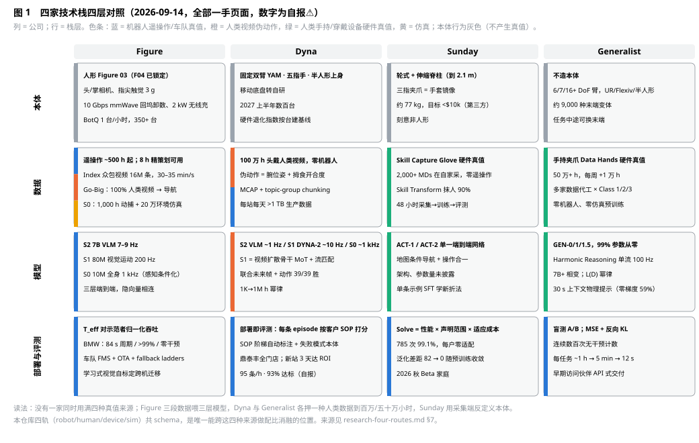

# Figure / Dyna / Sunday / Generalist 四家技术路线精读（2026-09-14）

> 抓取说明：本文全部主张来自四家官网一手页面，2026-09-14 用 curl 直抓（WebFetch 对四站均被拦截）：Figure 17 篇（figure.ai/news 全部技术类文章，2025-02-20 至 2026-08-25）、Generalist 10 篇（generalistai.com/blog 全部，2025-06-17 至 2026-08-19）、Sunday 4 篇（sunday.ai/blog 全部 + /technology）、Dyna 6 篇（dyna.co/research 全部，2025-06-24 至 2026-08-27）。第三方数字只在一手页缺失时补充并标 ⚠️。Dyna 的 DYNA-2 模型与基础设施已在 [research-dyna-comparison.md](research-dyna-comparison.md) 精读，本文对 Dyna 只补它的产品化页面与 DYNA-1 系列的两篇短文，其余引用该文。所有性能数字均为公司自报，无独立复现；新增登记 governance D-25–D-27。

## 0. 一句话结论

四家在"人类是数据源"上已完全趋同，在**人类数据怎么变成动作真值**上分成三种做法，在**模型分不分层**上分成两派，在**评测标准**上正在从"成功率"转向"声明范围 + 适应成本"的可比口径：

| | Figure | Dyna | Sunday | Generalist |
|---|---|---|---|---|
| 本体 | 人形（Figure 03，F04 已锁定设计） | 固定双臂 YAM / 五指手 / 半人形上身，2027 上半年数百台 | 轮式 + 伸缩脊柱 + 三指夹爪（Memo，非人形） | 不造本体；6/7/16+ DoF 臂，UR/Flexiv/半人形 |
| 预训练主语料 | Index 众包第一视角视频（手机为主，头戴为辅），30–35 min/s 入库 | 100 万 h 头戴人类视频，零机器人 | 2,000+ 名 Memory Developer 戴手套采的传感化人类数据，零遥操作 | 50 万+ h 手持夹爪（Data Hands）人类数据，零机器人、零仿真 |
| 动作真值 | 遥操作（机器人轨）；人类视频提取 head & hand tracks | 视频 3D 手姿 → 腕位姿 + 拇食开合度（伪动作） | 手套硬件真值（与 Memo 手同几何）+ Skill Transform 抹人 | 手持夹爪硬件真值（位姿 + 开合） |
| 模型 | S2 7B VLM（7–9 Hz）→ S1 80M 视觉运动（200 Hz）→ S0 10M 全身（1 kHz）三层 | DYNA-VLM / DYNA-2 WAM（视频扩散骨干 MoT，流匹配）/ System 0 | ACT-1/ACT-2，单一端到端网络，地图条件导航 + 操作，架构未披露 | GEN-0/1/1.5，99% 参数从零训练，Harmonic Reasoning 单流，7B+ 相变，100 Hz |
| 分层 vs 统一 | 三层，各自时标 | 四层栈（VLM / WAM / S0 / 硬件） | 单模型（导航 + 操作合一） | 明确反对 S1/S2 分层 |
| 新任务上线成本 | 8 h 精策划 → 可用；10→60 h 仍线性 | ≤10 h 后训练；~10 min 拧瓶盖；1 h 微调 ~100%（DYNA-1 base） | 单条示例 SFT 可教会可泛化的新折法；零每户适配 | ~1 h 机器人数据 99%；3–12 s 演示零梯度 59%；10 步 5 min 83% |
| 评测口径 | T_eff 归一化吞吐；BMW KPI（84 s 周期、>99%、零干预） | "部署即评测"：每条生产 episode 按客户 SOP 自动打标 | "Solve" = 性能 × 声明范围 × 适应成本，785 次 99.1% | 盲测 A/B；MSE + 反向 KL；连续数百次无干预计数 |
| 数据基础设施亮点 | 10 Gbps mmWave 回坞卸数；五阶段策展；学习式视觉自标定跨机迁移 | MCAP + topic-group chunking；Airflow 入湖；环形缓冲触发固化；SOP 阶梯自动标注；硬件退化指数 | 48 小时迭代周期；任务专属评分 + 多轮 QA；高质量子采样 vs 均匀子采样消融 | O(10K) 核处理、专线上行、6.85 年经验/训练日；任务向量分析定位数据缺口 |
| 开放度 | 无权重无数据；Index App 公开 | 无权重无 API | 无权重；Beta 家庭 | 早期访问伙伴可用 GEN-1 |

对本仓库最重要的三条新结论：① **Sunday 给出了"泛化差距随预训练规模收敛"的可复用度量**（域内 − 域外成功率，0% 预训练时 82 点，100% 时 0 点），且证明高质量子采样在同算力下把 12.5% 数据的成功率从 43.8% 抬到 75.6%——这是策展价值第一次被厂商量化；② **Dyna 的"部署即评测"把评测做成了数据基础设施**（SOP 分步自动标注 + 失败模式本体 + 硬件退化指数），与本仓库 D5 录制器和 L3 语义审计直接对应；③ **Figure 的学习式视觉自标定**（从机载视觉估计末端 6D 位姿）是车队跨机迁移的关键工程件，本仓库 robot 轨标定规范应加这一项。

---

## 1. Figure：人形本体 + 三层时标 + 众包视频

### 1.1 时间线（全部一手）

| 日期 | 里程碑 | 技术要点 |
|---|---|---|
| 2025-02-20 | Helix | S2 7B 开源开放权重 VLM（7–9 Hz）+ S1 80M cross-attention encoder-decoder（200 Hz，35-DoF 上半身）；~500 h 多机多操作员遥操作；事后反推指令自动标注；训练时给 S1/S2 输入加与部署延迟匹配的时间偏移；双嵌入式 GPU 各跑一系统 |
| 2025-02-26 | Helix Logistics | S1 加隐式立体视觉（双相机特征在多尺度立体网络中合并后再分词，token 数不变）、多尺度特征；**学习式视觉本体感知**（从机载视觉估末端 6D 位姿，在线自标定）实现单机数据训练的策略跨多机部署；Sport Mode（动作块线性重采样到 0.8T，200 Hz 执行，最高 +50%）；**8 h 精策划数据出可用策略**，策划后 1/3 数据吞吐 +40%；保留"环境随机性导致的纠正行为"、剔除操作员失误 |
| 2025-03-25 | RL 行走 | 仿真 RL，数千并行本体，域随机化 + kHz 力矩闭环，零样本上 Figure 02 车队；奖励含人类步态参考 |
| 2025-06-07 | Scaling Helix | 10/20/40/60 h 消融：6.84 → 4.31 s/件（+58% 吞吐），条码 88.2 → 94.4%，"仍在低数据区"；视觉记忆模块、状态历史窗口、力反馈入观测、decoder 头 +50% 参数；模块消融各去一个瓶颈（单目停顿 → 立体解深度 → 记忆消冗余动作 → 力/历史消停顿）；人机交接用"少量随机穿插的示范"实现视觉条件化 |
| 2025-08-12 / 09-03 | 叠毛巾 / 装洗碗机 | "同架构、只换数据"，无显式物体表征 |
| 2025-09-18 | Project Go-Big | Brookfield 10 万+ 住宅单元采第一视角视频；**100% 人类视频训练出语言 → SE(2) 速度的导航**，零机器人数据；单一网络同时输出操作与导航 |
| 2025-10-09 | Figure 03 | 相机帧率 2×、延迟 1/4、视野 +60%；掌心相机；自研指尖触觉 3 g；**10 Gbps mmWave 回坞卸数（TB 级/班次间隙）**；2 kW 足底无线充电；BotQ 12,000 台/年，四年 10 万台；执行器 2× 速度 |
| 2025-11-19 | BMW 收官 | Figure 02 11 个月，10 h 班次周一至周五，9 万+ 零件、1,250+ h、3 万+ 台 X3；KPI 三项：周期 84 s（装载 37 s）、放置 >99%/班、干预 0/班；5 mm 公差 2 s 内；前臂是最高故障点 → F03 腕部电子重构 |
| 2026-01-27 | Helix 02 | **S0 10M 参数 1 kHz 全身控制器**，>1,000 h 关节级重定向人体动捕 + 20 万并行环境仿真 RL，替换 109,504 行 C++；S1 "全传感器入、全关节出"（头/掌相机 + 指尖触觉 + 全身本体感知 → 腿/躯干/头/臂/腕/指）；4 分钟 61 个动作洗碗机任务；药片、5 ml 注射器、金属件分拣 |
| 2026-03-09 / 05-08 | 客厅 / 卧室 | 双人形共享同一权重、无通信、无中央规划，靠视觉读伙伴意图整理床铺；脚踩垃圾桶踏板、髋关闭抽屉 |
| 2026-04-29 | 产能爬坡 | 350+ 台 F03，1 台/天 → 1 台/小时（<120 天 24×）；150+ 联网工位 MES；末端首检良率 >80%，电池线 99.3%，9,000+ 执行器 10+ SKU；每台 80+ 项功能测试 + 数千次全身 burn-in；车队管理系统 + OTA + 现场服务系统 + 故障诊断分钟级定位 + "fallback ladders"；**S0 接入感知**：头部 RGB 经立体模型提升为 3D 表征输入 S0，仿真 RL 零样本上真机爬楼梯 |
| 2026-08-25 | Index | 详见 [research-figure.md](research-figure.md) §3.1；关键新句："此前尝试购买数据，供应商无法达到吞吐、多样性与质量门槛，于是自建"；"内部泛化结果已在验证这一论点，细节稍后分享"。第三方 ⚠️：2026-09-04 周活 69,943、入库 35 min/s |

### 1.2 路线判读

1. **分层是为时标，不是为模块化**。Figure 三层的分割线全是控制频率（7–9 Hz / 200 Hz / 1 kHz），并且每层都是端到端学习的，层间用连续隐向量而非符号接口，S1 梯度回传到 S2。这与 Generalist 反对的"System 1/2 分层"不是同一件事：Figure 的分层保留了端到端联合优化，Generalist 反对的是"VLM 慢思考 + 单独动作头"。
2. **数据策略是三段式叠加**：遥操作（对齐层，8–60 h/任务，质量优先）+ 人类视频（预训练层，Go-Big → Index）+ 仿真 + 动捕（S0 全身层）。三段数据分别喂三层模型，这正是本仓库四轨设计（robot / human / device / sim）的样板，只是 Figure 没有 device 轨。
3. **人类视频的直接迁移结果目前只公开了导航**（SE(2) 速度命令）。操作层面的人类视频迁移结果，Figure 说"稍后分享"。因此 Index 的 1,600 万视频对操作的价值，截至 2026-09-14 仍是论点而非证据（与 Dyna-2 的 39 任务离线评测形成对照）。
4. **工程护城河在车队闭环**：10 Gbps 回坞卸数、视觉自标定跨机迁移、fallback ladders、MES/FMS/OTA。这些没有一项是模型创新，但决定了 350+ 台机器人的数据能否回流成可训练的数据。

### 1.3 未披露项（⚠️）

遥操作硬件方案；S2 具体骨干；相机数量与分辨率；存储格式与时间对齐方案；Index 头戴设备规格；人类视频到操作的迁移结果；Figure 04 规格。

---

## 2. Dyna：RM 自举 → 世界-动作模型 → 部署即评测

DYNA-2 的架构、100 万小时 scaling、消融与 MCAP 基础设施见 [research-dyna-comparison.md](research-dyna-comparison.md) §2，本节只补三篇未精读的一手页。

### 2.1 DYNA-1 系列两篇短文（2025-10 / 2025-11）

- **DYNA-1i（2025-10）**：VLA 在训练环境外退化是 DYNA-1 的主要问题；DYNA-1i 用**仅数十小时、全部在办公室采的后训练数据**，在门厅 / 停车场 / CoRL 展厅零样本保持性能：30 分钟连续叠衣，已见环境 22 件、未见 20 件，均约 40 件/h。官方自认"通常需要数十到数百个环境的数据"，DYNA-1i 靠"建模与采集技术"降低了环境覆盖要求（未披露是什么技术）。
- **DYNA-1 预训练更新（2025-11）**：新 base 无后训练即可在未见环境叠衣、分拣包裹；**1 小时示范数据微调到约 100%**（叠杯、切芹菜、做早餐、铺桌垫）。这是 Dyna 转向 DYNA-2 之前的最后一个 VLA 结果，与 Generalist "1 h → 99%" 同量级、同期。

### 2.2 《Not Just a Model, But a Product》（2026-08-27）：把评测做成基础设施

这是四家里唯一一篇把**部署后的数据基础设施**写透的文章，对本仓库 L7 闭环层和 D5 车队录制器的价值最高：

| 主题 | 一手内容 | 对本仓库 |
|---|---|---|
| 商业里程碑 | 鼎泰丰（Din Tai Fung）从试点扩到全部门店与中央厨房；酒店/物流/数据中心在推；2027 上半年车队达数百台；新站点从部署到达 ROI 门槛最短 3 天 | R-20 飞轮反证的另一面：飞轮不自加速，但基础设施可以让每次部署更快 |
| 从 DYNA-1 到 DYNA-2 的产品指标 | 需求 1,500 条/18 h 班次；DYNA-1 约 35 条/h、75% 达标 → 480/天；DYNA-2 **95 条/h、93% 达标 → 1,590/天**（2.7×） | 与研究页 46 → 87% 是同一站点两种口径，登记 D-26 |
| 可操控性（steerability） | 叠好的餐巾要按指令放进 10 个几乎视觉相同的堆位；"几乎每个商业可行任务都需要某种指令跟随"，语言跟随因此在路线图上提前；解法是进预训练而非按仓位训模型 | 本仓库 L3 分层标注的子任务级指令要能表达空间槽位（"第 3 堆"），eval-protocol 应有"视觉相似目标的指令区分"探针 |
| 部署即评测 | 一小时实验室评测抓不到"两百次失败一次、一周内退化、这台好那台差"；每条生产 episode 按客户 SOP 定义打分；车队每天 >1 TB 原始数据（相机流、状态、控制指令、应用事件、硬件遥测 + 对齐时序） | eval-protocol §3 加"生产连续评测"档；data-platform 容量模型按 1 TB/天/站点校核 |
| 录制器 | 固定大小内存环形窗口持续记录；系统或操作员触发告警/诊断时把窗口连同事前事后一段**提升为可回放 episode**落盘；先本地后异步上传，上游校验后才删本地 | 与 capture-devices-design D5 "触发式固化"完全同构——第二家独立验证，D5 设计可升为"已验证" |
| SOP 阶梯自动标注 | 自动标注系统把每条 episode 切成 SOP 步骤（哪一步、起止、成败、失败模式），渲染成"阶梯图"（宽度 = 步骤耗时，底部 = 成败与失败模式）；人工只看新任务本体、罕见/模糊结果、低置信、疑似回归与抽样质检切片，纠错回灌标注器；标签使 episode 可按站点/机器人/硬件状态/检查点查询，并回答"当前数据配比是否有足够该行为样本" | curation §3.2 子任务分割 + §4.1 分层标注的合体，且多了**失败模式本体**与**按标签查询数据配比**——本仓库 L3 应显式产出 `failure_mode` 字段并进配比统计 |
| 案例 | 某站点吞吐下滑，日志无异常；自动标签定位到 SOP 第 1 步"抓单张餐巾"的 missed grab 翻倍；根因是**夹爪磨损**——"磨损夹爪和坏策略在 episode 里看起来一样" | 数据侧的失败归因需要硬件状态字段；robot 轨 EpisodeMeta 应带 `hardware_health` 引用 |
| 硬件退化指数 | 关节电流、轨迹跟踪误差 + 相机可见的物理结果，对每台机器人建随时间基线；定期标定与退化检查作参考；当天标出故障，提前排服务 | robot-track-teleop §6 回流与 runtime §4 加"退化指数"作为回流元数据；这是 sim-real gap 探针（eval §5）的车队版 |
| 训练取用 | "问题变成策展而非体量：几小时对的数据胜过更多错的数据"，维度 = 任务步骤 / 结果 / 失败模式 / 质量 / 站点 / 硬件状态 / 检查点；生产经验开始反哺**预训练配比**而不只后训练 | 对 CLAUDE.md 决策 6 的第三方佐证；配方（configs/mixtures）应支持按失败模式切片 |

### 2.3 路线判读

Dyna 是四家里**唯一公开承认自测 99.4% 与客户质检 46% 之间鸿沟**并用基础设施去填的公司。它的技术路线不是"VLA → WAM"一条线，而是三条并行：模型（RM 自举 → WAM）、数据（H5 → MCAP → 百万小时）、评测（实验室 → 生产）。本仓库把评测协议放在 M2 而不是 M3，与之一致。

---

## 3. Sunday：手套定义机器人 + 单模型 + Solve 标准

### 3.1 一手要点（ACT-1 2025-11-19，ACT-2 预览 2026-07-17，Series B 2026-03-12，技术页）

**数据机制**
- 核心命题："解决数据问题必须先解决具身失配"——把机器人形态对齐到人体，人类数据才能直接训机器人。Skill Capture Glove 与 Memo 的手"完全相同的几何与传感器布局"，"人戴手套能做的，机器人就能做"。
- Skill Transform：对齐运动学与视觉观测、抹除人体特征（身高、臂长、人手外观），手套数据 → 机器人数据成功率 90%。
- 采集员 Memory Developers（MDs）在自家而非仓库采集；"任务专属评分 + 多轮 QA，只从最高质量数据学"；技术页宣称 **48 小时迭代周期**（采集 → 训练 → 评测）；第三方 ⚠️：2,000+ MDs、手套 $200–400、约 1,000 万条轨迹。
- 手套本体集成广角相机 + USB-C（见 [research-sunday.md](research-sunday.md) §1）；官方未披露触觉 / 力传感是否记录。

**ACT-1（零机器人数据）**
- 单一端到端模型同时做**地图条件导航 + 长程操作**：训练时以环境 3D 地图为条件，学会"读地图"而非记房子，新家给地图即可导航。
- Table-to-Dishwasher：33 种独特、68 次灵巧交互，21 种物体，导航 130+ 英尺；6 个未见 Airbnb 零样本；叠袜、拉浓缩咖啡（空中压粉、整机身力矩锁把手）。
- 动作粒度"从毫米级操作到米级导航"，与 Figure "四个数量级"同一主张。

**ACT-2 预览（关键定量，全部自报）**
- **泛化差距 = 域内成功率 − 域外成功率**，同一后训练流程在不同预训练规模上重跑，每点 50 次评测：

| 预训练规模 | 域内 | 域外 | 差距 |
|---|---|---|---|
| 0% | 96% | 14% | 82 |
| 12% | 100% | 90% | 10 |
| 25% | 100% | 92% | 8 |
| 50% | 100% | 96% | 4 |
| 100% | 100% | 100% | 0 |

- **数据质量消融**（同数据量同算力）：高质量子采样 12.5% → 75.6%、25% → 87.9%、50% → 92.3%；均匀子采样 12.5% → 43.8%、25% → 53.6%、50% → 64.1%；旗舰 100% → 99.1%；验证损失与成功率强相关（0.0738 → 0.0653），"给了在跑昂贵真机评测前改数据配比的实用信号"。
- **单条示例教新行为**：同一预训练模型四份拷贝各用一条不同折法的示范做简单 SFT，在未见衣物上全部执行了新折法。
- **Solve 标准**：性能（成功、质量、速度）× 声明范围（衣物 9 类 XXS–8XL，未见房间、床与光照，篮中/堆中/地上任意起始态）× 适应成本（**每户为零**：无本地数据、无示范、无后训练，同一检查点）。785 次自主尝试 99.1%±0.3%，778 次成功；两轮独立标注，评分表事前固定；质量 4.72/5、98.3% ≥4 星；中位 2 min 13 s；最差类是衬衫 94.7%（轻薄、几何线索少）。
- 涌现：地上衣物回收、儿童干扰与对抗扰动下继续、8XL 与婴儿衣的工作范围靠移动底盘与脊柱扩展。
- 同一 base 在学吸尘、整理玩具、拉链、裤子翻面、做咖啡，尚未按 Solve 评测。
- Series B：工程 3×、研究 4×、数据运营 5× 扩编；"最快模型迭代环"；"数据护城河，同时受益于公开世界模型与 VLM 进步"（暗示 ACT 可能用了公开骨干，未确认）。

### 3.2 路线判读

1. **Sunday 是"采集端定义本体"的极端案例**：先做 100 版手套，再让机器人的手镜像手套，非人形轮式底盘也是为家庭工作范围与成本服务。代价是任务集受三指夹爪限制；收益是手套数据 100% 有硬件真值且与本体零几何差。
2. **它是四家里唯一把策展价值量化的**：高质量子采样在 12.5% 数据上比均匀多 32 个点，这比 Figure "1/3 数据 +40% 吞吐"更系统。也是唯一把"泛化差距"当成一条随规模收敛的曲线来报告的。
3. **Solve 标准对本仓库 eval-protocol 直接可用**：评测声明必须同时写范围与适应成本，否则 99.1% 不可比。
4. **未披露**：模型架构、参数量、是否用 VLM/世界模型骨干、数据小时数、传感器套件、Skill Transform 的方法。

---

## 4. Generalist：从零训练的单流模型 + 手持夹爪数据引擎

### 4.1 一手要点（10 篇博客，2025-06-17 至 2026-08-19）

**数据引擎**
- 2025-06 研究预览：端到端像素 → 100 Hz 动作；跨具身（Flexiv Rizon 4 七轴、UR5 六轴），紧固件任务对 UR5 零数据。
- GEN-0（2025-11-04）：**27 万 h**，每周 +1 万 h 且加速；数千采集设备与机器人遍布上千家庭/仓库/工厂；O(10K) 核持续处理、数十 PB 压缩、自铺专线上行、多云合同、自建上传机；数据加载"每训练日 6.85 年经验"；内部 t-SNE 语言嵌入检索工具（GEN-1.5 时可检索 1,891,392 个场景）。
- 数据来自**多家"数据代工"（data foundry）伙伴**，按 Class 1（任务专属）/ Class 2（中间）/ Class 3（"做任何事"）分类；8 种预训练集在 10 个长程任务集上对照，指标 = 验证 MSE + **反向 KL**（单位方差高斯混合蒙特卡洛估计，衡量模式寻求）；低 MSE + 低反向 KL → SFT 更好，高 MSE + 低反向 KL → 分布更多模态、利于后训练 RL；"多种采集策略并行才能持续 A/B 哪种数据最提升预训练"。
- 物理常识文（2026-01-29，Andy Zeng）：**遥操作破坏感知-动作闭环**（延迟、无触觉、不自然界面把人推向 System 2 慢思考，轨迹僵硬；事后加速会造成观测动力学与反应不匹配，"物体不会掉得两倍快"）；手持设备有力反馈，几分钟后操作员"停止思考开始反应"，数据里保留了反射、微修正与实时恢复。
- 千手文（2026-07-23）：**约 9,000 种末端执行器变体**（改装双指夹爪、现成工具、打印件、商用启发的新形态）；任务向量分析 ΔW = W_ft − W_0 按传感处理 / harmonic reasoning / 执行三块分解，末端微调改变 2.5%–11.4% 相对参数范数（电动螺丝刀 > 夹子；打蛋器主要动传感处理权重，因为要感知细钢丝）→ **"这直接指向数据干预：多采细而视觉稀疏的工具"**；任务中途换末端，模型识别新工具并换策略。

**模型**
- GEN-0：Harmonic Reasoning，异步连续时间的感知流与动作流 token 协同训练，"不依赖 System1-System2 架构或推理时引导"；**骨化相变**：1B 无法吸收、6B 开始受益、7B+ 后训练只需数千步，已到 10B+；**幂律 L(D) = (D_c/D)^α** 可回答"到某误差需多少预训练数据"；真机 A/B：仅 5.6 h（1%）任务数据后训练时预训练越多越好，最高 99% 需大预训练 + 550+ h 任务数据；预训练与后训练数据由不同人在不同环境采，无重叠。
- GEN-1（2026-04-02）："**约 99% 参数从零训练**"，"不是 VLM 拴动作头，也不只是世界模型"；预训练 50 万 h **无机器人数据**（适配新任务时同时首次适配该本体）；每任务约 1 h；三任务 99% vs GEN-0 64% vs 无预训练 19%；折箱 12.1 s vs π0/GEN-0 ~34 s（2.8×）；含"从经验学习（RL）"、多模态人类引导、新推理技术、自研 paged attention 做实时推理；"GEN-1 更准确地说是一个系统"；自认不是所有任务都到 99%；"对齐"一节承认涌现行为可能是负债，需可操控。
- 《Beyond World Models & VLAs》（2026-04-07，Pete Florence）：拒绝 VLA / 世界模型标签；"数据够多时从零训练总是赢"；VLM 预训练是机器人数据不足时的"拐杖"；目标驱动（"1 h 机器人数据 99%+"）而非方法驱动。
- GEN-1.5（2026-08-19）：**30 秒上下文**的视频记忆 + 传感 + 语言 + 本体感知 → 100 Hz；连续预训练 8 个月三阶段；**物理提示**：3–12 s 单条示范入上下文零梯度，10 任务 59%±10%；10 步梯度 5 min（~50 条）83%±9%；1 步 1 min 66.5%；10 步改变权重 <0.15%；无元学习、无辅助目标、随机采样连续时间跨度、预训练无仿真数据；提示可来自**仿真**（零仿真预训练）、来自**人在机器人相机前用自己的手示范**、可**拼接两条提示**成连续行为；工具即兴（香蕉当刷子、簸箕铲块）；微调步数越少即兴越强。

### 4.2 路线判读

1. **Generalist 是"数据决定论"的最纯形态**：不造本体、不用仿真、不用 VLM 骨干、不分层，一切押在手持夹爪数据的规模与质量上；其四篇"观点文"都在论证同一件事——有足够多的物理交互数据，其他都是拐杖。
2. **它把数据配比科学化到了可运营**：多家代工伙伴 × 三类数据 × 两个离线指标（MSE、反向 KL）× 任务向量按子系统分解 → "该多采什么"变成可回答的问题。这正是本仓库 configs/mixtures 版本化配方 + 缩放消融切分器要做的事。
3. **GEN-1.5 的物理提示改变了数据的消费形态**：策展好的短片段既是训练素材也是运行时输入；跨来源提示（仿真 / 人手 / 机器人）都能用，意味着数据集层需要按任务 embedding 检索的秒级切片库。
4. **未披露**：参数量、算力、设备照片与规格、数据代工伙伴身份、后训练 RL 方法、评测任务数与次数（GEN-1 "三任务"、GEN-1.5 "10 任务"）。

---

## 5. 横向对比

### 5.1 技术栈四层

*图 1　四家技术栈四层对照：本体 / 数据 / 模型 / 部署评测。填色表示该层由谁提供动作真值（蓝 = 机器人遥操作，橙 = 人类视频伪动作，绿 = 人类手持或穿戴设备硬件真值，黄 = 仿真）。*

### 5.2 分歧点

| 维度 | 分歧 | 谁在哪边 | 证据强度 |
|---|---|---|---|
| 动作真值来源 | 硬件记录 vs 视觉伪动作 | Generalist、Sunday 硬件；Dyna 伪动作；Figure 两者都用（遥操作 + head & hand tracks） | 各家只有自家曲线，无交叉实验；Dyna 自认伪动作缺手指/力/触觉 |
| 本体 | 人形 vs 非人形 | Figure 人形（人类视频"视角与运动学相同"论）；Sunday 明确非人形；Dyna 固定双臂起步；Generalist 不选边 | Figure 的人形优势论目前只有导航迁移证据 |
| 模型分层 | 时标分层 vs 单流 | Figure 三层、Dyna 四层栈；Generalist 单流并公开反对分层；Sunday 单模型 | Generalist 的 100 Hz 单流与 Figure 的 200 Hz S1 都达到了商用速度，无法判优 |
| 骨干来源 | VLM 初始化 vs 从零 | Figure S2 用开源 VLM，Dyna-1 用 Qwen3-VL-4B；Generalist 99% 从零；Dyna-2 视频扩散骨干（来源未披露）；Sunday 未披露 | Generalist "从零总是赢"只有自家数据支撑 |
| 训练目标 | 纯动作 vs 联合未来帧 | Dyna-2 联合（39/39 胜）；Generalist 明确不叫世界模型但"结合了两者的想法"；Figure、Sunday 未披露 | 见 U-37 |
| 仿真的角色 | 全身控制层 vs 不用 | Figure S0 全仿真 RL；Generalist 预训练零仿真但仿真可作提示；Dyna、Sunday 未提 | — |
| 部署形态 | 自有车队 vs 卖模型 | Figure、Sunday、Dyna 自有本体 + 车队；Generalist 早期访问 API 式 | — |

### 5.3 收敛点

1. **人类是主要数据源，机器人数据是对齐层**：四家全部。每任务的机器人数据量级：Figure 8–60 h、Dyna ≤10 h / 1 h、Generalist 1 h → 5 min → 12 s、Sunday 单条示例。这条线正在以每年一个数量级的速度下降。
2. **质量 > 数量已被四家分别量化**：Figure 1/3 数据 +40% 吞吐；Sunday 高质量子采样 +32 点；Generalist "质量与多样性比体量重要"（8 种预训练集消融）；Dyna "几小时对的胜过更多错的"。
3. **评测在向"可比声明"演进**：Figure T_eff（对示范者归一化）、BMW 三 KPI；Sunday Solve（范围 + 适应成本）；Dyna "部署即评测"（客户 SOP 连续打分）；Generalist 盲测 A/B + 连续无干预计数。共同点是**不再报裸成功率**。
4. **涌现即兴与恢复被三家独立观察**：Figure（拍平快递袋、多抓退回）、Generalist（香蕉当刷、双手拧盖）、Sunday（地上衣物回收）。三家都把它归因于预训练规模，也都（Generalist 明说）承认它是对齐问题。
5. **车队数据基础设施是共同短板补齐方向**：Figure 10 Gbps 回坞 + FMS/OTA；Dyna 环形缓冲 + SOP 自动标注 + 退化指数；Sunday 48 h 环；Generalist 专线 + 多云。

### 5.4 与本仓库四轨的映射

| 本仓库轨 | Figure | Dyna | Sunday | Generalist |
|---|---|---|---|---|
| robot（遥操作/车队） | 主对齐层 + 车队回流 | 后训练 + 生产回流 | 实验室后训练 hill-climb + Beta 车队 | 每任务 ~1 h |
| human（头戴/手机视频） | Index（预训练主轴） | 100 万 h（预训练主轴） | — | — |
| device（手持/穿戴真值） | — | — | 手套（预训练主轴） | Data Hands（预训练主轴） |
| sim | S0 全身 RL、S1 视觉骨干预训练 | — | — | 仅作提示来源 |

没有一家同时用满四轨；本仓库四轨共 schema 的设计让配比消融可以跨这四种路线做，这是开源管线相对四家的结构性差异点（战略文档 §1.1 控制点 2）。

---

## 6. 对本仓库的启示与回写清单

1. **eval-protocol 加"泛化差距"指标与"Solve 声明"格式**：域内 − 域外成功率随预训练规模的曲线（Sunday 表）作为 §1.3 规模侧指标；真机协议模板 §3 强制声明范围与适应成本三项，否则不得报成功率。
2. **curation 高质量子采样消融进验收钩子**：§7 消融钩子加"同数据量下高质量子集 vs 均匀子集"的对照，目标是复现 Sunday 的 +32 点量级（自家数据）；这也是 L3 估值排序器（D-14）的直接验证方式。
3. **L3 输出加失败模式本体**：curation §4.1 分层标注在子任务级之下加 `failure_mode` 枚举（missed grab / imprecise fold / double grab / drop / …，按任务 SOP 定义），并让配比统计可按失败模式切片（Dyna）。
4. **D5 录制器设计升为"两家验证"**：Dyna 的环形缓冲 + 触发固化与 capture-devices-design D5 同构，governance 相应条目改状态；同时 robot 轨 EpisodeMeta 加 `hardware_health`（退化指数引用），否则"磨损夹爪与坏策略不可分"。
5. **robot 轨标定规范加"学习式视觉自标定"**：Figure 从机载视觉估末端 6D 位姿实现跨机迁移；robot-track-teleop §1/§6 的车队跨机一致性应把它列为 H1 项，数据侧需要每条 episode 记录标定版本（已有 `device_id` + 标定引用）。
6. **指令跟随的空间槽位探针**：Dyna 的"10 个视觉相同堆位"说明子任务级指令要能表达空间槽位；eval-protocol §3 加一条"视觉相似目标的指令区分"任务。
7. **数据配比的离线指标加反向 KL**：Generalist 用 MSE + 反向 KL 判断一批数据对 SFT 还是 RL 更有用；eval-protocol §1.1 数据侧指标加反向 KL（模式寻求度），与 D-15 配比裁决配合。
8. **任务向量分析作为"该多采什么"的工具**：Generalist 按子系统分解 ΔW 定位数据缺口（细工具 → 传感处理权重）；本仓库消融切分器可在 M3 加"微调权重位移按模块分解"报告，属训练层，登记为 U-38 待定。
9. **诚实性**：四家全部自报；Sunday ACT-2 是自评标注（两轮独立）、Figure 内部泛化结果未公开、Generalist 评测任务数少、Dyna 单站点。登记 D-25（Sunday ACT-2 泛化差距与质量消融）、D-26（Dyna 生产指标 95/h、93%、3 天部署）、D-27（Figure 产能与 BMW 数字）。

**回写清单**：governance（D-25–D-27、U-38、R-12 下三条待办，本次登记）；eval-protocol §1/§3（泛化差距、Solve 声明、槽位探针、反向 KL，待 M2）；curation §4.1/§7（失败模式本体、高质量子采样消融，待 M2）；robot-track-teleop §1/§6 + data-format-contract（视觉自标定、`hardware_health`，待契约 0.3）；capture-devices-design D5 状态（本次改）；research-figure / research-sunday / research-generalist-dora 各加"一手补充（2026-09-14）"指回本文。

## 7. 来源（全部 2026-09-14 curl 一手）

- Figure：figure.ai/news/{helix, helix-logistics, reinforcement-learning-walking, scaling-helix-logistics, helix-learns-to-fold-laundry, helix-loads-the-dishwasher, project-go-big, introducing-figure-03, production-at-bmw, helix-02, helix-02-living-room-tidy, ramping-figure-03-production, helix-02-bedroom-tidy, introducing-index}，figure.ai/index-app。第三方：Humanoids Daily 2026-09 周活 69,943 / 35 min/s ⚠️。
- Dyna：dyna.co/research/{dyna-1, open-world-dexterity, pre-training, dyna-2, dyna-2-infrastructure, scaling-customer-deployments}（后三篇日期 2026-08-15/17/27）。
- Sunday：sunday.ai/blog/{no-robot-data, series-b, act-2-preview}，sunday.ai/technology。第三方：humanoid.guide / Humanoids Daily（Memo 77 kg、2.1 m 脊柱、手套 $200–400）⚠️。
- Generalist：generalistai.com/blog/{research-preview, the-robots-build-now-too, gen-0, physical-commonsense, the-real-breakthrough-behind-our-gtc-demo, gen-1, beyond-world-models, accelerating-the-next-phase-of-physical-ai, towards-machines-with-a-thousand-hands, gen-1.5}。
