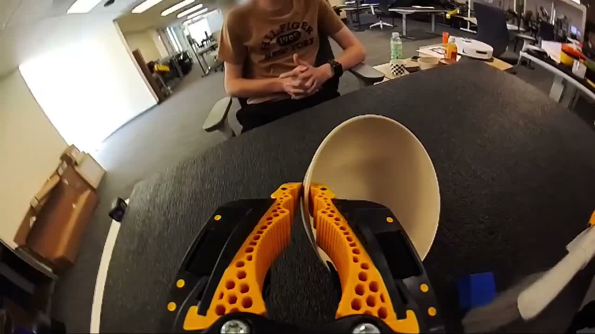
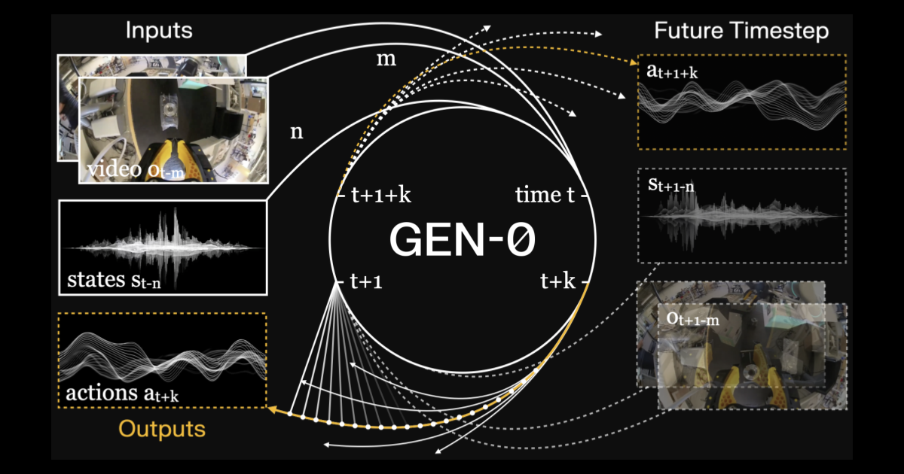
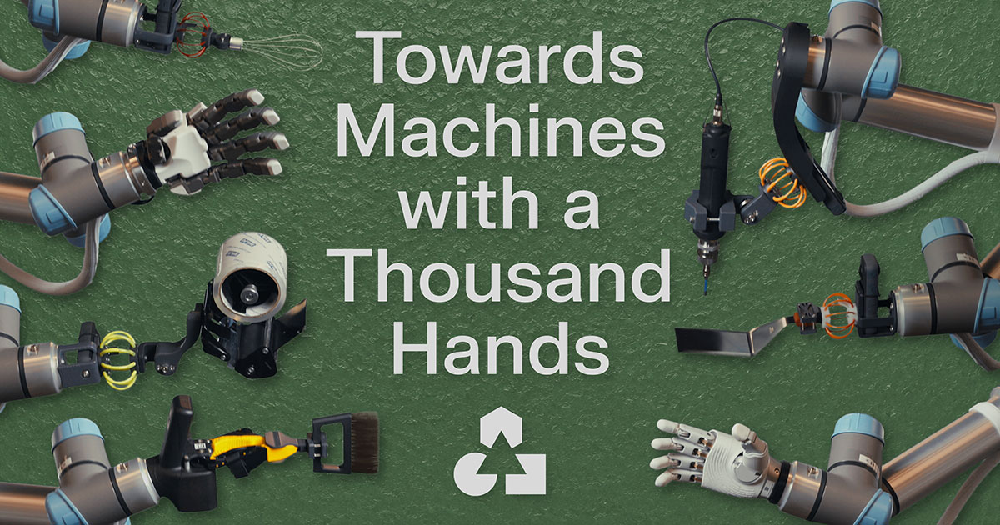

# Generalist AI 与 dora-rs 调研（2026-08-29）

> 注：generalistai.com 官网抓取受限，GEN-0 博客成功抓取一次，GEN-1 细节来自第三方报道（SiliconANGLE / The Robot Report）。Generalist 的性能数字基本为公司自报，独立基准有限——引用时注意。

## 1. Generalist AI（GEN-0 / GEN-1 / GEN-1.5）

背景（知乎解读 + SiliconANGLE，第三方）：2026-06 完成 4 亿美元融资（Radical Ventures 领投，英伟达、Bezos Expeditions 参投；李飞飞、林斌、袁征个人参投），投后 20 亿美元，新一轮洽谈中估值 30 亿；核心团队 Pete Florence、Andy Zeng（前 Google DeepMind 机器人）、Andrew Barry（前波士顿动力）。GEN-1.5 演示视频（[YouTube](https://www.youtube.com/watch?v=1cllCVK-9lo)）被中文社区称为"机器人的 GPT-3 时刻"。

### 数据采集：介于"纯视频"与"遥操作"之间的第三条路

*目前最接近 Data Hands 的公开影像：GEN-1.5 博客人类演示视频抽帧（human_brush_block_bowl.mp4，第一视角鱼眼）——双手各持一只黄黑配色、点阵镂空结构的手持夹爪，与 UMI 开源设计同构（图源：[generalistai.com/blog/gen-1.5](https://generalistai.com/blog/gen-1.5)）。Generalist 从未发布设备的产品照/规格。*

*GEN-0 官方架构图（图源：[generalistai.com/blog/gen-0](https://generalistai.com/blog/gen-0)）。注意左上视频输入帧：第一视角画面中可见**橙色软指双夹爪**——与 UMI 开源设计高度相似，佐证 Data Hands 的 UMI 谱系（Generalist 从未正式公布设备照片）。另见输入输出均为连续时间波形流（Harmonic Reasoning 的"感知流+动作流"）。*

*GEN-1"千手"博客题图：同一模型适配打蛋器/灵巧手/电钻/毛刷/铲刀等末端执行器（图源：[generalistai.com](https://generalistai.com/blog/towards-machines-with-a-thousand-hands)）*

- **Data Hands**：自研穿戴式手套/手持设备，"把人手变成机器人式夹爪"来采集真实世界演示——**动作是记录下来的，不是视觉估计的**（对比我们 Index 复刻方案的纯视觉伪标签路线）。
- 规模：GEN-0 发布时（2025-11）**27 万小时**真实操作轨迹，**每周新增 1 万小时且在加速**；GEN-1 时代（2026-04）**50 万+ 小时、约 9,000 种末端执行器/工具变体**（官方 2026-07-23 博客口径为 end-effector variations，此前误记为任务变体，2026-09-09 更正）。采集覆盖上千个家庭/仓库/工作场所，服装、制造、物流、汽车、电子多行业。
- 谱系：Data Hands 是 UMI（Universal Manipulation Interface，[arXiv:2402.10329](https://arxiv.org/abs/2402.10329)）路线的产业化——手持夹爪 + 鱼眼相机 + SLAM 位姿 + 机械开合记录，单 MP4 落盘。开源生态已验证其规模化：RDT2（[arXiv:2602.03310](https://arxiv.org/pdf/2602.03310)）用 UMI 数据探索零样本跨具身泛化。
- 基础设施自报数字：数十 PB 压缩数据、O(10K) 核持续多模态处理、数据加载吞吐"每训练日 6.85 年真实操作经验"、专用互联网线路。

### 训练与 scaling law（GEN-0 博客一手信息）

- **Harmonic Reasoning**：异步连续时间的感知流与动作流 token 协同训练——明确**反对 System1/System2 分层**（"物理世界不会暂停"），与 Helix/GR00T 路线相对立。是"统一流 vs 分层"之争的重要一极。
- **模型规模相变**（机器人领域首次报告的"骨化/ossification"）：1B 模型无法吸收复杂多样的感觉运动数据；6B 开始受益于预训练；7B+ 可吸收大规模机器人预训练数据、下游只需数千步后训练；已扩展到 10B+。
- **数据 scaling law**：验证误差随预训练数据量呈幂律 L(D) = (D_c/D)^α_D，可反推"达到目标误差需要多少预训练数据"——把采集预算决策公式化（比 Figure 的 10/20/40/60h 消融更进一步）。
- 数据分类学：Class 1 任务专属 / Class 2 中间 / Class 3 "做任何事"开放数据，混合预训练。
- 评测：验证集 MSE + 反向 KL（单位方差高斯混合的蒙特卡洛估计，衡量模式寻求行为）+ 真机盲测 A/B。
- GEN-1（第三方报道）：5 个月内任务成功率 64%→99%；末端执行器适配（五指手到专用工具）微调仅产生 2.5%–11.4% 相对参数变化。

### GEN-1 一手补充（2026-09-14）

GEN-1 博客（2026-04-02）抓取成功：预训练 50 万小时**无机器人数据**、从零训练；每任务约 1 小时机器人数据；三任务平均成功率 99%（GEN-0 64%、无预训练 19%）；折箱 12.1 s vs GEN-0/π0 ~34 s；自认"不是所有任务都能到这个成功率"；参数量/算力未披露。与 Dyna、Skild 的横向对比见 [research-dyna-comparison.md](research-dyna-comparison.md)。登记 D-24。

### GEN-1.5（2026-08 前后，官方博客一手信息）

- **物理提示（Physical Prompting）= 机器人的上下文学习**：3–12 秒演示直接放进上下文，**零梯度更新**即可执行新任务（10 任务平均成功率 59%±10%）；加 10 步梯度微调（每任务 1–5 分钟数据 / 约 10–50 条演示）→ 83%±9%；单步梯度（1 分钟数据）→ 66.5%。官方明确"未针对上下文学习显式训练"，属涌现能力；10 步微调后权重变化 <0.15%。
- 模型 I/O：视频（30 秒记忆）+ 传感器 + 语言 + 本体感知 → **100 Hz 动作轨迹**。
- 训练配方极简：8 个月连续预训练，连续时间跨度随机采样，唯一监督目标=下一动作预测；无元学习循环、无辅助目标；**预训练不含仿真数据**。
- 采集设备表述："手持夹爪对（成对，双手）"+ 机器人自身数据——进一步确认 UMI 式双手持夹爪路线。
- 演示组合：两个独立任务的演示可链接为连续行为；支持仿真→真实零样本、人类→机器人上下文迁移。
- 限制（官方自认）：评测任务为"短视野、简单任务"（开罐、拉拉链、刷块入碗等原子操作）；数据总量、参数量、质控细节未披露。

### 对本仓库的启示

1. **增设 device 轨（Data Hands/UMI 式）作为第四条采集轨**：动作真值靠硬件记录而非视觉估计，绕开伪标签精度问题；UMI 开源方案 BOM 低、单 MP4 落盘、已被 RDT2 等验证可规模化。与 Index 式头戴视频轨互补：UMI 轨有动作但只有夹爪视角/受限任务形态，头戴轨覆盖全任务但无动作。
2. **scaling law 拟合进验证模块**：消融切分器输出按 L(D) 幂律拟合，边际收益曲线直接指挥采集预算。
3. **架构对冲**：Harmonic Reasoning 统一流路线 vs Helix 分层路线尚无定论，数据 schema 保持两者都能消费（分层采样率本身不预设消费架构）。
4. **诚实性提醒**：64%→99% 等数字均为公司自报，无独立基准。
5. **演示即提示（GEN-1.5 后的新数据消费形态）**：策展好的短演示片段不再只是训练素材，还是运行时的"物理提示"。数据集层应支持**按任务 embedding 检索、秒级切片、可拖放组合的演示库**（demo library）；验证体系增加"少样本适应"维度（1 条演示零梯度 / 1–5 分钟数据 10 步微调后的成功率），与全量微调指标并列。

### 全部博客一手补充（2026-09-14）

generalistai.com/blog 全部 10 篇（2025-06-17 研究预览至 2026-08-19 GEN-1.5）已 curl 直抓、归档于 [sources/generalist/](sources/MANIFEST.md)，精读见 [research-four-routes.md](research-four-routes.md) §4。本文此前缺的一手事实：GEN-0 预训练数据来自**多家数据代工伙伴**，按 Class 1/2/3 分类做 8 种预训练集消融，指标为验证 MSE + 反向 KL（低 MSE + 低反向 KL 利于 SFT，高 MSE + 低反向 KL 利于 RL 后训练）；真机 A/B 用 5.6 h（1%）任务数据后训练，最高 99% 需大预训练 + 550+ h 任务数据；GEN-1「约 99% 参数从零训练」、含 RL 与自研 paged attention、「更准确地说是一个系统」；《Beyond World Models & VLAs》明确 VLM 预训练是数据不足时的「拐杖」；物理常识文论证遥操作破坏感知-动作闭环、事后加速造成动力学不匹配；千手文给出末端微调 ΔW 按传感/推理/执行分解（2.5%–11.4%）并据此决定采集干预（U-38）；GEN-1.5 上下文 30 s、8 个月连续预训练三阶段、10 步微调改变权重 <0.15%、提示可来自仿真或人手、两条提示可拼接。

## 2. dora-rs（DORA：Dataflow-Oriented Robotic Architecture）

- 数据流中间件：应用建模为有向图（节点=独立进程），**Apache Arrow 零拷贝**通信，低延迟，Python/Rust/C/C++ 多语言。[github.com/dora-rs](https://github.com/dora-rs)
- 数据采集能力：官方数据采集节点**直接输出 LeRobot 数据集格式**；覆盖遥操作与自主两种模式；采关节角/速度/位姿等；dora-mujoco 节点支持 Franka/UR5e/SO-101 等（YAML 配置 + URDF）。GSoC 2025 有专门的"机器人数据采集改进"项目。
- 社区关联：LeRobot AV1 编码博客作者即 dora-rs 团队（haixuantao），两个生态深度互通。

### 对本仓库的启示

recorder 层的候选中间件：dora 做**传输/运行时**（多传感器节点图、Arrow 零拷贝、直出 LeRobot 格式），MCAP 仍做**落盘存储**——两者不冲突（dora 节点写 MCAP sink）。M1 实现 recorder 时先评估 dora-rs 节点方案 vs 自写采集循环，评估维度：多相机同步精度、落盘可靠性、嵌入式资源占用。
