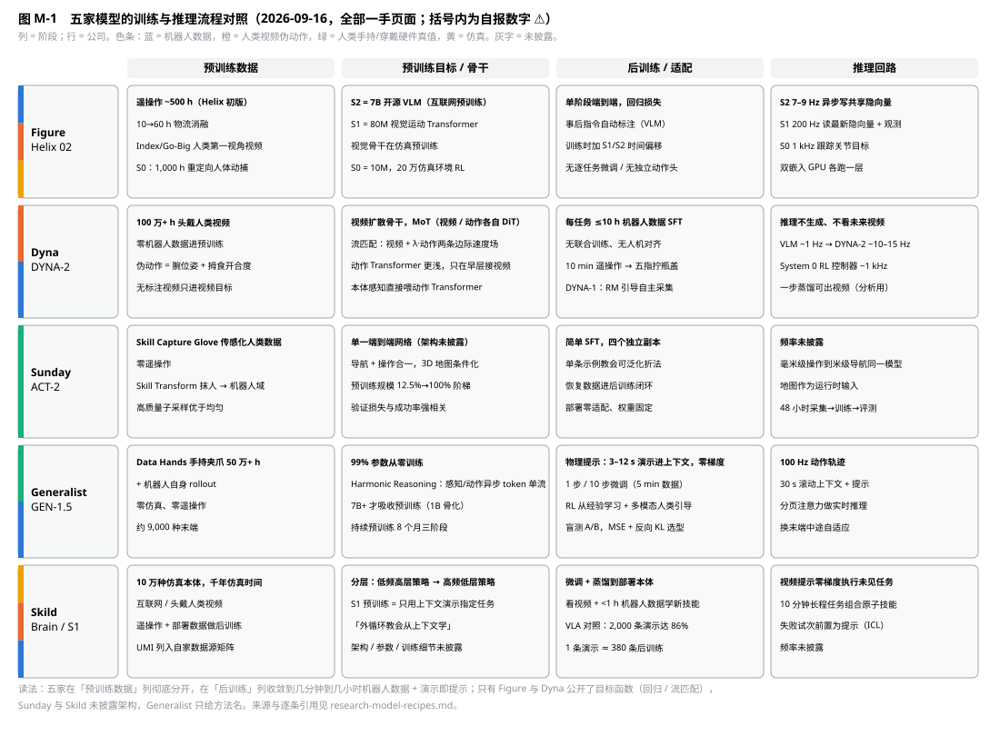

# 五家模型实现对比：VLA（Figure Helix）、WAM（Dyna）、端到端单网络（Sunday ACT）、从零训练单流（Generalist GEN）、omni-bodied 具身大脑（Skild）

> 2026-09-16。范围：架构、训练流程（数据 → 预训练 → 后训练 → 推理）、目标函数、关键原理。只写一手页面写明的内容，方法名后面没有细节的就标"未披露"。引用键指向 [sources/MANIFEST.md](sources/MANIFEST.md) 的归档文本；数字均为公司自报 ⚠️（governance D-22–D-27 已登记）。模型 I/O 表见 [research-four-routes.md](research-four-routes.md) §5.2，本文不重复。

[F:helix]: sources/figure/helix.txt
[F:helix-02]: sources/figure/helix-02.txt
[F:helix-logistics]: sources/figure/helix-logistics.txt
[F:scaling-helix]: sources/figure/scaling-helix-logistics.txt
[F:ramping]: sources/figure/ramping-figure-03-production.txt
[F:go-big]: sources/figure/project-go-big.txt
[F:rl-walking]: sources/figure/reinforcement-learning-walking.txt
[D:dyna-2]: sources/dyna/dyna-2.txt
[D:dyna-1]: sources/dyna/dyna-1.txt
[D:dyna-1i]: sources/dyna/open-world-dexterity.txt
[D:pre-training]: sources/dyna/pre-training.txt
[D:home]: sources/dyna/home.txt
[D:infra]: sources/dyna/dyna-2-infrastructure.txt
[S:act-1]: sources/sunday/no-robot-data.txt
[S:act-2]: sources/sunday/act-2-preview.txt
[S:technology]: sources/sunday/technology.txt
[G:gen-0]: sources/generalist/gen-0.txt
[G:gen-1]: sources/generalist/gen-1.txt
[G:gen-1.5]: sources/generalist/gen-1.5.txt
[G:beyond]: sources/generalist/beyond-world-models.txt
[G:hands]: sources/generalist/towards-machines-with-a-thousand-hands.txt
[K:brain]: sources/skild/building-the-general-purpose-robotic-brain.txt
[K:s1]: sources/skild/s1.txt
[K:watching]: sources/skild/learning-by-watching.txt
[K:omni]: sources/skild/omni-bodied.txt
[K:one-policy]: sources/skild/one-policy-all-scenarios.txt

## 0. 一句话结论

五家在**预训练数据**上彻底分开（遥操作 + 人类视频 / 纯头戴视频 / 手套 / 手持夹爪 / 仿真 + 视频），在**后训练**上收敛到"每任务几分钟到几小时机器人数据，或干脆把一段演示放进上下文"；在**目标函数**上只有 Figure（回归损失）和 Dyna（流匹配，视频 + 动作两条边际速度场共用主干）写了公式，Generalist 只给了方法名（Harmonic Reasoning、从零训练），Sunday 与 Skild 的架构完全未披露。**关键原理的分歧在三处**：骨干从哪来（VLM 初始化 vs 从零 vs 视频扩散）、层级还是单流（Figure 三层各自时标、Dyna 三层、Skild 两层；Generalist 与 Sunday 单网络）、任务怎么指定（语言 / 演示提示 / 3D 地图）。

*图 M-1　五家模型的训练与推理流程。色条为预训练数据的真值来源。*

| | Figure Helix 02 | Dyna DYNA-2 | Sunday ACT-2 | Generalist GEN-1.5 | Skild Brain / S1 |
|---|---|---|---|---|---|
| 自称标签 | VLA [F:helix] | World-Action Model [D:dyna-2] | "robot foundation model" [S:act-1] | 拒绝 VLA / 世界模型标签，"native foundation model for physical interaction" [G:beyond] | omni-bodied brain [K:brain] |
| 骨干来源 | S2 = 7B 开源 VLM；S1 视觉骨干仿真预训练 [F:helix] | 视频扩散骨干 + MoT；DYNA-1 从 Qwen3-VL-4B 初始化 [D:dyna-2] | 未披露 | 99% 参数从零 [G:beyond] | 未披露 |
| 参数量 | S2 7B / S1 80M / S0 10M [F:helix][F:helix-02] | 未披露 | 未披露 | 1B/6B/7B+ 消融，7B+ 才吸收预训练 [G:gen-0] | 未披露 |
| 层级与频率 | S2 7–9 Hz → S1 200 Hz → S0 1 kHz [F:helix][F:helix-02] | VLM ~1 Hz → DYNA-2 ~10–15 Hz → System 0 ~1 kHz [D:home] | 单网络，频率未披露 | 单流 100 Hz [G:gen-1.5] | 低频高层 → 高频低层，频率未披露 [K:brain] |
| 预训练数据 | ~500 h 遥操作（初版）；人类第一视角视频（Go-Big / Index）；S0 1,000 h 人体动捕 [F:helix][F:go-big][F:helix-02] | 100 万+ h 头戴人类视频，零机器人数据 [D:dyna-2] | 手套传感化人类数据，零遥操作 [S:act-1][S:act-2] | 50 万+ h 手持夹爪数据 + 机器人 rollout，零仿真 [G:gen-1][G:gen-1.5] | 10 万种仿真本体 + 互联网/头戴视频 [K:omni][K:brain] |
| 目标函数 | 端到端回归损失，S1 梯度经隐向量回传 S2 [F:helix]；S0 RL [F:helix-02] | 流匹配；视频损失 + λ·动作损失共用主干 [D:dyna-2] | 未披露；验证损失与成功率强相关 [S:act-2] | 未披露；用 MSE + 反向 KL 评估预训练模型 [G:gen-0] | 未披露；S1"预训练即元学习外循环" [K:s1] |
| 后训练 | 单阶段，无逐任务微调、无独立动作头 [F:helix]；物流版 10→60 h 消融 [F:scaling-helix] | 每任务 ≤10 h 机器人 SFT，无联合训练、无人机对齐 [D:dyna-2] | 简单 SFT，单条示例可泛化 [S:act-2] | 零梯度物理提示 / 1–10 步微调 / RL [G:gen-1.5][G:gen-1] | 微调 + 蒸馏到部署本体；看视频 + <1 h 机器人数据 [K:brain][K:watching] |
| 任务指定 | 语言（事后自动标注训练）[F:helix] | 语言（文本只影响视频 token）[D:dyna-2] | 3D 地图 + （语言未出现）[S:act-1] | 语言 + 物理提示（演示片段）[G:gen-1.5] | 视频演示提示 [K:s1] |
| 推理时的世界模型 | 无 | 不生成、不看未来视频 [D:dyna-2] | 无 | 无（"不是世界模型"）[G:beyond] | 未披露 |

## 1. Figure Helix 02：三层各自时标的 VLA

**架构** [F:helix][F:helix-02]
- S2：7B 开源开放权重 VLM，互联网预训练，输入单目图像 + 机器人状态（腕位姿、指位）+ 语言，输出一个连续隐向量；7–9 Hz。
- S1：80M 交叉注意力 encoder-decoder Transformer，全卷积多尺度视觉骨干（在仿真预训练）；隐向量投影进 S1 token 空间，与视觉特征沿序列维拼接；输出 200 Hz 连续动作（腕位姿、手指屈伸/外展、躯干与头朝向）。Helix 02 起改为输出全身关节目标。物流版加入隐式立体（两路相机特征先在多尺度立体网络合并再 token 化，token 数不变）、短时视觉记忆、状态历史窗口、力反馈入状态、解码器头参数 +50% [F:helix-logistics][F:scaling-helix]。
- S0：10M 全身控制器，输入全身关节状态 + 基座运动（后加头相机经立体模型的 3D 表征），输出关节级执行器指令，1 kHz [F:helix-02][F:ramping]。

**训练流程**
1. 数据：~500 h 高质量遥操作（初版，"<5% 于既有 VLA 数据集"）[F:helix]；物流版按 10/20/40/60 h 消融，8 h 精策划数据可用，⅓ 数据 +40% 吞吐 [F:helix-logistics][F:scaling-helix]。
2. 标注：自动标注 VLM 看机载相机分段视频，提示 "What instruction would you have given the robot to get the action seen in this video?" 生成事后指令 [F:helix]。
3. 目标：端到端回归损失，从像素与文本到连续动作；梯度从 S1 经隐向量回传到 S2，联合优化；**训练时在 S1 与 S2 输入之间加时间偏移**，偏移量按部署时两者的推理延迟差校准 [F:helix]。
4. 单阶段、单套权重，无逐任务微调、无独立动作头 [F:helix]。
5. S0：1,000 h 关节级重定向人体动作数据 + 20 万并行仿真环境 RL + 域随机化，零样本上真机；感知条件化版本在随机地形上端到端 RL 训练，楼梯零样本迁移 [F:helix-02][F:ramping]。步行控制器同源：GPU 物理仿真、几小时模拟数年、高频扭矩反馈 [F:rl-walking]。
6. Go-Big：100% 人类第一视角视频训练，输出 SE(2) 速度指令，零机器人数据 [F:go-big]。

**推理回路** [F:helix]：S2 作为异步后台进程消费最新观测和语言，持续更新共享内存中的隐向量；S1 作为独立实时进程 200 Hz 读最新观测 + 最新隐向量；两层各跑一块嵌入式 GPU；部署时的时序错位刻意与训练偏移一致。Sport Mode：把 [T × action_dim] 动作块线性重采样到 0.8T 再按 200 Hz 执行，+20% 常用 [F:helix-logistics]。跨机迁移靠学习式视觉本体感知（从机载视觉估计末端 6D 位姿）[F:helix-logistics]。

**关键原理**：用异步双时标把"想得慢"和"动得快"解耦，且训练时显式模拟部署延迟；直接回归连续动作，不做动作 token 化；每层可独立换数据独立迭代 [F:helix]。

## 2. Dyna DYNA-2：视频扩散骨干上的世界-动作模型

**架构** [D:dyna-2]（用户指定原文 §2 "Model architecture and training objectives"）
- 单一生成模型，可联合或分别去噪未来视频与未来动作，建立在视频扩散骨干上。
- Mixture of Transformers：视频、动作各自 token 化、各有一套 DiT 层，层间用注意力互通；本体感知 token 化后直接喂动作 Transformer。
- 掩码规则：视频 token 因果掩码；动作 token 双向自注意力（无因果掩码），并关注观测上下文的视频 token；视频 token 交叉注意文本 token，**文本不直接影响动作 token**。
- 动作 Transformer 深度更浅，只在早层接入视频流：早期探针发现 DiT 类视频扩散的时间推理能力主要在早层，这样做显著降低实时推理延迟且不损性能。

**目标函数** [D:dyna-2]：流匹配。条件 c = 过去帧 + 本体感知 + 语言指令，z = 未来视频隐变量，a = 未来动作块；两种模态沿直线路径加噪 z_t = t·z + (1−t)·ε_z，a_t = t·a + (1−t)·ε_a；网络预测去噪速度。缩放律用的变体是视频 + 动作共训：

L_co = E‖u_vid(z_t; t, c) − (z − ε_z)‖² + λ·E‖u_act(a_t; t, c) − (a − ε_a)‖²

两条边际速度场共用主干；因为 u_act 从不取 z_t 为参数，视频损失只塑造共享表征，**推理时策略既不生成也不关注预测的未来视频**，保持反应式。

**训练流程**
1. 数据：100 万+ h 头戴第一视角人类视频（数据伙伴 + 自采），清洗 / 手姿提取 / 验证 / 过滤管线；通过手姿质量门的 episode 带 3D 手姿轨迹，由此得到伪动作 = 腕位姿 + 拇食开合度连续抓取信号；不通过的只进视频目标 [D:dyna-2]。
2. 预训练消融：固定动作标注量（5k / 50k / 100k h）比较 action-only、joint、video co-training 三种配方，joint 每个规模都胜 action-only，video co-training 是唯一随动作数据增长而持续改善的；固定 50k h 动作标注、只加无标注视频 0 → 50k h 也持续改善 [D:dyna-2]。
3. 缩放律：1k → 1M h 嵌套子集，训练与评测配置相同；held-out 人类数据与**从未见过的机器人数据**上零样本预测指标都随规模改善，10k → 100k h 出现拐点 [D:dyna-2]。
4. 后训练：14 个内部任务各 ≤10 h 机器人数据，配方对所有任务相同，"robot data only, no co-training, no human-robot alignment"；1M h 预训练在 9/14 任务最强；拧瓶盖只用约 10 min 遥操作 [D:dyna-2]。
5. 与 VLA 对照：DYNA-1 是同样 MoT 架构的动作预测模型，从 Qwen3-VL-4B 初始化；相同预训练/后训练数据与超参、三个预训练 checkpoint 各起一次后训练；早期 DYNA-2 胜 65% / DYNA-1 胜 29% / 平 6%，且整套实验流程原本是为 VLA 调的 [D:dyna-2]。作者点名 VLA 为保留语义要多阶段训练和冻结骨干，"brittle and slow" [D:dyna-2]。
6. 一步视频生成：回归损失一步只能给条件均值而模糊；分布匹配蒸馏的教师分数在单步处未训练（概率流路径每步约 4°、累计 58° 弯曲）；他们做了一步蒸馏管线出多视角一致的未来（分析与展示用）[D:dyna-2]。

**其他组件**：DYNA-1 的"基础奖励模型"估计任务进度，用于自主探索、错误恢复、自主采集高质量数据 [D:dyna-1]；DYNA-1i 只用"几十小时办公室后训练数据" [D:dyna-1i]；预训练基座 1 h 微调到高可靠 [D:pre-training]；部署栈 VLM ~1 Hz → DYNA-2 ~10–15 Hz → System 0 RL 控制器 ~1 kHz [D:home]。训练基础设施：多相机各自采样率，训练样本"几帧视频 + 长窗口本体感知"的非对称读取，MCAP 按 topic 组 time-major 写 [D:infra]。

**关键原理**：预训练主语料是人类视频，机器人数据只在后训练；世界建模是让跨具身缩放律出现的必要目标，但只作训练期正则，不进推理；动作流浅、早接视频，为实时性服务。

## 3. Sunday ACT-1 / ACT-2：零机器人数据的端到端单网络

**架构**：未披露参数量与骨干。一手可知：单一端到端模型同时做长程操作与地图条件导航，动作粒度从毫米级到米级 [S:act-1]；训练时以环境 3D 地图为条件，大量多样化户型让模型学会"读图"而非记忆房子，新家给地图即可导航 [S:act-1]。

**训练流程**
1. 数据：Skill Capture Glove 采集的"传感化人类数据"，硬件真值，零遥操作 [S:act-1][S:act-2]；Skill Transform 把手套数据转成"看起来和动起来都像机器人自己生成的"训练集，转换成功率 90% [S:act-1]。
2. 预训练：ACT-2 在高质量高多样性数据上预训练；用 12.5% / 25% / 50% / 100% 阶梯做规模消融，**高质量子采样在同数据量同算力下显著优于均匀子采样**（12.5% 时 75.6% 对 43.8%）；验证损失与成功率强相关，用作调配比的离线信号 [S:act-2]。
3. 后训练：简单 SFT，四个独立副本；单条示例教会新折法并泛化到未见衣物；恢复数据进后训练闭环，48 小时采集→训练→评测 [S:act-2][S:technology]。
4. 评测口径：泛化差距（域内 − 域外）随预训练规模 82 → 0；Solve = 性能 × 声明范围 × 适应成本；部署权重固定、零适配 [S:act-2]。

**关键原理**：把具身差距在硬件层消掉（手套 = 手），软件层只剩 Skill Transform 抹人和归一化；预训练越强，后训练每条样本杠杆越大 [S:act-2]。

## 4. Generalist GEN-0 → GEN-1.5：从零训练的单流模型

**架构** [G:gen-0][G:beyond][G:gen-1.5]
- 约 99% 参数从零训练，"不是 VLM 上焊动作头，也不只是世界模型"；理由是数据够多时从零总是赢，并且完全掌控架构、训练与推理的每个决定 [G:beyond]。
- Harmonic Reasoning：感知与动作 token 作为异步、连续时间的两条流在**单一流**里"和谐"交织，模型同时思考与行动，不维护显式子任务，明确"不依赖 System1-System2 架构" [G:gen-0]。
- 规模：1B 明显早期骨化，6B / 7B 更能吸收预训练；7B+ 只需几千步后训练即迁移 [G:gen-0]。
- GEN-1.5：视频输入 30 s 记忆 + 其他传感器 + 语言 + 本体感知 → 100 Hz 动作轨迹 [G:gen-1.5]。

**训练流程**
1. 数据：Data Hands 手持夹爪采集 270k → 500k+ h，每周 +1 万 h；零仿真、零遥操作；GEN-0/1 基座"不含任何机器人数据"，机器人 rollout 只在后训练 [G:gen-0][G:gen-1][G:gen-1.5]。
2. 预训练科学：模型规模与算力的缩放律；预训练数据量与后训练性能的幂律（5.6 h 后训练数据上验证）；预训练与后训练数据由不同人在不同环境采集以防重叠；用 MSE（预测误差）+ 反向 KL 挑选基座，低误差低反向 KL 适合 SFT，高误差低反向 KL 多模态、适合 RL 后训练 [G:gen-0]。
3. GEN-1 作为"系统"：训练稳定性、自定义算子、新的分页注意力做实时推理、后训练（理论 RL、多模态人类引导）、控制平滑 [G:gen-1]。
4. GEN-1.5：持续预训练 8 个月三阶段；微调步数从数百 → 数十 → 1 步（1 分钟数据）；再到零梯度：3–12 s 单条演示插入 30 s 上下文即执行，未见任务 59%，10 步微调 5 min 数据 83%；**未专门为上下文学习做架构、元学习或辅助目标**；提示可来自仿真或人手，可组合多段提示成长程任务 [G:gen-1.5]。
5. 末端：约 9,000 种末端混合训练，模型条件化于眼前的末端；任务向量分析按传感 / 推理 / 执行子系统分解微调位移 [G:hands]。

**关键原理**：数据量换架构自由；不分层、不做世界模型，靠单流连续时间 token 解决"物理不会停下来等你思考"；上下文学习是规模的涌现，不是设计出来的。

## 5. Skild Brain / S1：仿真 + 视频预训练的分层 omni-bodied 大脑

**架构** [K:brain]：分层，低频高层操作与导航策略 → 高频低层策略输出关节角与电机扭矩；训练于多种形态（含人类数据，"humans are also a form of robot"）；部署时微调并蒸馏。明确反对"VLM + <1% 机器人数据"的路线，称其缺少可行动的物理常识。

**训练流程**
1. 预训练：大规模仿真 + 互联网视频；omni-bodied 页：10 万种不同机器人身体、"千年"仿真时间训练一个控制器，测试本体全部排除在训练集外，零样本控制 [K:omni][K:brain]。
2. 后训练：目标真实数据（遥操作 + 部署）；看视频 + <1 h 机器人数据学新技能 [K:brain][K:watching]。
3. S1：在"任务只通过上下文演示指定"的 episodic 数据上预训练；元学习意义上预训练是外循环、推理时演示驱动内循环不改权重；对照实验在 1k → 100k h 过滤子集上同时训练 ICL 策略与语言条件 VLA，未见任务 66% 对 9%（100k h），1k h 时反而 VLA 53% 对 43%；L1–L5 扰动阶梯下 VLA 退化最多 3 倍；1 条上下文演示 ≈ 380 条后训练 episode，VLA 到 2,000 条达 86%。**训练方法留待后续文章** [K:s1]。
4. 运动：全身控制端到端由在线视觉 + 本体感知驱动，杂技类可盲跑 [K:one-policy]；失败试次前置为提示后第三次成功、锯掉小腿 7–8 s 自适应，都归为上下文学习 [K:omni]。

**关键原理**："规模要万亿级样本，真实世界永远不够"，所以仿真与视频做预训练；用"控制一万个身体"逼模型学策略而非记忆；预训练的唯一目的是让上下文学习出现。

## 6. 横向：五个分歧轴

| 轴 | Figure | Dyna | Sunday | Generalist | Skild | 证据强度 |
|---|---|---|---|---|---|---|
| 骨干初始化 | S2 用开源 VLM；S1/S0 自训 | 视频扩散骨干（DYNA-1 用 Qwen3-VL-4B） | 未披露 | 99% 从零 | 未披露 | Dyna 有 WAM vs VLA 对照，但实验流程为 VLA 调优 [D:dyna-2]；Generalist "从零总是赢"只引自家结果 [G:beyond] |
| 层级 vs 单流 | 三层各自时标 | 三层 | 单网络 | 单流，反对 S1/S2 | 两层 | 200 Hz S1 与 100 Hz 单流都达商用速度，无法判优 |
| 训练目标 | 回归 | 流匹配，视频 + 动作 | 未披露 | 未披露 | 未披露 | 只有两家给公式；Dyna 联合目标 39/39 胜 [D:dyna-2]，本仓库 U-37 |
| 推理时世界模型 | 无 | 无（只训练期） | 无 | 无 | 未披露 | 五家里没有一家在推理时生成未来帧 |
| 任务指定 | 语言（事后标注） | 语言（只影响视频 token） | 3D 地图 | 语言 + 物理提示 | 视频演示 | Skild 直接对照 ICL vs 语言 [K:s1]；Generalist 上下文学习为涌现 [G:gen-1.5] |
| 仿真角色 | S0 全部仿真 RL | 无 | 无 | 零仿真预训练，可作提示 | 预训练主体 | — |
| 训练时延迟建模 | 显式时间偏移 [F:helix] | 动作流浅、早接视频 [D:dyna-2] | 未披露 | 分页注意力实时推理 [G:gen-1] | 未披露 | Figure 是唯一把部署延迟写进训练数据构造的 |
| 数据质量 vs 数量 | 8 h 精策划可用，⅓ 数据 +40% | "curation rather than volume" | 高质量子采样 +32 点 | "质量与多样性重于体量" | $1 采集配 $3 质控 | 五家全部一致，来源各自独立 |

**收敛点**：后训练形态（几分钟到几小时机器人数据 + 演示即提示）、质量优先、推理时不用生成式世界模型、验证损失作为离线信号（Sunday 验证损失与成功率相关、Generalist MSE + 反向 KL、Dyna 离线 accuracy@τ 与真机一致）。

## 7. 对本仓库的启示

1. **决策 7 的"≥2 家共识"复核**：VLM 骨干 + 动作头（Figure S2、DYNA-1）和流匹配头（Dyna）仍是共识；"从零训练"只有 Generalist 一家，"上下文学习"有 Generalist 与 Skild 两家但训练方法都未披露。训练层保守路线不变；WAM 目标维持 U-37 可选分支，因为 Dyna 自己也不在推理时用它。
2. **数据层要为"训练时延迟建模"留字段**：Figure 的 S1/S2 时间偏移按部署延迟校准 [F:helix]，需要每路观测的精确时间戳与推理延迟记录；recorder 的统一 ns 时间戳（决策 3）够用，但 EpisodeMeta 应记录部署时各层推理延迟（runtime §），否则复现不了偏移量。
3. **事后指令自动标注是两家共识**（Figure 事后指令 VLM [F:helix]、Dyna SOP 步骤标注 [D:infra]），curation 五阶段的 VLM 分层标注保持"事后反推式"；Figure 的提示词可直接作为 L3 标注模板。
4. **无标注视频也有训练价值**：Dyna 固定动作标注量、只加无标注视频 0 → 50k h 仍持续改善 [D:dyna-2]。human 轨的"手姿质量门未通过"episode 不应丢弃，标 `pseudo_action=null` 保留为视频目标语料（curation：清洗是标记不是删除）。
5. **离线指标进策展验收**：Sunday 验证损失 ↔ 成功率、Generalist MSE + 反向 KL、Dyna accuracy@τ 三家各自证明离线指标可用于配比选择；eval-protocol §4 消融判定加"离线代理指标与真机相关性"一列（与 L7 代理三层同源）。
6. **演示切片作为运行时输入**：Generalist 3–12 s 与 Skild 单条视频演示都把演示当输入，且演示可来自仿真或人手 [G:gen-1.5][K:s1]；data-format-contract 的秒级切片导出应覆盖 human、device、sim 三条轨，不只 robot 轨（research-skild §5 已提）。
7. **诚实性**：五家数字全部自报；Dyna 的 WAM vs VLA 对照自认流程偏向 VLA；Skild S1 训练方法未发；Sunday 架构未发；Generalist 只有方法名。任何进入设计前置条件的都走 D 表"若不成立"分支。

## 8. 来源

一手：本文顶部 26 个引用键，对应 [sources/MANIFEST.md](sources/MANIFEST.md) 的归档文本；Dyna-2 §2 原文即用户指定的 dyna.co/dyna-2#model-architecture-and-training-objectives（归档于 sources/dyna/dyna-2.txt，2026-09-14 抓取）。相关：[research-four-routes.md](research-four-routes.md) §5.2 模型 I/O、[research-dyna-comparison.md](research-dyna-comparison.md) §2、[research-skild.md](research-skild.md) §2、[research-vla-pretraining.md](research-vla-pretraining.md)（学术界对照）。
