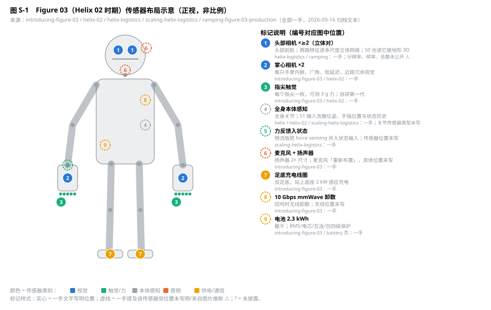
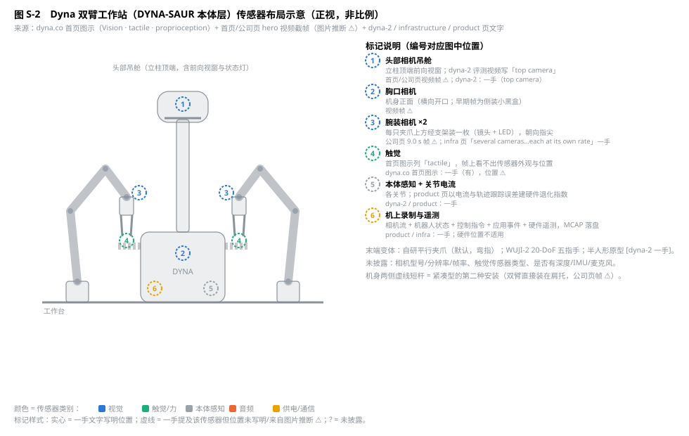
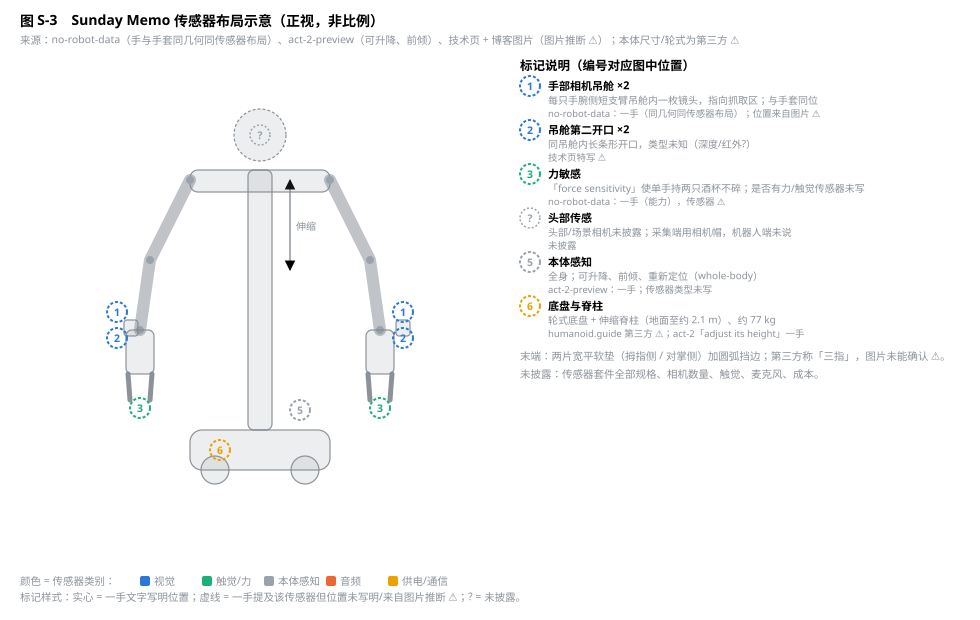
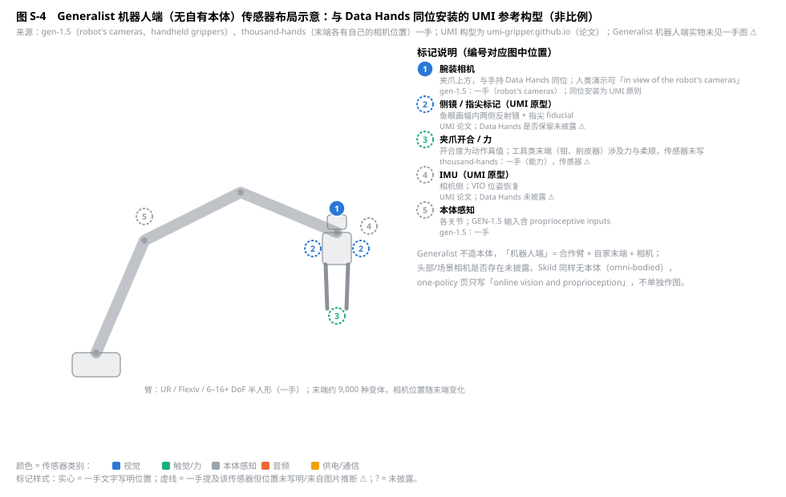

# 已调研产品机器人的本体传感器设计对照（Figure 03 / Dyna / Sunday Memo / Generalist 机器人端）

> 2026-09-16。范围：本仓库已做过一手调研且有产品本体的机器人。全部事实指向 [sources/MANIFEST.md](sources/MANIFEST.md) 的归档文本；位置信息若来自图片则标 ⚠️（图片推断），未披露即写"未披露"。Skild 无自有本体，只在 §5 带一句。采集设备（头戴、UMI、手套）的传感器见 [device-landscape.md](device-landscape.md) 与 [capture-devices-design.md](capture-devices-design.md)，本文只写机器人。

[F:figure-03]: sources/figure/introducing-figure-03.txt
[F:helix-02]: sources/figure/helix-02.txt
[F:helix]: sources/figure/helix.txt
[F:helix-logistics]: sources/figure/helix-logistics.txt
[F:scaling-helix]: sources/figure/scaling-helix-logistics.txt
[F:ramping]: sources/figure/ramping-figure-03-production.txt
[F:battery]: sources/figure/f-03-battery-development.txt
[D:home]: sources/dyna/home.txt
[D:dyna-2]: sources/dyna/dyna-2.txt
[D:infra]: sources/dyna/dyna-2-infrastructure.txt
[D:product]: sources/dyna/scaling-customer-deployments.txt
[S:act-1]: sources/sunday/no-robot-data.txt
[S:act-2]: sources/sunday/act-2-preview.txt
[S:technology]: sources/sunday/technology.txt
[G:gen-1.5]: sources/generalist/gen-1.5.txt
[G:hands]: sources/generalist/towards-machines-with-a-thousand-hands.txt
[K:one-policy]: sources/skild/one-policy-all-scenarios.txt

## 0. 一句话结论

四家里只有 Figure 把传感器套件当产品卖点写出来（头部立体相机、双掌心相机、指尖 3 g 触觉、音频、足底充电、mmWave），其余三家的一手文本只写"用了什么"不写"装在哪"；位置信息主要靠官方图片和视频帧。**三家有本体的公司都收敛到"头部相机 + 手内/腕装相机"的双视角**，触觉只有 Figure 明确到指尖、Dyna 只在图示里列了一个词、Sunday 只写"力敏感"。没有一家公开相机分辨率、帧率、总数或深度/IMU/麦克风的具体规格。

| | Figure 03 | Dyna 工作站 | Sunday Memo | Generalist 机器人端 |
|---|---|---|---|---|
| 头部/场景视觉 | 头部相机 ≥2，立体对 [F:helix-logistics][F:ramping] | 立柱顶端相机吊舱 ⚠️（dyna-2 写 "top camera" [D:dyna-2]） | 未披露 | 未披露（不造本体） |
| 躯干视觉 | 未提及 | 胸口相机 ⚠️ | 未披露 | 未披露 |
| 手内/腕装视觉 | 掌心相机 ×2，每手一枚 [F:figure-03] | 腕装相机 ×2，夹爪上方 ⚠️ | 手腕侧相机吊舱（镜头 + 第二开口）×2，与手套同位 [S:act-1] ⚠️ | 腕装相机，与 Data Hands 同位 [G:gen-1.5] |
| 触觉 / 力 | 每指尖触觉 3 g [F:figure-03][F:helix-02]；力反馈入状态 [F:scaling-helix] | 图示列 "tactile" [D:home]，位置未见 | "force sensitivity" 能力 [S:act-1]，传感器未写 | 未披露；开合度为动作真值 |
| 本体感知 | 全身关节 + 腕位姿/指位 + 状态历史 [F:helix][F:scaling-helix] | 关节状态 + 电流遥测（退化指数）[D:product] | 全身，可升降前倾 [S:act-2] | 关节 [G:gen-1.5] |
| 音频 | 麦克风 + 2× 扬声器 [F:figure-03] | 未披露 | 未披露 | 未披露 |
| 供电 / 通信 | 足底 2 kW 感应充电、10 Gbps mmWave 卸数、2.3 kWh 电池 [F:figure-03][F:battery] | 机上 MCAP 录制，每站 >1 TB/天 [D:product][D:infra] | 未披露 | 不适用 |
| 未披露的关键项 | 相机总数/分辨率/帧率、IMU、深度 | 相机规格、触觉类型、麦克风 | 除手部相机外几乎全部 | 机器人端实物、头部相机 |

## 1. Figure 03（Helix 02 时期）

*图 S-1　Figure 03 传感器布局示意（正视，非比例）。实心标记为一手文字写明位置的传感器，虚线为一手提及但位置未写明。*

| # | 传感器 | 类型 | 位置 / 数量 | 频率与用途 | 来源 |
|---|---|---|---|---|---|
| 1 | 头部相机 | RGB，立体对 | 头部；两路特征在多尺度立体网络里合并后再 token 化，token 数不增 | 视野较 F.02 +60%、帧率 2×、延迟 ¼（每相机）；S1 隐式立体；S0 也用它做地形 3D | [F:figure-03][F:helix-logistics][F:ramping] |
| 2 | 掌心相机 | 广角 RGB，低延迟 | 每只手掌内嵌 ×1，共 2 | 抓取近距冗余视觉，头相机被遮挡时保持视觉 | [F:figure-03][F:helix-02] |
| 3 | 指尖触觉 | 自研第一代力传感 | 每个指尖 ×1 | 可测 3 g 力（回形针级）；接触感知与握力调制；耐久优先 | [F:figure-03][F:helix-02] |
| 4 | 全身本体感知 | 关节状态 | 全身 | S1 输入含腕位姿、手指位置；物流版加状态历史窗口 | [F:helix][F:scaling-helix] |
| 5 | 力反馈 | 力传感（类型未写） | 未写明位置 | 物流版把 force sensing 并入状态输入，改善握力与平衡 | [F:scaling-helix] |
| 6 | 音频 | 麦克风 + 扬声器 | 扬声器 2× 尺寸、约 4× 功率；麦克风"重新布置"，位置未写 | 实时语音对话 | [F:figure-03] |
| 7 | 充电线圈 | 感应充电 | 双足底 | 站上底座 2 kW | [F:figure-03] |
| 8 | mmWave 卸数 | 无线通信 | 未写明位置 | 10 Gbps，回坞时卸 TB 级数据 | [F:figure-03] |
| 9 | 电池 | 2.3 kWh | 躯干 | 约 5 h 运行；BMS/电芯/互连/包四级保护，UN38.3 | [F:figure-03][F:battery] |

三点判读：
- **S1 的"all sensors in"是精确列举**：头相机、掌心相机、指尖触觉、全身本体感知四类 [F:helix-02]，没有 IMU、深度、麦克风进策略输入的说法。
- **立体不是深度相机**：F.03 的 3D 来自两路 RGB 的隐式立体网络 [F:helix-logistics]，S0 的地形理解也是同一套立体模型 [F:ramping]。
- **触觉进策略、力反馈进状态**是两条独立路径：触觉是 F.03 新硬件 [F:helix-02]；力反馈在 F.03 之前的物流版就以状态量形式进入 [F:scaling-helix]。相机总数、分辨率、帧率官方从未公开（[research-figure.md](research-figure.md) §5）。

## 2. Dyna 双臂工作站（DYNA-SAUR 本体层）

*图 S-2　Dyna 工作站传感器布局示意（正视，非比例）。位置几乎全部来自首页与公司页视频截帧（[research-dyna-comparison.md](research-dyna-comparison.md) §1.1），故全为虚线。*

| # | 传感器 | 类型 | 位置 / 数量 | 频率与用途 | 来源 |
|---|---|---|---|---|---|
| 1 | 头部相机吊舱 | RGB | 立柱顶端，前向视窗，侧面状态灯 ⚠️；评测视频称 "top camera" | 场景观测；训练时各相机各自采样率 | 视频帧 ⚠️；[D:dyna-2][D:infra] |
| 2 | 胸口相机 | RGB | 机身正面横向开口；早期帧为侧装小黑盒 ⚠️ | 工作面观测 | 视频帧 ⚠️ |
| 3 | 腕装相机 | RGB 模块 + LED | 每只夹爪上方经支架装一枚，朝向指尖，共 2 ⚠️ | 手内视角 | 视频帧 ⚠️；[D:infra]（several cameras） |
| 4 | 触觉 | 未写类型 | 首页图示 "Vision · tactile · proprioception"，帧上看不出 | — | [D:home] |
| 5 | 本体感知 + 电流 | 关节状态、电流遥测 | 各关节 | 电流与轨迹跟踪误差建硬件退化指数 | [D:product] |
| 6 | 机上录制 | 相机流 + 状态 + 指令 + 应用事件 + 遥测 | — | MCAP，topic 分组 time-major；每站 >1 TB/天 | [D:product][D:infra] |

末端三种：自研平行夹爪（默认；帧上为弯指细长指尖）、WUJI-2 20-DoF 五指手、半人形原型 [D:dyna-2]。两种安装方式：双臂立在桌沿独立基座，或直接装在机身两侧肩托（紧凑型）⚠️。首页图示写传感流回送 System 1（~10–15 Hz）与 System 2（~1 Hz），System 0 以 ~1 kHz 驱动本体 [D:home]。

## 3. Sunday Memo

*图 S-3　Sunday Memo 传感器布局示意（正视，非比例）。唯一有一手依据的是"手与手套同几何同传感器布局"，其余位置来自图片，头部传感未披露。*

| # | 传感器 | 类型 | 位置 / 数量 | 用途 | 来源 |
|---|---|---|---|---|---|
| 1 | 手部相机吊舱 | 镜头 ×1 | 每只手腕侧短支臂吊舱内，指向抓取区，共 2；与 Skill Capture Glove 同位 | 手内视角；手套采集数据与机器人观测同构 | [S:act-1]（同几何同传感器布局）；位置来自图片 ⚠️（[research-sunday.md](research-sunday.md) §1.1） |
| 2 | 吊舱第二开口 | 未知（深度/红外?） | 同吊舱内长条形开口 | — | 技术页特写 ⚠️ |
| 3 | 力敏感 | 未写传感器 | — | 单手持两只酒杯不碎、拧锁 portafilter 的高扭矩 | [S:act-1]（能力描述） |
| 4 | 头部传感 | 未披露 | 采集端用相机帽，机器人端未说 | — | — |
| 5 | 本体感知 | 未写类型 | 全身；可重新定位、升降、前倾 | 扩大工作范围 | [S:act-2] |
| 6 | 底盘与脊柱 | — | 轮式底盘 + 伸缩脊柱（地面至约 2.1 m），约 77 kg | — | humanoid.guide 第三方 ⚠️；"adjust its height" [S:act-2] |

Sunday 的传感器设计逻辑与其他三家相反：**先定手套能采到什么，再让机器人手复制手套的传感器布局** [S:act-1]，所以机器人端的手内相机不是为策略加的，是为了让采集数据零转换。头部/场景相机、触觉、麦克风一律未披露 [S:technology]。

## 4. Generalist 机器人端（无自有本体）

*图 S-4　Generalist 机器人端示意。Generalist 不造本体，"机器人端"= 合作臂（UR / Flexiv / 6–16+ DoF 半人形）+ 自家末端 + 相机；腕装相机与手持 Data Hands 同位是 UMI 路线的原则，Generalist 实物未见一手图 ⚠️。*

| # | 传感器 | 位置 | 依据 |
|---|---|---|---|
| 1 | 腕装相机 | 夹爪上方，与 Data Hands 同位；人类可"in view of the robot's cameras"演示，机器人当场复现 | [G:gen-1.5] 一手；同位安装为 UMI 原则（[device-landscape.md](device-landscape.md) §UMI） |
| 2 | 侧镜 / 指尖标记 | UMI 原型的鱼眼画幅内反射镜与 fiducial | UMI 论文；Data Hands 是否保留未披露 ⚠️ |
| 3 | 夹爪开合 / 力 | 开合度是动作真值；钳、削皮器等末端涉及柔顺与受控力 | [G:hands] 一手（能力），传感器未写 |
| 4 | IMU | UMI 原型相机侧，VIO 位姿 | UMI 论文；Data Hands 未披露 ⚠️ |
| 5 | 本体感知 | 各关节，GEN-1.5 输入含 proprioceptive inputs | [G:gen-1.5] |

约 9,000 种末端变体里"有些带自己的驱动方式和相机位置" [G:hands]，即相机位置随末端定义，不是随本体定义。

## 5. Skild

无自有本体（omni-bodied），one-policy 页只写全身控制"driven entirely by online vision and proprioception"，杂技类任务可"blind"只靠本体感知 [K:one-policy]。传感器布局取决于合作本体，不作图。

## 6. 对本仓库的启示

1. **相机语义槽位**：三家有本体的公司合计出现四个位置：`head`、`torso`、`wrist_l/r`（腕装）、`palm_l/r`（掌内）。data-format-contract 的相机归一化表应预留这四类，Dyna 占前三、Figure 占 head + palm、Sunday 占 wrist（吊舱在腕侧）。写回待契约 0.3（M1）。
2. **立体对而非深度相机**：Figure 用两路 RGB 做隐式立体 [F:helix-logistics]；本仓库 D2 头戴套件的"双目全局快门 + 深度可选不默认"（capture-devices-design §2）与之一致，robot 轨头部相机也应优先双目 RGB。
3. **触觉的三种状态**：Figure 指尖阵列进策略、Dyna 只列一词、Sunday 只写能力。决策 3 把 tactile 作可空模态（U-25）是对的；对齐集里触觉是否必填等 500 h 对照集，不因 Figure 一家改默认。
4. **状态里的"力"与"触觉"分开建模**：Figure 物流版的 force feedback 是状态量 [F:scaling-helix]，F.03 触觉是独立传感器 [F:helix-02]。契约里 `effort`（measured/estimated）与 `tactile` 已分列，保持。
5. **手内相机是配对采集的对齐点**：Sunday 手套与机器人手同位 [S:act-1]、Generalist Data Hands 与机器人腕相机同位 [G:gen-1.5]、Dyna 腕装相机与 UMI 同位 ⚠️。D1 触觉同构 UMI 与目标本体的腕相机安装位应在 U-04 裁决时一并固定。
6. **诚实性**：本文位置信息一半来自图片。每张图的实心/虚线/问号即可信度；任何把这些位置写进设计文档的地方都要带 ⚠️。

## 7. 来源

一手：本文顶部 17 个引用键，全部对应 [sources/MANIFEST.md](sources/MANIFEST.md) 的归档文本。图片：docs/assets/sources/dyna/（首页与公司页视频帧）、docs/assets/sources/sunday/（技术页与 ACT-1 博客图）。第三方 ⚠️：humanoid.guide（Memo 尺寸与轮式底盘）。UMI 构型：umi-gripper.github.io（论文页，见 device-landscape.md）。
