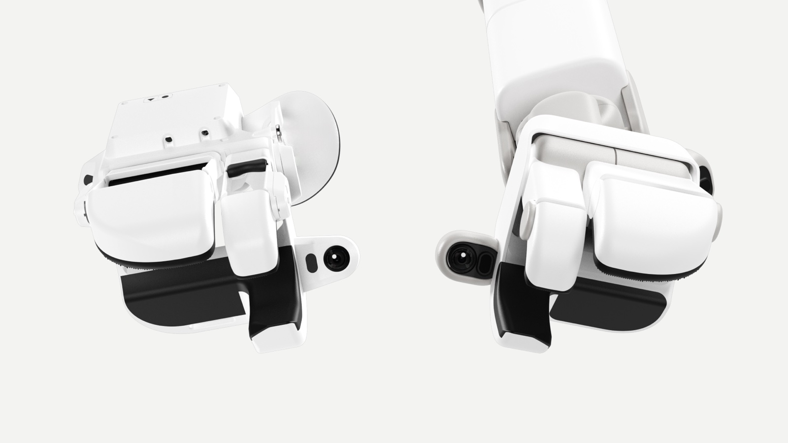
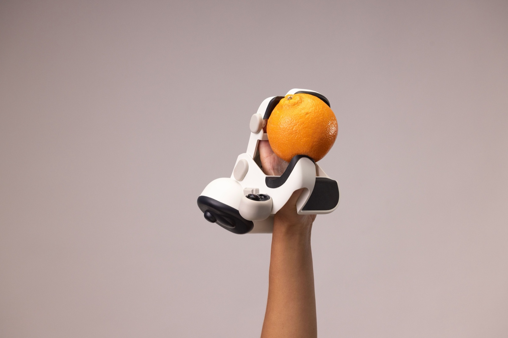
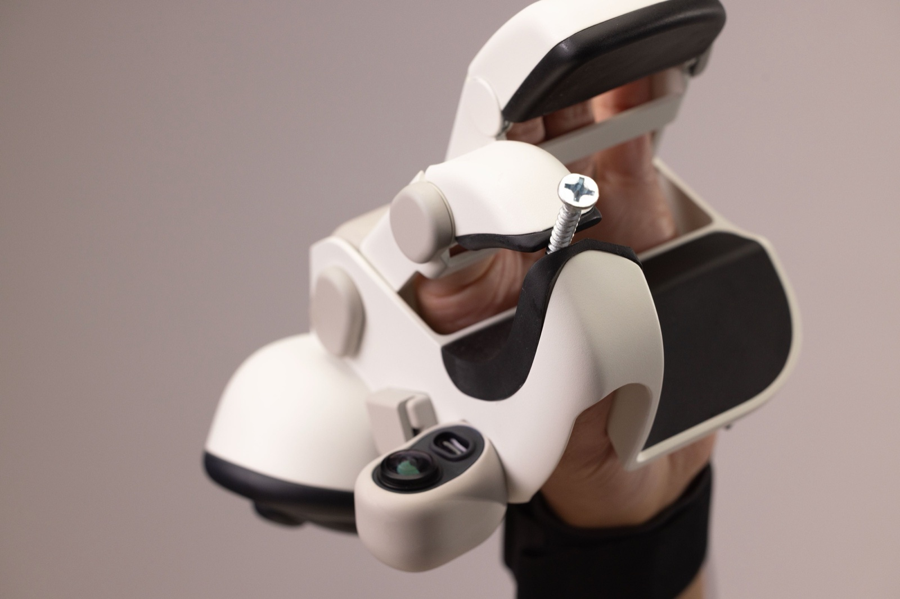

# Sunday Robotics（Memo + Skill Capture Glove）调研

> 2026-09-04。来源：官方 [ACT-1 博客](https://www.sunday.ai/journal/no-robot-data)、[技术页](https://www.sunday.ai/technology)（传感器套件、成本、数据小时数均未披露 ⚠️）、[Sacra](https://sacra.com/c/sunday/)、[Bain Capital Ventures](https://baincapitalventures.com/insight/robots-finally-at-home/)（投资方，非中立）、[humanoid.guide ACT-2](https://humanoid.guide/sunday-act-2-memo-laundry-solve/)、[Tony Zhao 推文](https://x.com/tonyzzhao/status/1991204844938621257)、[新浪科技](https://finance.sina.com.cn/tech/roll/2025-11-25/doc-infyrezv4813253.shtml)、[牛喀具身智能社区](https://i-newcar.com/index.php?a=index&aid=7321&c=View&m=home)、[GlobeNewswire 融资稿](https://www.globenewswire.com/news-release/2026/3/12/3254877/0/en/sunday-raises-165m-to-launch-first-autonomous-robots-by-thanksgiving.html)。创始人 Tony Zhao（ALOHA/ACT）与 Cheng Chi（Diffusion Policy/UMI），即 UMI 谱系的第二支产业化（第一支为 Generalist Data Hands，见 [research-generalist-dora.md](research-generalist-dora.md)）。数字为公司/投资方自报，独立验证有限。

## 0. 公司速览

- 2024 年成立，Mountain View。2025-11 出隐身，种子轮 $35M（Benchmark、Conviction）；2026-03 Series B $165M，投后 $1.15B（Coatue 领投，Bain、Fidelity、Tiger Global、Benchmark、Conviction 等跟投）；团队约 79 人（2026 年中）。
- 产品 Memo：轮式底盘 + 伸缩脊柱（触达地面到约 2.1 m）+ 双臂 + **简化三指夹爪**（取人类最常协同使用的三根手指），约 77 kg，目标售价 <$10k（原型 $6k–20k）。官方明确"非人形，且是刻意的"。2026 年 Founding Family beta，目标感恩节前交付首批自主机器人。
- 模型：ACT-1（2025-11，"Trained on Zero Robot Data"，地图条件导航 + 长程操作单一模型；Table-to-Dishwasher 演示 21 种物体、68 次灵巧交互，6 个未见 Airbnb 零样本）；ACT-2（2026-07，未见家庭叠衣 99.1%±0.3，9 类衣物 778 次）。

## 1. 采集设备：穿戴孪生夹爪手套 + 头戴广角相机帽

**Skill Capture Glove** = 穿戴式手套，复刻 Memo 三指夹爪的几何。官方原话："the glove and the robot hand share the exact same geometry and sensor layout"；"If a human can do it in the glove, the robot can also do it"。观测来自配套的**广角相机帽**（第三方描述，官方未展开）。传感器套件官方未披露。

补充（官方产品图，见 [device-landscape.md](device-landscape.md) §4）：产品特写证实**手套本体集成广角相机 + USB-C**（腕侧吊舱）——即同时具备 UMI 式近手观测（手套相机）与场景观测（相机帽）双视角；指面为拇指/对掌两片宽平软垫，人的拇指与四指分别驱动。

**在采集矩阵中的位置**：与 TwinDEX（[research-twindex.md](research-twindex.md)）同属"人穿机器人的手"的穿戴孪生路线，但落在更低的成本档位：软手套 + 简化三指夹爪，非外骨骼、非逐指灵巧手。单价 $200（Bain / humanoid.guide）或 $400（Sacra），口径不一；对比遥操作装备约 $20k，投资方称"资本效率高两个数量级"。

### 1.1 官方图片观察（2026-09-14，图片已归档，观察为本文推断）

*图 S-1　ACT-1 博客配图，页面原 caption「Skill Capture Glove (left) and Memo's hand (right)」（来源与原图哈希见 [sources/MANIFEST.md](sources/MANIFEST.md) 图片表；原文 [sources/sunday/no-robot-data.txt](sources/sunday/no-robot-data.txt)）*

 
*图 S-2 / S-3　技术页照片（无 alt/caption）：戴 Skill Capture Glove 握橙子；手套特写，捏着一枚螺钉。*

从三张官方图能看到、而官方文字没写的（均为图片观察 ⚠️，非一手文字）：
- **手套与机器人手同构**得到图像印证：左右两侧的接触面形状、黑色弹性体接触面、相机吊舱的位置与朝向一致，与原文「exact same geometry and sensor layout」相符。
- **相机装在手上而不只在头上**：腕侧有一个短支臂吊舱，含一枚镜头和一个长条形开口（第二个传感器，是否为深度/红外未知）。它指向抓取区，属「手内视角」，与 UMI 腕装鱼眼、Figure 掌心相机同一类；结合相机帽（站点 OG 图中帽檐也有镜头 + 长条开口），Sunday 的观测是**头戴 + 手内双视角**。
- **接触面形态**：可见两片宽平的软垫（拇指侧一片、对掌侧一片）加圆弧挡边；照片里人的四指并入一侧、拇指驱动另一侧，看起来更接近「两瓣宽平夹爪」，第三方所称「三指」在图上无法确认（存疑 ⚠️）。宽平接触面与原文「widening the range of objects the hand can grasp… handles and strings」一致。
- 手套本体有腕带固定、无外骨骼，与「软手套、非外骨骼」判断一致；未见触觉阵列或力传感的外露件（不能据此断定没有）。
- 同类「手持/穿戴夹爪 + 手内相机」形态见 [device-landscape.md](device-landscape.md)（UMI、Data Hands、TwinDEX 等）与 [research-skild.md](research-skild.md) §2 的四源三轴表（UMI 一行）。

## 2. 关键设计

1. **手套优先，机器人围绕手套设计**（与 TwinDEX 方向相反）：官方称 Memo 的手被"co-designed to be a perfect mirror of the glove's shape and sensors"；第三方称手套迭代约 100 版后才定型 Memo 的手。手的优化目标：扩大可抓物体范围、可靠的工具使用（喷壶、电钻）、把手与绳线类日常物。逻辑是先让人戴着舒服且采得到高质量数据，再让机器人手迁就手套与制造现实。
2. **观测是头戴视角，视觉域差没被硬件消灭 → Skill Transform**：UMI 腕装鱼眼保证本体不入观测，Sunday 的相机帽会拍到人的手臂/身体，采集员身高臂长也各异。Skill Transform 对齐运动学与视觉观测、抹除人体特征，产出"看起来和动起来都像机器人自己产生的"数据，自报 90%+ 成功率。本质是**手部接口对齐 + 手臂/视觉表征对齐的混合**，落在 [architecture.md](architecture.md) §6.5 两种哲学的中间态。
3. **接触力论据**：投资方称远程遥操作给不了好的力反馈，手套天然有，接触密集任务（叠袜子）的演示质量更高。注意这是"人有力反馈所以演示更好"，不等于"数据里有力信号"，官方未确认手套记录触觉。
4. **众包 + QA 流程**：Recruit → Design（任务指南）→ Capture → Review（任务专属评分 + 多轮 QA）→ Train → Evaluate，"只从最高质量数据学习"。对应我们五阶段策展的门①/②，但欺诈审计、去重、隐私脱敏均无披露。
5. **零真机数据 + 实验室后训练爬坡**：预训练全部来自手套数据；ACT-2 在实验室策展数据上"hill climb"到 99% 后，宣称零样本迁移到未见家庭。

## 3. 数据效率宣称（自报）

| 项目 | 数字 | 来源 |
|---|---|---|
| 付费采集员（Memory Developers） | 2,000+ 人，约 500 户美国家庭；官方仅说"shipped thousands of gloves" | 第三方 / 官方 |
| 轨迹总量 | 约 1,000 万条"家庭日常"，峰值日采 6 万条 | 官方新闻稿 + 中文报道 |
| 手套单价 | $200 或 $400（两来源不一致） | 第三方 |
| 对比遥操作装备 | 约 $20,000 | 投资方 |
| Skill Transform 转换成功率 | 90%+ | Tony Zhao 推文 |
| ACT-2 叠衣 | 99.1%±0.3，778 次，未见家庭零样本 | 第三方转述 |

1,000 万"轨迹"未给平均时长，无法换算成小时，与 Generalist 的 50 万+ 小时不能直接比。

## 4. 对本仓库的启示

1. **device 轨新增"低成本穿戴孪生"档位**：介于 UMI 手持（腕装相机、本体不入画）与 TwinDEX（外骨骼、逐指真值）之间。P0 仍以 UMI 起步（全开源），P1 评估"软手套复刻目标夹爪 + 头戴相机"。最大吸引力：它与 human 轨头戴设备可共用相机帽/头戴硬件，等于 **human 轨设备 + 一只手套就升级成有动作真值的 device 轨**，采集矩阵两行合一。
2. **具身转换是缺失的管线模块**：走头戴观测 + 穿戴手套，就必须有 Skill Transform 式的"人体抹除 + 跨采集员运动学归一化"模块。当前五阶段策展没有这个位置。建议作为 ingest 与 curation 之间的可选**具身转换阶段**（embodiment transform）：输入 device 轨原始 episode，输出机器人域 episode，转换结果作为派生产物入 lineage，raw 永存；其 90% 成功率意味着需要专属质量门（转换失败是标记，不是删除）。落地前需更新 architecture.md。
3. **"手套优先"的硬件决策顺序**：我们目标本体的末端未定。Sunday 证明可以先定采集端（人戴着能高质量演示什么），再反推机器人末端；与 TwinDEX 的"一致性指标反向设计"互补，一个从下游性能反推，一个从采集端可行性正推。三指简化夹爪路线再次出现（TwinDEX 三指九自由度、Sunday 三指夹爪），Figure 全五指路线的对立面在积累证据，仍需消融裁决而非站队。
4. **计酬与 QA 结构**与 [index-replica-plan.md](index-replica-plan.md) 原则 3 一致：付费采集员 + 任务专属评分 + 多轮 QA。但 Sunday 未披露反欺诈与去重，不能当作已验证的众包方案照抄。
5. **诚实性提醒**：全部数字为公司/投资方口径；手套单价两来源不一致；传感器套件、触觉、数据小时数均未披露；ACT-2 99.1% 为实验室策展后自测。

## 5. 采集方式矩阵的更新位置

新增行（介于 UMI 手持行与 TwinDEX 行之间）：穿戴孪生夹爪手套（Sunday 式），动作标签=硬件真值（夹爪级，头戴观测需具身转换），任务覆盖=简化夹爪任务子集，成本=低（软手套 + 相机帽，可与头戴设备共用），消费者=动作专家预训练。已同步 [index-replica-plan.md](index-replica-plan.md) §1.0 与 [device-track-umi.md](device-track-umi.md) §4。

## 6. ACT-2 一手补充（2026-09-14）

sunday.ai 全部博客（ACT-1、Series B、ACT-2 预览）与技术页已 curl 直抓、归档于 [sources/sunday/](sources/MANIFEST.md)，精读见 [research-four-routes.md](research-four-routes.md) §3。本文 §0/§3 的「ACT-2 叠衣 99.1%±0.3，778 次」更正口径为：785 次自主尝试、778 次成功、9 类衣物、每户零适配、同一检查点、两轮独立标注、评分表事前固定；质量 4.72/5；中位 2 min 13 s。新增两组本文此前没有的定量：**泛化差距**（域内−域外成功率）随预训练规模 82 → 10 → 8 → 4 → 0；**高质量子采样 vs 均匀子采样**在 12.5%/25%/50% 数据上分别 75.6/87.9/92.3% vs 43.8/53.6/64.1%，验证损失与成功率强相关。单条示例 SFT 可教会在未见衣物上泛化的新折法。ACT-1 一手细节：地图条件导航（训练时以 3D 地图为条件，新家给地图即可）+ 操作合一；Table-to-Dishwasher 33 种/68 次交互、21 物体、130+ 英尺；Series B 后工程 3× / 研究 4× / 数据运营 5× 扩编；技术页宣称 48 小时迭代周期。登记 D-25。

