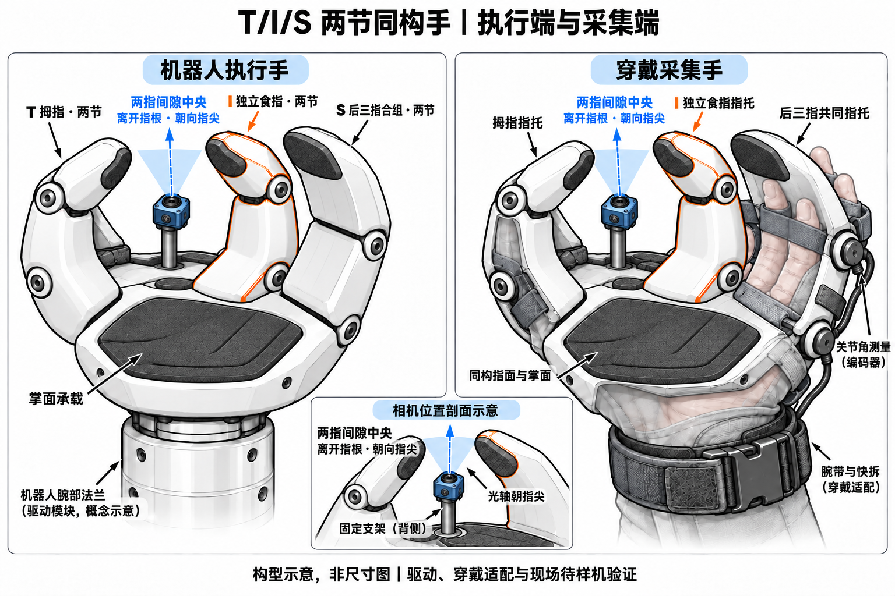

# robot 轨落地清单：目标本体 · 遥操作站 · 接管打点 · 回流

> 2026-09-08。robot 轨是 Stage A 放行门槛（10–50 小时精策划 robot 数据，training-pipeline §2）的唯一来源，也是 D 阶段 RL 闭环与车队回流的载体。本文规格与 [device-track-umi.md](device-track-umi.md) 同级。Figure 的遥操作硬件从未公开（research-figure §2.1），本文选型是自选，不以 Figure 为依据（governance D-12）。

## 1. 目标本体选型框架

下表保留平台选型框架；本产品线当前末端方向已更新为 T/I/S 两节同构手（§1.1）。现有二指具身档案是已记录基线，新手尚未完成硬件集成与验收。

| 维度 | 要求 | 理由 |
|---|---|---|
| 末端 | 当前方向：T 拇指 / I 独立食指 / S 后三指合组，各两节、加粗、有承载掌面；采集端与执行端共同设计 | 构型方向已确认；驱动、对掌轴、限位与任务能力待样机验证 |
| 上半身 | 双臂 ≥6 DoF/臂 + 腕 + 末端；可选躯干 1–2 DoF | 覆盖桌面/台面家务任务簇 |
| 移动底座 | H0 固定或轮式即可；人形腿部留给 S0/Isaac Lab 生态，不进本仓库范围 | training-pipeline §1.2-8 |
| 接口 | 关节级读写 ≥200 Hz、EE 位姿读 ≥100 Hz、PTP 时钟、ROS 2 或直接 SDK | architecture §8 |
| 相机 | 头部 ≥1（全局快门优先）+ 腕部 2；触觉可选 | data-format-contract §1.3 |
| 采购路径 | H0：现成开源/商用双臂（例：ALOHA 系、Unitree/傅利叶等人形上半身、UR/Franka 双臂）；先 1 台跑通链路，H1 扩到 3–5 台 | 成本与交付期 |

裁决产物：`configs/embodiments/<robot_model>.yaml` 具身档案（关节顺序、限位、相机映射、槽位映射），是 export 与训练的共同输入。

### 1.1 自研两节同构末端（当前方向）



[图示说明与生成记录](assets/tis2-paired-hand-v05/README.md)：两端共同构型的更新草图，穿戴适配、驱动与视场待验证。

以用户认可的[构型图](assets/inhouse-hand-reference-20261026/selected-reference.png)和[主设计](inhouse-isomorphic-end-effector.md)为新版输入。T/I 完成精细对捏，S 是一根宽合组指；保留掌面承载。相机位于拇食开放间隙中部、离开两侧指根，由掌体背侧固定支撑，光轴朝两指指尖之间的捏取区成像；安装方向必须通过实物视场和运动包络检查。

- **机械接口**：核对腕法兰、走线、重量/重心、负载与腕部力矩；建立左右手独立的关节限位、碰撞模型、TCP 和相机外参。概念图不提供尺寸或力矩依据。
- **控制与遥操作**：采集器机械关节测量经过映射、限位、速度约束再发给执行手；分别记录输入、实际发出命令和机器人反馈。两节数量不能推导出驱动轴数；S 合组不能伪装成三根独立指控制。
- **数据接入**：手部进入 `hand_left/right` 槽位，旧 `gripper_left/right` 掩码置无效；关节顺序、单位、控制模式和标定版本必须由新档案声明。`palm_left/right` 是看内部抓取区的语义视图，腕部/头部全局视图按任务保留。
- **档案隔离**：现有 [二指档案](../configs/embodiments/inhouse_wheeled_humanoid_v1.yaml) 保留；新版另建版本档案，完成[契约扩展](data-format-contract.md#14-tis2-两节同构末端档案扩展设计待实现)与验证后再启用，不静默替换已有训练数据。
- **验收顺序**：机械与急停/限位 → 编码器/控制回读 → 相机遮挡与标定 → 单任务遥操作录制 → 同构采集到机器人复现 → 训练与回流。每步分别保存实测证据；当前仅完成设计文档收敛。

## 2. 遥操作站

- **默认端**：Quest 3 手追（OPEN TEACH 路线，~$500，research-opensource §2）；接口抽象 `Teleoperator` 协议，可替换 AVP / GELLO / 主从臂（Echo 式带力反馈，接触密集任务备用）。
- **回传**：操作员看机器人头部相机第一视角（延迟预算端到端 ≤150 ms，超过则标记 `flag:teleop_latency`），status 叠加：录制状态、当前任务、接管状态。
- **闭环延迟测量**：每帧记录 `command_time`（Quest 发出）与 `publish_time`（机器人执行），ingest 统计延迟分布进 QC。
- **即时质控**：episode 结束即给操作员打分（轨迹平滑度、时长、静止占比、是否完成），对标 "Closing the Loop" 的采集时反馈（research-opensource §2）。
- **一站配置**：机器人 1 + Quest 3 + 工控机（PTP 主时钟、MCAP recorder）+ 场地相机 1（第三人称，评测用，不进训练默认视图）。

## 3. 协议实体

```
Teleoperator (协议)
  connect()/disconnect()
  read() -> TeleopFrame{command_time_ns, ee_pose_l/r, gripper_l/r, hand_joints_l/r?, buttons}
  set_feedback(state)              # 可选力/触觉反馈
Robot (协议)
  read_state() -> RobotState{publish_time_ns, joint_pos, joint_vel, ee_pose_l/r, gripper, tactile?}
  send_action(action, command_time_ns)
  estop()
Recorder
  subscribes Teleoperator + Robot + cameras → MCAP (data-format-contract §1)
```

重定向（Quest 手/腕位姿 → 机器人关节）跑在遥操作站，重定向参数版本进 EpisodeMeta（`firmware_version` 或 lineage 扩展），因为它决定动作真值的语义。

## 4. 接管打点规范

`/event/intervention` 消息由**遥操作站**写（不是事后标注）：

| 字段 | 含义 |
|---|---|
| `kind` | `takeover_start` / `takeover_end` / `estop` / `reset` |
| `publish_time_ns` | 操作员按下接管键的时刻；精度要求 ≤ 一个控制周期（10 ms） |
| `reason` | 枚举：`policy_stuck` / `unsafe` / `task_drift` / `hardware` / `other` + 自由文本 |
| `policy_version` | 被接管的策略版本（自主运行时） |

EpisodeMeta 的 `intervention_ts_ns` 是 `takeover_start` 列表的冗余副本（便于快速筛）；`fdp.intervention` 帧级布尔在 export 展开。纯遥操作 episode 无接管事件；混合 episode（策略自主 + 人接管）是 RECAP 式经验后训练的素材（research-vla-pretraining §3.3），必须保留策略段与人工段的边界。

## 5. 场地、任务、操作员、班次

- 场地 = `scene_id`；每场地固定灯光/相机安装位记录到场地档案；held-out 按场地组切分（curation §8），所以 H0 至少 3 个场地。
- 任务来自任务模板库（与 Creator App 共用，index-replica-plan §2），每 episode 一个模板 id，操作员口令标记子任务边界（`/event/task`）。
- 操作员：`operator_id` 必填；培训期数据打 `flag:operator_training`；每班次 ≤4 小时，每小时强制 10 分钟休息（质量随疲劳下降是 DROID 经验）。
- 班次记录：session 级元数据含班次 id、机器人 id、标定版本；换机器人 = 新 session。

## 6. 车队回流

- 部署中的机器人以相同 recorder 记录自主 rollout（`source="fleet"`，`policy_version`/`deployment_id` 必填），回坞批量卸数（store-and-forward，Figure 03 模式）。
- 回流 episode 走同一 ingest；QC 增加：成功判定（任务模板的完成判据 + VLM 审计）、接管段标注、OOD 事件对齐（runtime-and-deployment §3）。
- 回流数据的用途优先级：奖励分类器素材 > 纠错片段（接管前后各 5 s）> 成功 rollout 进 SFT；失败 rollout 不进 SFT 只进 RL。
- 隐私：部署场景若为家庭/办公，回流受 [compliance-and-security.md](compliance-and-security.md) 同样约束，脱敏在机上或坞站完成后再上传。

## 7. H0 交付与验收

- 1 台本体 + 1 站遥操作 + 3 个场地，跑通 `record → ingest → export` 出 ≥10 小时精策划 robot 轨数据。
- 验收：Stage A 微调（openpi/SmolVLA）在仿真基准上显著优于零样本（eval-protocol §4 的显著性规则）；接管打点延迟实测 ≤10 ms；闭环延迟 P95 ≤150 ms。
